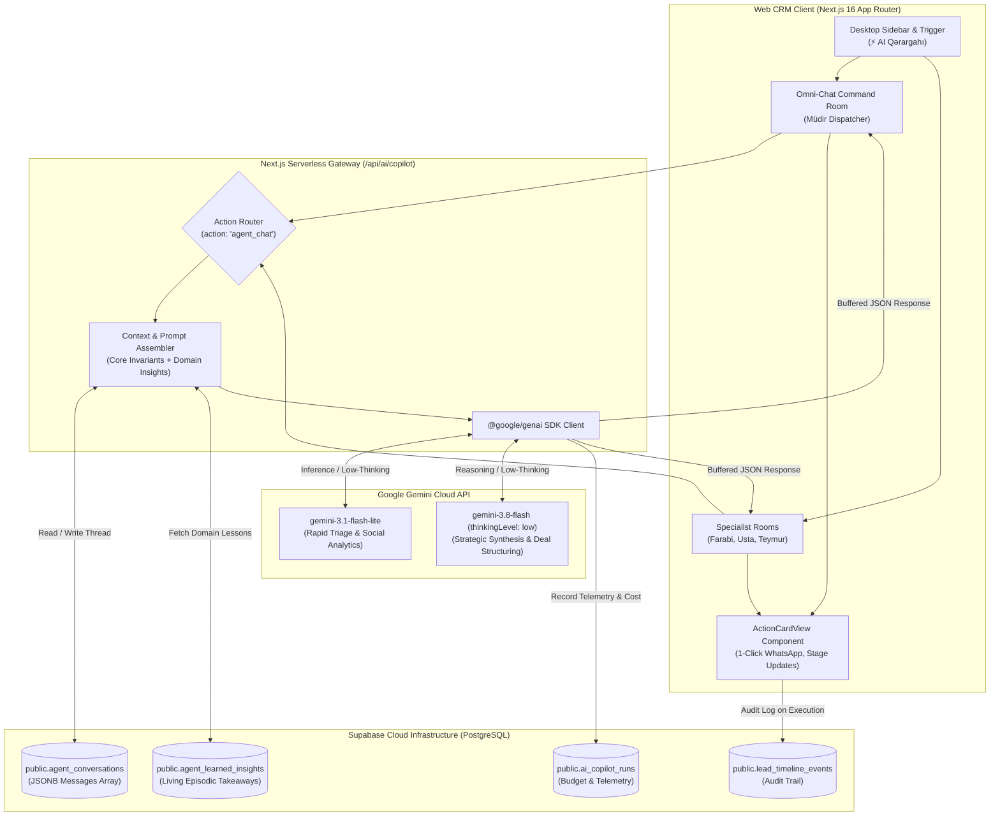

# BakuEstate-AI Autonomous Executive Agent Hub & Living Memory Architecture

* **Author:** fxbluster
* **Date:** 2026-11-21
* **Status:** Implemented (In Production)

---

## 1. Overview

This document specifies the architectural design of the **BakuEstate-AI Autonomous Executive Agent Hub**—an integrated, conversational command center inside the Web CRM powered by specialized executive agents with partitioned memory buffers, episodic learning, and executable action cards (later consolidated into the tri-persona cognitive copilot: `mudir`, `analitika`, and `musteri_psixologiyasi` in `left_canvas_action_stage_and_tri_persona_copilot.md`):

* **Chief of Staff & Omni Dispatcher (`Müdir`)**: Central coordinator that understands macro-project context, triages operator intent, routes tasks to domain specialists in the background, and synthesizes unified briefings.
* **Deal Strategist & Commission Shield (`Farabi` / `musteri_psixologiyasi`)**: Street-smart negotiation and commercial advisor specializing in buyer/seller psychology, commission defense (rebutting 50–100 AZN shaving requests), Kupça legal warranties, objection battlecards, Beh agreements, and commercial deal structuring.
* **Pricing & Market Arbitrageur (`Usta`)**: Neighborhood valuation expert tracking real square-meter transaction rates across Baku districts, identifying underpriced listings on bina.az, and vetting title deed encumbrances.
* **Audience & Social Media Analyst (`Teymur` / `analitika`)**: Growth engineer monitoring performance across 4 social channels (`@bakuestate.official`, `@baku.serfeli.evler`, `@bakuestate.premium`, `@baku_emlak_ai`), evaluating video hooks, viewing retention, and comment-to-lead pipelines.

Interaction is split between an **Omni-Chat Command Room** (top-level routing and cross-domain synthesis) and **Dedicated Specialist Rooms** (deep domain isolation). Memory is partitioned into immutable agency rules configured in code constants and evolving episodic takeaways (`agent_learned_insights`), preventing context bloating while fostering continuous adaptation to the local Azerbaijani real estate market.

---

## 2. The Problem

The existing Web CRM Copilot implementation is structured as a static, transactional form tool. Users must manually paste customer text into isolated inputs and click dedicated buttons to trigger safety scans or debrief templates. This architecture introduces severe operational limitations:

1. **Lack of Conversational Depth**: Real estate operators cannot hold fluid, multi-turn strategic dialogues with the AI. They cannot discuss complex deal dynamics, iterate on negotiation counter-tactics, or brainstorm marketing directions.
2. **Zero Persistent Memory & Organizational Learning**: Every interaction starts tabula rasa. The system does not remember past broker decisions, agency rules, won/lost deal takeaways, or successful pricing strategies.
3. **Context Window Saturation (The Monolith Fallacy)**: Attempting to dump all agency history, property data, and cross-domain responsibilities into a single conversational agent causes severe context bloat, model degradation ("hallucinations"), and rapid token budget exhaustion.
4. **Sterile, Robotic Corporate Tone**: Out-of-the-box LLM personas employ overly formal, polite, and ungrounded prose ("Hörmətli istifadəçi", "Sizə kömək etməyə şadam") that clashes with the gritty, relationship-driven realities of the Baku real estate market.

---

## 3. Goals vs. Non-Goals

### 3.1 In-Scope Goals
* **4-Agent Executive Council**: Establish 4 distinct system prompt profiles with decoupled context windows and dedicated operational domains (`Müdir`, `Farabi`, `Usta`, `Teymur`).
* **Omni-Chat & Specialist Rooms**: Dual-tier UI providing a central command dispatch chat alongside individual private consultation tabs for each specialist agent.
* **Living Episodic Memory Engine**: Two-tiered persistent storage in Supabase: lightweight conversational threads with JSONB messages (`agent_conversations`) and auto-extracted transaction takeaways (`agent_learned_insights`).
* **Conversational Action Execution**: Enable agents to output executable UI action cards (`UPDATE_LEAD_STAGE`, `DISPATCH_WHATSAPP`, `SAVE_INSIGHT`) directly in the chat stream.
* **Baku Real Estate Dialect Standards**: Enforce strict anti-robotic system instructions requiring concise, realistic, street-smart Azerbaijani prose.
* **Serverless Edge Gateway Reuse**: Extend the existing `/api/ai/copilot` endpoint with `action: 'agent_chat'`, eliminating duplicate auth, rate limiting, and cost tracking logic.

### 3.2 Out-of-Scope Non-Goals
* **Unbounded Raw Transcript Retention**: Raw chat transcripts will not be endlessly concatenated into LLM context prompts; historical context is strictly capped at a sliding window of 8 messages (max 2,000 tokens).
* **Replacement of Client-Side Regex Shields**: The 0ms offline regex address leak and commission shaving detector remains permanently active as a deterministic client-side safety guard before network requests are dispatched.
* **Autonomous Database Mutation**: The AI will not mutate database records without explicit broker confirmation via an action card click.
* **Voice Speech-to-Speech Streaming**: Real-time bidirectional WebRTC voice streaming is deferred; voice input will leverage HTML5 MediaRecorder base64 audio and native mobile keyboard dictation.

---

## 4. Technical Plan

### 4.1 System Architecture & Data Flow

The architecture operates on a decoupled client-serverless model where the Web CRM UI communicates with the existing Serverless AI Gateway (`/api/ai/copilot`), backed by Supabase for episodic persistence and the official `@google/genai` SDK for Gemini model execution:



---

### 4.2 Executive Persona Operational Matrix

| Persona ID | Agent Title | Local Dialect & Tone Focus | Primary Model Tier | Thinking Level | Memory Domain Keys (`domain`) | Context Quick-Action Pills | Supported Action Cards |
| :--- | :--- | :--- | :--- | :--- | :--- | :--- | :--- |
| `mudir` | Chief of Staff & Omni Dispatcher | Executive, decisive, synthesizing, macro-focused Baku Azerbaijani | `gemini-3.8-flash` | Low (`low`) | `MACRO_OPS`, `DISPATCH_RULES` | "Gündəlik Brifinq", "Agentləri Yoxla", "Vəziyyət İcmalı" | `UPDATE_LEAD_STAGE`, `DISPATCH_WHATSAPP`, `SAVE_INSIGHT` |
| `farabi` | Deal Strategist & Commission Shield | Gritty, street-smart negotiation, 50–100 AZN commission defense, Kupça legal realism, Beh structuring | `gemini-3.8-flash` | Low (`low`) | `NEGOTIATION_TACTICS`, `COMMISSION_DEFENSE`, `LEGAL_KUPCA` | "Komissiya Müdafiəsi", "Beh Razılaşması", "Müştəri Etirazı" | `UPDATE_LEAD_STAGE`, `DISPATCH_WHATSAPP`, `SAVE_INSIGHT` |
| `usta` | Pricing & Market Arbitrageur | Sharp, pragmatic, neighborhood valuation, historical m² price benchmarks, title encumbrance check | `gemini-3.8-flash` | Low (`low`) | `DISTRICT_VALUATION`, `BINA_ARBITRAGE`, `BUILDING_TIERS` | "M² Qiymət Hesabla", "Kupça Riskini Yoxla", "Arbitraj Tap" | `UPDATE_LEAD_STAGE`, `SAVE_INSIGHT` |
| `teymur` | Audience & Social Analyst | Analytical, dynamic, hook-focused, retention & viral metrics oriented across 4 Instagram channels | `gemini-3.1-flash-lite` | Off | `VIDEO_HOOKS`, `AUDIENCE_RETENTION`, `INSTAGRAM_PIPELINE` | "Reels Hook Təhlili", "Komentar-to-Lead", "Kanal Metrikası" | `SAVE_INSIGHT`, `DISPATCH_WHATSAPP` |

---

### 4.3 Database Schema (Supabase PostgreSQL)

Two dedicated tables establish conversation threading and living episodic memory without creating static read bottlenecks:

#### 1. `public.agent_conversations`
Consolidates conversation threading and multi-turn message history into a single relational table using a JSONB `messages` array for atomic 0ms retrieval and update:
```sql
CREATE TABLE IF NOT EXISTS public.agent_conversations (
    id UUID PRIMARY KEY DEFAULT gen_random_uuid(),
    operator_id UUID NOT NULL DEFAULT auth.uid(),
    agent_id TEXT NOT NULL CHECK (agent_id IN ('mudir', 'farabi', 'teymur', 'usta')),
    room_type TEXT NOT NULL DEFAULT 'SPECIALIST' CHECK (room_type IN ('OMNI', 'SPECIALIST')),
    title TEXT NOT NULL DEFAULT 'Yeni Söhbət',
    messages JSONB NOT NULL DEFAULT '[]'::jsonb,
    is_pinned BOOLEAN NOT NULL DEFAULT FALSE,
    created_at TIMESTAMPTZ NOT NULL DEFAULT NOW(),
    updated_at TIMESTAMPTZ NOT NULL DEFAULT NOW()
);

CREATE INDEX IF NOT EXISTS idx_agent_convs_lookup 
    ON public.agent_conversations (operator_id, agent_id, updated_at DESC);

-- Row Level Security
ALTER TABLE public.agent_conversations ENABLE ROW LEVEL SECURITY;

CREATE POLICY "Operators manage own agent conversations"
    ON public.agent_conversations FOR ALL
    TO authenticated
    USING (auth.uid() = operator_id)
    WITH CHECK (auth.uid() = operator_id);
```

#### 2. `public.agent_learned_insights`
Living episodic memory extracted from completed deals, buyer debriefs, and video campaign metrics:
```sql
CREATE TABLE IF NOT EXISTS public.agent_learned_insights (
    id UUID PRIMARY KEY DEFAULT gen_random_uuid(),
    operator_id UUID NOT NULL DEFAULT auth.uid(),
    agent_id TEXT NOT NULL CHECK (agent_id IN ('mudir', 'farabi', 'teymur', 'usta')),
    domain TEXT NOT NULL,
    insight_text TEXT NOT NULL,
    confidence_score NUMERIC(3,2) NOT NULL DEFAULT 0.85,
    source_reference TEXT,
    created_at TIMESTAMPTZ NOT NULL DEFAULT NOW()
);

CREATE INDEX IF NOT EXISTS idx_agent_insights_domain 
    ON public.agent_learned_insights (agent_id, domain);

-- Row Level Security
ALTER TABLE public.agent_learned_insights ENABLE ROW LEVEL SECURITY;

CREATE POLICY "Operators read and append own insights"
    ON public.agent_learned_insights FOR ALL
    TO authenticated
    USING (auth.uid() = operator_id)
    WITH CHECK (auth.uid() = operator_id);
```

*Note: Agency invariants (`KUPCA_MANDATE`, `COMMISSION_FLOOR_DEFENSE`, `BAKU_MEDIAN_VALUATION`) are maintained in code constants within `web/lib/agent-personas.ts`, eliminating unnecessary database I/O on every prompt assembly.*

---

### 4.4 Serverless Edge Gateway Extension (`/api/ai/copilot`)

The existing Next.js 15 route handler is extended with `action: 'agent_chat'` to reuse existing JWT validation, rate limiting (25 req/min), cost accounting, and budget ceiling enforcement:

```typescript
// Incoming Payload Interface
export interface AgentChatPayload {
  action: "agent_chat";
  conversation_id?: string;
  agent_id: "mudir" | "farabi" | "teymur" | "usta";
  message: string;
  context?: {
    lead_id?: string;
    listing_id?: string;
    initial_text?: string;
  };
}

// Canonical Action Card Discriminated Union
export type ActionCardPayload =
  | {
      type: "UPDATE_LEAD_STAGE";
      lead_id: string;
      current_stage: LeadStage;
      recommended_stage: LeadStage;
      rationale: string;
    }
  | {
      type: "DISPATCH_WHATSAPP";
      phone_number: string;
      draft_text: string;
      listing_code?: string;
      wa_link: string;
    }
  | {
      type: "SAVE_INSIGHT";
      agent_id: "mudir" | "farabi" | "teymur" | "usta";
      domain: string;
      insight_text: string;
      confidence_score: number;
    };
```

#### Staged Request Pipeline:
1. **Security & Spending Check**: Validates token and checks budget (`public.check_copilot_budget()`). If monthly spend reaches \$10.00, returns HTTP 429 with degraded fallback advice.
2. **Context Assembly**:
   - Queries `agent_conversations` for thread messages (slices the most recent 8 messages, max 2,000 tokens).
   - Injects code-level agency invariants (`CORE_AGENCY_INVARIANTS`).
   - Retrieves top 3 matching insights from `public.agent_learned_insights`.
3. **Model Dispatch**:
   - `gemini-3.8-flash` with `config: { thinkingConfig: { thinkingLevel: "low" }, responseMimeType: "application/json" }` for `mudir`, `farabi`, `usta`.
   - `gemini-3.1-flash-lite` for `teymur`.
4. **Response Serialization**:
   - Appends user and agent messages into `agent_conversations.messages`.
   - Returns structured `CopilotApiResponse` with SRE headers (`X-BakuEstate-Model-Served`, `X-BakuEstate-Run-Id`).

---

### 4.5 Web CRM UI Components (`web/components/hub/`)

* **`AgentHubDrawer.tsx`**: Unified slide-over drawer replacing `CopilotDrawer.tsx`. Features top persona switcher tabs, thread clear/reset actions, and active agent status badges.
* **`OmniChatRoom.tsx`**: Command center view rendering Müdir orchestration feed, delegation chips, and status badges.
* **`SpecialistRoom.tsx`**: Dedicated workspace for 1-on-1 consultations with domain-specific prompt pills.
* **`ChatStream.tsx`**: Auto-scrolling conversational feed rendering message bubbles and simulated optimistic typing state.
* **`ChatMessageItem.tsx`**: Renders formatted markdown responses, highlights agent identity with custom iconography, and mounts interactive `ActionCardView` components.
* **`ActionCardView.tsx`**: Interactive component rendered inline inside chat messages allowing the operator to execute recommendations with a single tap (transitions lead stage and logs to `public.lead_timeline_events`, opens WhatsApp via `buildWhatsAppUrl()`, or saves insights).
* **`SpecialistRoomPills.tsx`**: Supplies persona-specific shortcut prompt chips above the message input box.

---

## 5. Alternatives Considered

### 5.1 Standalone `/api/ai/hub` Endpoint
* **Mechanism**: Create a brand new API route specifically for the agent hub.
* **Trade-Offs**: Independent route file; zero modifications to `copilot/route.ts`.
* **Failure Condition**: Duplicates ~200 lines of JWT parsing, rate limiting, budget ceiling enforcement, and telemetry logging.
* **Decision**: *Rejected. Architectural Rationale: Extending `/api/ai/copilot` with `action: 'agent_chat'` unifies cost control and avoids cross-endpoint rate limiting collisions.*

### 5.2 5th Persona (`Maliyyəçi`)
* **Mechanism**: Keep a separate persona dedicated strictly to agency financial ROI and commission calculations.
* **Trade-Offs**: Hyper-granular separation of financial math from deal strategy.
* **Failure Condition**: Severe persona overlap with `Farabi`. In Baku real estate, defending commission and structuring deal economics occur in the exact same conversation.
* **Decision**: *Rejected. Architectural Rationale: Consolidating commission defense and commercial ROI into `Farabi` reduces cognitive overhead and prevents multi-hop latency.*

### 5.3 Database-Driven Core Invariants (`agent_core_rules` Table)
* **Mechanism**: Store agency invariants in a Postgres table and query them on every single turn.
* **Trade-Offs**: Allows editing rules without code deploys.
* **Failure Condition**: Generates unnecessary database roundtrips on every turn for rules that change less than once a quarter (Kupça mandates, 0-discount defense).
* **Decision**: *Rejected. Architectural Rationale: Storing invariants in TypeScript constants inside `web/lib/agent-personas.ts` delivers 0ms assembly with zero database I/O.*

### 5.4 Full Vector Database RAG for Raw Chat Logs
* **Mechanism**: Vectorize every single raw chat message and customer log into an external vector store (e.g., pgvector) and perform k-NN retrieval on every prompt.
* **Trade-Offs**: Semantic retrieval over exact message histories.
* **Failure Condition**: Noise accumulation from conversational pleasantries, high query latency on serverless edge functions, and increased database storage overhead for marginal retrieval gains.
* **Decision**: *Rejected. Architectural Rationale: Extracting high-signal, discrete episodic takeaways (`agent_learned_insights`) provides 10x higher analytical density than brute-force vector search over raw conversational noise.*

---

## 6. Risks, Constraints & Mitigations

### 6.1 Security & Access Boundaries
* **Risk: Persona Jailbreaking & Prompt Injection**: Malicious or untrusted customer transcripts could instruct agents to reveal confidential agency commission splits or bypass Kupça verification.
* **Mitigation**: Client-side regex safety shields execute deterministically at 0ms prior to payload dispatch; system instructions contain immutable boundaries; and Supabase Row Level Security (RLS) restricts conversation access strictly to authenticated operator sessions (`auth.uid() = operator_id`).

### 6.2 Latency & 504 Serverless Timeout Mitigation
* **Risk: Multi-Turn Context Bloat & Latency Spikes**: Large conversation histories combined with multi-hop chaining could exceed Netlify serverless execution limits (10s–26s).
* **Mitigation**: Single-hop direct execution in Omni-Chat; sliding window capped at 8 messages (max 2,000 tokens); partitioned episodic insights limited to top 3 domain matches; rapid queries routed to `gemini-3.1-flash-lite` (<1.2s SLA); deep strategic synthesis routed to `gemini-3.8-flash` with `thinkingLevel: 'low'`. Client uses an optimistic typing indicator while the serverless call is in-flight.

### 6.3 Token Economics & Graceful Budget Degradation
* **Risk: Runaway Loop Token Consumption**: Autonomous agent exchanges could exhaust monthly API budgets ($10.00 hard cap).
* **Mitigation**: Strict rate limiting (25 req/min per operator) and hard monthly cost cap ($10.00) enforced atomically at the gateway layer via `public.check_copilot_budget()`. When spending reaches 80% ($8.00), the system automatically downgrades default model routing to `gemini-3.1-flash-lite`.

### 6.4 Action Card Concurrency & Idempotency
* **Risk: Replay Vulnerability & State Corruption**: Operators clicking action cards multiple times or after external lead state changes.
* **Mitigation**: Action cards embed an execution state (`PENDING`, `EXECUTED`, `EXPIRED`) and verify `expected_current_stage` against the database before applying transitions. Every stage transition logs an immutable event to `public.lead_timeline_events`.

### 6.5 Market Dialect Drift
* **Risk: LLM Regression into Sterile Corporate Prose**: Standard updates might cause agents to default to robotic corporate apologies ("Hörmətli istifadəçi", "Bağışlayın").
* **Mitigation**: Automated Vitest test suites (`web/__tests__/agent-personas.test.ts`) validating negative constraints against corporate filler phrases before any prompt update merges.

---

## 7. Detailed Implementation Plan

### 7.1 Database & Migrations
1. `supabase/migrations/20261121170000_executive_agent_hub.sql` (Create):
   * **Rationale**: Creates the two relational tables required for conversational multi-turn threading and episodic living insights.
   * **Scope**: Defines `public.agent_conversations` (with JSONB `messages`) and `public.agent_learned_insights`. Enables Row Level Security (RLS) policies for authenticated operators and builds composite performance indexes (`idx_agent_convs_lookup`, `idx_agent_insights_domain`).

### 7.2 Serverless Edge Gateway & Personas
2. `web/lib/agent-personas.ts` (Create):
   * **Rationale**: Houses the explicit system prompts, operational boundaries, domain knowledge, static invariants, and communication tone guidelines for all 4 executive council members.
   * **Scope**: Defines typed configurations for `Müdir`, `Farabi`, `Usta`, and `Teymur`. Enforces the Anti-Robotic Dialect Standard (prohibits sterile corporate apologies and filler greetings; mandates concise, street-smart Baku Azerbaijani).
3. `web/app/api/ai/copilot/route.ts` (Modify):
   * **Rationale**: Extends the existing Next.js 15 Serverless AI API route to handle `action: 'agent_chat'`.
   * **Scope**: Authenticates operators via Supabase JWT, enforces 25 req/min rate limits, verifies the $10.00 monthly budget cap, pulls sliding context window (last 8 messages) + code invariants + top domain insights from `agent_learned_insights`, routes requests dynamically to `gemini-3.1-flash-lite` or `gemini-3.8-flash` (`thinkingConfig: { thinkingLevel: 'low' }`), and emits structured action cards alongside telemetry headers.
4. `web/lib/ai-client.ts` (Modify):
   * **Rationale**: Adds type-safe interfaces and client helper methods for the Agent Hub.
   * **Scope**: Exports TypeScript interfaces (`AgentPersonaId`, `AgentChatPayload`, `ActionCardPayload`, `AgentChatResponse`) and extends `invokeCopilot()` to handle `action: 'agent_chat'`.
5. `web/lib/copilot-context.tsx` (Modify):
   * **Rationale**: Unifies global state management for both legacy triggers and the new multi-agent hub.
   * **Scope**: Extends `CopilotContext` backward-compatibly with `agentPersonaId?: AgentPersonaId`, allowing `openCopilot()` to open the drawer directly inside a specified agent's room with pre-populated context.

### 7.3 Front-End Web CRM Components
6. `web/components/hub/AgentHubDrawer.tsx` (Create):
   * **Rationale**: The central slide-over conversational drawer replacing the legacy form-based Copilot drawer.
   * **Scope**: Features top persona switcher tabs, thread clear/reset actions, active agent status badges, and renders either `OmniChatRoom` or `SpecialistRoom`.
7. `web/components/hub/OmniChatRoom.tsx` (Create):
   * **Rationale**: Command center view rendering Müdir orchestration feed, delegation chips, and status badges.
8. `web/components/hub/SpecialistRoom.tsx` (Create):
   * **Rationale**: Dedicated workspace for 1-on-1 consultations with domain-specific prompt pills.
9. `web/components/hub/ChatStream.tsx` (Create):
   * **Rationale**: Auto-scrolling, high-performance conversational feed.
   * **Scope**: Renders message bubbles, streaming state, typing indicators, and manages viewport scrolling.
10. `web/components/hub/ChatMessageItem.tsx` (Create):
    * **Rationale**: Presentation component for individual user and agent messages.
    * **Scope**: Formats markdown responses, highlights agent identity with custom iconography, and mounts interactive `ActionCardView` components.
11. `web/components/hub/ActionCardView.tsx` (Create):
    * **Rationale**: Bridges conversation with immediate CRM action.
    * **Scope**: Renders executable UI cards: `UPDATE_LEAD_STAGE` (transitions lead stage and logs audit trail to `public.lead_timeline_events`), `DISPATCH_WHATSAPP` (reusing `buildWhatsAppUrl()` from `@/lib/format`), and `SAVE_INSIGHT` (commits extracted lessons to `public.agent_learned_insights`).
12. `web/components/hub/SpecialistRoomPills.tsx` (Create):
    * **Rationale**: Reduces typing cognitive load by providing contextual 1-tap prompts.
13. `web/components/AppShell.tsx` (Modify):
    * **Rationale**: Unifies navigation across the entire Web CRM.
    * **Scope**: Mounts `AgentHubDrawer` in place of `CopilotDrawer`, connecting the desktop sidebar `⚡ AI Qərargahı` button and floating trigger.
14. `web/components/CockpitCardHUD.tsx` (Modify):
    * **Rationale**: Seamlessly routes cockpit radar alerts into deep agent consultations.
    * **Scope**: Updates the card `[ 🤖 Copilot ]` launcher to open the Agent Hub directly inside `Usta` (for pricing/listing alerts) or `Farabi` (for negotiation/lead alerts).
15. `web/components/LeadsClient.tsx` (Modify):
    * **Rationale**: Integrates the CRM lead cards with the new multi-agent hub.
    * **Scope**: Updates lead card `[ 🤖 Copilot ]` launcher to invoke `openCopilot('shield', { persona: 'farabi', leadId: lead.id })`.

### 7.4 Verification, Testing & Documentation
16. `web/__tests__/agent-personas.test.ts` (Create):
    * **Rationale**: Ensures deterministic adherence to persona guidelines and tone rules.
    * **Scope**: Vitest unit tests verifying prompt integrity, forbidden phrase detection (`"Hörmətli istifadəçi"`, `"Bağışlayın"`, etc.), and domain boundary isolation.
17. `web/__tests__/agent-hub-routing.test.ts` (Create):
    * **Rationale**: Validates the end-to-end serverless contract and error handling.
    * **Scope**: Vitest unit tests verifying context sliding window assembly, budget ceiling enforcement (HTTP 429), rate limiting (25 req/min), and action card payload deserialization.
18. `docs/designs/SITEMAP.md` (Modify):
    * **Rationale**: Maintains repository architectural discoverability.
    * **Scope**: Updates `baku_estate_executive_agent_hub.md` status to `Approved`.
19. `TASK_STATE.md` (Modify):
    * **Rationale**: Tracks real-time implementation milestones and verification evidence.
    * **Scope**: Logs EGM review resolution, approved architecture, and next steps for the implementation phase.
