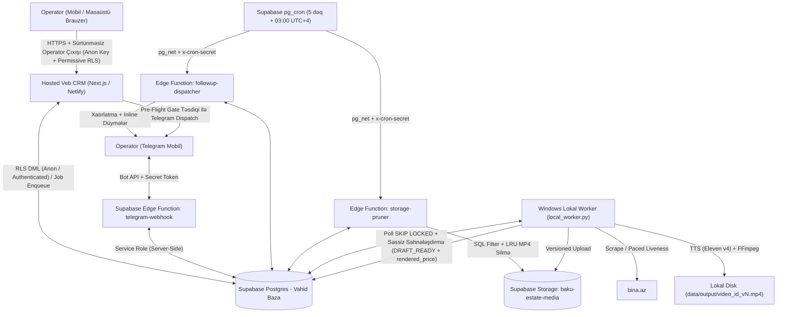

# BakuEstate-AI: 24/7 Follow-Up, Elan Təkrarsızlığı və Veb CRM Sistemi

*   **Author:** fxbluster
*   **Status:** Implemented (In Production)
*   **Date:** 2026-11-18

--------------------------------------------------------------------------------

## Overview

BakuEstate-AI hazırda `bina.az` elanlarından 9:16 video hazırlamaq, vahid uçot, təkrar elanların qarşısını alan yaddaş, elan dəyişikliklərinin tarixçəsi və müştəri/mülkiyyətçi follow-up idarəetməsini təmin edir. Sistem **bulud-əsaslı (Variant B)** memarlıqla işləyir: **Supabase Postgres** bütün elan, render, paylaşım, mülkiyyətçi, müştəri, iş növbəsi və worker statusu məlumatları üçün yeganə əsas baza olur; **Vercel** üzərində 24/7 işləyən sürtünməsiz (frictionless) operator çıxışlı **Next.js Veb CRM saytı** (`https://bakuestate-ai.vercel.app` — `web/middleware.ts` vasitəsilə `/login` birbaşa `/`-ə 307 yönləndirilir və cədvəllərə `anon` DML icazələri verilib) və **Supabase Edge Functions Telegram Webhook** birbaşa bu bazaya yazır; Windows kompüter isə `pipeline_jobs` növbəsindən `bina.az` yığımı, FFmpeg montajı və ElevenLabs səsləndirməsini icra edən lokal işçi (`worker`) kimi fəaliyyət göstərir.

Yeni və təkrar olmayan elanlar, eləcə də aktiv elanlarda `≥ 5%` qiymət düşüşləri (**Rejim 3**) avtomatik olaraq yeni versiyalı video render növbəsinə düşür — lakin satılmış, arxivlənmiş və ya vasitəçidən imtina etmiş elanlar, valyuta dəyişməsindən yaranan saxta endirimlər və gündəlik kvota/soyuma limitini aşan işlər sərt qaydalarla bloklanır. Render tamamlandıqda video dərhal Telegram-a göndərilmir; video Veb CRM-də səssizcə `DRAFT_READY` kimi səhnələşdirilir (`render_versions` cədvəlində `rendered_price` saxlanılmaqla) və avtomatik Telegram video göndərişi Veb CRM-dəki Pre-Flight yoxlama qapısı ilə əvəzlənərək dekuplinq edilib.

## The Problem

Bu memarlığa keçiddən əvvəlki kod bazasının auditi 5 konkret əməliyyat və texniki qırılma göstərdi:

1.  **Təkrarlanma və Səhifə-1 Aclığı:** `src/scraper/bina_scraper.py` elanları yığmazdan əvvəl bazanı yoxlamırdı. Səhifə-1-dəki ilk 3 mülkiyyətçi elanı artıq işlənibsə belə, onları yenidən çəkir və arxadakı təzə elanları kənarda qoyurdu. Eyni mənzili mülkiyyətçi silib yeni `bina_id` ilə (eyni telefon nömrəsi, oxşar sahə/mərtəbə ilə) təkrar paylaşanda sistem bunu yeni mənzil sayırdı. *(Qeyd: tamamilə fərqli telefon nömrəsi ilə fotoları klonlayan vasitəçi təkrarlarının aşkarlanması v1 əhatə xaricindədir və `Future Improvements` bölməsində `pHash` mərhələsinə saxlanılıb.)*
2.  **Tarixçəsiz Üstündən Yazma və Məlumat İtkisi:** `src/database.py` daxilində `save_listing()` `ON CONFLICT(bina_id) DO UPDATE` ilə qiymət, foto və təsviri köhnə dəyərin üstündən heç bir fərq qeydi (`listing_events`) saxlamadan yazırdı; telefon boş (`""`) gələndə əvvəlki nömrəni silirdi; hər render eyni `video_{bina_id}.mp4` faylını və Supabase obyektini əzirdi; `mark_video_dispatched()` həmin elanın bütün köhnə video sətirlərinin `telegram_message_id` sütununu yenisi ilə əvəz edirdi.
3.  **İki Baza Uyğunsuzluğu (Split-Brain):** Telegram-da `Təsdiqlə və Paylaş` və `Arxivlə` düymələri yalnız lokal SQLite-ı yeniləyirdi — Supabase və Notion yenilənmirdi. `Yenidən Render` zamanı isə `mock_dispatch=True` olsa da canlı Supabase sinxronizasiyası işləyib statusu geri `DISPATCHED` qaytarırdı. Bundan əlavə, `telegram_bot_service.py` Windows kompüterində long-polling ilə işlədiyi üçün PC sönülü olanda mobil düymələr və xatırlatmalar dayanırdı.
4.  **Follow-Up və Satış Uçotunun Yoxluğu:** Elan hansı platformada (Instagram Reels, TikTok, YouTube Shorts) paylaşılıb, hansı müştəri hansı elana görə yazıb, baxış nə vaxt təyin edilib, mülkiyyətçi ilə komissiya razılaşdırılıbmı və əmlak `bina.az`-da hələ aktualdırmı — bunların heç biri izlənmirdi.
5.  **Təhlükəsizlik və Resurs Riskləri:** Köhnə `config/settings.py` daxilində Supabase `service_role` JWT açarı kodda açıq saxlanılmışdı (artıq mənbə koddan silinib, əvvəlki git tarixçəsinə görə Supabase Dashboard-da rotasiya tələb olunur); `telegram_bot_service.py` daxil olan `chat_id`-ni doğrulamırdı və paralel renderlərdə qlobal `os.environ` dəyişənlərini dəyişdirirdi.

## Goals

*   **Vahid Həqiqət Mənbəyi (Single Source of Truth):** Bütün elanlar, dəyişiklik tarixçəsi, render versiyaları, paylaşımlar, mülkiyyətçi əlaqələri, müştəri sorğuları, follow-up tapşırıqları, iş növbəsi (`pipeline_jobs`) və worker canlılığı (`worker_heartbeats`) yalnız **Supabase Postgres** bazasında saxlanılır; ikitərəfli Notion sinxronizasiyası və lokal SQLite-ın əsas baza rolu ləğv edilir.
*   **24/7 Mobil və Veb İdarəetmə:** Vercel üzərində host edilən sürtünməsiz (frictionless) operator çıxışlı Veb CRM saytı (`https://bakuestate-ai.vercel.app` — `web/middleware.ts` vasitəsilə daimi `307` ilə `/`-ə yönləndirmə) və buludda çalışan **Telegram Webhook** vasitəsilə Windows kompüter sönülü olsa belə müştəri/mülkiyyətçi follow-up əməliyyatları, status dəyişikliyi və Telegram xatırlatmaları fasiləsiz işləyir.
*   **Sıfır Təkrar Video + Ağıllı Qiymət Düşüşü İzləməsi:**
    *   Scraper `bina.az`-da artıq işlənmiş `bina_id`-ləri əvvəlcədən atlayır (səhifə-1 aclığı bitir).
    *   Eyni telefon nömrəsi ilə yeni `bina_id` altında təkrar paylaşım (`owner_phone_normalized` + `district` + `rooms` + `area±3%` + `floor`, bal `≥ 0.85`) aşkarlanıb təsdiqə çıxarılır.
    *   Eyni valyutada birbaşa müqayisə, fərqli valyutalarda AZN normallaşdırması aparılır; aktiv elanda `≥ 5%` qiymət düşüşü avtomatik yeni versiyalı (`v2`, `v3`) video növbəsi yaradır (`DAILY_AUTO_RENDER_LIMIT=5`, 24 saatlıq soyuma və `ARCHIVED`/`OWNER_SOLD`/`REFUSED_AGENT` blokları ilə qorunur).
    *   Satılmış/silinmiş elanlar yalnız `HTTP 404/410` və ya açıq "elan silinib" təsdiqi ilə işarələnir (`429/403` blokları səhvən silinmiş sayılmır).
*   **10 Saniyəlik Müştəri & Mülkiyyətçi Follow-Up Axını:** Telegram-dan 1 sətirlik sürətli əlavə (`/lead`) və Veb CRM-də sürətli modal vasitəsilə müştəri sorğusu, əlaqəli elan, mərhələ, növbəti follow-up tarixi və nəticə qeyd olunur; Bakı vaxtı (`UTC+4`) ilə `09:30` səhər toplu xülasəsi və `HIGH` tapşırıqlarda dərhal Telegram xatırlatması + `[✅ Tamamlandı] [⏰ +3 saat] [📅 Sabaha]` düymələri işləyir.
*   **Təhlükəsizlik, Sürtünməsiz Çıxış və 1 GB Storage İntizamı:** `config/settings.py`-də açıq `service_role` açarı yoxdur (fail-closed `os.getenv`); Veb CRM şəxsi mobil və masaüstü cihazlardan operativ idarəetmə üçün sürtünməsiz operator rejiminə (`web/middleware.ts` `/login` səhifəsini daimi `307` ilə `/`-ə yönləndirir; CRM cədvəllərinə `anon` DML icazələri verilib) keçirilib; `telegram-webhook` gizli token (`403`) + `chat_id` yoxlayır; cron Edge Function-ları məcburi fail-closed `CRON_SECRET` tələb edir; `storage-pruner` SQL səviyyəsində köhnə və aktiv LRU videoları təmizləyərək 1 GB Supabase Storage limitini qoruyur.

## Non-Goals

*   **Avtomatik Instagram / TikTok / YouTube API Paylaşımı:** Sosial şəbəkələrə avtomatik upload botu bu mərhələdə qurulmur; operator videonu endirib/paylaşıb linki və statusu Veb CRM-də və ya Telegram-da qeyd edir.
*   **Avtomatik WhatsApp / Instagram DM Oxuyucu Bot:** Müştəri DM-lərinin Meta/WhatsApp qeyri-rəsmi botları ilə çəkilməsi əhatə xaricindədir; real maraqlı müştərilər 5–10 saniyəlik sürətli əlavə ilə CRM-ə salınır.
*   **Fərqli Telefonla Klonlanmış Foto Təkrarlarının Aşkarlanması:** v1 yalnız eyni telefon nömrəli repostları ballı müqayisə edir; fərqli telefon + klonlanmış foto aşkarlanması `Future Improvements` (`pHash`) mərhələsinə saxlanılıb.
*   **Çoxistifadəçili Agentlik / Rol Sistemi (Multi-Tenant RBAC):** Sistem tək operator üçündür.
*   **Notion İkitərəfli Sinxronizasiyası:** Split-brain yaratdığı üçün Notion CRM aktiv sinxronizasiyadan çıxarılıb (`NOTION_LEGACY_SYNC=false`, `NOTION_ENABLED=false`).
*   **Lokal Kompüter Sönülü İkən Video Render:** FFmpeg, Playwright/Brave və Google AI Pro lokal Windows işçi üzərində qalır; PC sönülü olanda verilən əmrlər `pipeline_jobs` növbəsində gözləyir.

## Open Questions

None — bütün əvvəlki dizayn sualları həll edilib və konfiqurasiya parametrləri kimi kilidlənib:
*   `DAILY_AUTO_RENDER_LIMIT = 5` (`0` dəyəri avto-renderi tam söndürür).
*   `STORAGE_PRUNE_DAYS = 14` + aktiv bulud MP4 LRU saxlama həddi `STORAGE_ACTIVE_KEEP_LIMIT = 35` (~700 MB; Telegram mesajı, DB tarixçəsi və lokal PC faylı silinmir).
*   `AUTO_JOB_TTL_HOURS = 24` (vaxtı keçən `AUTO_SCHEDULER` işlər `EXPIRED` olur; `WEB_UI` / `TELEGRAM_WEBHOOK` manual işləri heç vaxt `EXPIRED` olmur).

## Critical User Journeys (CUJs)

### CUJ 1: Təkrarsız Elan Yığımı və Avtomatik İlkin Render

*   **Given:** Supabase Postgres bazasında əvvəlcədən işlənmiş elanlar var; Windows lokal worker onlayndır və gündəlik avto-render limiti (`5/gün`) dolmayıb.
*   **When:** Planlı scrape dövrəsi `bina.az`-ın 1-ci səhifəsini yoxlayır — ilk 3 elan bazada mövcuddur, 4-cü elan tamamilə yenidir, 5-ci elan isə köhnə bir elanın yeni `bina_id` ilə eyni telefon+rayon+otaq+sahə altında təkrar paylaşımıdır.
*   **Then:** İlk 3 elanın yalnız `last_seen_at` vaxtı yenilənir və `limit` sayğacını azaltmır; 4-cü elan üçün `v1` video avtomatik render olunub Supabase Storage-a yüklənir və Veb CRM-də səssizcə `DRAFT_READY` kimi səhnələşdirilir (`render_versions` cədvəlində `rendered_price` və `rendered_currency='AZN'` saxlanılır; render tamamlanmasında avtomatik Telegram-a push ləğv edilib və Veb CRM-dəki Pre-Flight yoxlama qapısı ilə dekuplinq edilib); 5-ci elan `SKIPPED_DUPLICATE / PENDING_REVIEW` kimi işarələnir, `listings.duplicate_of_listing_id` sahəsi ilə köhnə elanla bağlanır və Veb CRM-də 1 kliklik təsdiqə çıxır.

### CUJ 2: Aktiv Elanda Qiymət Düşüşünün (`≥ 5%`) Avtomatik İzlənməsi

*   **Given:** `5616503` nömrəli mənzil 175,000 AZN qiymətlə `PUBLISHED` vəziyyətindədir və `owner_outreach_status` statusu `OWNER_SOLD` və ya `REFUSED_AGENT` deyil.
*   **When:** Yoxlama bu elanın qiymətinin 165,000 AZN-ə (`-5.71%`) düşdüyünü aşkarlayır (və ya `100,000 USD → 170,000 AZN` kimi valyuta çevrilməsini AZN üzərindən müqayisə edib saxta dəyişiklikləri süzür).
*   **Then:** `listing_events` cədvəlinə dəyişməz qeyd yazılır (`175,000 → 165,000 AZN`), lokal worker icra anında 4 qoruyucunu təkrar yoxlayıb avtomatik `v2` ("Qiymət Endi!") videosunu `video_5616503_v2.mp4` adı ilə render edir, köhnə `v1` tarixçəsini silmədən `SUPERSEDED` işarələyir və Veb CRM-də səssizcə `DRAFT_READY` kimi səhnələşdirir (`rendered_price = 165000` qeyd olunur; render tamamlanmasında avtomatik Telegram push ləğv edilib və Pre-Flight yoxlama qapısı ilə dekuplinq edilib).

### CUJ 3: Veb CRM-dən 24/7 Elan İdarəetməsi və Növbəli Əməliyyat

*   **Given:** Operator telefondan və ya kompüterdən Netlify-da host edilən Veb CRM saytına (`https://bakuestate-crm.netlify.app`) daxil olur (Windows PC hətta sönülü ola bilər; birbaşa sürtünməsiz çıxış təmin olunur).
*   **When:** Operator elanın detal səhifəsini açır, dəyişiklik tarixçəsinə, render versiyalarına və mülkiyyətçi nömrəsinə baxır; Instagram Reels linkini `publications` bölməsinə əlavə edib statusu `PUBLISHED` edir və ya başqa elan üçün "İnvestisiya bucağı + Arif səsi" ilə yenidən render düyməsinə basır.
*   **Then:** Paylaşım statusu və link dərhal Supabase-də yadda saxlanır; render əmri `pipeline_jobs` cədvəlinə `QUEUED` (`trigger_source = 'WEB_UI'`) düşür, Windows worker aktiv olan kimi manual işləri prioritetlə götürüb icra edir, hazır videonu Veb CRM-də `DRAFT_READY` kimi səhnələşdirir və Pre-Flight təsdiqindən sonra Telegram-a çatdırılmağa hazır edir.

### CUJ 4: Müştəri Sorğusunun Qeydiyyatı və Avtomatik Follow-Up Xatırlatması

*   **Given:** Operatora Instagram DM və ya WhatsApp-dan `5616503` mənzili üçün real maraqlı müştəri yazır.
*   **When:** Operator Telegram-da 1 sətirlik `/lead 5616503 Elvin +994501234567 sabah 14:00 baxış` əmri göndərir (və ya Veb CRM-də 10 saniyəlik sürətli form doldurur).
*   **Then:** Müştəri `buyer_leads` cədvəlinə `VIEWING_SCHEDULED` mərhələsi ilə yazılır, `lead_listings` cədvəlində `relation = 'INQUIRED'` ilə `5616503` elanına bağlanır və `follow_up_tasks` cədvəlində sabah `14:00` Bakı vaxtı üçün `HIGH` xatırlatma yaranır. Vaxtı çatanda (PC sönülü olsa belə) `followup-dispatcher` Telegram-a bildiriş və `[✅ Tamamlandı] [⏰ +3 saat] [📅 Sabaha]` düymələri göndərir; operator nəticəni 1 toxunuşla yeniləyir.

### CUJ 5: Mülkiyyətçi Əlaqəsi və Satılmış Elanın Avtomatik Bloklanması

*   **Given:** Operator Veb CRM-dən 1 kliklə WhatsApp linkini açıb mülkiyyətçiyə yazır və mənzilin artıq satıldığını öyrənir (və ya liveness yoxlayıcısı `bina.az`-da `HTTP 404/410` / "elan silinib" görür).
*   **When:** Status `OWNER_SOLD` və ya `REMOVED_ON_BINA` olaraq yenilənir.
*   **Then:** Həmin elan üçün bütün avtomatik avto-render və paylaşım təklifləri dərhal bloklanır; bu elana bağlı açıq `buyer_leads` (`stage NOT IN ('WON_CLOSED','LOST','COLD')`) varsa, sistem həm Veb CRM-də qırmızı xəbərdarlıq göstərir, həm də dərhal `HIGH` prioritetli `follow_up_tasks` (`due_at = NOW()`, `"⚠️ #bina_id satılıb — <client_name> üçün alternativ mənzil təklif et"`) yaradır ki, `followup-dispatcher` onu 5 dəqiqə ərzində Telegram-a çatdırsın.

## Technical Plan (Architecture)

Sistem 3 müstəqil qatdan ibarətdir: **(1) Supabase Cloud Core** (vahid Postgres bazası — 10 cədvəl + 1 görünüş, Storage, Telegram Webhook, Follow-Up Dispatcher və Storage Pruner Edge Function-ları), **(2) Hosted Veb CRM Paneli** (Next.js 15 App Router + `@netlify/plugin-nextjs` — Netlify üzərində `https://bakuestate-crm.netlify.app`, Supabase Auth + RLS), və **(3) Windows Lokal Render/Scrape İşçisi (`src/worker/local_worker.py`)** (Playwright, Brave Gemini, ElevenLabs v4 və FFmpeg əməliyyatlarını icra edən növbə işçisi).

### 1. Vahid Postgres Məlumat Modeli (10 Cədvəl + 1 Görünüş + RLS & RPC-lər)

İlkin memarlıqda cədvəllər strict Supabase Auth və `public.is_crm_operator()` (`REVOKE ALL FROM PUBLIC, anon`) ilə nəzərdə tutulmuşdu. Lakin tək operatorun şəxsi cihazlarından (mobil və masaüstü) email/parol maneəsi olmadan çevik və operativ idarəetmə aparması üçün `202611180004_frictionless_anon_access` miqrasiyası ilə sürtünməsiz operator rejiminə (frictionless operator access) keçid edilmişdir: `web/middleware.ts` `/login` marşrutunu daimi `307` ilə birbaşa `/`-ə yönləndirir, bütün CRM cədvəllərinə (`listings`, `listing_events`, `render_versions`, `publications`, `buyer_leads`, `lead_listings`, `follow_up_tasks`, `pipeline_jobs`, `worker_heartbeats` və əlaqəli sosial/preflight cədvəlləri) `anon` rolu üçün birbaşa DML (`SELECT`, `INSERT`, `UPDATE`, `DELETE`) icazələri verilmiş və RLS siyasətləri açıq operator rejiminə (`FOR ALL TO authenticated, anon USING (true) WITH CHECK (true)`) uyğunlaşdırılmışdır. Məxfi server konfiqurasiyası üçün nəzərdə tutulmuş `public.baku_estate_config` cədvəli isə `service_role`-only rejimində qalır. Yeniləmə triggeri kimi mövcud paylaşılan funksiyalarla toqquşmamaq üçün **`public.baku_estate_set_updated_at()`** istifadə olunur.

| # | Cədvəl / Görünüş | Məqsəd | Əsas Sütunlar, Məhdudiyyətlər (`CHECK` / `FK`) və İndekslər |
|---|---|---|---|
| 1 | `public.listings` | Kanonik elan, dedup, 4 status maşını və mülkiyyətçi əlaqəsi | `id (UUID PK)`, `bina_id (UNIQUE)`, `url`, `duplicate_of_listing_id (FK listings ON DELETE SET NULL, <> id)`, `duplicate_confidence (0..1)`, `duplicate_resolution (NONE\|PENDING_REVIEW\|CONFIRMED_DUPLICATE\|FALSE_POSITIVE)`, `photo_urls_hash`, `content_revision`, `last_rendered_revision`, `title`, `price`, `currency (AZN\|USD\|EUR)`, `price_azn_normalized`, `location`, `district_normalized`, `address`, `rooms`, `area`, `floor`, `floors`, `has_bill_of_sale`, `is_owner`, `contact_name`, `owner_phone_raw`, `owner_phone_normalized`, `photo_urls (JSONB)`, `description`, `archetype (budget\|luxury\|villa\|commercial)`, `source_availability (ACTIVE\|REMOVED_ON_BINA\|CONFIRMED_SOLD)`, `first_seen_at`, `last_seen_at`, `last_checked_at`, `pipeline_status (NEW\|QUEUED\|RENDERING\|DISPATCHED\|FAILED\|SKIPPED_DUPLICATE)`, `editorial_status (PENDING_REVIEW\|APPROVED\|PUBLISHED\|NEEDS_RERENDER\|REJECTED\|ARCHIVED)`, `owner_outreach_status (NOT_CONTACTED\|CONTACTED\|AVAILABILITY_CONFIRMED\|COMMISSION_AGREED\|UNRESPONSIVE\|REFUSED_AGENT\|OWNER_SOLD)`, `commission_type (PERCENT\|FIXED_AZN\|NONE)`, `commission_value`, `owner_min_price_azn`, `owner_last_contacted_at`, `owner_next_checkin_at`, `owner_notes`, `last_auto_rendered_at`, `created_at`, `updated_at`. İndekslər: `owner_phone_normalized`, `(district_normalized, rooms, area)`, `(editorial_status, source_availability)`, `duplicate_resolution='PENDING_REVIEW'`, `owner_outreach_status`, `last_seen_at DESC`. Triggerlər: `baku_estate_set_updated_at()`, `preserve_non_empty_owner_phone()`. |
| 2 | `public.pipeline_jobs` | Bulud ↔ Lokal PC idempotent iş növbəsi | `id (UUID PK)`, `idempotency_key (UNIQUE)`, `job_type (SCRAPE_NEW\|RENDER_INITIAL\|RENDER_PRICE_DROP\|RERENDER\|LIVENESS_CHECK\|SYNC_SOCIAL_METRICS)`, `listing_id (FK listings ON DELETE CASCADE)`, `trigger_source (AUTO_SCHEDULER\|WEB_UI\|TELEGRAM_WEBHOOK)`, `params_json (JSONB)`, `status (QUEUED\|RUNNING\|SUCCEEDED\|FAILED\|EXPIRED)`, `attempts`, `max_attempts (DEFAULT 2)`, `locked_by`, `lease_expires_at`, `expires_at`, `error_message`, `created_at`, `started_at`, `finished_at`. İndekslər: `(status, created_at)`, `lease_expires_at` (`RUNNING`), `listing_id`, `created_at DESC`. |
| 3 | `public.listing_events` | Dəyişməz dəyişiklik və audit jurnalı | `id (UUID PK)`, `listing_id (FK listings ON DELETE CASCADE)`, `event_type (SCRAPED_NEW\|PRICE_CHANGED\|KUPCA_CHANGED\|PHOTOS_CHANGED\|REMOVED_ON_BINA\|DUPLICATE_FLAGGED\|STATUS_CHANGED\|OWNER_UPDATED)`, `old_value_json`, `new_value_json`, `price_delta_pct` (mənfi = düşüş, məs. `-5.71`), `triggered_job_id (FK pipeline_jobs ON DELETE SET NULL)`, `actor (scraper\|liveness_poller\|web_user\|telegram_user\|local_worker\|migration)`, `created_at`. İndekslər: `(listing_id, created_at DESC)`, `(event_type, created_at DESC)`. |
| 4 | `public.render_versions` | Versiyalı video tarixçəsi (əzmə yoxdur) | `id (UUID PK)`, `listing_id (FK listings ON DELETE CASCADE)`, `version_num (UNIQUE(listing_id, version_num))`, `content_revision`, `trigger_reason (AUTO_INITIAL\|AUTO_PRICE_DROP\|MANUAL_RERENDER\|SCRIPT_ANGLE\|VOICE_SWITCH)`, `script_angle`, `voice_engine`, `voice_id`, `model_id`, `script_text`, `local_video_path`, `storage_object_path`, `video_cdn_url`, `duration_seconds`, `status (QUEUED\|RUNNING\|COMPLETED\|FAILED\|SUPERSEDED)`, `hook_type (PRICE_FIRST\|LOCATION_FIRST\|LUXURY_LIFESTYLE)`, `duration_bucket (SHORT_25_30\|LONG_40_50)`, `ab_metadata (JSONB DEFAULT '{}')`, `rendered_price (NUMERIC)`, `rendered_currency (TEXT DEFAULT 'AZN')`, `telegram_message_id`, `storage_pruned_at`, `error_message`, `created_at`, `completed_at`. İndekslər: `(listing_id, version_num DESC)`, prune namizədləri, `(trigger_reason, created_at DESC)`. |
| 5 | `public.publications` | Platforma və preflight paylaşım jurnalı | `id (UUID PK)`, `listing_id (FK listings ON DELETE CASCADE)`, `render_version_id (FK render_versions ON DELETE SET NULL)`, `channel (INSTAGRAM_REELS\|TIKTOK\|YOUTUBE_SHORTS\|TELEGRAM\|WHATSAPP_STATUS)`, `post_url`, `caption_used`, `status CHECK (status IN ('DRAFT', 'DRAFT_READY', 'READY_TO_PUBLISH', 'PUBLISHED', 'ARCHIVED', 'REMOVED'))`, `verified_at`, `preflight_status (UNCHECKED\|PASSED\|PRICE_MISMATCH\|REMOVED_ON_BINA)`, `last_preflight_error`, `telegram_dispatched_at`, `telegram_message_id`, `views_count`, `likes_count`, `comments_count`, `shares_count`, `external_post_id`, `telemetry_status (PENDING\|ACTIVE\|FROZEN\|ERROR)`, `last_scraped_at`, `next_poll_at`, `published_at`, `notes`, `created_at`. İndekslər: `(listing_id, published_at DESC)`, `(channel, status)`, `idx_publications_active_scraping`. |
| 6 | `public.buyer_leads` | Müştəri sorğu və satış qıfı | `id (UUID PK)`, `client_name (NOT NULL)`, `phone_normalized`, `social_handle`, `source_channel (IG_DM\|WHATSAPP\|TIKTOK_DM\|CALL\|TELEGRAM\|REFERRAL)`, `stage (NEW_INQUIRY\|QUALIFIED\|VIEWING_SCHEDULED\|VIEWED\|NEGOTIATING\|DEPOSIT\|WON_CLOSED\|LOST\|COLD)`, `budget_max_azn`, `preferred_districts (TEXT[])`, `expected_commission_azn`, `actual_commission_azn`, `lost_reason`, `notes`, `next_followup_at`, `created_at`, `updated_at`. İndekslər: `stage`, `next_followup_at`, `phone_normalized`. Trigger: `baku_estate_set_updated_at()`. |
| 7 | `public.lead_listings` | Müştəri ↔ Elan N:M əlaqə cədvəli | `lead_id (FK buyer_leads ON DELETE CASCADE)`, `listing_id (FK listings ON DELETE CASCADE)`, `PK(lead_id, listing_id)`, `relation (INQUIRED\|PITCHED\|VIEWED\|REJECTED\|OFFERED)`, `notes`, `updated_at`. İndeks: `listing_id`. Trigger: `baku_estate_set_updated_at()`. |
| 8 | `public.follow_up_tasks` | Vahid müştəri, mülkiyyətçi və təkrar yoxlama növbəsi | `id (UUID PK)`, `entity_type (BUYER_LEAD\|OWNER_OUTREACH\|DUPLICATE_REVIEW)`, `lead_id (FK buyer_leads ON DELETE CASCADE)`, `listing_id (FK listings ON DELETE CASCADE)`, `title`, `due_at`, `priority (LOW\|NORMAL\|HIGH)`, `status (OPEN\|SNOOZED\|DONE\|CANCELLED)`, `reminder_sent_at`, `snooze_count`, `completed_at`, `outcome_note`, `created_at`, `updated_at`. İndekslər: `(due_at, priority)` (`OPEN\|SNOOZED`), `lead_id`, `listing_id`. Trigger: `baku_estate_set_updated_at()`. |
| 9 | `public.baku_estate_config` | Özəl server-side konfiqurasiya cədvəli (`service_role`-only, `REVOKE anon/authenticated`) | `key (TEXT PK)`, `value (TEXT NOT NULL)`, `updated_at`. Post-miqrasiya bootstrap açarları: `operator_uid`, `supabase_project_url`, `cron_secret`. |
| 10 | `public.worker_heartbeats` | Lokal PC worker canlılıq cədvəli | `worker_id (TEXT PK)`, `last_seen_at`, `current_job_id (FK pipeline_jobs ON DELETE SET NULL)`, `metadata_json`, `updated_at`. |
| V1 | `public.worker_status` (View) | Veb CRM üçün `Online / Offline` görünüşü (`security_invoker = true`) | `worker_id`, `last_seen_at`, `current_job_id`, `current_job_type`, `current_job_status`, `is_online` (`last_seen_at ≥ NOW() - INTERVAL '3 minutes'`), `seconds_since_heartbeat`. |

**SQL RPC Funksiyaları (`service_role`):**
*   `record_worker_heartbeat(p_worker_id, p_current_job_id, p_metadata)` — worker canlılığını yeniləyir.
*   `claim_next_pipeline_job(p_worker_id, p_lease_minutes DEFAULT 5)` — vaxtı keçən `AUTO_SCHEDULER` işləri `EXPIRED` edir; lease bitən `RUNNING` işləri `attempts ≥ max_attempts` olduqda `FAILED`, əks halda `QUEUED` edir; manual işləri (`WEB_UI`, `TELEGRAM_WEBHOOK`) `AUTO_SCHEDULER`-dən öndə tutaraq `FOR UPDATE SKIP LOCKED` ilə 1 iş kilidləyir və heartbeat yazır.
*   `heartbeat_pipeline_job(p_job_id, p_worker_id, p_lease_minutes DEFAULT 5)` — yalnız `status='RUNNING' AND locked_by=p_worker_id` olduqda kirayəni uzadır (`BOOLEAN`).
*   `complete_pipeline_job(p_job_id, p_worker_id, p_status, p_error_message)` — fencing RPC: yalnız `id=p_job_id AND locked_by=p_worker_id AND status='RUNNING'` şərti ödəndikdə işi tamamlayır (itirilmiş lease ilə gecikmiş yazmanın qarşısını alır).
*   `count_today_auto_renders_baku()` — cari `Asia/Baku` günündə yaradılmış non-`FAILED` `AUTO` `render_versions` + `QUEUED` və ya `RUNNING` (hələ `render_versions` yazılmamış) `AUTO_SCHEDULER` `pipeline_jobs` sayını qaytarır.
*   `get_prunable_render_versions(p_prune_days DEFAULT 14, p_active_keep_limit DEFAULT 35, p_batch_limit DEFAULT 100)` — SQL səviyyəsində həm yaşı `> p_prune_days` olan `SUPERSEDED`/`ARCHIVED`/`OWNER_SOLD`/`REMOVED_ON_BINA`/`CONFIRMED_SOLD` videolarını, həm də aktiv bulud MP4 sayı `p_active_keep_limit` həddini keçdikdə ən köhnə `PUBLISHED`/`COMPLETED` videoları seçir (200-sətirlik JS aclığını tam ləğv edir).
*   `invoke_edge_function_cron(p_function_name)` — `pg_net` (`net.http_post`) vasitəsilə `baku_estate_config`-dən `supabase_project_url` və `cron_secret` oxuyub `x-cron-secret` başlığı ilə Edge Function çağırır.

### 2. Elan Təkrarsızlığı, Normallaşdırma və Rejim 3 Qoruyucuları

1.  **Scrape Öncəsi Filtrləmə (Səhifə-1 Aclığının Həlli):** `BinaScraper` hər səhifədə `bina_id` siyahısını yığıb 1 toplu sorğu ilə Supabase-dən (`get_listings_by_bina_ids`) mövcud vəziyyəti çəkir. Dəyişməyən elanlarda yalnız `last_seen_at` yenilənir (`touch_listings_last_seen`) və `limit` sayğacı azalmır.
2.  **Normallaşdırma & Hash Qaydaları:**
    *   `owner_phone_normalized`: `+994XXXXXXXXX` formatı (9/10/12 rəqəmli AZ nömrələrindən; etibarsızdırsa `None`).
    *   `district_normalized`: kiçik hərflə, boşluqlar təmizlənmiş kanonik Bakı rayonu (`normalize_district()`).
    *   `photo_urls_hash`: foto URL siyahısının sırasına həssas SHA-256 hash-i (`compute_photo_urls_hash()`); dəyişdikdə lokal foto keşi yenilənir.
3.  **Boş Sahəyə Davamlı Repost Aşkarlanması (PostgREST + Python Ballı Uyğunlaşdırma):**
    *   `find_repost_candidates()` PostgREST üzərindən dəqiq `owner_phone_normalized = eq.<phone>` (`limit=50`) sorğusu verir (`owner_phone_normalized` boşdursa heç vaxt təkrar bloklanmır — yeni tikilidə eyni planlı mənzillərdə yanlış bloklama olmur).
    *   Python-da `score_repost_candidate()` bal hesablayır: eyni telefon (`+0.45`), eyni rayon (`+0.15`), eyni otaq (`+0.15`), sahə fərqi `≤ 3%` (`+0.15`), eyni mərtəbə (`+0.10`). Bal `≥ 0.85` olarsa yeni `bina_id` `SKIPPED_DUPLICATE` / `PENDING_REVIEW` kimi qeyd olunur və `DUPLICATE_REVIEW` tapşırığı açılır.
4.  **Valyuta Müqayisəsi & Rejim 3 Qoruyucuları:**
    *   `old_currency == new_currency` olduqda qiymət fərqi birbaşa xam `price` üzərindən hesablanır (FX məzənnə dəyişimi saxta endirim yaratmır); yalnız fərqli valyutalar (`USD ↔ AZN`, `EUR ↔ AZN`) arasında `price_azn_normalized` (`USD=1.70`, `EUR=1.85`) müqayisə olunur. `< 1.0 AZN` kiçik fərqlər iqnor edilir.
    *   `price_delta_pct ≤ -5.0%` olduqda `listing_events` (`PRICE_CHANGED`, `price_delta_pct` mənfi işarəli) yazılır və 4 qoruyucu həm növbəyə salınanda, həm də worker icra anında yoxlanır: (1) `editorial_status NOT IN ('ARCHIVED','REJECTED')`, (2) `source_availability = 'ACTIVE'`, (3) `owner_outreach_status NOT IN ('OWNER_SOLD','REFUSED_AGENT')`, (4) `last_auto_rendered_at` son 24 saatda deyil **VƏ** `count_today_auto_renders_baku() < DAILY_AUTO_RENDER_LIMIT` (`5`).
5.  **Telefon Qorunması & Təhlükəsiz Liveness Yoxlaması:**
    *   Həm `SupabaseRepo` Python payload səviyyəsində boş telefon açarlarını buraxır, həm də Postgres `BEFORE UPDATE` triggeri (`preserve_non_empty_owner_phone`) köhnə qeyri-boş telefonu qoruyur.
    *   `LIVENESS_CHECK` hər `bina.az` sorğusu arasında `1.5–3.0s` təsadüfi gecikmə (jitter) saxlayır, ardıcıl `3` `429/403` cavabında circuit-breaker ilə dayanır; yalnız `HTTP 404/410` və ya açıq "elan tapılmadı / silinib" DOM mətnində `REMOVED_ON_BINA` yazır və açıq müştəri əlaqəsi varsa `HIGH` `follow_up_tasks` xəbərdarlığı yaradır.

### 3. 24/7 Bulud Komponentləri, Wire Kontraktları və Windows Lokal Worker

1.  **Hosted Veb CRM Paneli (Next.js 15 App Router — Netlify):**
    *   **Hostinq & Sürtünməsiz Auth:** Netlify (`web/netlify.toml`, `@netlify/plugin-nextjs`, canlı URL: `https://bakuestate-crm.netlify.app`). Brauzer `NEXT_PUBLIC_SUPABASE_URL` və `NEXT_PUBLIC_SUPABASE_ANON_KEY` istifadə edir. Şəxsi mobil və masaüstü cihazlardan operativ işləmə tələbinə əsasən sistem sürtünməsiz operator çıxışına (frictionless operator access) miqrasiya olunmuşdur: `web/middleware.ts` istifadəçi `/login` və ya `/login/*` marşrutuna daxil olduqda onu daimi `307` yönləndirməsi ilə birbaşa ana səhifəyə (`/`) yönləndirir; digər bütün səhifələr (`/`, `/listings`, `/leads`, `/jobs`, `/analytics`) Supabase Auth sessiya tokeni tələb olunmadan birbaşa açılır.
    *   **Data-Access Pattern:** Server Components (`web/lib/supabase/server.ts`) ilkin sorğuları oxuyur; interaktiv mutasiyalar (`DashboardClient`, `ListingDetailClient`, `LeadsClient`, `JobsClient`, `AnalyticsClient`) brauzer Supabase klienti (`web/lib/supabase/client.ts`) ilə icazəli `anon` DML siyasətləri vasitəsilə birbaşa Postgres cədvəllərinə yazır.
    *   **Media Saxlama & İzləmə:** Video obyektləri `baku-estate-media` bucket-də `videos/{bina_id}/v{version_num}.mp4` yolu ilə saxlanır; uzunmüddətli hədəf bucket-i private + `storage.objects` RLS + 1 saatlıq signed URL-ə keçirməkdir (keçid dövründə sosial paylaşım üçün hazır olan videoların `video_cdn_url` önizləməsi işləyir və 5 GB/ay egress limiti daxilində qalır).
    *   **Əsas Səhifələr & Mutasiyalar:**
        *   `/` — Gecikmiş/bugünkü `follow_up_tasks` (1 klik `DONE`/`SNOOZED`), son `PRICE_CHANGED`, `PENDING_REVIEW` təkrar kartları (`CONFIRMED_DUPLICATE` / `FALSE_POSITIVE` + render növbəsi), `worker_status` `Online/Offline` indikatoru.
        *   `/listings` & `/listings/[bina_id]` — Filtr/axtarış, `listing_events`, `render_versions` + HTML5 pleyer, `publications` link jurnalı, mülkiyyətçi komissiya/WhatsApp bloku, `✅ Paylaşıldı` (`editorial_status='PUBLISHED'` + `publications` qeydi), `❌ Satıldı` (`owner_outreach_status='OWNER_SOLD'` + açıq müştərilərə `HIGH` follow-up), `🎬 Render / Ssenari / Səs` (`pipeline_jobs` `WEB_UI` işi).
        *   `/leads` — Qıf filtri, 10 saniyəlik sürətli əlavə modalı (`buyer_leads` + `lead_listings` + `follow_up_tasks`), satılmış elan üçün qırmızı alternativ xəbərdarlığı, komissiya uçotu.
        *   `/jobs` — Canlı `pipeline_jobs` siyahısı; 1 kliklik **`Retry`** mövcud uğursuz/expired sətri `status='QUEUED', attempts=0, error_message=NULL, locked_by=NULL, lease_expires_at=NULL, finished_at=NULL` vəziyyətinə qaytarır (`UNIQUE(idempotency_key)` pozulmadan).
2.  **24/7 Telegram Webhook (`supabase/functions/telegram-webhook/index.ts`, `--no-verify-jwt`):**
    *   **Təhlükəsizlik & Retry Qorunması:** Etibarsız/əskik `X-Telegram-Bot-Api-Secret-Token` → `HTTP 403`. Etibarlı token, lakin icazəsiz `chat_id` → `HTTP 200 {"ok":true,"ignored":true}` (Telegram-ın 24 saatlıq retry fırtınasını önləyir).
    *   **Mətn Əmrləri:** `/start`, `/help`, `/today`, `/lead [bina_id] <ad> [telefon] [sabah|bugün|DD.MM|YYYY-MM-DD] [HH:MM] [qeyd]` (default `due_at = +3 saat`; `baxış`/`görüş` açar sözləri → `stage='VIEWING_SCHEDULED'`, `priority='HIGH'`, `lead_listings.relation='INQUIRED'`).
    *   **Callback Wire Format (`≤ 64 bayt`):** `publish_<bina_id>`, `archive_<bina_id>`, `keenable_<bina_id>` (Bakı 2026 rayon median AZN/m² müqayisə popup-u), `mainmenu_<bina_id>`, `rerender_<bina_id>`, `scriptmenu_<bina_id>`, `scriptset_<bina_id>_<family|investor|urgent|luxury>`, `voicemenu_<bina_id>`, `voiceset_<bina_id>_<eleven_male|eleven_female|nova|edge>`, `task_done_<uuid>`, `task_snooze_3h_<uuid>`, `task_tomorrow_<uuid>` (`09:30 Asia/Baku`), `dup_confirm_<uuid>`, `dup_separate_<uuid>`.
    *   **Növbə `params_json` Kontraktı:** `{"telegram_message_id": int, "chat_id": str, "script_angle": str|null, "voice_engine": "elevenlabs"|"openai"|"edge"|null, "voice_id": str|null}`.
3.  **Follow-Up Dispatcher & Storage Pruner (`pg_cron` + Edge Functions, `--no-verify-jwt`):**
    *   Hər iki funksiya `CRON_SECRET`-i **məcburi fail-closed** yoxlayır (`CRON_SECRET` təyin edilməyibsə `HTTP 500`, `x-cron-secret` uyğun gəlmirsə `HTTP 403`).
    *   `baku_estate_followup_dispatcher` (`*/5 * * * *`): `21:30–09:00 Asia/Baku` sakit saatlarında dayanır; `due_at ≤ NOW()` olan `HIGH` tapşırıqları dərhal göndərir; `≥ 09:30 Asia/Baku` saatından sonra `reminder_sent_at IS NULL OR reminder_sent_at < today_baku_start` olan `NORMAL`/`LOW` tapşırıqları gün ərzində 1 dəfə toplu səhər xülasəsi kimi `≤ 3800` simvolluq hissələrlə göndərir (`reminder_sent_at` yenilənir).
    *   `baku_estate_storage_pruner` (`0 23 * * *` = `03:00 Asia/Baku`): `get_prunable_render_versions(14, 35, 100)` SQL RPC-si ilə həm köhnə/əvəzlənmiş/satılmış, həm də 35-video aktiv LRU həddini keçən ən köhnə MP4-ləri `baku-estate-media` bucket-indən silib `storage_pruned_at = NOW()` yazır.
4.  **Windows Lokal Worker (`src/worker/local_worker.py`):**
    *   **`idempotency_key` Şablonları:**
        *   `SCRAPE_NEW`: `scrape:{YYYY-MM-DD}:{HH:MM}`
        *   `LIVENESS_CHECK`: `liveness:{YYYY-MM-DD}:b{0|1}` (12 saatlıq bloklar, `limit=50`)
        *   `RENDER_INITIAL`: `render_initial:{bina_id}:rev{content_revision}`
        *   `RENDER_PRICE_DROP`: `price_drop:{bina_id}:{int(round(price_azn))}`
        *   `RERENDER`: `rerender:{bina_id}:{timestamp_ms}`
    *   **Polling, Fencing & Coalescing:** Aktiv işdən sonra dərhal poll, boşda adaptiv `10s → 30s` gözləmə, 60s ayrı heartbeat. `JobHeartbeatThread` sərt maksimum müddət (`600s` render, `300s` scrape/liveness) tətbiq edir və `heartbeat_pipeline_job() == False` aldıqda `lease_lost` bayrağı qaldırır; bitmə zamanı yalnız `complete_pipeline_job(job_id, worker_id, ...)` fencing RPC-si ilə status yazır. PC oyandıqda yerli cədvəl buraxılmış köhnə slotları yığmır — yalnız son 3 saatdakı ən son slot üçün maksimum 1 catch-up `SCRAPE_NEW` yaradır. Keçici runtime xətalarında `attempts < max_attempts` olduqda işi `QUEUED`-a qaytarır. CLI bayraqları: `--once`, `--live-dispatch`, `--no-scheduler`, `--allow-agents`.
    *   **Render Tamamlanması və Telegram Dispatch Dekuplinqi:** Render uğurla başa çatdıqda video birbaşa Telegram-a göndərilmir (`self.telegram.dispatch_video_lead` avtomatik çağırışı ləğv edilib). Bunun əvəzinə, video Supabase Storage-a yüklənir, `render_versions` cədvəlində `rendered_price` və `rendered_currency='AZN'` qeyd olunur, və `publications` cədvəlində avtomatik olaraq `status = 'DRAFT_READY'`, `preflight_status = 'UNCHECKED'` qeydi yaradılaraq səssizcə səhnələşdirilir (silent staging). Telegram-a video və surətlənən `<code>...</code>` formatlı kapşon göndərişi yalnız Veb CRM-də operatorun təşəbbüsü ilə icra olunan Pre-Flight portal yoxlaması (`preflight_and_selective_publishing.md`) tərəfindən həyata keçirilir.

## Alternatives Considered

### Alternative A: Lokal-Əsaslı Veb Panel (SQLite WAL + Lokal FastAPI + Özəl Tunel)

*   **Pros:** Sıfır bulud yaddaş limiti (1 GB MP4 məhdudiyyəti yoxdur), lokal FFmpeg/Playwright fayllarına birbaşa çıxış, sıfır bulud hostinq asılılığı.
*   **Cons:** Windows kompüter yuxuda və ya sönülü olduqda Veb CRM açılmır, follow-up xatırlatmaları vaxtında getmir; telefondan çıxış üçün Tailscale/Cloudflare Tunnel və əlavə autentifikasiya qurulması tələb olunur; paralel lokal proseslərin bir SQLite faylına yazması kilid (`database is locked`) riski yaradır.
*   **Reason for Rejection:** Rejected by author: Mobil telefondan 24/7 (PC sönülü olsa belə) sayta daxil olub müştəri/mülkiyyətçi follow-up-larını idarə etmək və Telegram xatırlatmaları almaq əsas tələbdir.

### Alternative B: Hibrid Lokal Pipeline + Hazır Bulud CRM (Notion / NocoDB)

*   **Pros:** CRM cədvəlləri və Kanban görünüşü üçün əlavə veb frontend yazmağa ehtiyac qalmır.
*   **Cons:** Lokal SQLite ilə bulud CRM arasında ikitərəfli sinxronizasiya split-brain riski yaradır; Notion API ~3 sorğu/san limiti, sütun adı dəyişəndə qırılma riski və N:M `buyer_leads ↔ listings` + versiyalı render tarixçəsi üçün zəif relyasiya modeli yaradır; operator iki ayrı alət arasında parçalanır.
*   **Reason for Rejection:** Rejected by author: Tək əsas baza (Supabase Postgres) və tək veb idarəetmə paneli seçildi; ikitərəfli Notion sinxronizasiyası ləğv edildi.

### Alternative C: Review-First (Rejim 2) və ya Dəyişiklikdə Yalnız Bildiriş (Rejim 1) Render Siyasəti

*   **Pros:** Rejim 2 sıfır gözlənilməz ElevenLabs krediti xərci yaradır; Rejim 1 qiymət dəyişikliklərində manual nəzarət saxlayır.
*   **Cons:** Rejim 2-də operator məşğul olanda video axını tam dayanır; Rejim 1-də qiymət endirimi fürsətləri ("Qiymət endi!") manual təsdiq gözləyərkən gecikir.
*   **Reason for Rejection:** Rejected by author: Həm yeni təkrarsız elanların, həm də aktiv elanlarda `≥ 5%` qiymət düşüşlərinin avtomatik render olunması (Rejim 3) seçildi; kvota riski gündəlik limit (`5/gün`), 24 saatlıq soyuma və satılmış/arxivlənmiş blokları ilə idarə olunur.

### Alternative D: Telegram Long-Polling Prosesini Windows PC-də Saxlamaq

*   **Pros:** Mövcud `src/dispatcher/telegram_bot_service.py` faylını Edge Function-a köçürməyə ehtiyac qalmazdı.
*   **Cons:** Baza və Veb CRM 24/7 buludda olsa da, Windows PC sönülü olanda Telegram-dakı inline düymələr və `/lead` əmri cavabsız qalır.
*   **Reason for Rejection:** Rejected by author: Variant B çərçivəsində 24/7 mobil təcrübə təmin etmək üçün Telegram callback və `/lead` axını Supabase Edge Function Webhook üzərinə köçürülür.

### Alternative E: Deterministik `fingerprint_hash` ilə Avtomatik Təkrar Bloklama

*   **Pros:** Tək sütunda `UNIQUE` yoxlaması ilə sadə implementasiya.
*   **Cons:** Scraper fallback rejimində boş gələn sahələr eyni hash-ə düşərək fərqli elanları səhvən bloklayır; sahə yuvarlaqlaşdırmasında (`74.4 m² → 75.1 m²`) və yeni tikilidə eyni planlı mənzillərdə yanlış qərar verir.
*   **Reason for Rejection:** Rejected by author: Telefon-indeksli PostgREST + Python ballı uyğunlaşdırma (`≥ 0.85 → PENDING_REVIEW`) həm yanlış bloklamanın, həm də repost qaçırmalarının qarşısını alır.

--------------------------------------------------------------------------------

## Non-Functional Requirements

*   **Təhlükəsizlik & Məxfilik:**
    *   `config/settings.py` daxilində `SUPABASE_URL` və `SUPABASE_KEY` yalnız `os.getenv` ilə oxunur (fail-closed, `0` açıq JWT). Əvvəlki git tarixçəsində qalmış köhnə `service_role` açarı Supabase Dashboard-dan rotasiya olunmalıdır.
    *   Veb CRM `NEXT_PUBLIC_SUPABASE_ANON_KEY` ilə işləyir; `202611180004_frictionless_anon_access` miqrasiyası ilə şəxsi cihazlardan sürtünməsiz operator çıxışı təmin olunmuşdur (CRM cədvəllərinə `anon` DML icazələri verilmiş, `web/middleware.ts` isə `/login` marşrutunu daimi `307` ilə birbaşa `/`-ə yönləndirir). Yalnız həssas server konfiqurasiyası cədvəli (`public.baku_estate_config`) `service_role` üçün məxfi saxlanılır.
    *   `telegram-webhook` gizli token (`403`) + `chat_id` (`200 ignored`) doğrulayır; `followup-dispatcher` və `storage-pruner` məcburi fail-closed `CRON_SECRET` (`500`/`403`) tələb edir.
*   **Performans & Gecikmə (Performance & Latency):**
    *   Telegram Webhook cavabı: `< 1.0 san`; Veb CRM səhifə yüklənməsi: `< 1.5 san`.
    *   Video render müddəti (Windows lokal worker): 8 kadr + Eleven v4 + FFmpeg `~60–90 san`; Telegram Bot API `sendVideo` 50 MB limitini aşmamaq üçün video bitreyti `3500k` (`~15–22 MB`) saxlanılır; Telegram mətn mesajları `≤ 3800` simvolla parçalanır (`4096` limitinə qarşı).
*   **Etibarlılıq & İdempotentlik:**
    *   `pipeline_jobs` unikal `idempotency_key`, 5 dəqiqəlik lease, sərt wall-clock timeout (`600s`/`300s`) və `complete_pipeline_job` fencing RPC-si daşıyır.
    *   Render tamamlandıqda video səssizcə `DRAFT_READY` kimi səhnələşdirilir və `rendered_price` qeyd olunur; `render_versions.telegram_message_id` isə Pre-Flight yoxlama qapısı təsdiqindən sonra Telegram-a göndəriş zamanı yazılır (yenidən cəhddə təkrar göndəriş yoxdur).
*   **Ehtiyat Nüsxə & Bərpa (Backup & Rollback):**
    *   Supabase Postgres gündəlik `pg_dump` ehtiyat nüsxəsi əsas bərpa mexanizmidir. `USE_CLOUD_BACKEND=false` yalnız lokal CLI scrape/render fallback-ı üçündür (buludda yaradılmış CRM/lead məlumatlarını SQLite-a geri qaytarmır).

## Risks & Mitigations

| Risk / Limit | Təsiri | Azaltma Mexanizmi (Mitigation) |
|---|---|---|
| `bina.az` DOM dəyişimi və ya `429/403` anti-bot bloku | Yeni elan yığımı dayanır və ya aktiv elanlar səhvən silinmiş sayılar | `1.5–3.0s` jitter, ardıcıl `3` `429/403`-də circuit-breaker, yalnız `404/410` və ya açıq "elan silinib" DOM təsdiqində `REMOVED_ON_BINA`. |
| Supabase Free Tier 1 GB Storage və 5 GB/ay egress limiti | Yeni MP4 yükləmələri bloklanır | SQL-səviyyəli `get_prunable_render_versions()` (14 gün köhnə + `35` aktiv video LRU həddi), `3500k` bitreyt; Telegram + lokal PC ehtiyatı qalır. |
| ElevenLabs kredit bitməsi və ya API kəsilməsi | Avto-renderlər uğursuz olur | `DAILY_AUTO_RENDER_LIMIT=5`, 24s soyuma, `attempts < max_attempts` retry, `openai`/`edge` fallback mühərrikləri. |
| Windows PC sönülü/yuxuda (SPOF) | Yeni renderlər gecikir | Veb CRM, müştəri CRM, Telegram `/lead` + follow-up xatırlatmaları 24/7 buluddan işləyir; PC açılanda manual işlər öncəliklə icra olunur, köhnə `AUTO` işlər `EXPIRED` olur. |
| Lokal Windows `.env` faylında `SUPABASE_SERVICE_ROLE_KEY` | PC ələ keçirilsə tam DB çıxışı riski | `.gitignore` izolyasiyası, açıq kodda `0` açar, Veb CRM-də yalnız `ANON_KEY` + RLS, periodik açar rotasiyası. |
| Supabase Free Tier 7 günlük yuxu (inactivity pause) | Baza və bot dayanır | 5 dəqiqəlik `pg_cron` `followup-dispatcher` dövrəsi layihəni fasiləsiz aktiv saxlayır. |

--------------------------------------------------------------------------------

### Implemented Subsystems (In Production)

*   **Sosial Media Analytics, Telemetriya və Auditoriya İntellekti:**
    İlkin dizaynda gələcək təkmilləşdirmə kimi planlaşdırılmış Sosial Media Analitikası tam şəkildə tətbiq olunmuş və istehsalata buraxılmışdır (bax: [social_lifecycle_and_audience_intelligence.md](file:///C:/Users/HP/BakuEstate-AI/docs/designs/social_lifecycle_and_audience_intelligence.md)).
    *   **Veb CRM `/analytics` Paneli:** Paylaşımlar üzrə baxış, bəyənmə, şərh, paylaşım və 48 saatlıq NER (Normalized Engagement Ratio) göstəricilərini təqdim edən canlı vizualizasiya paneli.
    *   **Unauthenticated Telemetriya Müşahidəçisi (`SocialTelemetryObserver`):** `src/social/observer.py` birbaşa fırlanan user-agent və BeautifulSoup ilə ödənişli xarici API-lərə ehtiyac duymadan metrikaları toplayır.
    *   **4-Mərhələli Polling və Snapshot İzləməsi:** `T+4h`, `T+12h`, `T+24h`, `T+48h`, `T+7d` decay cədvəli ilə `publication_telemetry_snapshots` cədvəlində böyümə əyriləri qeydə alınır.
    *   **Gemini Şərh Təsnifatı və Lead İnteqrasiyası:** Sosial şərhlər Gemini vasitəsilə təhlil edilərək alıcı niyyəti daşıyan şərhlər (`is_intent_lead`, `intent_category`, `suggested_reply`) avtomatik `buyer_leads` cədvəli ilə əlaqələndirilir.
*   **Pre-Flight Yoxlama Qapısı və Seçici Paylaşım:**
    İstehsalatda tətbiq olunmuş Pre-Flight yoxlama qapısı (bax: [preflight_and_selective_publishing.md](file:///C:/Users/HP/BakuEstate-AI/docs/designs/preflight_and_selective_publishing.md)) sayəsində render tamamlanması avtomatik Telegram video push-undan ayrılmışdır; videolar səssizcə `DRAFT_READY` kimi səhnələşdirilir və yalnız real-time `bina.az` portal qiyməti ilə `rendered_price` eyniliyi təsdiqləndikdən sonra Telegram-a buraxılır.

### Future Improvements

*   **Perceptual Image Hashing (`pHash`):** Fərqli telefon nömrələri ilə eyni fotoları paylaşan gizli vasitəçiləri aşkarlamaq üçün `imagehash` (dHash/pHash) əlavəsi.
*   **Private Bucket + Signed URL Keçidi:** `baku-estate-media` bucket-ini `public=false` edib `storage.objects` RLS + 1 saatlıq signed URL ilə tam məxfi media yayımına keçid.

--------------------------------------------------------------------------------

## Detailed Implementation Plan

### Phase 1: Security Hardening, Postgres Schema & RPCs
*Checkpoint:* `0` açıq JWT repo axtarışında; miqrasiyalar (`0001`, `0002`, `0003`, `0004`) tətbiq edilib; `anon` açarı ilə CRM cədvəllərinə birbaşa DML çıxışı və sürtünməsiz operator siyasəti təsdiqlənib; `baku_estate_config` bootstrap sətirləri təsdiqlənib.

#### 1. `config/settings.py` (Modify)

*   **Type / Scope:** Python Konfiqurasiya Modulu
*   **Proposed Changes:** `SUPABASE_URL`, `SUPABASE_KEY`, `SUPABASE_SERVICE_ROLE_KEY`, `SUPABASE_ANON_KEY`, `SUPABASE_BUCKET`, `SUPABASE_ENABLED` yalnız `os.getenv` ilə fail-closed oxunur (`0` hardcoded JWT); `NOTION_ENABLED` default `"false"`; Rejim 3 və worker sabitləri (`USE_CLOUD_BACKEND`, `USD_TO_AZN_RATE=1.70`, `EUR_TO_AZN_RATE=1.85`, `PRICE_DROP_TRIGGER_PCT=5.0`, `DAILY_AUTO_RENDER_LIMIT=5`, `AUTO_RENDER_COOLDOWN_HOURS=24`, `AUTO_JOB_TTL_HOURS=24`, `STORAGE_PRUNE_DAYS=14`, `WORKER_ID`, `TELEGRAM_WEBHOOK_SECRET`, `BAKU_QUIET_START`, `BAKU_QUIET_END`).

#### 2. `.env.example` (Modify)

*   **Type / Scope:** Mühit Dəyişənləri Şablonu
*   **Proposed Changes:** Bütün yeni bulud, `CRON_SECRET`, `TELEGRAM_WEBHOOK_SECRET`, `NOTION_LEGACY_SYNC=false` və Rejim 3 dəyişənlərini nümunə dəyərlərlə sənədləşdirmək.

#### 3. `supabase/migrations/202611180001_crm_core_schema.sql` (Create)

*   **Type / Scope:** SQL Miqrasiya
*   **Proposed Changes:** 9 cədvəl (`baku_estate_config` + 8 əsas CRM cədvəli), `baku_estate_set_updated_at()`, `is_crm_operator()`, bütün `CHECK`/`FK`/indekslər, `REVOKE ALL FROM PUBLIC, anon` və RLS siyasətləri.

#### 4. `supabase/migrations/202611180002_worker_rpc_and_cron.sql` (Create)

*   **Type / Scope:** SQL Miqrasiya
*   **Proposed Changes:** `worker_heartbeats` cədvəli, `worker_status` görünüşü, `record_worker_heartbeat`, `claim_next_pipeline_job`, `heartbeat_pipeline_job`, `count_today_auto_renders_baku`, `invoke_edge_function_cron` və `pg_cron` cədvəlləri (`*/5 * * * *` və `0 23 * * *`).

#### 5. `supabase/migrations/202611180003_goldfish_hardening.sql` (Create)

*   **Type / Scope:** SQL Miqrasiya (Goldfish Audit Hardening)
*   **Proposed Changes:** `preserve_non_empty_owner_phone()` `BEFORE UPDATE` triggeri (`listings`), `complete_pipeline_job()` fencing RPC-si, `RUNNING` `AUTO` işləri daxil edən yenilənmiş `count_today_auto_renders_baku()`, və 200-sətirlik aclığı aradan qaldıran `get_prunable_render_versions()` SQL RPC-si.

#### 5b. `supabase/migrations/202611180004_frictionless_anon_access.sql` (Create)

*   **Type / Scope:** SQL Miqrasiya (Frictionless Operator Access)
*   **Proposed Changes:** Şəxsi mobil və masaüstü cihazlardan email/parol maneəsi olmadan çevik idarəetmə təmin etmək üçün bütün CRM cədvəllərinə (`listings`, `listing_events`, `render_versions`, `publications`, `buyer_leads`, `lead_listings`, `follow_up_tasks`, `pipeline_jobs`, `worker_heartbeats` və `worker_status` görünüşünə) `anon` rolu üçün birbaşa DML (`SELECT`, `INSERT`, `UPDATE`, `DELETE`) icazələrinin verilməsi və RLS siyasətlərinin açıq operator rejiminə (`FOR ALL TO authenticated, anon USING (true) WITH CHECK (true)`) keçirilməsi.

### Phase 2: Python Core (Repository, Deduplication, Scraper & TTS)
*Checkpoint:* `python -m unittest tests/test_change_detector.py tests/test_supabase_repo.py` 100% keçir (`0` xəta).

#### 6. `src/cloud/__init__.py` (Create)

*   **Type / Scope:** Python Paket Başlatıcısı
*   **Proposed Changes:** `SupabaseRepo` eksportu.

#### 7. `src/cloud/supabase_repo.py` (Create)

*   **Type / Scope:** Python Supabase Repozitoriyası
*   **Proposed Changes:** `get_listings_by_bina_ids`, `touch_listings_last_seen`, `upsert_listing` (boş telefon qorunması ilə), `update_listing`, `find_repost_candidates` (telefon-indeksli PostgREST), `insert_listing_event`, `create_render_version` / `supersede_prior_renders`, `enqueue_pipeline_job`, `claim_next_pipeline_job`, `heartbeat_pipeline_job`, `complete_pipeline_job` (fenced RPC), `count_today_auto_renders_baku`, `record_worker_heartbeat`, `upload_versioned_video` (`videos/{bina_id}/v{n}.mp4`), `create_sold_listing_lead_alerts`.

#### 8. `src/dedup/__init__.py` (Create)

*   **Type / Scope:** Python Paket Başlatıcısı
*   **Proposed Changes:** Dedup helper eksportları.

#### 9. `src/dedup/change_detector.py` (Create)

*   **Type / Scope:** Python Dedup & Dəyişiklik Məntiqi
*   **Proposed Changes:** `normalize_price_to_azn`, `normalize_district`, `compute_photo_urls_hash`, `score_repost_candidate`, `find_best_repost_match`, `detect_listing_changes` (eyni valyutada birbaşa müqayisə, fərqli valyutada AZN normallaşdırma, `< 1 AZN` filtr), `evaluate_price_drop_retrigger` (4 qoruyucu).

#### 10. `src/scraper/bina_scraper.py` (Modify)

*   **Type / Scope:** Python Scraper Modulu
*   **Proposed Changes:** `scrape_and_process_page()` daxilində `known_bina_ids` atlanması, `photo_urls_hash` əsaslı foto keşi yeniləməsi, `check_listing_liveness(bina_id)` (`ACTIVE` | `REMOVED_ON_BINA` yalnız `404/410`+DOM | `TRANSIENT_ERROR` `429/403/5xx`).

#### 11. `src/media/tts_service.py` (Modify)

*   **Type / Scope:** Python TTS Modulu
*   **Proposed Changes:** Açıq `tts_engine`, `voice_id`, `script_angle`, `version_num`, `price_drop_info` parametrləri (`os.environ` mutasiyasız), versiyalı fayl adları (`voice_{bina_id}_v{n}.mp3`, `subs_{bina_id}_v{n}.srt`) və "Qiymət Endi!" açılış dəstəyi.

#### 12. `src/media/elevenlabs_tts.py` (Modify)

*   **Type / Scope:** Python ElevenLabs TTS Modulu
*   **Proposed Changes:** Default `model_id="eleven_v4"`, `voice_id="ZQJv3hwvRAIC7fvWZ1Qr"`, `output_format=mp3_44100_128` və açıq parametr ötürülməsi.

### Phase 3: Local Worker, Pipeline Orchestration & Data Migration
*Checkpoint:* `python -m unittest discover -s tests` (bütün 170+ test `OK`); `scripts/migrate_sqlite_to_supabase.py --dry-run` exit `0` və təkrar icrada idempotentlik təsdiqlənir.

#### 13. `src/worker/__init__.py` (Create)

*   **Type / Scope:** Python Paket Başlatıcısı
*   **Proposed Changes:** `LocalPipelineWorker` eksportu.

#### 14. `src/worker/local_worker.py` (Create)

*   **Type / Scope:** Windows Lokal Worker Daemonu
*   **Proposed Changes:** Adaptiv polling, 60s heartbeat + sərt wall-clock timeout (`600s`/`300s`) + `lease_lost` dayandırılması + fenced `complete_pipeline_job`, `SCRAPE_NEW`/`RENDER_INITIAL`/`RENDER_PRICE_DROP`/`RERENDER`/`LIVENESS_CHECK` icraçıları; render tamamlanmasında avtomatik Telegram video push ləğv edilir (decoupled) və video Veb CRM-də səssizcə `publications` cədvəlində `status='DRAFT_READY'` və `preflight_status='UNCHECKED'` kimi səhnələşdirilir (`render_versions` cədvəlinə `rendered_price` və `rendered_currency='AZN'` yazılır); oyanmada missed-slot coalescing (maks. 1 catch-up), icra anı Rejim 3 qoruyucu yoxlaması, `1.5–3.0s` liveness jitter + 3-xətalı circuit-breaker + satılmış elan `HIGH` lead xəbərdarlığı, `attempts < max_attempts` transient re-queue. `src/scheduler.py`-dən `parse_schedule_times` funksiyasını yenidən istifadə edir.

#### 15. `start_worker.bat` (Create)

*   **Type / Scope:** Windows Başlatıcı Skript
*   **Proposed Changes:** `local_worker.py`-ni layihə kökündən `python -u` ilə işə salan 1 kliklik Windows başlatıcı.

#### 16. `src/scheduler.py` (Modify — Kept as Helper)

*   **Type / Scope:** Python Cədvəl Köməkçisi
*   **Proposed Changes:** `parse_schedule_times()` köməkçisi `local_worker.py` tərəfindən idxal olunur; köhnə birbaşa cron dövrəsi yerinə `local_worker.py` əsas icraçıdır.

#### 17. `run_pipeline.py` (Modify)

*   **Type / Scope:** Python Pipeline Orkestratoru
*   **Proposed Changes:** `SupabaseRepo` + `ChangeDetector` + versiyalı `video_{bina_id}_v{n}.mp4`, video render tamamlanmasının səssiz `DRAFT_READY` səhnələşdirilməsi ilə avtomatik Telegram push-dan ayrılması, dərhal `telegram_message_id` qeydi (Pre-Flight təsdiqindən sonra), `update_telegram_message_id` (`editMessageMedia`), köhnə versiyaların `SUPERSEDED` edilməsi, Notion deaktiv, `USE_CLOUD_BACKEND` bayrağı.

#### 18. `src/dispatcher/supabase_sync.py` (Modify)

*   **Type / Scope:** Köhnə Bulud Körpüsü
*   **Proposed Changes:** `SupabaseRepo`-ya uyğun körpü; mövcud test interfeysləri qorunur.

#### 19. `src/dispatcher/notion_crm.py` (Modify)

*   **Type / Scope:** Legacy Notion Modulu
*   **Proposed Changes:** Default deaktiv (`NOTION_LEGACY_SYNC=false`); yalnız açıq icazə ilə işləyir.

#### 20. `src/dispatcher/telegram_bot_service.py` (Modify)

*   **Type / Scope:** Lokal Dev/Fallback Bot Modulu
*   **Proposed Changes:** Fail-closed `is_authorized_chat()` (`chat_id == TELEGRAM_CHAT_ID`) yoxlaması və `os.environ` mutasiyasız açıq parametr ötürülməsi.

#### 21. `scripts/migrate_sqlite_to_supabase.py` (Create)

*   **Type / Scope:** Birdəfəlik İdempotent Miqrasiya Skripti
*   **Proposed Changes:** Legacy SQLite `listings`/`generated_videos` cədvəllərini Supabase Postgres-ə köçürür (`--dry-run` dəstəyi ilə). Status çevirmə cədvəli: `NEW/PHOTOS_READY/TTS_READY/VIDEO_READY → pipeline='NEW', editorial='PENDING_REVIEW'`; `DISPATCHED → pipeline='DISPATCHED', editorial='PENDING_REVIEW'`; `PUBLISHED → pipeline='DISPATCHED', editorial='PUBLISHED'`; `ARCHIVED → pipeline='DISPATCHED', editorial='ARCHIVED'`; `FAILED → pipeline='FAILED', editorial='PENDING_REVIEW'`. Təkrar icrada `on_conflict=bina_id` və `UNIQUE(listing_id, version_num)` ilə dublikat yaratmır.

### Phase 4: Supabase Edge Functions (24/7 Webhook, Follow-Up & Pruner)
*Checkpoint:* 3 funksiya `--no-verify-jwt` ilə deploy olunub; gizli tokensiz sorğular `403`, düzgün `x-cron-secret` ilə `200 OK`, icazəsiz `chat_id` ilə `200 {"ignored":true}` qaytarır.

#### 22. `supabase/functions/telegram-webhook/index.ts` (Create)

*   **Type / Scope:** Supabase Edge Function (Deno TypeScript)
*   **Proposed Changes:** Sabit-vaxtlı `X-Telegram-Bot-Api-Secret-Token` (`403`) + `TELEGRAM_CHAT_ID` (`200 ignored`), `/start`, `/help`, `/today`, `/lead` (`lead_listings.relation='INQUIRED'`), və bütün 14 inline callback-ın emalı.

#### 23. `supabase/functions/followup-dispatcher/index.ts` (Create)

*   **Type / Scope:** Supabase Edge Function (Deno TypeScript)
*   **Proposed Changes:** Məcburi fail-closed `CRON_SECRET` (`500`/`403`), `21:30–09:00 Asia/Baku` sakit saatlar, `due_at ≤ NOW()` `HIGH` pinglər, `≥ 09:30 Asia/Baku` 1 dəfəlik toplu səhər xülasəsi və `≤ 3800` simvolluq Telegram parçalama.

#### 24. `supabase/functions/storage-pruner/index.ts` (Create)

*   **Type / Scope:** Supabase Edge Function (Deno TypeScript)
*   **Proposed Changes:** Məcburi fail-closed `CRON_SECRET` (`500`/`403`), `get_prunable_render_versions()` SQL RPC çağırışı, 50-lik hissələrlə `baku-estate-media` MP4 silinməsi və `storage_pruned_at = NOW()`.

### Phase 5: Hosted 24/7 Next.js Web CRM (`web/` on Netlify) & Docs
*Checkpoint:* `web/` daxilində `npm run lint` (`0` xəta), `npm run build` (`0` xəta), canlı `https://bakuestate-crm.netlify.app/` `/login` → daimi `307 /`, bütün səhifələr `anon` açarı ilə `200 OK`.

#### 25. `web/package.json`, `web/tsconfig.json`, `web/next.config.ts`, `web/netlify.toml` (Create)

*   **Type / Scope:** Next.js 15 + Tailwind + `@supabase/ssr` + `@netlify/plugin-nextjs` Konfiqurasiyası
*   **Proposed Changes:** Layihə asılılıqları, TypeScript konfiqurasiyası və Netlify Next.js runtime deploy ayarları.

#### 26. `web/middleware.ts` (Create)

*   **Type / Scope:** Next.js Auth Middleware
*   **Proposed Changes:** Şəxsi cihazlarda sürtünməsiz operator çıxışını təmin edir: `/login` və `/login/*` marşrutlarını daimi `307` ilə birbaşa ana səhifəyə (`/`) yönləndirir; bütün digər səhifələr (`/`, `/listings`, `/leads`, `/jobs`, `/analytics`) heç bir auth sessiya maneəsi olmadan `anon` açarı ilə birbaşa açılır.

#### 27. `web/lib/supabase/env.ts`, `web/lib/supabase/server.ts`, `web/lib/supabase/client.ts`, `web/lib/types.ts` (Create)

*   **Type / Scope:** Supabase SSR/Browser Köməkçiləri & TypeScript Tipləri
*   **Proposed Changes:** Yalnız `NEXT_PUBLIC_SUPABASE_URL` + `NEXT_PUBLIC_SUPABASE_ANON_KEY` oxuyur (`0` `service_role`); bütün 10 cədvəl + `worker_status` üçün ciddi TypeScript tipləri.

#### 28. `web/app/layout.tsx`, `web/app/globals.css`, `web/components/AppShell.tsx` (Create)

*   **Type / Scope:** Qlobal Layout & Naviqasiya
*   **Proposed Changes:** Mobil-uyumlu tünd executive UI qabığı və naviqasiya.

#### 29. `web/app/login/page.tsx` (Create)

*   **Type / Scope:** Operator Giriş Səhifəsi
*   **Proposed Changes:** Operator giriş səhifəsi; sürtünməsiz rejimdə `web/middleware.ts` tərəfindən daimi `307` ilə birbaşa `/`-ə yönləndirilir.

#### 30. `web/app/page.tsx` & `web/components/DashboardClient.tsx` (Create)

*   **Type / Scope:** İcmal & Bugünkü Follow-Up Səhifəsi
*   **Proposed Changes:** Gecikmiş/bugünkü `follow_up_tasks`, son qiymət düşüşləri, `PENDING_REVIEW` təkrar kartları və `worker_status` `Online/Offline` indikatoru.

#### 31. `web/app/listings/page.tsx`, `web/app/listings/[bina_id]/page.tsx`, `web/components/ListingDetailClient.tsx` (Create)

*   **Type / Scope:** Elanlar Reyestri & Detal Səhifəsi
*   **Proposed Changes:** Axtarış/filtr, `listing_events`, `render_versions` + HTML5 video pleyer, `publications` link jurnalı, mülkiyyətçi komissiya + WhatsApp linki, və `pipeline_jobs` əməliyyat düymələri.

#### 32. `web/app/leads/page.tsx` & `web/components/LeadsClient.tsx` (Create)

*   **Type / Scope:** Müştəri CRM & Follow-Up Səhifəsi
*   **Proposed Changes:** Mərhələ qıfı, 10 saniyəlik sürətli əlavə modalı, bağlı elanlar (satılmış elan üçün qırmızı alternativ xəbərdarlığı), nəticə və komissiya izləməsi.

#### 33. `web/app/jobs/page.tsx` & `web/components/JobsClient.tsx` (Create / Unified Center)

*   **Type / Scope:** Vahid İş Növbəsi və Worker Mərkəzi (`/jobs?tab=jobs` və `?tab=worker`)
*   **Proposed Changes:** İş Növbəsi və Lokal Worker monitorunu təkrarsız şəkildə birləşdirən 2-sekməli mərkəz (`İş Tarixçəsi` və `Kompüter Monitoru`): 1 başlıq, sadə Azərbaycan dilində 1 düymə paneli (`bina.az-dan Elan Yığ` — manual sorğularda `enqueue_render_jobs: false` göndərərək avtomatik toplu render yaratmır; `Aktualığı Yoxla`, `Yenilə`), kompakt Worker status zolağı, oxunaqlı tapşırıq nişanları, deterministik Bakı ay adları (`24 Noy, 19:39`), boş səhifələrdə qlobal HUD süzgəci və 1 kliklik `Retry`.

#### 33b. `web/app/worker/page.tsx`, `web/components/WorkerMonitorClient.tsx` & `supabase/migrations/202611250001_worker_telemetry_and_realtime.sql` (Unified Redirect & Live Panel)

*   **Type / Scope:** Vahid Worker Canlı Paneli (`WorkerLivePanel` + `/worker` → `/jobs?tab=worker` yönləndirməsi)
*   **Proposed Changes:** `/worker` marşrutu köhnə linkləri qırmadan `/jobs?tab=worker` sekmesine yönləndirir (`AppShell` yan menyusunda vahid 5 bölmə). `WorkerLivePanel` təkrar başlıq və təkrar son işlər siyahısı olmadan aktiv `PID`, `uptime`, növbəti Bakı avto-yığım saatı (`12:30` / `19:30`), aktiv elan/faza göstəricisi, `recent_logs` konsol axını və oflayn rejimdə 1-klik kopyalanan PowerShell başlatma əmrini göstərir.

#### 34. `tests/test_change_detector.py`, `tests/test_supabase_repo.py`, `tests/test_local_worker.py` (Create) & `README.md` (Modify)

*   **Type / Scope:** Python Test Paketi & Sənədləşmə
*   **Proposed Changes:** Valyuta, repost, Rejim 3 qoruyucu, liveness jitter/circuit-breaker, fencing/timeout, phone-preservation və idempotentlik testləri; yenilənmiş `README.md`.

### Verification Plan

*   **Təhlükəsizlik & RLS Yoxlaması:**
    *   `config/`, `src/`, `scripts/`, `supabase/`, `web/` üzrə `service_role` JWT axtarışı (`0` nəticə).
    *   `SUPABASE_ANON_KEY` ilə CRM cədvəllərinə birbaşa DML çıxışı işləkdir (`202611180004`), `baku_estate_config` cədvəli isə `service_role` üçün qorunur; `web/middleware.ts` `/login` marşrutunu `307` ilə birbaşa `/`-ə yönləndirir.
    *   `telegram-webhook` gizli tokensiz `403`, etibarlı token + icazəsiz `chat_id` ilə `200 {"ignored":true}`; `followup-dispatcher` və `storage-pruner` `x-cron-secret`-siz `403` (və `CRON_SECRET` boşsa `500`) qaytarmalıdır.
*   **SQL & Miqrasiya Doğrulaması:**
    *   Miqrasiyalar (`0001`, `0002`, `0003`, `0004`) xətasız tətbiq edilir; `scripts/migrate_sqlite_to_supabase.py` 2 dəfə ardıcıl icra edildikdə sətir sayları SQLite mənbəyi ilə dinamik bərabər qalır (`postgres_count == sqlite_count`, `0` dublikat).
*   **Python Unit & İnteqrasiya Testləri + Coverage:**
    *   Komanda: `python -m unittest discover -s tests` — bütün mövcud (`124`) + yeni (`46+`) testlər `100%` keçir (`0` xəta); `src/dedup/` və `src/worker/` üzrə hədəf örtük `≥ 85%`.
*   **Veb CRM Build & Lint:**
    *   `web/` daxilində `npm run lint` (`0` xəbərdarlıq/xəta) və `npm run build` (`0` TypeScript/build xətası).
*   **Canlı E2E Ssenari Yoxlaması (CUJ 1–5):**
    1.  **CUJ 1:** `bina.az` scrape zamanı mövcud elanlar atlanır, 1 yeni elan `v1` render olunub səssizcə `DRAFT_READY` kimi səhnələşdirilir (`rendered_price` qeyd olunur; avtomatik Telegram push icra olunmur); eyni telefonlu təkrar `PENDING_REVIEW` işarələnir.
    2.  **CUJ 2:** `-6%` qiymət dəyişikliyində `v2` avtomatik render olunur və səssizcə `DRAFT_READY` kimi səhnələşdirilir, `v1` `SUPERSEDED` qalır; `OWNER_SOLD` edildikdə avto-render bloklanır.
    3.  **CUJ 3:** PC worker dayandırılmış halda telefondan `https://bakuestate-crm.netlify.app` açılır (sürtünməsiz çıxışla), paylaşım linki əlavə olunur və `RERENDER` əmri növbəyə düşür; worker açılanda icra edib `DRAFT_READY` səhnələşdirir və Pre-Flight yoxlamasından sonra Telegram-a çatdırır.
    4.  **CUJ 4:** Telegram-da `/lead` əmri göndərilir, `followup-dispatcher` xatırlatma göndərir və `[✅ Tamamlandı]` düyməsi Postgres-i yeniləyir.
    5.  **CUJ 5:** Açıq müştəriyə bağlı elan `OWNER_SOLD` / `HTTP 404` `REMOVED_ON_BINA` olduqda avto-render bloklanır, Veb CRM-də qırmızı xəbərdarlıq və Telegram üçün `HIGH` alternativ-təklif tapşırığı yaranır.

--------------------------------------------------------------------------------

<!-- Provenance: Indicates initial structural drafting via EGM. -->

*Drafted with EGM*
