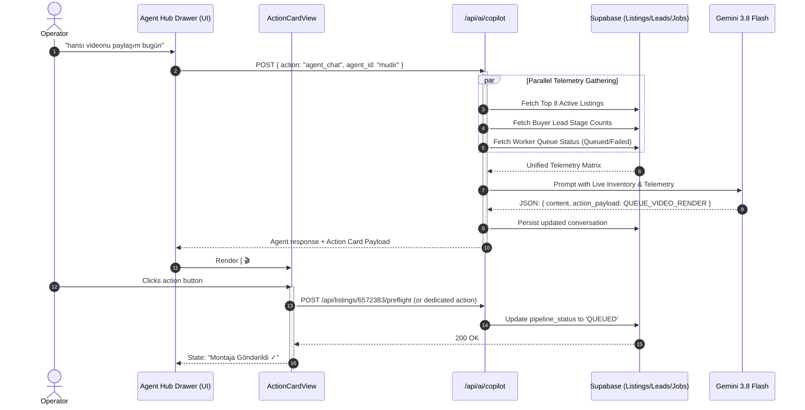

# BakuEstate-AI Interactive Action Cards, Cross-System Telemetry Ingestion, and Council Automation Engine (Executive Agent Hub V2)

*   **Author:** fxbluster
*   **Status:** Superseded by Left-Canvas Stage & Floating Window Cards
*   **Date:** 2026-11-21

--------------------------------------------------------------------------------

## Overview

The BakuEstate-AI Executive Agent Hub provides direct conversational access to four specialized AI agents (Müdir, Farabi, Usta, Teymur). While the council currently has access to active property listings, interaction is limited to static text output. When an agent recommends a concrete operational step—such as queuing a video render for listing #6572383, delegating a script to Teymur, or updating a buyer lead stage—the operator must manually copy-paste identifiers and perform actions across disparate CRM screens.

This design introduces Executive Agent Hub V2:
1. **Interactive Chat Action Cards & One-Click UI Buttons**: Agents emit structured action payloads that render as interactive execution buttons directly beneath the agent's message bubble (e.g., `[ 🎬 Queue Video Render ]`, `[ 📲 Delegate to Teymur ]`, `[ 💬 Send WhatsApp Script ]`, `[ 📊 Open Preflight Audit ]`).
2. **Omni-Telemetry Telemetry Ingestion**: Agents gain direct read access to buyer lead statuses (`buyer_leads`), video render pipeline worker queues (`jobs`, `listing_events`), and engagement analytics (`analytics_snapshots`).
3. **Autonomous Council Delegation**: Agents can hand off tasks directly between one another through unified action triggers, functioning as an integrated operations team rather than isolated chatbots.

--------------------------------------------------------------------------------

## The Problem

1. **Operational Friction from Text-Only Responses**:
   When Müdir identifies listing `#6572383` as the top priority for evening broadcast, the operator must manually navigate to the Listings tab, find `#6572383`, open the preflight modal or render trigger, and select channels. This manual bridge creates delay and increases the likelihood of operator omission.
2. **Telemetry Blindspots Beyond Listings**:
   Agents currently inspect top inventory items from `public.listings`. However, when asked about marketing effectiveness, worker errors, or lead conversion bottlenecks, agents lack live access to `buyer_leads` stage counts, rendering worker failure logs, or social media metric snapshots.
3. **Fragmented Inter-Agent Delegation**:
   When Müdir instructs "Teymura ötürün" (delegate to Teymur), the operator must manually switch to the Teymur tab, copy the listing details, and type a fresh prompt. The system lacks programmatic delegation where a single click transfers the listing context and task directive directly into Teymur's workspace.

--------------------------------------------------------------------------------

## Goals

*   **G-1: Interactive Action Card Engine in Chat**: Enable agent responses to attach validated action payloads (`action_payload` array or single card) rendered as clickable interactive components with immediate execution states (`IDLE`, `EXECUTING`, `COMPLETED`, `FAILED`).
*   **G-2: Immediate Action Triggers**:
    *   `QUEUE_VIDEO_RENDER`: Triggers video pipeline render for designated `bina_id` without navigating away from chat.
    *   `DELEGATE_AGENT`: Switches to target persona tab (`teymur`, `usta`, `farabi`, `mudir`) and auto-submits a contextualized task brief.
    *   `DISPATCH_WHATSAPP`: Launches pre-filled WhatsApp Web link with one click.
    *   `UPDATE_LEAD_STAGE`: Executes stage transition RPC in Supabase with confirmation state.
    *   `OPEN_PREFLIGHT_MODAL`: Opens the preflight audit inspector for a designated listing.
*   **G-3: Omni-Telemetry Read Ingestion**: Inject compact, token-efficient summaries of CRM buyer leads (top pending leads and stage distribution), worker pipeline queue health (active jobs and failed items), and channel analytics into the agent prompt context.
*   **G-4: Sub-300ms Client Execution**: Action card clicks must provide immediate optimistic visual feedback, executing underlying serverless API routes without full page reloads or drawer disruptions.

--------------------------------------------------------------------------------

## Non-Goals

*   **NG-1: Unchecked Autonomous Execution**: Agents will not perform destructive operations (deleting listings, permanently discarding leads, or charging external payment APIs) without explicit operator button confirmation.
*   **NG-2: Unbounded Context Window Telemetry**: Raw event logs and historical CRM records will not be dumped into LLM prompts. Only structured, pre-aggregated 24-hour metric summaries will be injected to remain well within Gemini token budgets.
*   **NG-3: Full Headless Background Loop**: Agents will not execute long-running background tasks without human-in-the-loop triggers; all actions are mediated through operator click gates.

--------------------------------------------------------------------------------

## Open Questions

*   **Q-1: Action Card Concurrency**: If an agent outputs multiple actionable recommendations in a single message (e.g., both queueing video render for #6572383 and opening WhatsApp for owner outreach), should the UI support multi-action button rows or a primary action card with secondary pills?
*   **Q-2: Worker Trigger Route**: Should `QUEUE_VIDEO_RENDER` call the existing Next.js `/api/listings/[bina_id]/preflight` endpoint directly, or dispatch a dedicated serverless action route `/api/ai/copilot/action`?

--------------------------------------------------------------------------------

## Critical User Journeys (CUJs)

### CUJ 1: One-Click Property Video Render from Müdir's Recommendation

*   **Given**: Operator opens AI Executive Hub and asks Müdir "hansı videonu paylaşım bugün".
*   **When**: Müdir analyzes live inventory, identifies `#6572383` (Xətai, 181,000 AZN), and outputs an action payload with type `QUEUE_VIDEO_RENDER`.
*   **Then**: The message bubble renders an interactive gold card: `[ 🎬 #6572383 Montaja Ver ]`. Clicking the button immediately invokes the pipeline dispatch API, updates button state to `Montaja Göndərildi ✓`, and notifies the pipeline worker without closing the chat.

### CUJ 2: Instant Council Task Delegation (Müdir -> Teymur)

*   **Given**: Operator asks Müdir for marketing strategy on listing `#6630403`.
*   **When**: Müdir outputs response recommending a luxury viral reel and provides a delegation card `[ 📲 Teymura Ötür (Reels Ssenarisi) ]`.
*   **Then**: Operator clicks the delegation button. The drawer automatically switches to the `Teymur` tab, injects listing `#6630403` details, and triggers Teymur to generate the hook, caption, and music suggestions instantly.

### CUJ 3: Cross-Telemetry Lead & Pipeline Inspection

*   **Given**: Operator asks "vəziyyət necədir, tıxanan iş və ya gözləyən müştəri var?".
*   **When**: `/api/ai/copilot` assembles context by querying `buyer_leads` stage counts and `jobs` worker queue status.
*   **Then**: Müdir accurately reports exact numbers (e.g., "Bazada 3 müştəri Beh ərəfəsində gözləyir, iş növbəsində 1 render gözləmədədir"), accompanied by an action button to inspect the queue.

--------------------------------------------------------------------------------

## Technical Plan (Architecture)

### Architectural Overview

The Executive Agent Hub V2 architecture transforms the assistant from a passive advisory interface into an active command center. The system establishes a closed operational loop:
1. Operator submits queries or commands to an executive council persona.
2. The serverless route `/api/ai/copilot` aggregates cross-system telemetry (listings, buyer leads, render queue, channel metrics) in parallel.
3. Gemini 3.8 Flash synthesizes the state and outputs authentic Baku dialect commentary along with a strictly typed `ActionCardPayload`.
4. The client renders the action card directly inside the chat bubble with live button states (`IDLE`, `EXECUTING`, `COMPLETED`, `FAILED`).
5. Operator clicks the action card to trigger background execution (render dispatch, agent delegation, stage update, or WhatsApp outreach).



### Component Details

#### 1. Action Card Contract (`web/lib/ai-client.ts`)

The wire schema expands `ActionCardPayload` to support five deterministic operations:

```typescript
export type ActionCardPayload =
  | {
      type: "QUEUE_VIDEO_RENDER";
      bina_id: string;
      channels: ("official" | "serfeli" | "premium" | "ai")[];
      headline: string;
      rationale: string;
    }
  | {
      type: "DELEGATE_AGENT";
      target_agent_id: "mudir" | "farabi" | "usta" | "teymur";
      task_directive: string;
      listing_id?: string;
      lead_id?: string;
    }
  | {
      type: "DISPATCH_WHATSAPP";
      phone_number: string;
      draft_text: string;
      listing_code?: string;
      wa_link: string;
    }
  | {
      type: "UPDATE_LEAD_STAGE";
      lead_id: string;
      client_name?: string;
      current_stage: string;
      recommended_stage: string;
      rationale: string;
    }
  | {
      type: "OPEN_PREFLIGHT_MODAL";
      bina_id: string;
      rationale: string;
    }
  | {
      type: "SAVE_INSIGHT";
      agent_id: "mudir" | "farabi" | "usta" | "teymur";
      domain: string;
      insight_text: string;
      confidence_score: number;
    };
```

#### 2. Interactive Component (`web/components/hub/ActionCardView.tsx`)

`ActionCardView` mounts beneath the message text inside `ChatMessageItem.tsx`. It provides specialized visual layouts based on payload type:
*   **Video Render Card (`QUEUE_VIDEO_RENDER`)**:
    *   Renders listing badge, target channels (`@bakuestate.official`, `@baku.serfeli.evler`), and a gold execution button: `[ 🎬 Montaja Ver ]`.
    *   On click: dispatches to `/api/listings/[bina_id]/preflight` with `{ action: "approve", channels }`.
    *   Transitions to disabled state with emerald indicator: `✓ Növbəyə Əlavə Edildi`.
*   **Agent Delegation Card (`DELEGATE_AGENT`)**:
    *   Renders target agent badge with directional icon (e.g., `📱 Teymura Yönləndir`).
    *   On click: calls `openAgentHub(target_agent_id, { initialPrompt: task_directive, listingId })`, immediately switching rooms and submitting the brief.
*   **WhatsApp Outreach Card (`DISPATCH_WHATSAPP`)**:
    *   Renders formatted draft message snippet and phone badge.
    *   On click: launches `window.open(wa_link, "_blank")`.
*   **Lead Stage Transition Card (`UPDATE_LEAD_STAGE`)**:
    *   Renders stage migration pill (e.g., `NEW_LEAD` -> `OFFER`).
    *   On click: executes stage update RPC and indicates success.

#### 3. Omni-Telemetry Context Ingestion (`web/app/api/ai/copilot/route.ts`)

During `agent_chat`, `/api/ai/copilot` executes three fast queries in parallel via `Promise.allSettled`:
1.  **Top Active Inventory**: 8 most recent active listings with price, location, Kupça status, and current pipeline state.
2.  **Buyer Lead Pipeline Health**: Total counts grouped by stage (`NEW_LEAD`, `CONTACTED`, `VIEWING_SCHEDULED`, `OFFER`, `UNDER_CONTRACT`), plus the top 3 uncontacted leads.
3.  **Worker Queue Telemetry**: Counts of jobs in `QUEUED`, `RENDERING`, and `FAILED` states to alert the operator if the pipeline is backlogged.

The resulting telemetry block is injected into the LLM system instruction under `--- CARİ ƏMƏLİYYAT VƏ TELEMETRİYA MATRİSİ ---`.

--------------------------------------------------------------------------------

## Alternatives Considered

### Alternative A: Headless Autonomous Auto-Execution without UI Cards

*   **Description**: The LLM uses function calling to automatically execute database mutations (queueing video renders, updating lead stages) during the response cycle, outputting only text confirmation (e.g., "Mənzili artıq montaja verdim").
*   **Pros**:
    *   Zero operator clicks required after typing the prompt.
    *   No specialized interactive UI components needed inside the chat bubble.
*   **Cons**:
    *   Eliminates the human-in-the-loop safety boundary.
    *   Risk of accidental video rendering costs and unwanted stage updates caused by prompt misinterpretation.
    *   No visual feedback on channel selection or dispatch parameters before execution.
*   **Reason for Rejection**: `Rejected by author: Blind autonomous mutations remove essential operator oversight, creating budget risks and accidental client outreach. Operator-mediated one-click action cards preserve safety while keeping friction minimal.`

### Alternative B: Modal-Heavy Popup Configuration

*   **Description**: Clicking any recommendation opens a comprehensive multi-step popup modal (e.g., full Preflight Modal or Edit Lead Dialog) requiring confirmation of all metadata.
*   **Pros**:
    *   Exposes every single configuration field before dispatching.
*   **Cons**:
    *   Interrupts the conversational flow with heavy visual overlays.
    *   Recreates the exact screen-switching friction this feature is designed to replace.
*   **Reason for Rejection**: `Rejected by author: Heavy modal redirection defeats the purpose of the Executive Hub as a fast, frictionless command center. One-click inline cards execute default high-confidence actions immediately, with an optional drill-down link if detailed editing is needed.`

### Alternative C: Client-Side Telemetry Ingestion via Browser State

*   **Description**: The React client queries all CRM tables (`buyer_leads`, `jobs`, `analytics`) and attaches the entire client-side state tree into the `/api/ai/copilot` request body.
*   **Pros**:
    *   Reduces backend database roundtrips within the serverless function.
*   **Cons**:
    *   Bloats request payloads from mobile clients.
    *   Exposes internal unaggregated telemetry over public client networks.
    *   Fails when the operator is on a page that has not mounted those specific queries.
*   **Reason for Rejection**: `Rejected by author: Client-side state injection is fragile, bandwidth-heavy, and dependent on active page mounts. Server-side parallel queries via the Supabase admin client are faster, secure, and independent of client page context.`

--------------------------------------------------------------------------------

## Detailed Implementation Plan

### Target Files to Create/Modify

#### 1. `web/lib/ai-client.ts` (Modify)
*   **Type / Scope**: TypeScript Client API & Contract Definitions
*   **Proposed Changes**:
    *   Expand `ActionCardPayload` union type to include:
        *   `QUEUE_VIDEO_RENDER`: `{ bina_id: string, channels?: string[], headline?: string, rationale: string }`
        *   `DELEGATE_AGENT`: `{ target_agent_id: AgentPersonaId, task_directive: string, listing_id?: string, lead_id?: string }`
        *   `OPEN_PREFLIGHT_MODAL`: `{ bina_id: string, rationale: string }`
    *   Add helper function `executeActionCard(payload: ActionCardPayload): Promise<{ ok: boolean, error?: string }>` to handle client-side execution dispatching.
*   **Rationale**: Establishes the type-safe foundation for all action cards and provides a centralized client dispatcher.

#### 2. `web/components/hub/ActionCardView.tsx` (Modify)
*   **Type / Scope**: React Component (Chat UI)
*   **Proposed Changes**:
    *   Add dedicated interactive card renderers for:
        *   `QUEUE_VIDEO_RENDER`: Gold-bordered card with channel badges, listing ID, and an interactive `[ 🎬 Montaja Ver ]` button. On click, invokes `/api/listings/[bina_id]/preflight` with action `approve` to queue video generation.
        *   `DELEGATE_AGENT`: Indigo/purple card showing target agent icon (`Teymur`, `Usta`, `Farabi`), task summary, and a `[ 📲 {Agent}-a Ötür ]` button. On click, triggers `openAgentHub` with target persona and pre-filled task directive.
        *   `OPEN_PREFLIGHT_MODAL`: Cyan card with `[ 🔍 Preflight Auditini Aç ]` button triggering the preflight modal for that listing.
    *   Implement immediate state feedback: `IDLE` -> `EXECUTING` (spinner) -> `SUCCESS` (green checkmark and disabled state).
*   **Rationale**: Transforms static recommendations into actionable interactive UI elements right in the chat stream.

#### 3. `web/components/hub/ChatMessageItem.tsx` (Modify)
*   **Type / Scope**: React Component (Chat Bubble)
*   **Proposed Changes**:
    *   Accept optional `onSwitchPersona?: (agentId: AgentPersonaId) => void` prop.
    *   Pass `onSwitchPersona` down to `ActionCardView` so delegation cards can switch active tabs without page reloads.
*   **Rationale**: Enables direct inter-agent delegation from message bubbles.

#### 4. `web/components/hub/SpecialistRoom.tsx` & `web/components/hub/OmniChatRoom.tsx` (Modify)
*   **Type / Scope**: React Room Containers
*   **Proposed Changes**:
    *   Forward `onSwitchPersona` to `ChatStream` and `ChatMessageItem`.
    *   Listen for delegation triggers to smoothly shift focus to the delegated specialist room.
*   **Rationale**: Completes the end-to-end UI delegation loop.

#### 5. `web/app/api/ai/copilot/route.ts` (Modify)
*   **Type / Scope**: Next.js Serverless Route
*   **Proposed Changes**:
    *   Enhance telemetry gathering in `agent_chat` by querying in parallel:
        1.  `listings`: Top 8 active listings with price, location, Kupça status, and current pipeline state.
        2.  `buyer_leads`: Total stage counts (`NEW_LEAD`, `CONTACTED`, `OFFER`, etc.) and top 3 pending buyer inquiries.
        3.  `listing_events` / `jobs`: Worker queue counts (`QUEUED`, `RENDERING`, `FAILED`).
    *   Format telemetry into structured prompt blocks: `--- CARİ REYESTR VƏ PORTFEL ---`, `--- MÜŞTƏRİ CRM VƏZİYYƏTİ ---`, `--- İŞ NÖVBƏSİ VƏ RENDER STATUSU ---`.
    *   Instruct LLM personas to generate `QUEUE_VIDEO_RENDER` and `DELEGATE_AGENT` payloads when operational actions are proposed.
*   **Rationale**: Gives all council personas comprehensive awareness of the entire business state (not just inventory).

#### 6. `web/lib/agent-personas.ts` (Modify)
*   **Type / Scope**: Agent Prompt Configuration
*   **Proposed Changes**:
    *   Update `Müdir`, `Farabi`, `Usta`, and `Teymur` system prompts with clear guidelines on emitting action payloads.
    *   Enforce that whenever an agent says "X-i montaja verin" or "Teymura ötürün", they MUST attach the corresponding structured `action_payload`.
*   **Rationale**: Guarantees alignment between the text response and the interactive UI card.

#### 7. `web/__tests__/action-card-engine.test.ts` (Create)
*   **Type / Scope**: Vitest Unit Tests
*   **Proposed Changes**:
    *   Test `ActionCardPayload` type discrimination.
    *   Test execution state transitions (`IDLE` -> `EXECUTING` -> `SUCCESS`).
    *   Test telemetry summary formatting with empty and populated databases.
*   **Rationale**: Ensures regression-free implementation and high code quality.

---

### Verification Plan

*   **Compilation / Build**:
    *   Run `cd C:\Users\HP\BakuEstate-AI\web; npm run build` to verify clean Next.js 15 compilation with 0 TypeScript/ESLint errors.
*   **Unit Tests**:
    *   Run `cd C:\Users\HP\BakuEstate-AI\web; npm run test` to verify that all 53 existing tests plus new action card engine tests pass (100% green).
*   **Live Netlify Endpoint Verification**:
    *   Deploy build to Netlify production (`https://bakuestate-crm.netlify.app`).
    *   Send live test query "hansı videonu paylaşım bugün" to Müdir and verify that the response returns valid `action_payload` of type `QUEUE_VIDEO_RENDER`.
    *   Test one-click interaction in browser to verify that the button executes without closing the drawer or resetting chat history.

--------------------------------------------------------------------------------

*Drafted with EGM*
