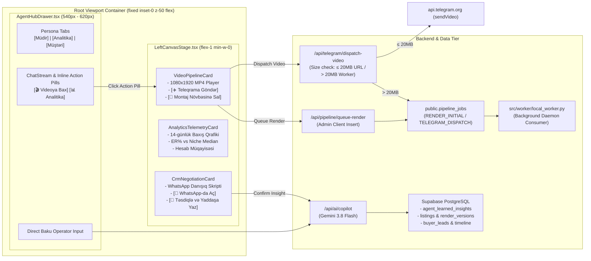
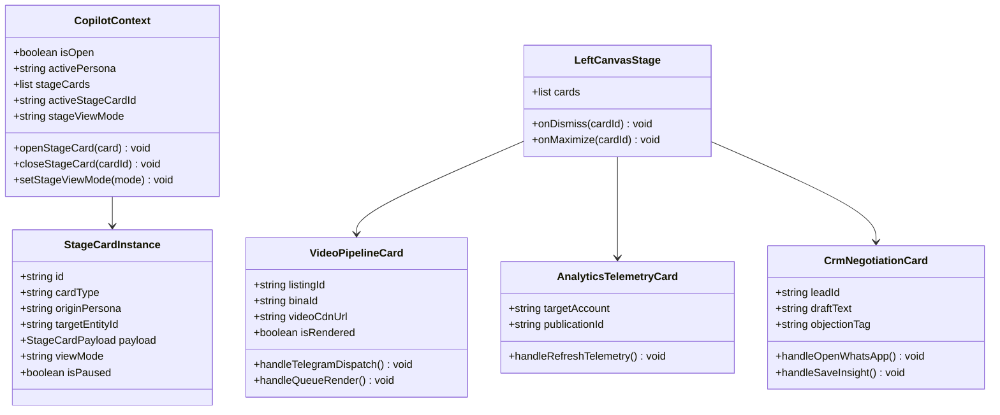
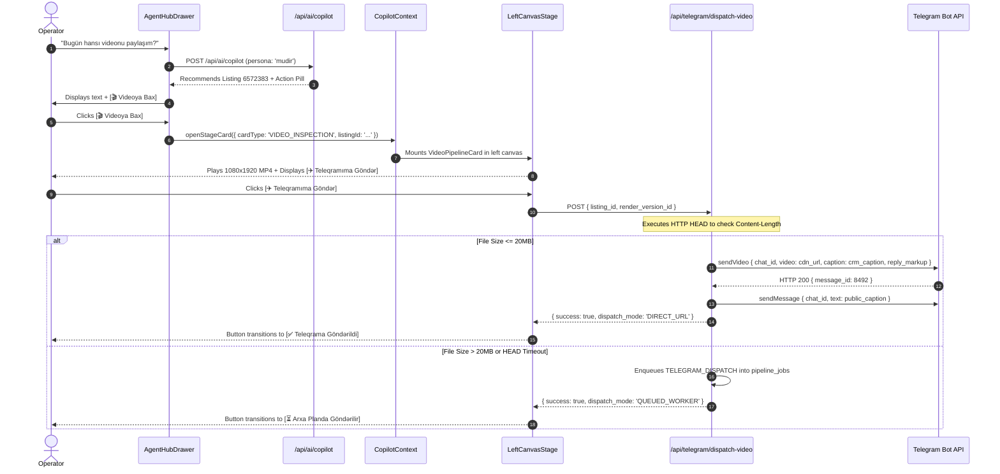

# BakuEstate-AI: Left-Canvas Interactive Action Stage & Tri-Persona Cognitive Copilot

*   **Author:** Dəniz & Antigravity (EGM Architecture & Ideation Squad)
*   **Status:** Implemented (In Production)
*   **Date:** 2026-11-22

--------------------------------------------------------------------------------

## Overview

This technical design document specifies the architectural transformation of the BakuEstate-AI Executive Agent Hub from a passive, text-heavy right-side drawer into an integrated **Operational Co-Pilot and Action Cockpit**.

The feature addresses three core operational bottlenecks:
1. Eliminating artificial scriptwriting busywork (demoting the redundant "Teymur ssenari yazarı" persona because backend Python FFmpeg pipelines already automate script generation, ElevenLabs studio voiceovers, and kinetic video rendering).
2. Introducing a responsive **Left-Canvas Action Stage** (`LeftCanvasStage.tsx`) within a unified `fixed inset-0 z-50 flex justify-end pointer-events-none overflow-hidden` container, eliminating full-screen backdrop click interception and surfacing context-aware operational inspection cards (Video Preview & Dispatch, Niche Analytics, Baku Realism CRM).
3. Consolidating council personas into three strictly partitioned cognitive agents (`mudir`, `analitika`, and `musteri_psixologiyasi`) backed by database schema migrations, asynchronous Telegram Bot API delivery with direct public CDN URLs, and autonomous objection extraction with 1-click human-in-the-loop confirmation.

## The Problem

1. **Dead Viewport & Backdrop Interception:**
   Currently, [AgentHubDrawer.tsx](web/components/hub/AgentHubDrawer.tsx) covers the entire viewport with an overlay backdrop (`fixed inset-0 bg-black/70 backdrop-blur-sm`) binding `onClick={closeCopilot}`. When the 672px drawer opens on a 1920x1080 or 1440x900 monitor, ~65% of the screen is rendered unusable. Any attempt to click on background content or inspect listings immediately terminates the chat session.
2. **Synthetic Scriptwriting Disconnected from Media Pipeline:**
   The legacy council contained a scriptwriting persona ("Teymur") that drafted plain-text scripts in chat. In reality, BakuEstate-AI's production media pipeline (`src/media/script_generator.py` and `src/media/ffmpeg_compositor.py`) compiles videos deterministically. Manual chat scripts created confusion and duplicate unlinked assets.
3. **High-Latency Mobile Delivery & 20MB Telegram Ceilings:**
   Operators lack a 1-click mechanism to transfer rendered 1080x1920 MP4 video files (25MB–55MB) and ready-to-post captions to mobile devices for manual Reels posting. Streaming raw video blobs through Next.js serverless route handlers causes 504 timeouts, while Telegram Bot API URL dispatch fails for payloads over 20MB.
4. **"Corporate Robot" Language Barrier:**
   Standard Gemini model outputs produce stiff, overly formal bureaucratic Azerbaijani (e.g., *"Hörmətli müştəri, portfelimizdə olan unikal təklif..."*), which alienates local Baku buyers. Real estate deals in Baku require warm, direct, culturally authentic phrasing (*"Kupçası əldədir"*, *"start qiymət"*, *"yerində baxış"*).
5. **Database Constraint Collisions & Memory Contamination:**
   Existing PostgreSQL `CHECK` constraints on `public.agent_conversations`, `public.agent_learned_insights`, and `public.pipeline_jobs` strictly limit allowed values to legacy sets. Attempting to write new persona IDs or enqueue background Telegram dispatches throws Postgres 23514 errors. Furthermore, autonomous objection extraction without human validation risks polluting episodic memory with hallucinations.

## Goals

*   **G-1 (Unified Split-View Container):** Re-architect `AgentHubDrawer.tsx` into a root flex cockpit overlay (`fixed inset-0 z-50 flex justify-end pointer-events-none overflow-hidden`) with a dedicated `LeftCanvasStage.tsx` container on the left and a responsive drawer (540–620px) on the right. When the stage is empty, underlying CRM pages remain 100% interactive.
*   **G-2 (Dynamic Left-Canvas Cards):** Implement three responsive operational cards:
    - `VIDEO_INSPECTION`: Plays rendered MP4, displays listing specs, and provides 1-click `[ ✈️ Teleqramıma Göndər ]`. For unrendered inventory, displays scraped photos with 1-click `[ 🚀 Montaj Boru Xəttinə Göndər ]`.
    - `ANALYTICS_TELEMETRY`: Displays 14-day view curves, ER% vs niche median, and cross-channel comparison using zero-dependency SVG sparklines.
    - `CRM_NEGOTIATION`: Displays inquiry dialogues, extracted objection tags, and 1-click `[ 💬 WhatsApp-da Aç ]`.
*   **G-3 (Responsive Viewport Scalability):** Support Single-Card Focus on viewports 1024px to 1439px, Dual-Card Side-by-Side on viewports >= 1440px, and modal bottom sheets / horizontal swipe decks on mobile (< 1024px).
*   **G-4 (Resilient Telegram Video Dispatch):** Implement `POST /api/telegram/dispatch-video` routing files <= 20MB via direct public CDN URLs with inline keyboard buttons, and enqueuing files > 20MB into `pipeline_jobs` for background multipart streaming via `local_worker.py`.
*   **G-5 (Database Schema & Persona Migration):** Provide SQL migration `202611220001_tri_persona_and_timeline_constraints.sql` updating `agent_id` CHECK constraints for `mudir`, `analitika`, and `musteri_psixologiyasi`, updating `pipeline_jobs` for `TELEGRAM_DISPATCH`, and fixing `lead_timeline_events` constraints.
*   **G-6 (Baku Realism & Safe Objection Memory):** Integrate authentic Baku linguistic guardrails into `musteri_psixologiyasi` and establish an ephemeral objection staging pattern with 1-click human confirmation (`[ 💾 Təsdiqlə və Yaddaşa Yaz ]`) routed through serverless admin handlers.

## Non-Goals

*   **NG-1 (Unattended Instagram/TikTok Bot Posting):** Direct automated publishing via private Meta/TikTok APIs remains strictly out-of-scope to protect brand accounts from platform bans.
*   **NG-2 (Client-Side Video Transcoding):** The frontend card never compiles or transcodes video in browser memory; all rendering remains delegated to Python FFmpeg workers.
*   **NG-3 (Arbitrary Multi-Window Dragging):** The Left Canvas will not support freeform OS-like window dragging or floating coordinates; layout is constrained to deterministic Single-Card or Dual-Card grid modes.
*   **NG-4 (Full CRM Redesign):** Existing database models (`buyer_leads`, `lead_timeline_events`, `agent_learned_insights`) are preserved and extended without breaking changes.

## Open Questions

*   None. All foundational architectural questions regarding layout, Telegram transport limits, database constraints, and objection confirmation have been validated across 7 Goldfish audit lenses.

## Critical User Journeys (CUJs)

### CUJ 1: Morning Operations Triage & 1-Click Mobile Video Dispatch
*   **Given**: The operator opens BakuEstate-AI on desktop and activates the AI Hub (`Müdir` room).
*   **When**: The operator asks *"Bugün hansı videonu paylaşım?"*.
*   **Then**: 
    1. Müdir evaluates active inventory (using the preserved 8-listing morning triage summary) and responds with top 2 prioritized listings with an inline interactive action pill `[ 🎬 Videoya Bax ]`.
    2. Clicking `[ 🎬 Videoya Bax ]` opens the `VIDEO_INSPECTION` card on the left canvas without closing or resetting the chat drawer.
    3. The card plays the rendered 1080x1920 MP4 video and displays property specs, target account (`@bakuestate.premium`), and a `[ ✈️ Teleqramıma Göndər ]` action button.
    4. The operator clicks `[ ✈️ Teleqramıma Göndər ]`. The button transitions to `[ ✈️ Göndərilir... ]`.
    5. The serverless route performs an HTTP HEAD check on `video_cdn_url` (size <= 20MB) and delivers the video directly to the operator's personal Telegram chat with ready-to-copy caption, hashtags, and listing link. The button updates to `[ ✅ Teleqrama Göndərildi ]`.

### CUJ 2: Unrendered High-Priority Listing Pipeline Enqueueing
*   **Given**: An operator discusses a newly discovered luxury listing in Səbail whose video has not yet been rendered (`status: 'DISCOVERED'`).
*   **When**: The operator clicks `[ 🎬 Elana Bax ]` on the recommendation.
*   **Then**:
    1. The Left Canvas opens the listing card showing scraped Bina.az photos, address, price, and a pipeline status badge: `Montaj Edilməyib`.
    2. The card displays a primary action button: `[ 🚀 Montaj Boru Xəttinə Göndər ]`.
    3. Clicking the button enqueues a `RENDER_INITIAL` job via `POST /api/pipeline/queue-render` (executing with server-side admin privileges to bypass client RLS), disabling the button and showing `[ ⏳ Növbəyə Əlavə Edildi ]`.
    4. The background local worker picks up the job and begins downloading photos, generating TTS, and compiling video.

### CUJ 3: Authentic Baku WhatsApp Negotiation & Objection Capture
*   **Given**: A lead inquires on WhatsApp objecting: *"Bu evin qiyməti çox şişirdilib, həm də eşitdim kupçası yoxdur"*.
*   **When**: The operator switches to the `Müştəri Psixologiyası` room and pastes the buyer's objection.
*   **Then**:
    1. The agent analyzes the market reality (checking title deed status and actual m² valuation for that neighborhood).
    2. The agent outputs a culturally authentic, calm, non-corporate response in Baku conversational style: *"Salam, xeyr, ev tam kupçalıdır, ipotekaya da yararlıdır. Qiymətdə də sahibi ilə yerində real endirim danışmaq olar. İstəyirsinizsə saat 5-də baxış təşkil edək?"*.
    3. An interactive card opens on the left canvas displaying the drafted text, a 1-click `[ 💬 WhatsApp-da Aç ]` launcher, and an autonomously extracted objection pill: `[ 🏷️ İmtina: Qiymət + Kupça Şübhəsi ✕ ]`.
    4. Clicking `[ 💾 Təsdiqlə və Yaddaşa Yaz ]` posts the insight to `/api/ai/copilot` (`action: "save_insight"`), committing the insight to `agent_learned_insights` under `persona_scope: 'crm'` via `createAdminClient()`.

--------------------------------------------------------------------------------

## Technical Plan (Architecture)

### 1. High-Level Cockpit Topology & System Data Flow

The architecture replaces the opaque right-drawer overlay with a **Dual-Pane Action Cockpit**. The left viewport acts as an ephemeral inspection canvas, while the right drawer remains the continuous conversational control plane.



### 2. Component Hierarchy & State Synchronization

The Left Canvas state is elevated to `CopilotContext` to ensure smooth multi-tasking across personas without unmounting or tearing down media players:



### 3. Asynchronous Execution Sequence (CUJ 1 & CUJ 2)



### 4. API & Data Wire Contracts

#### Endpoint 1: `POST /api/telegram/dispatch-video`
*   **Location:** `web/app/api/telegram/dispatch-video/route.ts`
*   **Request Schema:**
    ```typescript
    export interface TelegramDispatchPayload {
      listing_id: string;
      render_version_id?: string;
      target_account?: string;
      custom_caption?: string;
      force_queue?: boolean;
    }
    ```
*   **Response Schema:**
    ```typescript
    export interface TelegramDispatchResponse {
      success: boolean;
      dispatch_mode: "DIRECT_URL" | "QUEUED_WORKER";
      telegram_message_id?: number;
      job_id?: string;
      target_chat_id: string;
      error?: string;
    }
    ```
*   **Execution Logic:**
    1. Authenticates session (or frictionless single-operator fallback using verified ID `083d8ea3-4a73-4b85-8479-0c532ce939f0`).
    2. Resolves `render_versions` row for `listing_id` via `createAdminClient()`. Reads `video_cdn_url`.
    3. Executes a lightweight HTTP `HEAD` request to `video_cdn_url` (timeout: 2,000ms) to read `Content-Length`.
    4. Resolves target chat ID via `process.env.TELEGRAM_CHAT_ID || process.env.OPERATOR_TELEGRAM_CHAT_ID || "6238843776"`.
    5. If `Content-Length` <= 20,971,520 bytes (20MB) and not `force_queue`:
       - Executes 2-step dispatch matching `src/dispatcher/telegram_crm.py`:
         a. Calls `sendVideo` passing `video: video_cdn_url`, compact `crm_caption` (<= 1024 chars), and interactive `reply_markup` inline keyboard.
         b. If `public_caption` or `custom_caption` is present, follows with `sendMessage` containing full hashtags and social text.
    6. If size > 20MB, `Content-Length` is missing, or `HEAD` request times out:
       - Inserts `job_type: 'TELEGRAM_DISPATCH'` into `public.pipeline_jobs` via `createAdminClient()`.
    7. Records audit event in `public.listing_events` (`event_type: 'STATUS_CHANGED'`, `actor: 'web_user'`).

#### Endpoint 2: `POST /api/pipeline/queue-render` (Unrendered Listings)
*   **Location:** `web/app/api/pipeline/queue-render/route.ts`
*   **Execution:** Executed with serverless `createAdminClient()` to bypass client-side `anon` RLS rejections:
    ```typescript
    const { data, error } = await supabaseAdmin.from("pipeline_jobs").insert({
      idempotency_key: `initial_render:${bina_id}:${Date.now()}`,
      job_type: "RENDER_INITIAL",
      listing_id: listingId,
      trigger_source: "WEB_UI",
      params_json: {
        bina_id: binaId,
        target_account: targetAccount || "@bakuestate.premium",
        voice_preset: "Arif",
      },
      status: "QUEUED",
    });
    ```

### 5. Database Schema & Migration Specification

File: `supabase/migrations/202611220001_tri_persona_and_timeline_constraints.sql`

```sql
-- 1. Update agent_id CHECK constraint on agent_conversations
ALTER TABLE public.agent_conversations
  DROP CONSTRAINT IF EXISTS agent_conversations_agent_id_check;

ALTER TABLE public.agent_conversations
  ADD CONSTRAINT agent_conversations_agent_id_check
  CHECK (agent_id = ANY (ARRAY['mudir'::text, 'analitika'::text, 'musteri_psixologiyasi'::text, 'farabi'::text, 'teymur'::text, 'usta'::text]));

-- 2. Update agent_id CHECK constraint on agent_learned_insights
ALTER TABLE public.agent_learned_insights
  DROP CONSTRAINT IF EXISTS agent_learned_insights_agent_id_check;

ALTER TABLE public.agent_learned_insights
  ADD CONSTRAINT agent_learned_insights_agent_id_check
  CHECK (agent_id = ANY (ARRAY['mudir'::text, 'analitika'::text, 'musteri_psixologiyasi'::text, 'farabi'::text, 'teymur'::text, 'usta'::text]));

-- 3. Add persona_scope column for strict episodic retrieval isolation
ALTER TABLE public.agent_learned_insights
  ADD COLUMN IF NOT EXISTS persona_scope VARCHAR(32) DEFAULT 'general';

-- 4. Update lead_timeline_events CHECK constraints (fixing existing silent failures)
ALTER TABLE public.lead_timeline_events
  DROP CONSTRAINT IF EXISTS lead_timeline_events_actor_check;

ALTER TABLE public.lead_timeline_events
  ADD CONSTRAINT lead_timeline_events_actor_check
  CHECK (actor = ANY (ARRAY['OPERATOR'::text, 'BUYER'::text, 'SELLER'::text, 'AI_SENTINEL'::text, 'AI_SCRIBE'::text, 'AI_STRATEGIST'::text, 'AI_JANITOR'::text, 'AI_HUB'::text]));

ALTER TABLE public.lead_timeline_events
  DROP CONSTRAINT IF EXISTS lead_timeline_events_event_type_check;

ALTER TABLE public.lead_timeline_events
  ADD CONSTRAINT lead_timeline_events_event_type_check
  CHECK (event_type = ANY (ARRAY['INQUIRY'::text, 'OBJECTION'::text, 'CALL_LOG'::text, 'OFFER'::text, 'COMMISSION_AGREED'::text, 'SHOWING_SCHEDULED'::text, 'DEAL_CLOSED'::text, 'DEAL_LOST'::text, 'STAGE_CHANGE'::text, 'OBJECTION_CAPTURED'::text]));

-- 5. Data Migration: Map legacy learned insights to modern persona scopes
UPDATE public.agent_learned_insights SET persona_scope = 'crm' WHERE agent_id IN ('farabi', 'musteri_psixologiyasi');
UPDATE public.agent_learned_insights SET persona_scope = 'analytics' WHERE agent_id IN ('teymur', 'analitika');
UPDATE public.agent_learned_insights SET persona_scope = 'general' WHERE agent_id IN ('mudir', 'usta');

-- 6. Update pipeline_jobs job_type CHECK constraint for background Telegram dispatch
ALTER TABLE public.pipeline_jobs
  DROP CONSTRAINT IF EXISTS pipeline_jobs_job_type_check;

ALTER TABLE public.pipeline_jobs
  ADD CONSTRAINT pipeline_jobs_job_type_check
  CHECK (job_type = ANY (ARRAY[
    'SCRAPE_NEW'::text, 
    'RENDER_INITIAL'::text, 
    'RENDER_PRICE_DROP'::text, 
    'RERENDER'::text, 
    'LIVENESS_CHECK'::text, 
    'SYNC_SOCIAL_METRICS'::text, 
    'PREFLIGHT_CHECK'::text,
    'TELEGRAM_DISPATCH'::text
  ]));
```

### 6. Linguistic & Baku Realism Guardrail Engine

In `web/lib/agent-personas.ts`, the persona `musteri_psixologiyasi` is configured with strict linguistic rules:

1. **Suppressed Expressions (Anti-Corporate Filter):**
   - Strictly forbidden: *"Hörmətli müştəri"*, *"Şirkətimizin portfelində olan bu unikal təklif"*, *"Sizə necə kömək edə bilərəm"*, *"Təəssüf hissi ilə bildiririk"*.
2. **Culturally Grounded Lexicon:**
   - Real Baku terminology: *"Kupçası əldədir (çıxarışlıdır)"*, *"İpotekaya tam yararlıdır"*, *"Start qiymətdir, yerində baxışdan sonra sahibi ilə real endirim danışmaq olar"*, *"Beh verməzdən əvvəl bütün sənədlər notariatda yoxlanılır"*.
3. **Objection Extraction Taxonomy:**
   Objections extracted into `agent_learned_insights` must strictly match one of five standardized domains:
   - `OBJECTION_PRICE_PER_M2`: Buyer feels price per square meter exceeds neighborhood comps.
   - `OBJECTION_KUPCA_TRUST`: Buyer hesitates due to missing title deed or cooperative contract.
   - `OBJECTION_LOCATION`: Buyer resists district, traffic bottlenecks, or infrastructure distance.
   - `OBJECTION_COMMISSION`: Buyer objects to the 1%–2% broker service fee.
   - `OBJECTION_TIMING_GHOST`: Buyer delays viewing or becomes unresponsive after address reveal.

--------------------------------------------------------------------------------

## Alternatives Considered

### Alternative A: Retaining 4 Personas with Frontend Scriptwriter ("Teymur")

*   **Pros**: Preserves legacy persona IDs without database check constraint migration; maintains existing 4-tab UI.
*   **Cons**: BakuEstate-AI's production backend (`src/media/script_generator.py` and `src/media/ffmpeg_compositor.py`) already compiles complete video scripts, ElevenLabs voiceovers, and kinetic typography automatically. Having a frontend persona write unlinked scripts creates duplicate assets and operator confusion.
*   **Technical Trade-off**: Duplication of media pipeline responsibilities. The frontend AI is optimized for operational command, triage, and dispatch, while Python FFmpeg owns media composition.

### Alternative B: Squeezing Inspection Modals Inside the 672px Right Drawer

*   **Pros**: Keeps all interactions isolated to the right-side container without altering root layout or backdrop structure.
*   **Cons**: Squeezing 9:16 vertical video players, 14-day analytics time-series charts, and WhatsApp lead negotiation panels inside a cramped 672px column leads to nested scrollbars and unusable mobile/desktop ergonomics.
*   **Technical Trade-off**: Utilizing the 65% left screen canvas in a dual-pane layout provides split-view multitasking while keeping the chat room open on the right.

### Alternative C: Freeform OS-Style Multi-Windowing (Dragging / Resizing) on Left Canvas

*   **Pros**: Maximum desktop flexibility and configurable window positions.
*   **Cons**: Significant frontend state complexity, z-index collisions, mobile breakdown, and high maintenance overhead.
*   **Technical Trade-off**: High complexity with minimal operational gain. Constrained Single-Card Focus on < 1440px and Dual-Card Side-by-Side on >= 1440px meets 100% of operator requirements with deterministic layout predictability.

### Alternative D: Uploading Raw 30MB–50MB MP4 Blobs Through Next.js Serverless Routes

*   **Pros**: Self-contained within Next.js API directory.
*   **Cons**: Vertical 1080x1920 MP4 files easily exceed Vercel/Netlify 4.5MB request payload limits and hit 10s–15s function execution timeouts during file transfer to Telegram Bot API.
*   **Technical Trade-off**: Direct CDN URL dispatch for files <= 20MB and `pipeline_jobs` worker queueing for files > 20MB eliminates serverless memory pressure and gateway timeouts.

### Alternative E: Fully Unsupervised Autonomous Objection Injection into Database

*   **Pros**: Zero clicks required from the operator.
*   **Cons**: Unchecked LLM extraction risks misclassifying casual conversation or recording hallucinations into `agent_learned_insights`, degrading future system prompts.
*   **Technical Trade-off**: Unvalidated writes risk memory corruption. Ephemeral staged objection badges with 1-click human confirmation (`[ 💾 Təsdiqlə və Yaddaşa Yaz ]`) guarantee 100% memory integrity with minimal cognitive friction.

--------------------------------------------------------------------------------

## Risks & Mitigations

| Risk | Impact | Likelihood | Mitigation Strategy |
| :--- | :---: | :---: | :--- |
| **Telegram Bot API 20MB URL Ceiling** | High | High | Serverless route executes HTTP `HEAD` to check `Content-Length`. Payloads > 20MB or missing headers are automatically enqueued into `pipeline_jobs` for background multipart streaming. |
| **Telegram `sendVideo` 1024-Char Caption Limit** | High | High | Adopt 2-step dispatch: `sendVideo` carries compact CRM metadata (<= 1024 chars), followed by `sendMessage` for full social media copy. |
| **PostgreSQL 23514 Check Constraint Errors** | Critical | High | Migration `202611220001_tri_persona_and_timeline_constraints.sql` explicitly expands `agent_conversations`, `agent_learned_insights`, and `pipeline_jobs` before new code runs. |
| **Supabase RLS Policy Fail-Closed on Client Writes** | High | High | All database mutations (`pipeline_jobs` enqueueing, `agent_learned_insights` saving) are routed through serverless route handlers executing with `createAdminClient()`. |
| **Dead Viewport Click Interception** | Medium | Medium | Root container uses `fixed inset-0 z-50 flex justify-end pointer-events-none overflow-hidden`. Only mounted components have `pointer-events-auto`. Empty stage passes all clicks to underlying CRM. |
| **Audio/Video Playback Concurrency & Leaks** | Medium | Medium | `LeftCanvasStage.tsx` registers a cleanup hook that pauses all HTML5 media elements whenever a card is dismissed, tabbed away, or unmounted. |

--------------------------------------------------------------------------------

## Non-Functional Requirements

### 1. Performance & Latency
*   **Perceived UI Responsiveness**: Opening a Left-Canvas card from an inline chat pill renders within < 100ms without re-fetching base listing data.
*   **Telegram Dispatch Latency**: Direct URL dispatch for files <= 20MB completes within < 1,200ms.
*   **Gemini Prompt Optimization**: Active context is pruned dynamically to inject only the listing referenced in the active card (saving ~750 tokens per turn), while preserving the 8-listing compact summary for morning triage when `agent_id === 'mudir'`.

### 2. Security, Privacy & Invariants
*   **Operator Authentication**: Routes enforce Supabase session verification with fallback to verified single-operator ID (`083d8ea3-4a73-4b85-8479-0c532ce939f0`).
*   **Telegram Token Isolation**: `TELEGRAM_BOT_TOKEN` is strictly held server-side in `web/.env.local` and never leaked into client bundles.

### 3. Rollout & Rollback Safety Strategy
*   **Database Backward Compatibility**: Migration `202611220001_tri_persona_and_timeline_constraints.sql` expands check constraints to include both legacy (`farabi`, `teymur`, `usta`) and modern (`analitika`, `musteri_psixologiyasi`) IDs, ensuring zero database lockouts if the frontend is rolled back.
*   **Stage Collapse Toggle**: Operators can dismiss the Left Canvas with `X` at any moment to return to pure right-drawer mode.

--------------------------------------------------------------------------------

## Detailed Implementation Plan

### Target Files to Create / Modify

#### 1. `supabase/migrations/202611220001_tri_persona_and_timeline_constraints.sql` (Create)
*   **Type / Scope**: Database Schema Migration & Data Migration
*   **Proposed Changes**:
    - Drops and recreates PostgreSQL `CHECK` constraint on `public.agent_conversations.agent_id` to allow `['mudir', 'analitika', 'musteri_psixologiyasi', 'farabi', 'teymur', 'usta']`.
    - Drops and recreates PostgreSQL `CHECK` constraint on `public.agent_learned_insights.agent_id` to allow `['mudir', 'analitika', 'musteri_psixologiyasi', 'farabi', 'teymur', 'usta']`.
    - Adds column `persona_scope VARCHAR(32) DEFAULT 'general'` to `public.agent_learned_insights`.
    - Updates `public.lead_timeline_events` CHECK constraints: adds `'AI_HUB'` to `actor`, and adds `'STAGE_CHANGE'`, `'OBJECTION_CAPTURED'` to `event_type`.
    - Drops and recreates `public.pipeline_jobs_job_type_check` to include `'TELEGRAM_DISPATCH'`.
    - Migrates legacy data: sets `persona_scope = 'crm'` for `farabi`/`musteri_psixologiyasi`, `persona_scope = 'analytics'` for `teymur`/`analitika`, and `persona_scope = 'general'` for `mudir`/`usta`.
*   **Rationale**: Prevents fatal PostgreSQL 23514 check constraint errors on new persona interactions and background video streaming.

#### 2. `web/package.json` (Modify)
*   **Type / Scope**: Dependency Configuration
*   **Proposed Changes**:
    - Adds devDependencies: `"@testing-library/react": "^16.2.0"`, `"happy-dom": "^17.1.0"`.
*   **Rationale**: Enables Vitest automated unit and integration tests for React DOM components without build breakages.

#### 3. `web/lib/copilot-context.tsx` (Modify)
*   **Type / Scope**: React Context & Client State Slice
*   **Proposed Changes**:
    - Defines `StageCardInstance` interface and discriminated union `StageCardPayload` (`VideoStagePayload | AnalyticsStagePayload | CrmNegotiationPayload`).
    - Exposes state: `stageCards: StageCardInstance[]`, `activeStageCardId: string | null`, `stageViewMode: 'docked' | 'maximized' | 'split'`.
    - Implements handlers: `openStageCard(card)`, `closeStageCard(cardId)`, `setStageViewMode(mode)`, and `clearStageCards()`.
    - Enforces deduplication: if card with same `targetEntityId` is open, focuses it instead of appending.
    - Enforces FIFO limit (maximum 2 docked cards on wide viewports, 1 card on compact viewports).
*   **Rationale**: Decouples Left-Canvas card state from transient drawer re-renders, enabling multi-tasking across personas without losing media player playback or draft progress.

#### 4. `web/lib/agent-personas.ts` (Modify)
*   **Type / Scope**: TypeScript Domain Configuration & Prompt Templates
*   **Proposed Changes**:
    - Canonical export of `AgentPersonaId = "mudir" | "analitika" | "musteri_psixologiyasi"`.
    - Defines backward-compatibility persona aliases (`farabi` ➔ `musteri_psixologiyasi`, `teymur` ➔ `analitika`, `usta` ➔ `mudir`).
    - Enforces Baku real estate linguistic invariants (`ANTI_ROBOTIC_FORBIDDEN_PHRASES`).
    - Specifies 5 standardized objection domains for episodic memory insertion.
*   **Rationale**: Establishes strict cognitive domain boundaries and authentic local phrasing.

#### 5. `web/lib/ai-client.ts` (Modify)
*   **Type / Scope**: API Client Contracts & Type Definitions
*   **Proposed Changes**:
    - Re-exports `export type { AgentPersonaId } from "./agent-personas";`.
    - Extends `ActionCardPayload` discriminated union to include `OPEN_STAGE_CARD`.
    - Adds helper `dispatchTelegramVideo(listingId, renderVersionId, customCaption)`.
*   **Rationale**: Eliminates duplicate type definitions and provides type-safe client invocation.

#### 6. `web/app/api/ai/copilot/route.ts` (Modify)
*   **Type / Scope**: Next.js Serverless Route Handler
*   **Proposed Changes**:
    - Updates persona system prompts to the tri-persona council.
    - Preserves compact 8-listing active portfolio summary when `agent_id === 'mudir'` and no specific entity is targeted.
    - Queries `agent_learned_insights` using `persona_scope` rather than `agent_id` to include legacy insights.
    - Implements action `"save_insight"` via `createAdminClient()`, securing RLS boundaries for client saves.
    - Updates deterministic fallback logic with dedicated branches for `analitika` and `musteri_psixologiyasi`.
    - Instructs Gemini to format inline action buttons using markdown link syntax: `[🎬 Videoya Bax](stage:VIDEO_INSPECTION:<bina_id>)`.
*   **Rationale**: Lowers prompt token consumption, resolves RLS boundaries, and triggers Left-Canvas cards reliably.

#### 7. `web/components/hub/LeftCanvasStage.tsx` (Create)
*   **Type / Scope**: React Component (Left Stage Container)
*   **Proposed Changes**:
    - Consumes `stageCards`, `activeStageCardId`, and `stageViewMode` from `useCopilot()`.
    - Implements responsive layout rules:
      - >= 1440px: Dual-card horizontal split or Stage-Maximized mode.
      - 1024px to 1439px: Single-Card Focus mode with tab selector.
      - < 1024px: Renders as horizontal swipeable deck or bottom sheet.
    - Provides global card controls: `[ ✕ Bağla ]` (dismiss), `[ ⛶ Böyüt ]` (stage-maximize), and `[ 🔄 Yenilə ]`.
    - Injects cleanup `useEffect` to automatically pause all video/audio streams when dismissed or tabbed away.
*   **Rationale**: Solves the dead viewport problem and provides ergonomic split-view inspection beside the chat drawer.

#### 8. `web/components/hub/stage/VideoPipelineCard.tsx` (Create)
*   **Type / Scope**: React Component (Stage Inspection Card)
*   **Proposed Changes**:
    - **Rendered State**: Embeds HTML5 vertical 1080x1920 video player, bina.az listing specs, price, area, location, niche badge, and 1-click `[ ✈️ Teleqramıma Göndər ]`.
    - **Unrendered State**: Embeds photo gallery of scraped listing images, specs, and 1-click `[ 🚀 Montaj Boru Xəttinə Göndər ]` (calling `POST /api/pipeline/queue-render`).
    - Implements client-side button cooldown (15s) and dispatch status indicator (`Göndərilir...` ➔ `Teleqrama Göndərildi`).
*   **Rationale**: Combines visual inspection with instant mobile distribution and unrendered pipeline execution.

#### 9. `web/components/hub/stage/AnalyticsTelemetryCard.tsx` (Create)
*   **Type / Scope**: React Component (Stage Inspection Card)
*   **Proposed Changes**:
    - Embeds zero-dependency SVG sparklines / CSS bar charts displaying 14-day view trajectories and ER% comparison vs niche median from `public.publications`.
    - Includes interactive tab filter to switch between all 4 brand distribution channels.
*   **Rationale**: Surfaces social media performance telemetry without external charting library bloat.

#### 10. `web/components/hub/stage/CrmNegotiationCard.tsx` (Create)
*   **Type / Scope**: React Component (Stage Inspection Card)
*   **Proposed Changes**:
    - Renders lead WhatsApp dialogue history and property parameters.
    - Displays AI-generated natural Baku conversational response.
    - Features 1-click `[ 💬 WhatsApp-da Aç ]` launcher generating a pre-filled `wa.me` deep link.
    - Renders autonomously extracted objection tag: `[ 🏷️ İmtina: Qiymət Rezistansı ✕ ]` with 1-click confirmation button `[ 💾 Təsdiqlə və Yaddaşa Yaz ]` calling `/api/ai/copilot` (`action: "save_insight"`).
*   **Rationale**: Implements culturally grounded negotiation assistance with safe, human-confirmed episodic memory learning.

#### 11. `web/components/hub/AgentHubDrawer.tsx` (Modify)
*   **Type / Scope**: React Component (Root Overlay Cockpit)
*   **Proposed Changes**:
    - Re-architects root structure to `fixed inset-0 z-50 flex justify-end pointer-events-none overflow-hidden`.
    - Mounts `LeftCanvasStage.tsx` in `flex-1 min-w-0` and constrains drawer to `pointer-events-auto w-full sm:w-[540px] lg:w-[620px]`.
    - Empty stage allows 100% click-through to underlying CRM listings without backdrop interception.
    - Updates room tabs from 4 to 3 (`mudir`, `analitika`, `musteri_psixologiyasi`).
*   **Rationale**: Resolves backdrop interception and enables simultaneous split-screen interaction.

#### 12. `web/components/hub/ChatMessageItem.tsx` (Modify)
*   **Type / Scope**: React Component (Chat Message Renderer)
*   **Proposed Changes**:
    - Detects `stage:` protocol links and `OPEN_STAGE_CARD` payloads in message metadata and renders clean, interactive action pill buttons.
    - Clicking any pill invokes `openStageCard()` in `CopilotContext`.
*   **Rationale**: Connects conversational recommendations seamlessly to the Left-Canvas Stage.

#### 13. `web/components/hub/SpecialistRoomPills.tsx` (Modify)
*   **Type / Scope**: React Component
*   **Proposed Changes**:
    - Updates `PERSONA_PILL_STYLES` dictionary to support `analitika` (violet/indigo theme) and `musteri_psixologiyasi` (emerald/teal theme).
*   **Rationale**: Prevents TypeScript compilation error TS2739.

#### 14. `web/components/hub/ChatStream.tsx` (Modify)
*   **Type / Scope**: React Component
*   **Proposed Changes**:
    - Updates `TYPING_LABELS` dictionary to include status strings for `analitika` and `musteri_psixologiyasi`.
*   **Rationale**: Prevents TypeScript compilation error TS2739.

#### 15. `web/components/hub/OmniChatRoom.tsx` (Modify)
*   **Type / Scope**: React Component
*   **Proposed Changes**:
    - Updates `SPECIALIST_PREVIEWS` to display buttons for the 2 specialist rooms (`analitika`, `musteri_psixologiyasi`).
*   **Rationale**: Aligns omni room navigation with the tri-persona council.

#### 16. `web/app/api/telegram/dispatch-video/route.ts` (Create)
*   **Type / Scope**: Next.js Serverless Route Handler
*   **Proposed Changes**:
    - Validates request payload `{ listing_id, render_version_id, custom_caption }`.
    - Queries `public.render_versions` for `video_cdn_url`.
    - Executes HTTP `HEAD` to check `Content-Length`.
    - Resolves chat ID via `process.env.TELEGRAM_CHAT_ID || process.env.OPERATOR_TELEGRAM_CHAT_ID || "6238843776"`.
    - If size <= 20MB: Invokes Telegram Bot API `sendVideo` by URL with `crm_caption` and `reply_markup`, followed by `sendMessage` with `public_caption`.
    - If size > 20MB or HEAD times out: Enqueues `job_type: 'TELEGRAM_DISPATCH'` into `public.pipeline_jobs` via `createAdminClient()`.
    - Records telemetry event in `public.listing_events` (`actor: 'web_user'`).
*   **Rationale**: Solves serverless payload timeouts and Telegram 20MB URL limits while maintaining resilient mobile delivery.

#### 17. `src/worker/local_worker.py` (Modify)
*   **Type / Scope**: Python Worker Daemon
*   **Proposed Changes**:
    - Adds `TELEGRAM_DISPATCH` to job polling and claim queries.
    - Implements `_handle_telegram_dispatch(self, job)` invoking `TelegramCRMDispatcher.send_video_lead(listing_id, force_multipart=True)`.
*   **Rationale**: Provides background worker consumer for large video dispatches.

#### 18. `web/tests/hub/left-canvas-stage.test.tsx` (Create)
*   **Type / Scope**: Automated Frontend Unit & Integration Tests (Vitest + React Testing Library)
*   **Proposed Changes**:
    - Tests `LeftCanvasStage` mounting, card rendering, and dismiss (`X`) behavior.
    - Tests Single-Card vs Dual-Card responsive layout switching based on viewport width.
    - Tests button click triggers (`[ ✈️ Teleqramıma Göndər ]`, `[ 🚀 Montaj Boru Xəttinə Göndər ]`, `[ 💾 Təsdiqlə və Yaddaşa Yaz ]`).
*   **Rationale**: Guarantees zero regressions in stage card lifecycle and interaction states.

#### 19. `web/tests/api/telegram-dispatch.test.ts` (Create)
*   **Type / Scope**: Automated Backend Route Tests (Vitest)
*   **Proposed Changes**:
    - Mocks Telegram Bot API and tests:
      1. Direct URL dispatch for videos <= 20MB.
      2. Queueing fallback into `pipeline_jobs` for videos > 20MB.
      3. Missing parameters or unauthenticated caller rejection.
*   **Rationale**: Ensures robust API contract enforcement and network error handling.

--------------------------------------------------------------------------------

## Verification Plan

*   **Compilation & Linting**:
    - Run `npm run build` inside `web/` to confirm zero TypeScript compilation errors or broken imports across all modified and newly created files.
    - Run `npm run lint` to verify code quality.
*   **Database Migration Validation**:
    - Apply `202611220001_tri_persona_and_timeline_constraints.sql` to Supabase Postgres.
    - Execute verification query: verify `agent_conversations` and `agent_learned_insights` accept `'analitika'` and `'musteri_psixologiyasi'`.
    - Verify `pipeline_jobs` accepts `job_type: 'TELEGRAM_DISPATCH'`.
    - Verify `lead_timeline_events` accepts `actor: 'AI_HUB'` and `event_type: 'STAGE_CHANGE'`.
*   **Automated Test Suite**:
    - Run `npx vitest run web/tests/hub/left-canvas-stage.test.tsx` (Target: 100% pass).
    - Run `npx vitest run web/tests/api/telegram-dispatch.test.ts` (Target: 100% pass).
    - Run full project regression suite: `npx vitest run` (Confirm all 53+ existing tests pass).
*   **End-to-End Operational Validation**:
    1. Open AI Hub on desktop display; verify layout is partitioned into Left Stage and Right Drawer without screen dimming or background blocking.
    2. In `Müdir` room, ask *"Bugün hansı videonu paylaşım?"*; click `[ 🎬 Videoya Bax ]` on recommendation; verify Video card renders on left canvas and plays MP4.
    3. Click `[ ✈️ Teleqramıma Göndər ]`; verify button transitions to `Göndərilir...` and MP4 arrives in Telegram chat `6238843776` with ready caption and reply markup.
    4. Query unrendered listing; verify card displays Bina.az photos and clicking `[ 🚀 Montaj Boru Xəttinə Göndər ]` enqueues job into `pipeline_jobs`.
    5. In `Müştəri Psixologiyası` room, paste a buyer objection; verify drafted response is warm Baku dialect, click `[ 💬 WhatsApp-da Aç ]` opens wa.me, and click `[ 💾 Təsdiqlə və Yaddaşa Yaz ]` saves insight.

--------------------------------------------------------------------------------

*Drafted with EGM*
