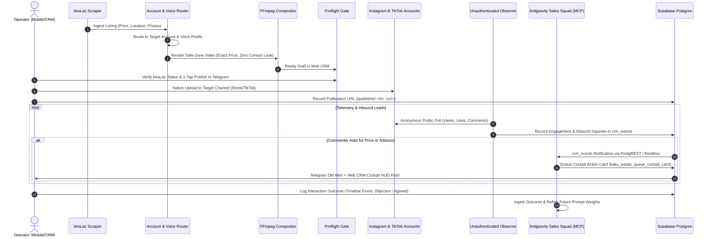
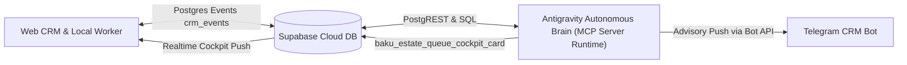

# BakuEstate-AI: Multi-Account Social Distribution, Broker Funnel & Continuous AI Learning Engine

* **Author:** Dəniz & Antigravity
* **Status:** Implemented (In Production)
* **Date:** 2026-11-19

--------------------------------------------------------------------------------

## Overview

This design establishes the end-to-end operational architecture to elevate BakuEstate-AI from a local video generator to an active multi-account social media brokerage engine across Instagram Reels and TikTok.

The system deploys a **zero-upfront permission, curated-funnel model**:
* Listings are ingested from bina.az and rendered at their authentic portal price with identifying building numbers, exact streets, and owner contact details suppressed.
* Cinematic videos drive viewers to comment keywords (e.g., `"EV"`) or submit direct messages (DMs), leveraging native platform engagement algorithms for organic distribution.
* High-intent buyer inquiries are captured into a structured lead pipeline.
* A continuous **AI Learning Engine** (modeled after the Citadel CRM architecture) records buyer and seller timeline events, analyzes win/loss objections, and generates real-time tactical guidance for the operator via an Antigravity multi-agent bridge.

--------------------------------------------------------------------------------

## The Problem

While BakuEstate-AI possesses an automated video rendering engine, pre-flight listing verification, and Web CRM backlog management, it currently lacks an executable go-to-market distribution model for live social media channels:

1. **Permission Paralysis vs. Listing Velocity:** Manually contacting every property owner on bina.az prior to video rendering creates prohibitive administrative latency (hours spent waiting for replies from inactive sellers) and collapses publishing velocity.
2. **Pricing Transparency vs. Lead Capture:** In Baku's real estate market, inflating scraped listing prices alienates buyers who actively cross-reference bina.az. Conversely, displaying exact building addresses and owner contacts in public social posts cuts the operator completely out of the transaction (bypassing broker commission).
3. **Multi-Account Platform Risk:** Operating multiple social media accounts without clear niche separation risks algorithmic duplicate content penalties (shadowbans) across Meta and TikTok.
4. **Lack of Operational Intelligence:** Currently, operator interactions with buyers and sellers exist in an unrecorded vacuum. The system has no mechanism to ingest real-world conversation logs, learn local market objections, and dynamically suggest optimal negotiation tactics.

--------------------------------------------------------------------------------

## Goals

* **Goal 1 (Curated Social Lead Funnel):** Standardize video captions and kinetic CTAs to direct viewers to Instagram/TikTok comments and DMs without inflating portal prices or leaking property location specifics.
* **Goal 2 (Multi-Account Niche Matrix):** Partition public distribution across segmented social channels (e.g., `@bakuestate.premium` for luxury/central properties $\ge \text{250 000 AZN}$ vs. `@baku.serfeli.evler` for budget/mortgage properties $< \text{150 000 AZN}$) with synchronized telemetry in the Web CRM.
* **Goal 3 (Voice Quality Invariance & Deterministic Engines):** Standardize speech synthesis on high-fidelity native Azerbaijani ElevenLabs voice profiles (Arif `ZQJv3hwvRAIC7fvWZ1Qr` for Luxury/General, Ayan `DZaip8UahF0Qri1FxU8M` for Affordable/TikTok) with deterministic fallback cascades to Edge-TTS (`az-AZ-BabekNeural`, `az-AZ-BanuNeural`) and strict phonetic preprocessing (`AZN` $\rightarrow$ `manat`, `m²` $\rightarrow$ `kvadrat metr`).
* **Goal 4 (Citadel-Pattern AI Intelligence Loop):** Introduce a lead timeline and mutation store where operator interactions (buyer calls, seller negotiations, commission agreements) are recorded, and an LLM intelligence engine surfaces automated action cards and objection handling scripts.

--------------------------------------------------------------------------------

## Non-Goals

* **Non-Goal 1 (Physical Showing Automation):** Automating physical on-site apartment showings or complex multi-agent co-brokerage contracts is deferred to future operational iterations. The operator coordinates showings via phone/WhatsApp under a Remote Lead Curation Brokerage model.
* **Non-Goal 2 (Headless Direct Social Posting):** The system will not use unauthorized private Instagram/TikTok APIs to publish videos autonomously; the operator retains native mobile 1-tap publishing to protect account safety.
* **Non-Goal 3 (Automated Bot DMs):** No unauthorized automated outbound messaging directly inside social media apps.

--------------------------------------------------------------------------------

## Critical User Journeys (CUJs)

### CUJ 1: Automated Ingestion, Safe-Zone Compositing, and Multi-Account Publication
1. **Ingestion & Assignment:** The worker scrapes a fresh bina.az listing (e.g., a 240 m² 4-room apartment at 1 000 000 AZN in Sahil). `AccountRouter` deterministically classifies it as `LUXURY`, routing it to `@bakuestate.premium`, selecting ElevenLabs voice profile `Arif` (`ZQJv3hwvRAIC7fvWZ1Qr`), and picking ambient lounge music.
2. **Safe-Zone Rendering:** `ffmpeg_compositor.py` renders a 9:16 vertical video adhering to Reels/TikTok safe margins: kinetic subtitles baseline at $y = 1380$ px (`MarginV=540`), hero price badge centered at $y = 186$ px ($x=80$ px, $w=920$ px, display $\ge 3.2$s), compact watermark pill ($180 \times 40$ px at $x=860, y=24$), and all owner phone numbers purged. The final 4 seconds display a full-screen CTA: *"Dəqiq ünvan, ətraflı video və baxış üçün ŞƏRHƏ 'EV' yazın və ya DM göndərin!"*.
3. **Pre-flight & 1-Tap Handover:** The operator opens the Web CRM, verifies live listing status via residential proxy preflight, and clicks **[ 🚀 Təsdiqlə və Telegram-a Göndər ]**. Telegram delivers the high-bitrate MP4 alongside a 1-tap copyable caption block and direct links.
4. **Mobile Publication:** The operator switches to the target account via isolated Android Work Profile, uploads the reel, pastes the caption, and confirms publication in Telegram via `/published <bina_id> <post_url>`.

### CUJ 2: Inbound Buyer Lead Curation, Cockpit Card Advisory, and Margin Defense
1. **Inbound Inquiry:** A prospective buyer comments *"EV"* and asks for the exact building address on an Instagram Reel.
2. **Event Ingestion:** The unauthenticated observer logs an inquiry event into `public.crm_events`.
3. **Squad Analysis:** The Antigravity autonomous squad processes the event:
   * **Sentinel** verifies that property location specifics remain withheld and flags a 50–100 AZN curation fee protection mandate.
   * **Scribe** drafts a Baku-dialect WhatsApp response: *"Salam! Sahil metrosunun yaxınlığında yerləşən 4 otaqlı mənzilimizlə bağlı yazmısınız. Mənzil tam təmirli və kupçalıdır. Sahibkarla ilkin razılıq əsasında baxış təyin edə bilərik. Zəhmət olmasa zəng üçün uyğun vaxtınızı bildirin."*
   * **Strategist** issues a high-priority **Cockpit Card** in Web CRM and Telegram with 1-click WhatsApp deep links.
4. **Owner Agreement & Handover:** Before disclosing contact details, the operator calls the bina.az property owner using the Strategist Pre-Call Blueprint to lock the referral fee (50–100 AZN). Once secured, the buyer is introduced.
5. **Debrief & Feedback:** The operator sends a 15-second voice note debrief. **Janitor** normalizes phone numbers, transcribes the debrief, and appends the outcome to `public.lead_timeline_events`.

--------------------------------------------------------------------------------

## Technical Plan

### Architecture & End-to-End Data Flow



---

### Operational Isolation & Device Staggering Protocol

To eliminate shadowbans and algorithmic duplicate-content penalties across Meta and TikTok:
1. **Device Isolation:** The operator utilizes Android Work Profiles (or dual-app cloning) to run segmented account sessions without cross-contaminating local device cache or auth cookies.
2. **Network IP Rotation:** Prior to publishing on a different brand handle, the operator cycles the mobile data connection (toggling Airplane Mode for 5 seconds on 4G/5G) to acquire a fresh residential cellular IP address.
3. **Staggered Publishing Interval:** Video releases across the portfolio are separated by a minimum of 90 minutes.

---

### Multi-Account Niche Router (`AccountRouter`)

Listings are deterministically assigned to a dedicated channel niche based on a strict waterfall decision matrix:

1. **Priority 1 (High-Yield Viral Trigger):** If listing is marked urgent or `price_drop_pct >= 10.0%`, assign to `@baku_emlak_ai` (TikTok Viral).
2. **Priority 2 (Price Dominance):**
   * $\ge 250\,000\text{ AZN} \rightarrow$ `@bakuestate.premium` (Luxury / Central)
   * $< 150\,000\text{ AZN} \rightarrow$ `@baku.serfeli.evler` (Affordable / Mortgage)
   * Else $\rightarrow$ `@bakuestate.official` (Mid-Market / General)

| Channel Niche | Target Price Range | Target Locations | Voice Profile & Engine | Musical Style | Target Account |
| :--- | :--- | :--- | :--- | :--- | :--- |
| **Luxury / Central** | $\ge \text{250 000 AZN}$ | Səbail, Nəsimi, Nərimanov, Ağ Şəhər, Bilgəh | ElevenLabs: `Arif` (`ZQJv3hwvRAIC7fvWZ1Qr`) *(Fallback: Edge-TTS Babek)* | `ambient_lounge.mp3` | `@bakuestate.premium` |
| **Affordable / Mortgage** | $< \text{150 000 AZN}$ | Xırdalan, Masazır, Əhmədli, Sabunçu, Hövsan | Edge-TTS: `az-AZ-BanuNeural` *(Fallback: ElevenLabs Female)* | `upbeat_acoustic.mp3` | `@baku.serfeli.evler` |
| **Mid-Market / General** | $150\,000 - 250\,000\text{ AZN}$ | Yasamal, Xətai, Binəqədi, Qara Qarayev | Edge-TTS: `az-AZ-BabekNeural` | `modern_lofi.mp3` | `@bakuestate.official` |
| **TikTok Viral Format** | Any (High-Yield Deals) | All Baku | Edge-TTS: `az-AZ-BanuNeural` (+15% speed) | `viral_bass.mp3` | `@baku_emlak_ai` |

**Database Schema Updates:**
```sql
-- 1. Extend publications with niche and target account
ALTER TABLE public.publications 
  ADD COLUMN IF NOT EXISTS target_account_handle VARCHAR(64) NOT NULL DEFAULT '@bakuestate.official',
  ADD COLUMN IF NOT EXISTS channel_niche VARCHAR(32) NOT NULL DEFAULT 'GENERAL'
    CHECK (channel_niche IN ('LUXURY', 'AFFORDABLE', 'GENERAL', 'TIKTOK'));

-- 2. Refactor unique constraint to allow multi-account distribution per listing
ALTER TABLE public.publications
  DROP CONSTRAINT IF EXISTS publications_listing_id_channel_key;

DO $$ 
BEGIN 
  IF NOT EXISTS (
    SELECT 1 FROM pg_constraint WHERE conname = 'publications_listing_target_account_key'
  ) THEN
    ALTER TABLE public.publications 
      ADD CONSTRAINT publications_listing_target_account_key 
      UNIQUE (listing_id, target_account_handle);
  END IF;
END $$;

-- 3. Extend existing public.cockpit_cards with optional listing_id reference
ALTER TABLE public.cockpit_cards
  ADD COLUMN IF NOT EXISTS listing_id UUID NULL REFERENCES public.listings(id) ON DELETE CASCADE;

-- 4. Create Lead and Operator Timeline Events ledger
CREATE TABLE IF NOT EXISTS public.lead_timeline_events (
  id UUID PRIMARY KEY DEFAULT gen_random_uuid(),
  lead_id UUID NULL REFERENCES public.buyer_leads(id) ON DELETE CASCADE,
  listing_id UUID NULL REFERENCES public.listings(id) ON DELETE SET NULL,
  actor TEXT NOT NULL CHECK (actor IN ('OPERATOR', 'BUYER', 'SELLER', 'AI_SENTINEL', 'AI_SCRIBE', 'AI_STRATEGIST', 'AI_JANITOR')),
  event_type TEXT NOT NULL CHECK (event_type IN ('INQUIRY', 'OBJECTION', 'CALL_LOG', 'OFFER', 'COMMISSION_AGREED', 'SHOWING_SCHEDULED', 'DEAL_CLOSED', 'DEAL_LOST')),
  summary TEXT NOT NULL,
  metadata JSONB NOT NULL DEFAULT '{}'::jsonb,
  created_at TIMESTAMPTZ NOT NULL DEFAULT NOW()
);

CREATE INDEX IF NOT EXISTS idx_timeline_events_lead ON public.lead_timeline_events(lead_id, created_at DESC);
CREATE INDEX IF NOT EXISTS idx_timeline_events_listing ON public.lead_timeline_events(listing_id, created_at DESC);

-- 5. Frictionless RLS and Permissions
GRANT SELECT, INSERT, UPDATE, DELETE ON public.lead_timeline_events TO anon, authenticated, service_role;
ALTER TABLE public.lead_timeline_events ENABLE ROW LEVEL SECURITY;
DROP POLICY IF EXISTS operator_all_timeline ON public.lead_timeline_events;
CREATE POLICY operator_all_timeline ON public.lead_timeline_events FOR ALL TO authenticated, anon USING (true) WITH CHECK (true);
```

---

### Curated Video Funnel & Social Safe-Zone Composition

1. **Reels/TikTok UI Safe Zones:**
   * **Canvas:** $1080 \times 1920$ px ($9:16$).
   * **Top Safe Margin:** $160$ px (header icons & search).
   * **Bottom Safe Margin:** $420$ px (username, caption text, audio title).
   * **Right Margin:** $140$ px (like, comment, share, remix buttons).
   * **Kinetic Subtitle Baseline:** Anchored vertically between $y = 1250$ px and $y = 1420$ px (centered, strictly within the safe viewport).
   * **Hero Badge Positioning:** Centered horizontally at $x = 80$ px, $y = 186$ px ($w = 920$ px, $h = 176$ px).

2. **Purging Owner Contacts & Hardcoded Banners:**
   * In `src/media/glass_badge.py` (`create_cta_badge`), purge all references to `owner_phone` and `"BİRBAŞA SAHİBİNDƏN • KOMİSSİYASIZ"`.
   * In `src/media/ffmpeg_compositor.py`, eliminate the hardcoded bottom contact card filterchain drawing at $y = 1680$ px.

3. **Standardized Engagement Call-to-Action (CTA):**
   * **Video Final Frame (0:26–0:30):** Full-screen animated card:
     > *"Mənzilin dəqiq ünvanı, videosu və ilkin baxış üçün şərhə 'EV' yazın və ya birbaşa DM göndərin!"*
   * **1-Tap Standalone Copyable Caption:**
     > `📍 Nərimanovda, parkın yaxınlığında 3 otaqlı tam təmirli mənzil.`  
     > `💰 Qiymət: 185 000 AZN (Real bazar qiyməti)`  
     > `📐 Sahə: 115 m² | Mərtəbə: 7/14 | Kupça: Var`  
     > `🔑 Dəqiq ünvan, ətraflı video və mənzilə baxış üçün ŞƏRHƏ 'EV' yazın və ya DM göndərin!`  
     > `📞 Əlaqə: +994 50 [YENİ_NÖMRƏ] (WhatsApp aktivdir)`  
     > `#baku #azerbaijan #emlak #evler #binaaz #menzil`

---

### The BakuEstate Autonomous Real Estate Squad (Antigravity Multi-Agent Bridge Architecture)

Rather than treating AI as an isolated, single-turn LLM script, BakuEstate-AI adopts the Citadel Autonomous Squad & Antigravity MCP Bridge architecture (`CITADEL_SALES_SQUAD_SPEC.md` / `CITADEL_BRIDGE_ARCHITECTURE.md`).

Antigravity operates as the master multi-agent intelligence engine, interacting with the BakuEstate Supabase event ledger and Web CRM through the Model Context Protocol (MCP) via dedicated tools (`baku_estate_queue_cockpit_card`, `baku_estate_append_timeline`, `baku_estate_mutate_lead`).

```
┌────────────────────────────────────────────────────────────────────────┐
│            BAKUESTATE AUTONOMOUS REAL ESTATE SQUAD (DÖRD BÖYÜK QÜVVƏ)   │
├──────────────────┬──────────────────┬──────────────────┬───────────────┤
│ 1. SENTINEL      │ 2. SCRIBE        │ 3. STRATEGIST    │ 4. JANITOR    │
│    (Cəllad)      │    (Skriptor)    │    (Şahmatçı)    │    (Dəftərdar)│
├──────────────────┼──────────────────┼──────────────────┼───────────────┤
│ • Time-Waster    │ • 1-Click Baku   │ • 10:00 AM Deal  │ • E.164 Phone │
│   Disqualifier   │   WhatsApp DMs   │   Cockpit Cards  │   Normalizer  │
│ • Address Leak   │ • Azerbaijani    │ • Pre-Call Owner │ • Voice Note  │
│   Blocker        │   Persuasion     │   Blueprint      │   Debriefer   │
│ • Margin & 100₼  │ • Objection      │ • Golden Cat     │ • Timeline    │
│   Shield         │   Battlecards    │   Questions      │   Weaver      │
└──────────────────┴──────────────────┴──────────────────┴───────────────┘
```

#### Autonomous Personas & Operational Mandates:

1. **SENTINEL (Cəllad / Reallıq Müfəttişi):**
   * **Mandate:** Protect operator time and transaction margin. Ruthlessly eliminate time-wasters and disintermediation risks.
   * **Operational Rules:**
     * *Address Leak Guard:* Intercepts any premature disclosure of exact building numbers. Mandates remote lead curation: lock referral fee with property owner before sharing details.
     * *Phantom Lead Killer:* Disqualifies and archives inquiries that only ask "price?" without confirming budget or responding to qualification calls.
     * *Margin & Commission Shield:* Ensures every transaction captures a minimum 50–100 AZN curation fee: *"Heç nə almadan alıcını vermək xeyriyyəçilikdir, biznes deyil!"*.

2. **SCRIBE (Skriptor / Zərbəçi):**
   * **Mandate:** Eliminate operator copy-pasting and messaging overhead.
   * **Operational Rules:**
     * Prepares 1-click WhatsApp (`wa.me`) and Instagram DM responses tailored to Baku real estate vernacular.
     * *Objection Handling:*
       - *"Çox bahadır"* $\rightarrow$ Analytical comparison against recent localized square-meter transactions.
       - *"Təklif göndərin baxarıq"* $\rightarrow$ *"Sabah saat 16:00-da cəmi 10 dəqiqəlik baxış keçirək, realda görmək 100 şəkildən yaxşıdır."*

3. **STRATEGIST (Qrossmeyster / Şahmatçı):**
   * **Mandate:** Plan the daily sales pipeline and craft pre-call blueprints.
   * **Operational Rules:**
     * **10:00 AM Cockpit Curation:** Surfaces the Top 5 highest-probability deal cards in Web CRM and Telegram every morning.
     * **Pre-Call Blueprint:** Delivers a 30-second briefing before dialing a property owner (owner history, portal tenure, price drop history, and 1 Golden Question).

4. **JANITOR (Dəftərdar / Məlumat Nizamlayıcısı):**
   * **Mandate:** Maintain data cleanliness and process voice debriefs.
   * **Operational Rules:**
     * Normalizes all captured telephone numbers into standard E.164 format (`+994...`).
     * Ingests operator post-call voice debriefs, extracting deal milestones, agreed fees, and scheduled viewings into `public.lead_timeline_events`.

---

### Antigravity MCP Bridge Topology



--------------------------------------------------------------------------------

## Alternatives Considered

### Upfront Artificial Price Mark-Up
* **Description:** Inflate the scraped bina.az price by 5,000–10,000 AZN on video overlays to capture an embedded margin.
* **Pros:** Guarantees gross profit margin if an uneducated buyer purchases at the marked-up price.
* **Cons:** Baku buyers routinely cross-reference bina.az. Price discrepancies immediately destroy credibility, flag the account as a predatory intermediary, and incentivize buyers to find the original listing to bypass the broker.
* **Verdict:** Rejected in favor of authentic portal pricing combined with property address concealment.

### Upfront Cold Permission Messaging to Every bina.az Owner
* **Description:** Before rendering a video, require the operator to message each owner via WhatsApp and wait for written consent.
* **Pros:** Ensures 100% upfront contractual clarity.
* **Cons:** Severe administrative drag. Hours spent waiting for unresponsive sellers (many units are already rented or sold) completely paralyzes publishing velocity.
* **Verdict:** Rejected in favor of zero-upfront permission rendering and reactive owner outreach only when a qualified buyer inquiry is captured.

### Single Monolithic Social Account
* **Description:** Publish all scraped properties (from 60,000 AZN suburban walk-ups to 1,500,000 AZN penthouses) to a single Instagram page.
* **Pros:** Lowest operational overhead (one account to manage).
* **Cons:** Confuses recommendation algorithms and dilutes audience demographics. High-net-worth buyers unfollow accounts that spam budget walk-ups, while budget buyers are alienated by luxury penthouses.
* **Verdict:** Rejected in favor of segmented niche channels (`@bakuestate.premium` vs `@baku.serfeli.evler`).

### Identical Cross-Posting Across Multiple Accounts
* **Description:** Upload the exact same rendered video file simultaneously to 3–4 accounts from one mobile device.
* **Pros:** Maximum volume with minimal render compute.
* **Cons:** Meta and TikTok perceptual hashing flags duplicate video uploads from identical device/IP clusters as spam farms, resulting in immediate organic reach suppression (shadowbans).
* **Verdict:** Rejected in favor of deterministic niche routing where each property is rendered uniquely for its designated target channel.

--------------------------------------------------------------------------------

## Non-Functional Requirements

1. **Security & PII Isolation:** Property owner telephone numbers and building numbers must never appear in rendered video frames, audio speech, or public social captions.
2. **Audio Performance & Quality:** Speech synthesis must complete within $\le 5$ seconds per 30-second script. Audio background music must duck cleanly by $-18\text{ dB}$ beneath speech tracks with $1.5\text{s}$ fade-in/fade-out ramps.
3. **Sub-Second Preflight Gate:** Verification checks against bina.az via residential proxies must complete within $\le 3000\text{ ms}$, failing closed if status or price changes.
4. **Rollback & Failure Recovery:** If ElevenLabs TTS fails due to quota limits (HTTP 401/429), the rendering pipeline must fall back immediately to Microsoft Edge-TTS without dropping the render job.

--------------------------------------------------------------------------------

## Open Questions

1. **Multi-SIM Mobile Device Setup:** Will the operator manage all 4 accounts on a single dual-SIM smartphone using Android Work Profiles, or deploy secondary dedicated hardware? *(Recommended: Single smartphone with Android Work Profiles and 4G cellular IP cycling).*
2. **Commission Fee Agreement Mechanics:** Should the 50–100 AZN referral fee with the property owner be formalized via standard digital WhatsApp confirmation text or recorded phone consent? *(Recommended: Standardized WhatsApp confirmation card dispatched via Scribe).*

--------------------------------------------------------------------------------

## Detailed Implementation Plan

The implementation is executed as a unified engineering phase touching database schemas, video compositing safe zones, TTS phonetics, AI advisory engines, and Web CRM operator interfaces.

### Target Files to Create/Modify

#### `supabase/migrations/202611190003_multi_account_and_ai_advisor.sql`
* **Type:** New Database Migration
* **Rationale:** Extends `public.publications` with `target_account_handle` and `channel_niche`, refactors unique constraints to `(listing_id, target_account_handle)`, extends existing `public.cockpit_cards` with `listing_id`, and creates `public.lead_timeline_events`.

#### `src/cloud/supabase_repo.py`
* **Type:** Repository Extension
* **Rationale:** Adds data access methods:
  * `append_lead_timeline_event(lead_id, listing_id, actor, event_type, summary, metadata)`
  * `queue_cockpit_card(lead_id, listing_id, channel, priority, headline, draft_text, target_uri, strategic_rationale)`
  * `get_pending_cockpit_cards(limit=10)`
  * `update_cockpit_card_status(card_id, status)`
  * Updates `create_or_update_publication()` to persist `target_account_handle` and `channel_niche`.

#### `src/worker/account_router.py`
* **Type:** New Worker Module
* **Rationale:** Implements deterministic waterfall assignment logic (`route_listing_to_channel`) mapping listing price, location, and urgency to target brand handles, voice engines, voice IDs, and background music tracks (`ambient_lounge.mp3`, `upbeat_acoustic.mp3`, `modern_lofi.mp3`, `viral_bass.mp3`).

#### `src/worker/local_worker.py`
* **Type:** Core Worker Pipeline Update
* **Rationale:** Integrates `AccountRouter` into the rendering pipeline so that each render job receives its designated niche parameters, persisting channel metadata into `render_versions.ab_metadata` and `publications`.

#### `src/media/ffmpeg_compositor.py`
* **Type:** Compositor Safe-Zone Update
* **Rationale:** Eliminates the hardcoded bottom contact card filterchain at $y = 1680$ px. Purges all references to `owner_phone`. Calibrates kinetic subtitle baselines to $y \in [1250, 1420]$ px and adds background music missing-file fallback to `luxury_beat.mp3`.

#### `src/media/glass_badge.py`
* **Type:** Badge Overlay Update
* **Rationale:** In `create_cta_badge`, replaces the owner phone number and `"BİRBAŞA SAHİBİNDƏN"` text with the standardized kinetic CTA (`"DƏQİQ ÜNVAN VƏ BAXIŞ ÜÇÜN ŞƏRHƏ 'EV' YAZIN"`). Centers hero badge at $x = 80$ px, $y = 186$ px.

#### `src/media/tts_service.py` & `src/media/elevenlabs_tts.py`
* **Type:** Speech Engine Updates
* **Rationale:** Enhances `normalize_azerbaijani_phonetics()` to verbalize floor fractions into full Azerbaijani words (e.g. `4/9` $\rightarrow$ `doqquz mərtəbəli binanın dördüncü mərtəbəsində`). Implements ElevenLabs voice ID mapping for `Arif` (`ZQJv3hwvRAIC7fvWZ1Qr`) with automatic fallback to Edge-TTS (`az-AZ-BabekNeural`) on quota limits.

#### `src/mcp/baku_estate_mcp_server.py` & `src/ai/squad_orchestrator.py`
* **Type:** Antigravity Squad Engine & MCP Server
* **Rationale:** Exposes MCP tools (`baku_estate_queue_cockpit_card`, `baku_estate_append_timeline`, `baku_estate_mutate_lead`) with full support for `listing_id`, `bina_id`, and default `owner_id` resolution. Implements the 4 autonomous personas (Sentinel, Scribe, Strategist, Janitor).

#### `src/dispatcher/telegram_crm.py` & `src/dispatcher/telegram_bot_service.py`
* **Type:** Dispatcher Updates
* **Rationale:** Surfaces high-priority Cockpit Cards into Telegram with interactive callback buttons (`cockpit_act_{card_id}`, `cockpit_dismiss_{card_id}`).

#### `supabase/functions/telegram-webhook/index.ts`
* **Type:** Edge Function Callback Handler
* **Rationale:** Handles 24/7 Telegram button callbacks for Cockpit Card actions even when the local Windows worker is offline.

#### `web/lib/types.ts`
* **Type:** TypeScript Interface Definitions
* **Rationale:** Adds interfaces for `ChannelNiche`, `CockpitCard`, and `LeadTimelineEvent`.

#### `web/components/ListingsClient.tsx`
* **Type:** Web CRM Backlog Component Update
* **Rationale:** Preserves top-level lifecycle filter tabs (`ALL`, `DRAFTS`, `PUBLISHED`) while adding a secondary pill row for channel niche filtering (`[💎 Premium]`, `[🏠 Sərfəli]`, `[🏢 Rəsmi]`, `[🔥 Viral]`).

#### `web/components/CockpitCardHUD.tsx` & `web/components/AppShell.tsx`
* **Type:** Web CRM HUD Components
* **Rationale:** Displays live AI negotiation advice and tactical action cards in the Web CRM sidebar with 1-click execution.

---

### Verification Plan

1. **Compilation & Static Analysis:**
   * Python syntax check across all modified modules: `flake8` / `mypy`.
   * Web CRM TypeScript build verification: `npm run build` in `web/` with 0 type errors.
2. **Automated Unit & Regression Tests:**
   * Run new test suite: `pytest tests/test_multi_account_and_advisor.py -v`.
   * Run full existing test suite: `pytest tests/ -v` (confirming all $\ge 221$ existing tests pass with 0 regressions).
3. **Visual Safe-Zone Verification:**
   * Render test video clip through `run_pipeline.py` and inspect extracted frame coordinates at $t = 5\text{s}$, $t = 15\text{s}$, and $t = 28\text{s}$ to verify complete compliance with Reels/TikTok safe margins and confirm 0 phone number leaks.

--------------------------------------------------------------------------------

*Drafted with EGM*
