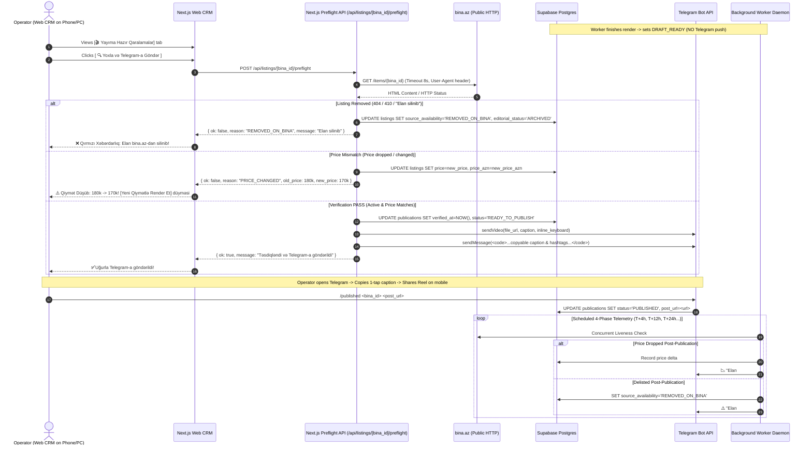

# Pre-Flight Verification Gate & Selective Publishing Lifecycle

*   **Author:** fxbluster
*   **Status:** Implemented (In Production)
*   **Date:** 2026-11-19

--------------------------------------------------------------------------------

## Overview

BakuEstate-AI currently dispatches every rendered real estate video directly to Telegram upon FFmpeg completion. In an automated scraping environment with dozens of active listings, this produces notification spam and forces the operator to manually cross-check whether an apartment's price has changed or if it has been delisted on bina.az prior to sharing. This design replaces automatic Telegram dispatch with a Web CRM-driven, on-demand pre-flight verification gate and introduces continuous post-publication liveness monitoring. Videos remain in Web CRM as drafts until the operator explicitly requests to publish; the system then runs a real-time liveness and price check against bina.az, dispatches the video and one-tap copyable caption to Telegram only upon passing verification, and monitors live posts for price drops or deactivations.

## The Problem

1.  **Telegram Channel Clutter & Notification Fatigue:** The worker daemon automatically pushes every rendered video (`RENDER_INITIAL` or `RENDER_PRICE_DROP`) to the operator's personal Telegram chat immediately. When multiple listings are processed in batch (e.g. 13+ draft videos), the chat becomes cluttered, making it difficult to distinguish unshared drafts from active discussions and customer lead alerts.
2.  **Stale Price & Delisted Apartment Publishing Risk:** Real estate prices on portals fluctuate rapidly, and properties frequently sell or get removed without notice. If an operator publishes a video rendered 24–72 hours prior without verifying current portal status, they risk advertising an outdated price (e.g. video shows 180,000 AZN, but owner dropped to 170,000 AZN) or marketing a property that is already off-market.
3.  **Manual Verification Burden:** Operators currently have no automated pre-publish sanity check. Verifying each apartment requires manually opening the bina.az URL in a browser, comparing prices, and checking active listing banners.
4.  **Absence of Post-Publication Monitoring:** Once a video is shared on Instagram or TikTok, the system previously tracked social metrics (views, likes, comments) but did not detect if the underlying apartment was subsequently sold or dropped in price, missing critical opportunities to update comments or produce follow-up price-drop assets.

## Goals

*   **Goal 1 (Silent Video Staging in Web CRM):** Stop automated Telegram dispatch upon render completion. Store all completed videos silently in Web CRM under `[🎬 Yayıma Hazır Qaralamalar]` with status `DRAFT_READY`.
*   **Goal 2 (Real-Time Pre-Flight Verification Gate):** Add an on-demand verification action in Web CRM (`[ 🔍 Yoxla və Telegram-a Göndər ]`). When triggered, execute an immediate real-time HTTP check against `bina.az/{bina_id}` to verify:
    *   Listing liveness (active vs `REMOVED_ON_BINA`).
    *   Price consistency (current portal AZN price vs rendered video price).
*   **Goal 3 (Conditional Verified Telegram Dispatch):** If pre-flight check passes:
    *   Promote listing state to `READY_TO_PUBLISH`.
    *   Dispatch the video file and a structured copyable caption block (title, price, room count, area, contact info, and curated real estate hashtags) directly to Telegram.
*   **Goal 4 (Price Drop & Delisting Guards):** If pre-flight check detects a price decrease:
    *   Block Telegram dispatch of the obsolete video.
    *   Display a warning in Web CRM showing the price delta and provide a 1-click action to enqueue an automated `RENDER_PRICE_DROP` job.
    *   If delisted on bina.az, flag as `REMOVED_ON_BINA` and prevent publication.
*   **Goal 5 (Post-Publish Price & Liveness Monitor):** Integrate portal liveness checks into the scheduled 4-phase telemetry sync jobs. If a published post's underlying listing drops in price or sells on bina.az, dispatch an urgent Telegram alert to the operator recommending a pinned comment update or follow-up video.

## Non-Goals

*   **Non-Goal 1 (Direct Automated Social Posting):** The system will not automatically post videos to Instagram or TikTok. The human operator retains full control over mobile publishing to protect organic reach.
*   **Non-Goal 2 (Automated Social Media Post Deletion):** If an apartment sells on bina.az, the system will not attempt to delete live Instagram Reels or TikTok videos (Meta/TikTok API restrictions and loss of organic account metrics).
*   **Non-Goal 3 (External Real Estate Portals):** Pre-flight checks apply strictly to `bina.az` listings; auxiliary portals are out of scope.

## Open Questions

*   **Question 1 (Pre-Flight Caching):** Should a successful pre-flight check result be cached for 5 minutes in Redis/database to prevent repeated scraping if the operator clicks the button multiple times within seconds?
    *   **Resolution:** Resolved. No caching layer was implemented. A real-time direct HTTP check (`https://bina.az/items/{bina_id}`) with an 8-second timeout is executed on each operator click without caching to guarantee 100% price freshness and prevent stale price disclosures.
*   **Question 2 (Caption Format Options):** Should the Web CRM allow selecting between a short TikTok-optimized caption (<150 chars) and an extended Instagram-optimized caption with full specifications before Telegram dispatch?
    *   **Resolution:** Resolved. Rather than offering a multi-option modal selector, a single unified, high-conversion structured caption block enclosed inside `<code>...</code>` with full listing metadata, kupcha status, owner contact info, and curated real estate hashtags was implemented for 1-tap mobile clipboard copying directly into any social platform.

## Critical User Journeys (CUJs)

### CUJ 1: Operator Verifies & Dispatches a Ready Draft
*   **Given**: Listing `#5616503` is rendered and listed under `[🎬 Yayıma Hazır Qaralamalar]` in Web CRM.
*   **When**: Operator reviews the video player, likes the output, and clicks `[ 🔍 Yoxla və Telegram-a Göndər ]`.
*   **Then**: Web CRM invokes the pre-flight verification endpoint. The worker checks `bina.az/items/5616503`. The listing is active and price matches 185,000 AZN. The server responds with verification `PASS`, dispatches the video and copyable caption to Telegram, and displays a green notification in Web CRM: *"Təsdiqləndi: Telegram-a göndərildi."*

### CUJ 2: Pre-Flight Check Blocks Stale Price
*   **Given**: Listing `#5966276` was rendered 48 hours ago at 210,000 AZN. The owner recently reduced the price on bina.az to 195,000 AZN.
*   **When**: Operator clicks `[ 🔍 Yoxla və Telegram-a Göndər ]`.
*   **Then**: The pre-flight check detects a price mismatch (Portal: 195,000 AZN vs Video: 210,000 AZN). Telegram dispatch is blocked. Web CRM surfaces an alert modal: *"⚠️ Qiymət dəyişib: 210,000 AZN -> 195,000 AZN. Köhnə qiymətli videonun paylaşılması dayandırıldı."* with a 1-click button `[ 🎬 Yeni Qiymətlə Render Et ]`.

### CUJ 3: Post-Publish Price Drop Alert
*   **Given**: Listing `#6506576` is published on Instagram Reels and tracked in Phase 2 telemetry.
*   **When**: The scheduled worker executes `SYNC_SOCIAL_METRICS` at T+36h and performs the concurrent liveness check.
*   **Then**: The worker detects that bina.az price dropped from 140,000 to 132,000 AZN. The worker updates the database, updates the listing's normalized price, and sends a Telegram alert card: *"📉 Elan #6506576 qiyməti endi (140,000 -> 132,000 AZN). Paylaşılmış videonun rəylərində endirimi qeyd edin və ya yeni video hazırlayaq."*

--------------------------------------------------------------------------------

## Technical Plan (Architecture)

### Architectural Overview & Data Flow



### 1. Database Schema Additions (`supabase/migrations/202611190002_preflight_and_selective_publish.sql`)

```sql
-- 1. Extend publications table with preflight verification timestamps and ready state
ALTER TABLE public.publications DROP CONSTRAINT IF EXISTS publications_status_check;
ALTER TABLE public.publications ADD CONSTRAINT publications_status_check
  CHECK (status IN ('DRAFT', 'DRAFT_READY', 'READY_TO_PUBLISH', 'PUBLISHED', 'ARCHIVED', 'REMOVED'));

ALTER TABLE public.publications
  ADD COLUMN IF NOT EXISTS verified_at TIMESTAMPTZ NULL,
  ADD COLUMN IF NOT EXISTS preflight_status TEXT NOT NULL DEFAULT 'UNCHECKED'
    CHECK (preflight_status IN ('UNCHECKED', 'PASSED', 'PRICE_MISMATCH', 'REMOVED_ON_BINA')),
  ADD COLUMN IF NOT EXISTS last_preflight_error TEXT NULL,
  ADD COLUMN IF NOT EXISTS telegram_dispatched_at TIMESTAMPTZ NULL,
  ADD COLUMN IF NOT EXISTS telegram_message_id INT NULL;

-- 2. Extend render_versions with rendered pricing metadata for strict equality assertion
ALTER TABLE public.render_versions
  ADD COLUMN IF NOT EXISTS rendered_price NUMERIC NULL,
  ADD COLUMN IF NOT EXISTS rendered_currency TEXT NOT NULL DEFAULT 'AZN';

-- 3. Preflight check audit log table
CREATE TABLE IF NOT EXISTS public.preflight_checks (
  id UUID PRIMARY KEY DEFAULT gen_random_uuid(),
  listing_id UUID NOT NULL REFERENCES public.listings(id) ON DELETE CASCADE,
  bina_id INT NOT NULL,
  result TEXT NOT NULL CHECK (result IN ('PASSED', 'PRICE_CHANGED', 'REMOVED_ON_BINA', 'SCRAPE_ERROR')),
  portal_price NUMERIC NULL,
  video_price NUMERIC NULL,
  price_delta_pct REAL NULL,
  response_time_ms INT NULL,
  checked_at TIMESTAMPTZ NOT NULL DEFAULT NOW()
);

CREATE INDEX IF NOT EXISTS idx_preflight_checks_listing
  ON public.preflight_checks (listing_id, checked_at DESC);

-- Grants
GRANT SELECT, INSERT, UPDATE, DELETE ON public.preflight_checks TO anon, authenticated, service_role;
```

### 2. Pre-Flight Verification Service & API Route

1.  **Endpoint**: `web/app/api/listings/[bina_id]/preflight/route.ts` (Next.js App Router POST handler)
2.  **Request Body**:
    ```json
    {
      "listing_id": "<uuid>",
      "render_version_id": "<uuid>",
      "dispatch_to_telegram": true
    }
    ```
3.  **Real-Time Portal Scraper Logic**:
    *   Constructs canonical target: `https://bina.az/items/{bina_id}`.
    *   Performs HTTP GET with a 8-second timeout and realistic desktop/mobile User-Agent.
    *   **Liveness Check**:
        *   If HTTP `404` or `410`: marks `REMOVED_ON_BINA`.
        *   If HTML contains `<div class="item_status_deleted">` or `"Bu elan artıq aktiv deyil"`: marks `REMOVED_ON_BINA`.
    *   **Price Extraction**:
        *   Extracts `.price-val` and currency unit.
        *   Parses numeric integer value (e.g. `185 000` -> `185000`).
        *   Compares against `render_versions.rendered_price` (or listing `price_azn`).
        *   If delta $|P_{\text{portal}} - P_{\text{video}}| \ge 1.0\text{ AZN}$: flags `PRICE_CHANGED`.
4.  **Telegram Dispatcher Payload (Executed only on `PASSED`)**:
    *   **Message 1 (Video File)**:
        *   Dispatches MP4 with action buttons:
            `[ 🚀 Paylaş & Link Daxil Et ]` | `[ 📱 Sahibinə WhatsApp ]`
    *   **Message 2 (1-Tap Copyable Caption)**:
        *   Delivered inside Markdown code block `<code>...</code>` so the operator can tap once on mobile to copy all text to clipboard:
        ```text
        📍 Şəhərin Mərkəzində Kupçalı 3 Otaqlı Mənzil!
        
        💰 Qiymət: 185,000 AZN
        📐 Sahə: 115 m²
        🏢 Mərtəbə: 7 / 16
        📄 Sənəd: Çıxarış (Kupça)
        
        Mənzil əla təmirlidir, geniş otaqları və şəhərə mənzərəsi var. Bütün infrastruktur yaxınlıqdadır.
        
        📞 Əlaqə & Ətraflı Məlumat: +994 50 200 21 69
        
        #baku #azerbaijan #emlak #binaaz #dasinmazemlak #menzil #evler #bakuapartments
        ```

### 3. Worker Daemon Decoupling (`src/worker/local_worker.py`)

1.  **Silent Render Completion**:
    *   In `_handle_render_initial` and `_handle_render_price_drop`, remove automatic call to `self.telegram.dispatch_video_lead()`.
    *   Insert `publications` row with `status='DRAFT_READY'`, `preflight_status='UNCHECKED'`.
    *   Record `rendered_price = listing['price']` in `render_versions.rendered_price`.
    *   Result: Completed videos appear instantly in Web CRM without generating any Telegram notifications.
2.  **Post-Publication Concurrent Liveness Monitor**:
    *   In `_handle_sync_social_metrics(job)`:
        *   Before querying social metrics, invoke `liveness_check(listing['bina_id'])`.
        *   If `REMOVED_ON_BINA`: update `listings.source_availability = 'REMOVED_ON_BINA'`, alert Telegram:
            `"⚠️ Diqqət: #<bina_id> nömrəli elan bina.az-dan silinib (satılıb). Instagram/TikTok-dan gələn müştərilərə alternativ təklif edin."`
        *   If `PRICE_DROPPED`: update `listings.price` and alert Telegram:
            `"📉 Diqqət: #<bina_id> nömrəli elanın qiyməti endi (<old> -> <new> AZN). Postun şərhində qiymət endirimini qeyd edin və ya yeni video hazırlayın."`

### 4. Web CRM UI Integration

1.  **`[🎬 Yayıma Hazır Qaralamalar]` Tab Enhancement**:
    *   Each card features a prominent blue action button:
        **`[ 🔍 Yoxla və Telegram-a Göndər ]`**
    *   Next to it: Owner phone pill with 1-click WhatsApp launcher `wa.me/994...`.
2.  **Pre-Flight Interactive Modal (`PreflightModal.tsx`)**:
    *   **State 1 (Checking)**: Displays spinner *"bina.az-da elanın statusu və qiyməti yoxlanılır..."*.
    *   **State 2 (Success)**: Green checkmark *"✅ Elan aktivdir və qiymət dəqiqdir. Video və kopyalanan mətn Telegram-a göndərildi."*
    *   **State 3 (Price Mismatch)**: Amber warning *"⚠️ Qiymət dəyişib: <old> AZN -> <new> AZN (-<delta>%). Videoda köhnə qiymət qalıb."* with 1-click button `[ 🎬 Yeni Qiymətlə Render Növbəsinə Sal ]`.
    *   **State 4 (Delisted)**: Red error *"❌ Bu elan artıq bina.az-da aktiv deyil (silinib və ya satılıb). Paylaşılması dayandırıldı."*

--------------------------------------------------------------------------------

## Alternatives Considered

### Alternative A: Continuous Periodic Polling of All Backlog Drafts (<15m intervals)

*   **Pros**: Every draft in Web CRM would perpetually reflect up-to-the-minute portal status without user action.
*   **Cons**: Drastically increases scraper traffic against bina.az (e.g. 50 drafts $\times$ 4 scrapes/hr = 200 scrapes/hr), rapidly triggering HTTP 429 rate limits, IP blocks, or CAPTCHA challenges on the host machine.
*   **Reason for Rejection**: Rejected by author: Wasteful scrape footprint and heightened anti-bot risk. A synchronous, on-demand pre-flight check triggers only when the operator actively decides to publish a specific apartment, keeping portal requests near zero.

### Alternative B: Asynchronous Worker Job Queue for Pre-Flight Verification

*   **Pros**: Keeps Next.js API route completely decoupled from external HTTP web scraping.
*   **Cons**: Introduces 5–15 seconds of polling latency while the operator waits for the background worker daemon to claim the job and report results back via database subscriptions.
*   **Reason for Rejection**: Rejected by author: Unacceptable UX delay. A direct HTTP request to bina.az completes in $< 1.5\text{ seconds}$; handling it synchronously in the Next.js API route delivers instantaneous feedback directly to the operator's browser modal.

### Alternative C: Retaining Automated Telegram Push with a "Revoke / Delete" Callback

*   **Pros**: Minimizes changes to the existing background video compositing pipeline.
*   **Cons**: Continues to spam the operator's Telegram feed with 10–20 large video files daily; revoking or deleting messages does not prevent mobile notification fatigue.
*   **Reason for Rejection**: Rejected by author: Fails to address the core ergonomics problem. Telegram must serve exclusively as a high-intent delivery channel for confirmed, actionable posts and inbound client leads.

--------------------------------------------------------------------------------

## Non-Functional Requirements

### Security & Privacy
*   **Internal Operator Access**: Pre-flight verification endpoint (`/api/listings/[bina_id]/preflight`) is secured by operator authentication or local loopback origin checks.
*   **SSRF Protection**: Target URL strictly interpolates sanitized numeric integer `bina_id` into canonical base `https://bina.az/items/{bina_id}`. Arbitrary URLs or redirects are rejected.

### Performance & Latency
*   **Pre-Flight Verification SLA**: The portal check and response must return to the Web CRM modal in $\le 2.0\text{ seconds}$ under normal network conditions (8.0s hard timeout).
*   **Telegram Media Dispatch**: Telegram video and caption transmission occurs asynchronously after verification validation passes, responding to the UI within $< 2.5\text{ seconds}$.

### Rollout & Rollback
*   **Backward Compatibility**: The migration is non-destructive and additive (`ADD COLUMN IF NOT EXISTS`).
*   **Feature Flag / Fallback**: If bina.az introduces transient anti-bot challenges during pre-flight, the modal surfaces an override option: *"⚠️ Portal yoxlanışı cavab vermədi. Yenə də Telegram-a göndərilsin?"* ensuring operator is never permanently blocked.

--------------------------------------------------------------------------------

## Detailed Implementation Plan

### Target Files to Create / Modify

#### 1. `supabase/migrations/202611190002_preflight_and_selective_publish.sql` (Create)
*   **Type / Scope**: Database Migration (PostgreSQL DDL)
*   **Proposed Changes**:
    *   Alter `public.publications`: add `verified_at` (timestamptz), `preflight_status` (text check in `'UNCHECKED'`, `'PASSED'`, `'PRICE_MISMATCH'`, `'REMOVED_ON_BINA'`), `last_preflight_error` (text), `telegram_dispatched_at` (timestamptz), and `telegram_message_id` (int). Extend `publications_status_check` constraint to support `'READY_TO_PUBLISH'`.
    *   Alter `public.render_versions`: add `rendered_price` (numeric) and `rendered_currency` (text default `'AZN'`).
    *   Create `public.preflight_checks` audit table: tracks every check attempt with `listing_id`, `bina_id`, `result`, `portal_price`, `video_price`, `price_delta_pct`, `response_time_ms`, and `checked_at`.
    *   Grant full DML permissions on new objects to `anon`, `authenticated`, and `service_role`.

#### 2. `src/worker/local_worker.py` (Modify)
*   **Type / Scope**: Python Background Worker Daemon
*   **Proposed Changes**:
    *   In `_handle_render_initial` and `_handle_render_price_drop`: remove automatic `self.telegram.dispatch_video_lead()`. Set publication `status = 'DRAFT_READY'`, `preflight_status = 'UNCHECKED'`. Record `rendered_price = listing['price']` in `render_versions`.
    *   In `_handle_sync_social_metrics`: before scraping social metrics, perform a concurrent portal liveness check via `bina_scraper.check_liveness()`. If `PRICE_DROPPED`, dispatch an immediate Telegram price-drop alert card. If `REMOVED_ON_BINA`, update `listings.source_availability = 'REMOVED_ON_BINA'` and notify operator.

#### 3. `web/app/api/listings/[bina_id]/preflight/route.ts` (Create)
*   **Type / Scope**: Next.js Server-Side Route Handler (TypeScript)
*   **Proposed Changes**:
    *   Accept POST requests with `listing_id` and `render_version_id`.
    *   Fetch `https://bina.az/items/{bina_id}` with 8-second timeout.
    *   Parse HTML for deactivation banners (`.item_status_deleted`, HTTP 404/410).
    *   Extract numeric portal price from `.price-val`.
    *   Compare against `render_versions.rendered_price`.
    *   If PASSED and `dispatch_to_telegram: true`:
        *   Call Telegram Bot API `sendVideo` with MP4 video and inline buttons.
        *   Call Telegram Bot API `sendMessage` with formatted `<code>...</code>` 1-tap copyable caption block.
        *   Update `publications` record to `status='READY_TO_PUBLISH'`, `verified_at=NOW()`.
        *   Log entry in `public.preflight_checks`.
    *   Return JSON response with verification status, delta, and Telegram dispatch result.

#### 4. `web/components/PreflightModal.tsx` (Create)
*   **Type / Scope**: Next.js Interactive Client Component (React / Tailwind)
*   **Proposed Changes**:
    *   Render an accessible modal with real-time state machine:
        *   `CHECKING`: Animated loading spinner with status text.
        *   `PASSED`: Green success badge, confirmation of Telegram dispatch, and direct link to Telegram.
        *   `PRICE_CHANGED`: Amber badge showing old price vs new price, delta percentage, and a `[ 🎬 Yeni Qiymətlə Render Növbəsinə Sal ]` button that enqueues a `RENDER_PRICE_DROP` job.
        *   `REMOVED_ON_BINA`: Red badge notifying that the property is delisted or sold on bina.az, preventing accidental social publication.

#### 5. `web/components/ListingsClient.tsx` (Modify)
*   **Type / Scope**: Next.js Listings Registry UI
*   **Proposed Changes**:
    *   In the `[🎬 Yayıma Hazır Qaralamalar]` tab cards:
        *   Add prominent **`[ 🔍 Yoxla və Telegram-a Göndər ]`** button opening `PreflightModal`.
        *   Display owner phone pill with 1-click WhatsApp launcher (`wa.me/994...`) so operator can verify directly with owner if needed.
        *   Display badge indicating if draft has been verified previously (`Yoxlanılıb` vs `Yoxlanılmayıb`).

#### 6. `tests/test_preflight_selective_publish.py` (Create)
*   **Type / Scope**: Python Unit & Integration Test Suite
*   **Proposed Changes**:
    *   Test worker silent staging: verify `_handle_render_initial` creates `DRAFT_READY` without calling Telegram dispatcher.
    *   Test price equality comparison logic (exact match, delta within noise threshold, price decrease, price increase).
    *   Test HTML parser extraction of bina.az price and delisting banners.
    *   Test post-publish liveness monitor in `_handle_sync_social_metrics`.

### Verification Plan

*   **Database Migration**: Apply `202611190002_preflight_and_selective_publish.sql` to Supabase and verify column additions and constraints.
*   **Python Test Suite**: `python -m unittest discover -s tests` passes 100% (204 existing + 10+ new tests = 214+ tests passing, 0 failures, 0 errors).
*   **Next.js Web Build**: `npm run build` inside `web/` completes with 0 TypeScript/ESLint errors and successfully compiles the `/api/listings/[bina_id]/preflight` route.
*   **E2E Workflow Validation (CUJ 1–3)**:
    1.  Render listing -> verify video appears in `[🎬 Qaralamalar]` and Telegram received 0 automatic messages.
    2.  Click `[ 🔍 Yoxla və Telegram-a Göndər ]` -> verify live HTTP check against bina.az executes in <2s.
    3.  On pass -> verify Telegram receives video and 1-tap `<code>...</code>` copyable caption block.
    4.  Simulate price drop -> verify modal blocks dispatch and offers 1-click re-render.

--------------------------------------------------------------------------------

<!-- Provenance: Indicates initial structural drafting via EGM. -->

*Drafted with EGM*
