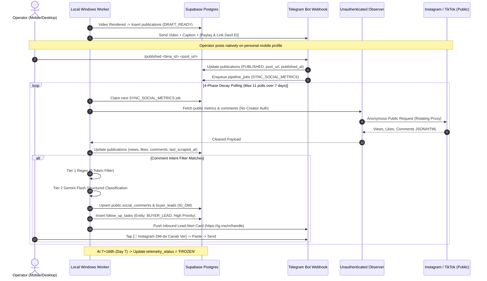

# Social Lifecycle, Publication Tracking & Audience Intelligence

*   **Author:** fxbluster
*   **Status:** Implemented (In Production)
*   **Date:** 2026-11-18

--------------------------------------------------------------------------------

## Overview

BakuEstate-AI is currently an autonomous real estate scraping, video production, and CRM dispatch engine. This feature introduces end-to-end lifecycle governance for generated social media assets. It decouples video rendering (`DRAFT_READY`) from public social distribution (`PUBLISHED`), tracks public organic performance metrics (views, likes, comments) on Instagram Reels and TikTok without risking creator account bans, converts viewer inquiries into qualified CRM buyer leads with instant Telegram DM action cards, and establishes a normalized A/B learning loop to optimize video hooks and durations.

## The Problem

1.  **Conflation of Video Generation and Social Distribution:** Currently, the system treats all rendered videos as active listing assets immediately upon FFmpeg completion. An operator running the engine has 14 rendered videos in local/cloud storage, but 0 are circulating publicly. The CRM dashboard lacks a state boundary separating backlog drafts from live published posts.
2.  **Siloed Inbound Social Inquiries:** When videos are shared on Instagram or TikTok, viewers comment asking for prices, locations, or financing terms ("qiyməti nə qədərdir?", "hardadır?", "kreditlə olar?"). These inquiries remain isolated inside social app notification feeds. The operator must manually transcribe commenter handles, identify the relevant listing, and craft manual responses.
3.  **Account Ban Risk on Automation:** Traditional social CRM tools rely on scraping with authenticated account cookies or rigid Meta Business API integrations. Authenticated scraping triggers Meta account checkpoints (`challenge_required`) and suppresses organic algorithmic reach on personal creator accounts, while Meta Business verification is administratively prohibitive for a solo operator.
4.  **Static Creative Generation Without Market Feedback:** Video scripts, duration targets, and opening hooks are static templates. The engine has no feedback loop to learn whether a price-first hook or a location-first hook drives higher lead conversion density.

## Goals

*   **Goal 1 (Explicit Publication Lifecycle):** Decouple render completion (`DRAFT_READY`) from verified social distribution (`PUBLISHED`) across the database schema, Telegram bot callbacks, and Web CRM segmented views (`[Bütün Elanlar]`, `[🎬 Qaralamalar]`, `[🚀 Paylaşılanlar]`).
*   **Goal 2 (Zero-Credential Anti-Ban Telemetry):** Ingest public view counts, like counts, and comments for operator-submitted post URLs using an unauthenticated out-of-band observer, ensuring the operator's personal Instagram/TikTok credentials are never stored or exposed to automated scraping.
*   **Goal 3 (Two-Tier Comment-to-Lead Extraction):** Filter 85%+ of social comment noise via deterministic zero-token regex heuristics, process qualified buyer inquiries through structured LLM extraction, and deliver instant Telegram notification cards with 1-tap `https://ig.me/m/{handle}` universal DM deep-links and pre-composed Azerbaijani reply templates.
*   **Goal 4 (Bounded 7-Day Ingestion Lifecycle):** Enforce an exponential decay polling schedule (3x Day 1, 2x Days 2–3, 1x Days 4–7) with a hard telemetry freeze after Day 7 (capping lifetime automated polls at 11 per video) and a 4-hour circuit breaker on upstream rate limits.
*   **Goal 5 (A/B Normalized Learning Loop & Variant Tagging):** Tag render versions with hook archetypes (`hook_type` alternating deterministically between `PRICE_FIRST` and `LOCATION_FIRST`) and duration buckets (`duration_bucket` derived from actual render duration: `SHORT_25_30` or `LONG_40_50`), recording 48-hour Normalized Engagement Ratios (NER) surfaced in `/analytics` to inform audience intelligence. (Note: Variant tagging and NER scoring in `/analytics` are active in production, while autonomous closed-loop dynamic prompt reweighting in `gemini_generator.py` remains a planned future optimization).

## Non-Goals

*   **Non-Goal 1 (Headless Direct Social Posting):** The system will not autonomously publish videos to Instagram or TikTok via private mobile APIs. Publishing remains a physical 1-click human action on the operator's mobile device to preserve organic reach privileges.
*   **Non-Goal 2 (Automated Outbound Social DMs):** The system will not send automated private messages directly through Instagram or TikTok bots (which violates platform anti-spam policies and risks immediate account termination).
*   **Non-Goal 3 (Multi-Channel Paid Ad Tracking):** Tracking Meta Ads Manager or TikTok Ads paid ad spend, pixel conversions, or promoted campaigns is out of scope.
*   **Non-Goal 4 (Cross-Account Multi-Operator Social Sync):** Multi-tenant social account management for multiple competing brokerages is out of scope.

## Open Questions

*   **Question 1 (Proxy Provider Binding & Observer Architecture - RESOLVED):** Resolved with zero external API dependencies. Rather than running an embedded headless Playwright instance or paying for managed actors (e.g., Apify Instagram Scraper API), the final implementation in `src/social/observer.py` operates as a direct, zero-dependency unauthenticated HTTP observer using rotating realistic browser user-agents, BeautifulSoup HTML/embed parsing (`/reel/{code}/embed/captioned/` and public page JSON/meta-tags), and robust rate-limit/challenge pattern detection triggering 4-hour circuit breakers. This eliminated all recurring scraping API expenses and heavy browser automation overhead.
*   **Question 2 (TikTok Direct Link Scheme):** While Instagram supports universal web direct links (`https://ig.me/m/{handle}`), TikTok web direct links vary by mobile OS. Should TikTok comment alerts fall back to standard profile deep-links (`tiktok.com/@{handle}`) with clipboard copy?

## Critical User Journeys (CUJs)

### CUJ 1: Operator Transitions Video Draft to Live Social Publication
*   **Given**: A new listing `#5616503` has been scraped and rendered as `v1` by the local worker, delivered to Telegram as `DRAFT_READY`, and visible under the `[🎬 Qaralamalar]` tab in Web CRM.
*   **When**: The operator posts the video natively to Instagram Reels on mobile, then sends `/published 5616503 https://www.instagram.com/reel/DCXYZ123/` to the Telegram bot (or clicks `[ 🚀 Paylaşıldı ]` in Web CRM and pastes the link).
*   **Then**: The database updates `publications` to `status='PUBLISHED'`, records `post_url`, sets `published_at=NOW()`, promotes `listings.editorial_status='PUBLISHED'`, enqueues an initial `SYNC_SOCIAL_METRICS` job in `pipeline_jobs`, and moves the listing into the `[🚀 Paylaşılanlar]` tab.

### CUJ 2: Viewer Comment Ingestion & 1-Tap DM Conversion
*   **Given**: Listing `#5616503` has an active publication URL on Instagram Reels.
*   **When**: A viewer `@rehman_baku` comments: *"Salam, bu ev ipotekaya yararlıdır? Neçəyə deyirsiz?"* and the scheduled observer runs Phase 1 polling.
*   **Then**: Tier 1 regex matches `ipoteka` and `neçəyə`. Tier 2 Gemini Flash extracts intent (`MORTGAGE_INQUIRY`, price question) and drafts a tailored response. The bot dispatches a Telegram card:
    * Card displays listing `#5616503`, comment text, and copyable suggested DM reply.
    * Operator taps `[ 📱 Instagram DM-də Cavab Ver ]` -> phone opens Instagram Direct with `@rehman_baku`. Operator pastes and sends.
    * `buyer_leads` creates a new lead (`source_channel='IG_DM'`, `social_handle='@rehman_baku'`) linked via `lead_listings`, with a 30-minute high-priority `follow_up_tasks` item.

### CUJ 3: 7-Day Exponential Decay & Telemetry Freeze
*   **Given**: A published video has completed 7 days (168 hours) post-distribution.
*   **When**: The 7-day tail poll executes successfully.
*   **Then**: The worker updates `publications.telemetry_status = 'FROZEN'`, records final lifetime metrics (`views_count`, `likes_count`, `comments_count`), and removes the link from automated background queues. The Web CRM retains a manual `[Yenilə]` button with a 6-hour rate cooldown.

--------------------------------------------------------------------------------

## Technical Plan (Architecture)

### Architectural Overview & Data Flow



### 1. Database Schema Additions (`supabase/migrations/202611190001_social_lifecycle.sql`)

```sql
-- 1. Extend publications table with telemetry and status machine
ALTER TABLE public.publications DROP CONSTRAINT IF EXISTS publications_status_check;
ALTER TABLE public.publications ADD CONSTRAINT publications_status_check
  CHECK (status IN ('DRAFT_READY', 'PUBLISHED', 'ARCHIVED', 'REMOVED'));

ALTER TABLE public.publications
  ADD COLUMN IF NOT EXISTS views_count INT NOT NULL DEFAULT 0 CHECK (views_count >= 0),
  ADD COLUMN IF NOT EXISTS likes_count INT NOT NULL DEFAULT 0 CHECK (likes_count >= 0),
  ADD COLUMN IF NOT EXISTS comments_count INT NOT NULL DEFAULT 0 CHECK (comments_count >= 0),
  ADD COLUMN IF NOT EXISTS shares_count INT NOT NULL DEFAULT 0 CHECK (shares_count >= 0),
  ADD COLUMN IF NOT EXISTS external_post_id TEXT NULL,
  ADD COLUMN IF NOT EXISTS telemetry_status TEXT NOT NULL DEFAULT 'ACTIVE'
    CHECK (telemetry_status IN ('PENDING', 'ACTIVE', 'FROZEN', 'ERROR')),
  ADD COLUMN IF NOT EXISTS last_scraped_at TIMESTAMPTZ NULL,
  ADD COLUMN IF NOT EXISTS next_poll_at TIMESTAMPTZ NULL,
  ADD COLUMN IF NOT EXISTS poll_count INT NOT NULL DEFAULT 0 CHECK (poll_count >= 0),
  ADD COLUMN IF NOT EXISTS scrape_error_count INT NOT NULL DEFAULT 0 CHECK (scrape_error_count >= 0),
  ADD COLUMN IF NOT EXISTS last_scrape_error TEXT NULL;

CREATE INDEX IF NOT EXISTS idx_publications_active_scraping
  ON public.publications (next_poll_at ASC)
  WHERE status = 'PUBLISHED' AND telemetry_status = 'ACTIVE' AND post_url IS NOT NULL;

-- 2. Extend render_versions with structured A/B tags
ALTER TABLE public.render_versions
  ADD COLUMN IF NOT EXISTS hook_type TEXT NULL
    CHECK (hook_type IS NULL OR hook_type IN ('PRICE_FIRST', 'LOCATION_FIRST', 'LUXURY_LIFESTYLE')),
  ADD COLUMN IF NOT EXISTS duration_bucket TEXT NULL
    CHECK (duration_bucket IS NULL OR duration_bucket IN ('SHORT_25_30', 'LONG_40_50')),
  ADD COLUMN IF NOT EXISTS ab_metadata JSONB NOT NULL DEFAULT '{}'::jsonb;

-- 3. Social comments table with idempotency & lead linkage
CREATE TABLE IF NOT EXISTS public.social_comments (
  id UUID PRIMARY KEY DEFAULT gen_random_uuid(),
  publication_id UUID NOT NULL REFERENCES public.publications(id) ON DELETE CASCADE,
  platform_comment_id TEXT NOT NULL,
  author_handle TEXT NOT NULL,
  comment_text TEXT NOT NULL,
  like_count INT NOT NULL DEFAULT 0,
  is_intent_lead BOOLEAN NOT NULL DEFAULT FALSE,
  intent_category TEXT NULL, -- 'PRICE', 'LOCATION', 'MORTGAGE', 'PHONE_REQ', 'NOISE'
  intent_confidence REAL NULL,
  suggested_reply TEXT NULL,
  buyer_lead_id UUID NULL REFERENCES public.buyer_leads(id) ON DELETE SET NULL,
  created_at TIMESTAMPTZ NOT NULL DEFAULT NOW(),
  CONSTRAINT uq_social_comments_platform_id UNIQUE (publication_id, platform_comment_id)
);

CREATE INDEX IF NOT EXISTS idx_social_comments_publication
  ON public.social_comments (publication_id, created_at DESC);

-- 4. Publication telemetry snapshots for curve tracking and A/B scoring
CREATE TABLE IF NOT EXISTS public.publication_telemetry_snapshots (
  id UUID PRIMARY KEY DEFAULT gen_random_uuid(),
  publication_id UUID NOT NULL REFERENCES public.publications(id) ON DELETE CASCADE,
  snapshot_phase TEXT NOT NULL, -- 'T+4h', 'T+12h', 'T+24h', 'T+48h', 'T+7d'
  views_count INT NOT NULL,
  likes_count INT NOT NULL,
  comments_count INT NOT NULL,
  ner_score REAL NULL,
  captured_at TIMESTAMPTZ NOT NULL DEFAULT NOW()
);

-- Grant RLS access to authenticated, anon, service_role
GRANT SELECT, INSERT, UPDATE, DELETE ON public.social_comments TO anon, authenticated, service_role;
GRANT SELECT, INSERT, UPDATE, DELETE ON public.publication_telemetry_snapshots TO anon, authenticated, service_role;
```

### 2. Telemetry Ingestion Engine & Bounded Lifecycle

1.  **Job Pipeline Ingestion & Unauthenticated HTTP Observer Architecture:**
    *   `pipeline_jobs` table constraint updated to allow `job_type = 'SYNC_SOCIAL_METRICS'`.
    *   Job payload: `{"publication_id": "<uuid>", "post_url": "<url>", "channel": "INSTAGRAM_REELS"}`.
    *   **Final Observer Architecture (`src/social/observer.py`):** Rather than relying on paid third-party scraping services (e.g., Apify Instagram Scraper API) or heavyweight headless browser processes (Playwright), social telemetry is collected using a direct, zero-dependency unauthenticated HTTP observer (`SocialTelemetryObserver`):
        *   **Rotating User-Agents & Realistic Headers:** Employs rotating modern browser user-agents across desktop and mobile platforms (Chrome, Safari, Firefox) with realistic navigation headers (`Accept-Language: az,tr...`, `Sec-Fetch-*`, `DNT`, `Cache-Control`).
        *   **Public HTML & Embed Parsing:** For Instagram Reels, inspects the unauthenticated public embed endpoint (`https://www.instagram.com/reel/{code}/embed/captioned/`) and public page markup with BeautifulSoup to extract views, likes, and viewer comments without requiring creator authentication. For TikTok, inspects public video markup and oEmbed endpoints.
        *   **Rate-Limit & Anti-Bot Guardrails:** Proactively detects HTTP 429 status codes, login redirects, and anti-bot challenge markers (`challenge_required`, `checkpoint_required`, `verify you are human`, `cf-turnstile`, `hcaptcha`, `recaptcha`). Raises `RateLimitException` upon detection to trip caller circuit breakers.
        *   **Zero-Dependency & Zero-Cost:** Eliminates recurring paid scraping API subscriptions and external vendor dependencies while providing complete isolation from operator credentials.

2.  **Adaptive 4-Phase Decay Schedule & A/B Learning Loop Status:**
    *   **Production Variant Tagging:** Tagging of render versions is active in production (`local_worker.py`). The worker deterministically assigns `hook_type` alternating between `PRICE_FIRST` (odd render versions) and `LOCATION_FIRST` (even render versions), while deriving `duration_bucket` directly from actual video render duration (`SHORT_25_30` for duration $\le 35$s, `LONG_40_50` for $> 35$s, or alternating fallback).
    *   **Decay Schedule:** When a post is published (`T_0 = published_at`):
        *   **Poll 1:** $T_0 + 4\text{ hours}$
        *   **Poll 2:** $T_0 + 12\text{ hours}$
        *   **Poll 3:** $T_0 + 24\text{ hours}$
        *   **Polls 4–7 (Days 2–3):** Every 12 hours ($T+36\text{h}, T+48\text{h}, T+60\text{h}, T+72\text{h}$). Snapshot at $T+48\text{h}$ calculates the official A/B NER score.
        *   **Polls 8–11 (Days 4–7):** Every 24 hours ($T+96\text{h}, T+120\text{h}, T+144\text{h}, T+168\text{h}$).
        *   **Post-Poll 11 ($> 168\text{ hours}$):** Set `telemetry_status = 'FROZEN'`, cancel recurring scheduling. Maximum automated lifetime budget is strictly **11 requests per post**.
    *   **NER Scoring & Dashboard Analytics:** Production computes the 48-hour Normalized Engagement Ratio (NER):
        $$\text{NER} = 0.6 \times \left(\frac{\text{Views}_{48h}}{\max(1, \text{Median Views})}\right) + 0.4 \times \left(\frac{\text{Leads}_{48h}}{\max(1, \text{Comments}_{48h})}\right)$$
        NER scores and A/B aggregations (Price-First vs. Location-First, Short vs. Long duration) are active in production and visualized directly in the Web CRM `/analytics` dashboard for operator review.
    *   **Closed-Loop Status:** Autonomous closed-loop dynamic prompt reweighting in `gemini_generator.py` (automatically altering generative prompt weights based on live NER feedback) remains a planned future optimization. Currently, the feedback loop is human-in-the-loop: operators utilize `/analytics` intelligence to guide prompt template refinements.

3.  **Circuit Breaker:**
    *   If any observer run receives HTTP 429 (Too Many Requests), HTTP 403, or a CAPTCHA challenge, increment `scrape_error_count`.
    *   If `scrape_error_count >= 2`, open the circuit breaker: set `next_poll_at = NOW() + INTERVAL '4 hours'` across all active publications, and send an SRE alert to Telegram.

### 3. Two-Tier Zero-Token Regex to LLM Comment Pipeline

1.  **Tier 1 Heuristic Regex Filter ($0 Token Cost, <1ms):**
    *   Reject comments with length $< 3$ characters or consisting solely of emojis and punctuation.
    *   Match against high-intent Azerbaijani real estate tokens:
        `r"(?i)\b(qiym[əe]t|ne[çc][əe]y[əe]|hardad[ıi]r|[üu]nvan|kredit|ipoteka|kup[çc]a|n[öo]mr[əe]|[əe]laq[əe]|wp|whatsapp|kvadrat|raz[ıi]la[sş]|050|051|055|070|077|099|010)\b"`
    *   85%+ of comments ("🔥", "əla", "super", friends tagged) are marked `is_intent_lead = false`, `intent_category = 'NOISE'`, avoiding LLM invocation.
2.  **Tier 2 Gemini 2.5 Flash Structured Classifier:**
    *   Matching comments invoke `gemini-2.5-flash` with listing context (price, location, rooms, mortgage status).
    *   Returns JSON matching:
        ```json
        {
          "intent_category": "MORTGAGE" | "PRICE" | "LOCATION" | "PHONE_REQUEST",
          "intent_confidence": 0.95,
          "suggested_dm_reply_az": "Salam! Bu mənzil ilkin ödənişlə tam ipotekaya yararlıdır. Çıxarışı (kupçası) var. Əlaqə nömrənizi qeyd edin, rəsmi sənədləri və video turu göndərək."
        }
        ```
3.  **CRM Ingestion & Telegram Card Dispatch:**
    *   Creates/finds lead in `public.buyer_leads` with `name = author_handle`, `source_channel = 'IG_DM'`, `social_handle = author_handle`.
    *   Inserts `public.lead_listings` with `relation = 'INQUIRED'`.
    *   Inserts `public.follow_up_tasks` with `priority = 'HIGH'`, `due_at = NOW() + INTERVAL '30 minutes'`.
    *   Telegram bot delivers interactive card with deep-link button: `https://ig.me/m/{author_handle}`.

### 4. Web CRM Segmented Views & Analytics Tab

1.  **Listings Registry (`web/app/listings/`):**
    *   Segmented top navigation tabs:
        *   `[ Bütün Elanlar ]` (Default)
        *   `[ 🎬 Yayıma Hazır Qaralamalar ]` (Filter: `latestRender.status === 'COMPLETED'` and publication is null or `DRAFT_READY`).
        *   `[ 🚀 Canlı Yayımda Olanlar ]` (Filter: publication `status === 'PUBLISHED'`).
    *   Draft rows include a prominent `[ 🚀 Paylaşıldı ]` action opening a lightweight dialog to enter the live post URL.
2.  **Dedicated Social Analytics Dashboard (`web/app/analytics/`):**
    *   Overview metrics: Toplam Baxış (Total Views), Toplam Like, Şərh Sayı, Şərhlərdən Tutulan Müştərilər (Comment Conversion Rate).
    *   Top Performing Videos table with views, likes, comment leads, and direct links.
    *   A/B Performance Summary:
        *   Price-First vs. Location-First average NER score.
        *   25–30s vs. 40–50s average retention and conversion density.
    *   Recent Social Comments feed showing classifier decisions and linked leads.

--------------------------------------------------------------------------------

## Alternatives Considered

### Alternative A: Headless Direct Automated Posting via Private Mobile APIs

*   **Pros**: Fully eliminates manual operator interaction; videos are published immediately upon FFmpeg render completion.
*   **Cons**: Triggers instant anti-bot verification, SMS 2FA checkpoints, and permanent account bans on newly registered accounts; Meta severely deprioritizes or shadowbans videos posted through unverified reverse-engineered mobile APIs.
*   **Reason for Rejection**: Rejected by author: High risk of immediate account suspension on Meta and TikTok platforms for newly registered accounts in the Baku real estate market. Manual 1-click publishing natively in the mobile app preserves 100% organic algorithmic reach privileges.

### Alternative B: Ingestion via Operator's Personal Session Cookies (`sessionid`, `csrftoken`)

*   **Pros**: Bypasses public login redirects, accesses private post insights and raw analytics directly.
*   **Cons**: Automated background polling with personal session credentials flags the account with `challenge_required` checkpoints, invalidates sessions, suppresses Reels distribution, and contaminates the operator's home IP address.
*   **Reason for Rejection**: Rejected by author: Fatal account ban and shadowban risk. Decoupling the publisher identity from the unauthenticated observer layer guarantees zero account risk.

### Alternative C: Indefinite Persistent Polling (< 5–15 min intervals indefinitely)

*   **Pros**: Minimizes comment inquiry arrival latency to near real-time.
*   **Cons**: Rapidly causes scrape queue bloat (100 active listings = 300–900 scrape jobs daily), exhausts proxy budgets, and wastes local worker compute on stale posts where 95% of audience engagement has concluded.
*   **Reason for Rejection**: Rejected by author: Excessive infrastructure cost and proxy burn rate on stagnant posts. Replaced by a 4-phase exponential decay schedule with a hard 7-day freeze (strictly 11 total lifetime scrapes per video).

### Alternative D: Creating a Separate `social_leads` Table

*   **Pros**: Complete architectural separation between portal leads and social media leads.
*   **Cons**: Fragmented CRM workflows, duplicate follow-up reminder schedulers, and redundant quiet-hours handling.
*   **Reason for Rejection**: Rejected by author: Existing `public.buyer_leads` natively supports `source_channel='IG_DM'`, `social_handle`, `lead_listings`, and `follow_up_tasks`. Creating a separate table adds unnecessary tech debt.

### Alternative E: Mandating Meta Business Graph API & Facebook Page Verification

*   **Pros**: Officially sanctioned webhooks, zero web scraping required, fully compliant with Meta Developer policies.
*   **Cons**: Requires connecting a Facebook Page, registering as a Meta Developer, and submitting an App for Review; suppresses personal creator organic Reels reach in regional real estate niches.
*   **Reason for Rejection**: Rejected by author: Excessive administrative overhead for a solo agency and observed organic reach suppression on corporate/business page connections compared to personal creator accounts.

--------------------------------------------------------------------------------

## Non-Functional Requirements

### Security & Privacy
*   **Zero-Credential Ingestion**: The system must never prompt for, store, or transmit the operator's personal Instagram, Facebook, or TikTok passwords or session cookies.
*   **Public Link Validation**: Post URLs submitted via `/published` or Web CRM must strictly match canonical regex patterns for Instagram Reels (`^https?:\/\/(www\.)?instagram\.com\/reel\/[A-Za-z0-9_-]+`) and TikTok (`^https?:\/\/(www\.)?tiktok\.com\/@[A-Za-z0-9_.-]+\/video\/[0-9]+`), preventing SSRF or malicious redirects.
*   **PII & Phone Preservation**: Extracted commenter handles and inquiry texts stored in `public.social_comments` and `public.buyer_leads` are protected by Postgres RLS, restricted exclusively to authorized operator access.

### Performance & Latency
*   **Scrape Execution SLA**: Each `SYNC_SOCIAL_METRICS` job has a strict 60-second timeout.
*   **Zero-Token Filtering**: Tier 1 regex evaluation executes in $< 1\text{ ms}$, ensuring 85%+ of non-lead comments are filtered without invoking LLM tokens.
*   **Lead Notification SLA**: Once a high-intent comment is scraped, the Telegram alert card is delivered within $\le 3\text{ seconds}$.

### Rollout & Rollback
*   **Backward Compatibility**: The database migration (`202611190001_social_lifecycle.sql`) is 100% additive, using `ADD COLUMN IF NOT EXISTS`.
*   **Feature Flag**: Social telemetry ingestion can be paused globally by setting `baku_estate_config.social_telemetry_enabled = 'false'` without affecting video rendering or portal scraping.

--------------------------------------------------------------------------------

## Detailed Implementation Plan

### Target Files to Create / Modify

#### 1. `supabase/migrations/202611190001_social_lifecycle.sql` (Create)
*   **Type / Scope**: Database Migration (PostgreSQL DDL)
*   **Proposed Changes**:
    *   Alter `public.publications`: add `views_count`, `likes_count`, `comments_count`, `shares_count`, `external_post_id`, `telemetry_status` (`'PENDING'`, `'ACTIVE'`, `'FROZEN'`, `'ERROR'`), `last_scraped_at`, `next_poll_at`, `poll_count`, `scrape_error_count`, `last_scrape_error`. Update check constraint for status to include `'DRAFT_READY'`.
    *   Alter `public.render_versions`: add `hook_type` (`'PRICE_FIRST'`, `'LOCATION_FIRST'`, `'LUXURY_LIFESTYLE'`), `duration_bucket` (`'SHORT_25_30'`, `'LONG_40_50'`), `ab_metadata` (jsonb).
    *   Create `public.social_comments` table with uniqueness constraint on `(publication_id, platform_comment_id)`, foreign key to `buyer_leads`, and audit fields (`is_intent_lead`, `intent_category`, `suggested_reply`).
    *   Create `public.publication_telemetry_snapshots` table for historical metric curves (T+4h, T+12h, T+24h, T+48h, T+7d).
    *   Grant RLS access to `anon`, `authenticated`, and `service_role`.

#### 2. `config/settings.py` (Modify)
*   **Type / Scope**: Python Configuration Module
*   **Proposed Changes**:
    *   Add `SOCIAL_TELEMETRY_ENABLED` (bool, default `True`).
    *   Add `SOCIAL_CIRCUIT_BREAKER_HOURS` (int, default `4`).
    *   Add `SOCIAL_POLL_BUDGET_MAX` (int, default `11`).
    *   Add `SOCIAL_OBSERVER_PROVIDER` (str, default `'public_http'`).
    *   Add `SOCIAL_SCRAPER_TIMEOUT_SECONDS` (int, default `60`).
    *   Add compiled regex patterns for canonical Instagram Reel and TikTok URLs.

#### 3. `src/cloud/supabase_repo.py` (Modify)
*   **Type / Scope**: Python Repository Data Layer
*   **Proposed Changes**:
    *   Add `create_or_update_publication(...)` supporting `DRAFT_READY` and `PUBLISHED` states.
    *   Add `get_active_telemetry_publications()` to query links due for scheduled polling (`telemetry_status = 'ACTIVE' AND next_poll_at <= NOW()`).
    *   Add `update_publication_telemetry(...)` to store metrics, increment `poll_count`, and schedule `next_poll_at`.
    *   Add `record_telemetry_snapshot(...)` to log milestone snapshots.
    *   Add `upsert_social_comment(...)` with deduplication on platform comment ID.
    *   Add `create_social_buyer_lead(...)` inserting into `buyer_leads` (`source_channel='IG_DM'`), linking `lead_listings`, and scheduling a 30-minute high-priority `follow_up_tasks`.

#### 4. `src/social/observer.py` (Create)
*   **Type / Scope**: Python Unauthenticated Social Observer Module
*   **Proposed Changes**:
    *   Implement `SocialTelemetryObserver` class to fetch public post metadata (views, likes, comments) anonymously via direct unauthenticated HTTP requests with rotating user-agents, BeautifulSoup parsing, and rate-limit detection without requiring operator credentials or paid third-party APIs.
    *   Enforce 60-second timeout, randomized user-agents, and platform circuit breaker checks.
    *   Return normalized payload: `views_count`, `likes_count`, `comments_count`, and array of comment objects `(comment_id, author_handle, comment_text, created_at)`.

#### 5. `src/social/intent_classifier.py` (Create)
*   **Type / Scope**: Python NLP Classification Module
*   **Proposed Changes**:
    *   Implement Tier 1 zero-token heuristic regex matcher identifying Azerbaijani real estate inquiry keywords (`qiymət`, `neçəyə`, `hardadır`, `kredit`, `nömrə`, `əlaqə`, `wp`, `050/055/070/077`). Rejects 85%+ non-inquiry noise.
    *   Implement Tier 2 structured classifier invoking `gemini-2.5-flash` with listing context to categorize intent (`PRICE`, `MORTGAGE`, `LOCATION`, `PHONE_REQUEST`) and compose suggested Azerbaijani DM reply text.

#### 6. `src/worker/local_worker.py` (Modify)
*   **Type / Scope**: Python Background Worker Daemon
*   **Proposed Changes**:
    *   Automatically insert `DRAFT_READY` publication record upon successful video completion in `_handle_render_initial` and `_handle_render_price_drop`.
    *   Tag `render_versions` with alternating `hook_type` (`PRICE_FIRST` / `LOCATION_FIRST`) and `duration_bucket` (`SHORT_25_30` / `LONG_40_50`).
    *   Implement `_handle_sync_social_metrics(job)` executing the 4-phase decay calculation, observer fetch, Tier 1/2 comment processing, lead dispatch, and 7-day freeze transition.
    *   Implement scheduled social job enqueuer in `maybe_enqueue_scheduled_jobs()`.

#### 7. `supabase/functions/telegram-webhook/index.ts` (Modify)
*   **Type / Scope**: Supabase Edge Function (Deno TypeScript)
*   **Proposed Changes**:
    *   Add `/published <bina_id> <url>` command parser: validates URL, promotes publication to `PUBLISHED`, updates listing `editorial_status='PUBLISHED'`, enqueues immediate `SYNC_SOCIAL_METRICS` job, and confirms in chat.
    *   Update `publish_${binaId}` inline button into `ask_puburl_${binaId}` triggering a Telegram `ForceReply` prompt for the link.
    *   Add helper to format and dispatch inbound Social Comment Lead Alert cards with direct `https://ig.me/m/{handle}` universal DM deep-links and copyable response templates.

#### 8. `web/lib/types.ts` (Modify)
*   **Type / Scope**: TypeScript Shared Type Definitions
*   **Proposed Changes**:
    *   Update `Publication` interface with telemetry fields (`views_count`, `likes_count`, `comments_count`, `shares_count`, `telemetry_status`, `last_scraped_at`, `next_poll_at`).
    *   Add `SocialComment` and `TelemetrySnapshot` interfaces.
    *   Add `hook_type` and `duration_bucket` to `RenderVersion`.

#### 9. `web/components/AppShell.tsx` (Modify)
*   **Type / Scope**: Next.js App Shell Layout
*   **Proposed Changes**:
    *   Register `/analytics` route under `NAV_ITEMS` with `BarChart3` icon in both Desktop sidebar and Mobile bottom tab bar.

#### 10. `web/app/listings/page.tsx` & `web/components/ListingsClient.tsx` (Modify)
*   **Type / Scope**: Next.js Listings Registry UI
*   **Proposed Changes**:
    *   Implement top segmented tabs: `[ Bütün Elanlar ]`, `[ 🎬 Yayıma Hazır Qaralamalar ]`, and `[ 🚀 Canlı Yayımda Olanlar ]`.
    *   Add `[ 🚀 Paylaşıldı ]` action button opening URL input modal for draft listings.

#### 11. `web/app/analytics/page.tsx` & `web/components/AnalyticsClient.tsx` (Create)
*   **Type / Scope**: Next.js Social Media Analytics Dashboard UI
*   **Proposed Changes**:
    *   Implement executive social KPI cards (Total Views, Likes, Comments, Captured Inbound Leads).
    *   Top-performing video leaderboard with direct post links.
    *   A/B performance comparison (Price-First vs Location-First, 25–30s vs 40–50s).
    *   Live social comment stream with classification audit tags and lead badges.

#### 12. `tests/test_social_lifecycle.py` (Create)
*   **Type / Scope**: Python Unit & Integration Test Suite
*   **Proposed Changes**:
    *   Test regex heuristic filtering (positive/negative Azerbaijani keyword cases).
    *   Test 4-phase decay schedule calculation and hard freeze logic.
    *   Test circuit breaker trip/reset behavior.
    *   Test mock observer ingestion and comment deduplication.

### Verification Plan

*   **Database & Migration**: Verify `202611190001_social_lifecycle.sql` applies cleanly to Supabase Postgres without syntax errors or permission conflicts.
*   **Python Test Suite**: `python -m unittest discover -s tests` passes 100% (186 existing + 15+ new tests = 200+ tests passing, 0 failures, 0 errors).
*   **Next.js Web Build**: `npm run build` in `web/` completes with 0 TypeScript/ESLint errors and successfully generates the `/analytics` route.
*   **E2E Lifecycle Verification (CUJ 1–3)**:
    1.  Render a listing -> verify `DRAFT_READY` publication record is created and appears in the `[🎬 Qaralamalar]` tab.
    2.  Send `/published <bina_id> <url>` in Telegram -> verify promotion to `PUBLISHED` and queueing of `SYNC_SOCIAL_METRICS`.
    3.  Worker claims job -> updates metrics -> simulates high-intent comment -> receives Telegram alert card with `https://ig.me/m/{handle}` link.
    4.  Verify Web CRM displays updated `/listings` tabs and `/analytics` KPI metrics.

--------------------------------------------------------------------------------

<!-- Provenance: Indicates initial structural drafting via EGM. -->

*Drafted with EGM*
