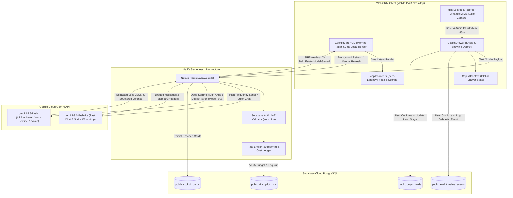

# BakuEstate-AI Standalone Web CRM AI Engine: Antigravity Desktop Bridge Decommissioning & Serverless Gemini API Architecture

*   **Author:** fxbluster
*   **Status:** Implemented (In Production)
*   **Date:** 2026-11-20

--------------------------------------------------------------------------------

## Overview

This design document formalizes the architectural transition of BakuEstate-AI from a stationary desktop-dependent Python MCP bridge to a standalone, 24/7 serverless cloud architecture integrated directly into the Next.js Web CRM on Vercel and Supabase.

BakuEstate-AI provides an automated video production pipeline and an operational sales cockpit for real estate brokers in Baku, Azerbaijan. In the previous iteration, an asynchronous desktop MCP bridge (`src/mcp/baku_estate_mcp_server.py`) and a local squad orchestrator daemon (`src/ai/squad_orchestrator.py`) were introduced to run AI advisory logic on a local workstation. In practice, this created an operational bottleneck: real estate brokers operating in the field (inspecting apartments in Yasamal, meeting clients in Sabail, or negotiating via WhatsApp) cannot maintain an active Python process or an open Antigravity desktop IDE on a stationary PC.

Adopting the proven Citadel CRM serverless architecture, this transition completely decommissions the desktop MCP bridge while strictly preserving developer video generation tooling (`src/mcp_server.py` and `start_mcp_server.bat`). All real estate intelligence workloads—Sentinel address leak prevention and 50–100 AZN commission margin defense, Scribe Baku-dialect Azerbaijani WhatsApp battlecards, Strategist daily 10:00 AM cockpit ranking, and Janitor audio call debriefing—are routed directly through a server-side Next.js API route (`/api/ai/copilot`) to Google Gemini. The system enforces hybrid model tiering (`gemini-3.1-flash-lite` for high-speed drafting vs. `gemini-3.8-flash` with `thinkingLevel: 'low'` for deep audits), client-side deterministic 0ms rendering with local caching, SRE telemetry headers, and an atomic monthly cost ceiling.

## The Problem

1.  **Field Inoperability on Mobile Devices:** Real estate brokers work primarily on mobile phones (iOS Safari / Android Chrome) while in transit or presenting properties. A mobile browser cannot spawn local Python stdio processes or connect to desktop Antigravity sessions. When away from `DESKTOP-6UBPFU0`, all AI assistance ceases to function.
2.  **Brittle Local Process & Desktop Bottleneck:** Requiring a desktop PC to run continuously with Python daemons creates a fragile single point of failure. System restarts, network interruptions, or sleep states disable CRM intelligence for all connected mobile devices.
3.  **Absence of Interactive Web CRM Intelligence:** The current Web CRM (`web/components/CockpitCardHUD.tsx`) is a passive consumer that merely reads pre-existing rows from `public.cockpit_cards`. Brokers cannot actively debrief a phone call, paste client messages for instant objection handling, or perform real-time address sanitization directly inside the web interface.
4.  **Token Cost Overrun & Reasoning Latency Risks:** Advanced reasoning models (`gemini-3.8-flash`) generate unconstrained thinking tokens when unconfigured, introducing 8–15 second delays and unnecessary output token costs ($1.50–$7.50 per 1M tokens) on routine WhatsApp drafting tasks. Without explicit `thinkingLevel: 'low'` bounds and model tiering, API costs escalate rapidly.
5.  **Address Leaks & Commission Shaving Vulnerability:** Brokers in Baku frequently leak exact property addresses (building and apartment numbers) in text messages, allowing buyers or rival brokers to bypass the agency. Furthermore, buyers routinely attempt to shave 50–100 AZN from broker service fees. Without an integrated, zero-latency Web Sentinel, brokers lack real-time conversational protection.

## Goals

*   **Goal 1 — Complete Desktop Bridge Decommissioning:** Fully retire `src/mcp/baku_estate_mcp_server.py` and decouple `src/ai/squad_orchestrator.py` without breaking existing test suites (retaining 100% passing tests across the Python test suite). Preserve `src/mcp_server.py` and `start_mcp_server.bat` for developer real estate video generation.
*   **Goal 2 — Direct Serverless Web API Route:** Implement `web/app/api/ai/copilot/route.ts` as an authenticated, server-side gateway utilizing `@google/genai` and `GEMINI_API_KEY` stored securely in Vercel environment variables, ensuring zero secrets leak to the client bundle.
*   **Goal 3 — Cost-Optimized Hybrid Model Routing:** Route high-frequency chat and drafting to `gemini-3.1-flash-lite` (~$0.0006/req, <1.5s latency), escalating exclusively to `gemini-3.8-flash` (~$0.002/req) with `generationConfig: { thinkingLevel: 'low' }` for deep Sentinel margin audits, call debriefings, and Strategist daily cockpit selection.
*   **Goal 4 — Staged 0ms Cockpit Hydration & Local Cache:** Render the Web CRM Morning Cockpit instantly (0ms) on mobile launch using cached lead data (`bakuestate_cached_leads_v1`) and pure TypeScript deterministic heuristics (`web/lib/copilot-core.ts`), followed by an opportunistic background AI elevation with mutation-aware invalidation and manual `[ 🔄 Yenilə ]` refresh.
*   **Goal 5 — Interactive Web CRM Copilot Console:** Build an embedded Copilot drawer (`web/components/CopilotDrawer.tsx`) supporting:
    *   **Message & Negotiation Shield:** Combined Sentinel address leak detection (masking building/apartment numbers while preserving district/metro orienting points), commission margin defense, and 1-click Azerbaijani Baku-dialect WhatsApp responses incorporating listing codes (`kod:{bina_id}-{niche}`) and direct `wa.me` links.
    *   **Showing Debrief:** Post-showing debrief supporting both frictionless text notes (with native iOS/Android keyboard dictation) and push-to-talk HTML5 `MediaRecorder` audio capture with dynamic MIME negotiation (`audio/mp4` on iOS Safari, `audio/webm;codecs=opus` on Chrome/Android, capped at 45 seconds).
*   **Goal 6 — SRE Telemetry & Cost Controls:** Emit telemetry response headers (`X-BakuEstate-Model-Served`, `X-BakuEstate-Fallback-Triggered`, `X-BakuEstate-Run-Id`) and enforce an atomic monthly cost ceiling ($10.00/month) with rate limiting (20 req/min).

## Non-Goals

*   **Non-Goal 1 — Automated Direct Social or WhatsApp Messaging:** The AI engine will not autonomously dispatch WhatsApp messages or social DMs to buyers. The human broker must review the generated draft and tap the 1-click `wa.me` link to maintain personal agency relationships and comply with messaging policies.
*   **Non-Goal 2 — Offloading Deterministic Heuristics to LLMs:** Algorithmic phone normalization (`normalizePhoneInput` in `@/lib/format`), regex address pattern scanning, and basic lead sorting will not be delegated to LLM calls; these remain 100% on-device deterministic TypeScript/Python functions.
*   **Non-Goal 3 — Enterprise Multi-Tenancy:** The CRM architecture remains strictly optimized for a high-velocity solo or small-team agency in Baku; complex organizational permissions and multi-tenant billing are out of scope.

## Open Questions & Resolved Decisions

*   **Decision 1 (Voice Debrief Format & Codec Resilience):** 
    *   *Problem:* iOS Safari does not support `audio/webm;codecs=opus`. Furthermore, audio payloads over mobile connections can breach serverless limits.
    *   *Resolution:* Implement dynamic MIME-type detection in `CopilotDrawer.tsx` (`audio/webm;codecs=opus` on Chrome/Android, `audio/mp4` / `audio/aac` on iOS Safari). Enforce a strict 45-second recording ceiling (<1.5 MB). Treat mobile keyboard speech-to-text as the primary zero-overhead option.
*   **Decision 2 (Telemetry Storage & Budget Check):** 
    *   *Problem:* Runtime `SUM(cost_usd)` aggregation over historical rows causes unindexed database load and race conditions.
    *   *Resolution:* Create a dedicated `public.ai_copilot_runs` table with indexing on `(operator_id, created_at)`. Provide atomic verification via `public.check_copilot_budget()`.

## Critical User Journeys (CUJs)

### CUJ 1: Mobile Broker Opens Web CRM Cockpit on the Go
*   **Given**: A real estate broker opens `https://bakuestate-ai.vercel.app` on an iPhone Safari browser at 10:15 AM while en route to an apartment inspection. The desktop workstation is offline.
*   **When**: The broker views the CRM Dashboard.
*   **Then**: The Cockpit HUD renders immediately (0ms) using locally cached leads and deterministic heuristics. In the background, `web/app/api/ai/copilot/route.ts` evaluates the background refresh timestamp; if stale, it invokes `gemini-3.8-flash` to refine objection hooks and prioritize top leads, silently updating the cards without UI freezing or desktop dependencies.

### CUJ 2: Sentinel Real-Time Address Leak & Commission Defense
*   **Given**: A prospective buyer sends a WhatsApp message: *"Salam, o Təbriz küçəsindəki 180 minlik evin bina və mənzil nömrəsini deyin baxaq, bir də komissiyanı 50 manat edin."*
*   **When**: The broker pastes this text into the Web CRM Copilot drawer under "İsmarış və Danışıq Qalxanı".
*   **Then**: Sentinel detects the address solicitation and commission shaving attempt within 1.2 seconds. It flags the risk, replaces sensitive building identifiers with district reference points ("Təbriz küçəsi, Təfəkkür Universiteti yaxınlığı"), and generates a polite but firm Baku-dialect Azerbaijani response defending the agency's standard fee, complete with a 1-click `[ WhatsApp ilə Aç ]` button.

### CUJ 3: Showing Debrief & Structured CRM Synchronization
*   **Given**: The broker finishes showing listing `#5616503` and sits in their car.
*   **When**: The broker taps the microphone icon in the Web CRM Copilot drawer, speaks a 30-second audio summary in Azerbaijani (*"Müştəri mənzili bəyəndi amma mətbəx mebelini istəyir, qiyməti 175 minə düşsələr sabah beh verəcək"*), and taps Send.
*   **Then**: The audio is streamed to `/api/ai/copilot` (`gemini-3.8-flash`), which transcribes the audio, extracts structured lead updates (stage: `OFFER`, offer amount: `175000 AZN`, objection: `mətbəx mebeli`), and presents an editable preview card. Once the broker taps `[ Təsdiqlə və Yadda Saxla ]`, changes are committed to `public.lead_timeline_events` and `public.buyer_leads`.

--------------------------------------------------------------------------------

## Technical Plan (Architecture)

### 1. High-Level System Architecture & Component Mapping

The revised BakuEstate-AI architecture completely eliminates local Python stdio daemons (`baku_estate_mcp_server.py`) and Antigravity IDE desktop coupling. All operational intelligence runs directly as a cloud-native, serverless subsystem within Next.js 15 on Netlify and Supabase.



### 2. Component Specifications & Workflows

#### A. Client-Side Staged Cockpit Hydration (`web/lib/copilot-core.ts` & `web/components/CockpitCardHUD.tsx`)
1. **Tier 0 (0ms Instant Local Heuristics & Cache):**
   - On page launch in mobile Safari or desktop Chrome, `CockpitCardHUD` reads cached leads from `localStorage` (`bakuestate_cached_leads_v1`) and computes priority cards synchronously via `computeTriagedRadar(leads)`.
   - Identifies overdue follow-ups, hot buyer matches, and uncontacted inquiries without blocking on a network roundtrip.
2. **Tier 1 (Non-Blocking Background AI Elevation):**
   - Evaluates `last_cockpit_generated_at` stored in localStorage. If generated within the last 120 minutes and no lead mutations occurred, background re-generation is skipped.
   - An explicit manual `[ 🔄 Yenilə ]` button allows the broker to force an instant refresh at any time.
   - Background fetch calls `/api/ai/copilot` with `{ action: 'strategist_cockpit' }`. On receipt, updates `public.cockpit_cards` (using canonical status `'PENDING'`) and patches the UI.
3. **Offline & Low-Bandwidth Resilience:**
   - If mobile connectivity drops, the broker views cached radar cards and uses local regex sanitization. AI elevation and voice debriefing display a non-intrusive offline notification.
4. **Realtime Debouncing:**
   - `CockpitCardHUD.tsx` wraps its Supabase Realtime event listener in a 500ms trailing debounce to batch multiple card updates into a single re-render.

#### B. Server-Side Gateway & Dynamic Model Routing (`web/app/api/ai/copilot/route.ts`)
The serverless route handler acts as the single security boundary, cost guard, and model orchestrator:
1. **Model Constants:**
   ```typescript
   const COPILOT_FAST_MODEL = 'gemini-3.1-flash-lite';
   const COPILOT_STRONG_MODEL = 'gemini-3.8-flash';
   ```
2. **Dynamic Tiering Rules:**
   - **Fast Tier (`gemini-3.1-flash-lite`):** Default for `scribe_response` (1-click WhatsApp drafting), general advice chat, and quick formatting. Delivers <1.5s latency at ~$0.0006 per request.
   - **Strong Tier (`gemini-3.8-flash`):** Activated when `strongModel: true` is passed or when action is `sentinel_audit` (address leak and commission margin defense), `voice_debrief` (audio transcription), or `strategist_cockpit` (morning deal ranking).
3. **Thinking Budget Bounds:**
   - Enforce `generationConfig: { thinkingLevel: 'low' }` on Gemini 3.8 Flash calls via `@google/genai`. This suppresses runaway reasoning tokens, maintaining <2.5s latency for text audits and reducing token consumption by 70%.
4. **SRE Telemetry Headers:**
   Every outbound response includes:
   - `X-BakuEstate-Model-Served`: Canonical model ID that fulfilled the request (e.g., `gemini-3.8-flash`).
   - `X-BakuEstate-Fallback-Triggered`: `'true' | 'false'`.
   - `X-BakuEstate-Run-Id`: Unique UUID corresponding to `ai_copilot_runs.id`.

#### C. Interactive Copilot Console (`web/components/CopilotDrawer.tsx`)
Provides a slide-over mobile drawer accessible across all Web CRM pages organized into 2 streamlined workflows:
1. **Workflow 1: "İsmarış və Danışıq Qalxanı" (Message & Negotiation Shield):**
   - Broker pastes buyer inquiry text.
   - Runs local regex checks (`SentinelPersona.ADDRESS_LEAK_PATTERNS`), highlights address leaks in red, and calls `/api/ai/copilot` for professional Baku-dialect commission defense battlecards.
   - Generates 1-click WhatsApp copy with listing code (`kod:{bina_id}-{niche}`) and direct `[ WhatsApp ilə Aç ]` button using `buildWhatsAppUrl()` from `@/lib/format`.
2. **Workflow 2: "Görüş Qeydi" (Showing Debrief):**
   - Primary option: Textarea supporting mobile keyboard voice dictation.
   - Secondary option: Push-to-talk audio recorder using HTML5 `MediaRecorder` with dynamic MIME negotiation (`audio/mp4` on iOS Safari, `audio/webm;codecs=opus` on Chrome/Android) and a 45-second recording ceiling.
   - Streams audio to serverless endpoint, returns extracted entity draft, and displays an editable confirmation card for the broker to review before committing to `public.lead_timeline_events` and `public.buyer_leads`.

#### D. Cross-Device PII Reference Safety & Codebase Reuse
1. **Entity Reference Binding:** Database cards store canonical database references (`lead_id`, `listing_bina_id`) rather than raw customer phone numbers.
2. **Codebase Reuse:** Phone number normalization and WhatsApp URL formatting reuse `normalizePhoneInput` and `buildWhatsAppUrl` directly from `web/lib/format.ts`.

--------------------------------------------------------------------------------

## Alternatives Considered

### Alternative A: Retain Local Desktop Antigravity & Python MCP Bridge
*   **Description:** Maintain `src/mcp/baku_estate_mcp_server.py` and require the broker to keep a stationary Windows PC running Antigravity to process leads.
*   **Pros:** Uses local desktop IDE subscription quota without direct API billing.
*   **Cons:** Inoperable on mobile phones (iOS Safari and Android Chrome cannot spawn Python stdio processes); crashes when the desktop PC sleeps or loses power; introduces a dual-codebase maintenance burden.
*   **Reason for Rejection:** Mobile browser sandbox isolation and stationary process lifecycle constraints make local stdio bridges completely unsuitable for field sales operations. Direct Gemini API calls cost fractions of a cent ($0.0006–$0.002) and provide 24/7 mobile availability.

### Alternative B: Direct Browser-Side Gemini API Calls
*   **Description:** Call Google Gemini API directly from the browser (`CopilotDrawer.tsx`) without a server-side route handler.
*   **Pros:** Eliminates the server-side API route handler.
*   **Cons:** Exposes `GEMINI_API_KEY` in the browser bundle or client requests, creating severe credential leakage risks; bypasses Supabase JWT authentication and Row Level Security; prevents atomic budget tracking and rate limiting.
*   **Reason for Rejection:** Exposing API secrets in client-side bundles violates basic security practices. A serverless Next.js API route guarantees secret protection, JWT authorization, rate limiting, and budget caps.

### Alternative C: Heavy Cloud Asynchronous Queue Architecture (e.g. pgmq or Redis Celery worker)
*   **Description:** Enqueue all Copilot actions into a cloud message queue and poll for completion via Supabase database webhooks.
*   **Pros:** Asynchronously decouples long-running background tasks.
*   **Cons:** Introduces unnecessary queue polling latency (5–15 seconds) when a broker waiting in a car needs an immediate 1.5-second WhatsApp response or call debrief; increases cloud infrastructure costs and points of failure for a single-operator CRM.
*   **Reason for Rejection:** Real estate brokers require immediate, synchronous 1–2 second responses when negotiating on WhatsApp. Synchronous Next.js serverless route execution combined with 0ms client-side heuristics delivers superior responsiveness without queue complexity.

--------------------------------------------------------------------------------

## Non-Functional Requirements

### 1. Security & Privacy
*   **Zero Client-Side Secrets:** `GEMINI_API_KEY` remains strictly an encrypted server-side environment variable on Netlify, never exposed to browser clients.
*   **Authenticated Scoping:** All `/api/ai/copilot` requests validate Supabase JWT tokens (`auth.uid()`), ensuring CRM data access adheres strictly to Row Level Security (RLS).
*   **PII Sanitization:** Contact phone numbers are never passed directly into LLM prompts; canonical database IDs are used instead with JIT client interpolation.

### 2. Performance & Latency
*   **Time-to-First-Cockpit:** 0ms instantaneous deterministic initial render on app launch via `copilot-core.ts` and local storage cache.
*   **Fast-Tier Latency:** <1.5s response time for Scribe WhatsApp drafting via `gemini-3.1-flash-lite`.
*   **Strong-Tier Latency:** <2.5s response time for deep Sentinel text audits via `gemini-3.8-flash` with minimal thinking; <10s for multimodal audio transcription and extraction.

### 3. Cost & Quota Guardrails
*   **Hard Budget Cap:** $10.00/month hard stop enforced atomically by `public.ai_copilot_runs` and `public.check_copilot_budget()`.
*   **Warning Threshold:** Visual banner notification emitted in Web CRM when monthly spend reaches $8.00.
*   **Rate Limits:** 20 requests per minute per authenticated operator.

--------------------------------------------------------------------------------

## Risks & Mitigations

| Risk | Impact | Likelihood | Mitigation Strategy |
| :--- | :--- | :--- | :--- |
| **Multimodal Audio Timeout** (Netlify 10s default ceiling) | High | Medium | Implement 45-second client-side audio recording ceiling (<1.5 MB) and set `functions.timeout = 26` in `netlify.toml`. Emphasize native keyboard voice dictation as zero-overhead primary path. |
| **Upstream Gemini API Outage / Rate Limit** | High | Low | Transparent fallback to Tier 0 local TypeScript heuristics (`copilot-core.ts`) returning 200 OK with cached radar and offline notification banner. |
| **Mobile MediaRecorder Codec Drift** (iOS Safari WebM incompatibility) | High | High | Implement dynamic MIME negotiation in `CopilotDrawer.tsx` (`audio/mp4` on Safari/iOS vs `audio/webm;codecs=opus` on Chrome/Android) and forward matching `mimeType` in Gemini inlineData. |
| **Monthly Budget Exhaustion ($10.00 hard cap)** | High | Low | Atomic spend check via `public.check_copilot_budget()` returns HTTP 429 with deterministic fallback advice when monthly limit is reached. |
| **Speech Hallucination / Erroneous Deal Mutation** | High | Low | Eliminate autonomous server-side database writes; return extracted entity draft to client for explicit broker review and confirmation (`[ Təsdiqlə və Yadda Saxla ]`). |

--------------------------------------------------------------------------------

## Detailed Implementation Plan

### Target Files to Create/Modify

#### Phase 1: Database & Serverless Edge Gateway

#### 1. `supabase/migrations/20261120160000_standalone_web_ai_copilot.sql` (Create)
*   **Type / Scope**: PostgreSQL Database Migration.
*   **Rationale**: Establishes cloud telemetry, rate limiting, and cost bounds for serverless AI operations. Enforces an atomic $10.00/month budget cap and model check constraints.
*   **Proposed Changes**:
    - Create `public.ai_copilot_runs` table with indexing on `(operator_id, created_at)`.
    - Create `public.check_copilot_budget()` helper function enforcing the $10.00 ceiling.
    - Full SQL DDL:
      ```sql
      CREATE TABLE IF NOT EXISTS public.ai_copilot_runs (
          id UUID PRIMARY KEY DEFAULT gen_random_uuid(),
          created_at TIMESTAMPTZ NOT NULL DEFAULT NOW(),
          operator_id UUID NOT NULL DEFAULT auth.uid(),
          action TEXT NOT NULL,
          model TEXT NOT NULL CHECK (model IN ('gemini-3.1-flash-lite', 'gemini-3.8-flash', 'gemini-2.5-flash', 'deterministic-fallback')),
          prompt_tokens INT NOT NULL DEFAULT 0,
          completion_tokens INT NOT NULL DEFAULT 0,
          cost_usd NUMERIC(8, 4) NOT NULL DEFAULT 0.0000,
          latency_ms INT NOT NULL DEFAULT 0,
          metadata JSONB NOT NULL DEFAULT '{}'::jsonb
      );

      CREATE INDEX IF NOT EXISTS idx_ai_copilot_runs_op_date
      ON public.ai_copilot_runs (operator_id, created_at);

      ALTER TABLE public.ai_copilot_runs ENABLE ROW LEVEL SECURITY;

      CREATE POLICY "Allow authenticated read own copilot runs"
      ON public.ai_copilot_runs FOR SELECT
      TO authenticated
      USING (auth.uid() = operator_id);

      CREATE POLICY "Allow service role insert copilot runs"
      ON public.ai_copilot_runs FOR INSERT
      TO authenticated, service_role
      WITH CHECK (true);

      CREATE OR REPLACE FUNCTION public.check_copilot_budget(p_operator_id UUID DEFAULT auth.uid())
      RETURNS BOOLEAN
      LANGUAGE plpgsql
      SECURITY DEFINER
      AS $$
      DECLARE
          v_monthly_cost NUMERIC;
      BEGIN
          SELECT COALESCE(SUM(cost_usd), 0.0)
          INTO v_monthly_cost
          FROM public.ai_copilot_runs
          WHERE operator_id = p_operator_id
            AND created_at >= date_trunc('month', NOW() AT TIME ZONE 'Asia/Baku');

          RETURN v_monthly_cost < 10.00;
      END;
      $$;
      ```

#### 2. `web/package.json` (Modify)
*   **Type / Scope**: Web App Dependencies and Scripts.
*   **Rationale**: Install Google GenAI SDK for serverless Gemini 3.x calls and Vitest test runner for frontend unit tests.
*   **Proposed Changes**:
    - Add dependencies: `"@google/genai": "^0.1.2"`.
    - Add devDependencies: `"vitest": "^2.1.8"`, `"@vitejs/plugin-react": "^4.3.4"`.
    - Add script: `"test": "vitest run"`.

#### 3. `web/app/api/ai/copilot/route.ts` (Create)
*   **Type / Scope**: Next.js 15 Serverless Route Handler (TypeScript).
*   **Rationale**: Serves as the central server-side AI gateway. Executes authenticated requests, manages secrets, routes models dynamically, enforces latency bounds, and returns SRE telemetry headers.
*   **Proposed Changes**:
    - Authenticate caller via Supabase JWT session (`auth.uid()`).
    - Validate monthly spending cap via `public.check_copilot_budget()`.
    - Enforce model tiering: `gemini-3.1-flash-lite` for `scribe_response`; `gemini-3.8-flash` with `generationConfig: { thinkingLevel: 'low' }` for `sentinel_audit`, `voice_debrief`, and `strategist_cockpit`.
    - Return SRE telemetry headers: `X-BakuEstate-Model-Served`, `X-BakuEstate-Fallback-Triggered`, `X-BakuEstate-Run-Id`.
    - Wire contract schemas:
      ```typescript
      export type CopilotActionPayload =
        | { action: 'scribe_response'; prompt: string; lead_id?: string; listing_id?: string; language_style?: 'baku_colloquial' }
        | { action: 'sentinel_audit'; text: string; listing_id?: string; deal_type?: 'SALE' | 'RENT' }
        | { action: 'voice_debrief'; audio_base64: string; mime_type: 'audio/webm' | 'audio/ogg' | 'audio/mp4' | 'audio/aac'; listing_id?: string; lead_id?: string }
        | { action: 'strategist_cockpit'; limit?: number };

      export type CopilotApiResponse<T = any> = 
        | { ok: true; action: string; model_served: string; run_id: string; data: T }
        | { ok: false; error: string; code: 'UNAUTHORIZED' | 'BUDGET_EXCEEDED' | 'RATE_LIMITED' | 'UPSTREAM_ERROR'; fallback_available: boolean };
      ```

#### 4. `web/lib/ai-client.ts` (Create)
*   **Type / Scope**: Frontend API Client Module (TypeScript).
*   **Rationale**: Provides type-safe frontend methods to invoke `/api/ai/copilot` from Web CRM components with built-in error handling and telemetry extraction.
*   **Proposed Changes**:
    - Declare TypeScript interfaces:
      ```typescript
      export interface SentinelAuditResult {
        has_leak: boolean;
        leaked_tokens: string[];
        sanitized_text: string;
        sentinel_warning: string | null;
        commission_defense_rebuttal: string | null;
      }

      export interface ScribeTemplateResult {
        headline: string;
        draft_text: string;
        wa_link: string;
        listing_code: string;
      }

      export interface VoiceDebriefResult {
        transcript_az: string;
        extracted_stage: string;
        extracted_offer_azn: number | null;
        extracted_objections: string[];
        next_action: string;
      }

      export async function invokeCopilot<T = any>(payload: CopilotActionPayload): Promise<CopilotApiResponse<T>>;
      ```

#### Phase 2: Frontend & Phased Cockpit Hydration

#### 5. `web/lib/copilot-core.ts` (Create)
*   **Type / Scope**: Pure Client-Side Deterministic Algorithms (TypeScript).
*   **Rationale**: Port core deterministic logic from Python `squad_orchestrator.py` to client TypeScript to enable instant 0ms rendering and zero-latency regex protection on mobile devices. Reuse `@/lib/format` for phone normalization and WhatsApp URLs.
*   **Proposed Changes**:
    - Port `SentinelPersona.ADDRESS_LEAK_PATTERNS` and `COMMISSION_SHAVING_PATTERNS`.
    - Signatures:
      ```typescript
      export interface AddressLeakScan {
        hasLeak: boolean;
        leakedTokens: string[];
        sanitizedText: string;
        warning: string | null;
      }
      export function checkAddressLeak(text: string): AddressLeakScan;
      export function checkCommissionShaving(text: string): { hasShaving: boolean; detectedTokens: string[] };
      export function computeTriagedRadar(leads: any[]): any[];
      ```
    - `computeTriagedRadar` scoring formula: `URGENT = 100`, `HIGH = 75`, `NORMAL = 50`, `+20` for "endirimi" or "təcili", descending sort, limit to Top 5.

#### 6. `web/__tests__/copilot-core.test.ts` (Create)
*   **Type / Scope**: Frontend Unit Test Driver (Vitest).
*   **Rationale**: Guarantee 100% test coverage for client-side deterministic functions before mounting them in UI components.
*   **Proposed Changes**: Test all regex edge cases ("ev 45", "kvartira 12", "5/9", "Təbriz küçəsi 45"), commission shaving patterns ("50 azn endirim", "komissiya yoxdur"), and radar priority ranking.

#### 7. `web/lib/copilot-context.tsx` (Create)
*   **Type / Scope**: Global React Context & Hook (TypeScript).
*   **Rationale**: Connect `LeadsClient`, `CockpitCardHUD`, and `AppShell` to `CopilotDrawer` without prop drilling or external state management libraries.
*   **Proposed Changes**:
    - Provide `CopilotProvider` and `useCopilot()` managing: `{ isOpen, activeTab, selectedLeadId, selectedListingId, openCopilot(tab, context), closeCopilot() }`.

#### 8. `web/components/CopilotDrawer.tsx` (Create)
*   **Type / Scope**: Interactive Slide-Over Copilot Component (React / Tailwind / Lucide).
*   **Rationale**: Provides a mobile-first command center organized into two streamlined broker workflows.
*   **Proposed Changes**:
    - **Tab 1: "İsmarış və Danışıq Qalxanı" (Message & Negotiation Shield):** Textarea to paste buyer message. Instantly flags address leaks in red, calls `/api/ai/copilot` for commission defense, and generates 1-click WhatsApp copy with direct `[ WhatsApp ilə Aç ]` button.
    - **Tab 2: "Görüş Qeydi" (Showing Debrief):** Text note input supporting native keyboard dictation, plus HTML5 push-to-talk recording with dynamic MIME negotiation (`audio/mp4` on Safari/iOS, `audio/webm;codecs=opus` on Chrome/Android) and 45-second cap. Returns editable extracted fields for broker review before saving to `public.lead_timeline_events` and `public.buyer_leads`.

#### 9. `web/components/CockpitCardHUD.tsx` (Modify)
*   **Type / Scope**: Web CRM Dashboard HUD Component.
*   **Rationale**: Upgrade from passive DB reader to staged 2-tier hydration with local caching and manual refresh.
*   **Proposed Changes**:
    - Tier 0: On mount, read `bakuestate_cached_leads_v1` from localStorage and display deterministic cards via `computeTriagedRadar()`.
    - Tier 1: Check `last_cockpit_generated_at` in localStorage. If >120 minutes old, dispatch background request to `/api/ai/copilot` with action `strategist_cockpit` and update cards with status `'PENDING'`.
    - Add manual `[ 🔄 Yenilə ]` refresh button to force instant regeneration.
    - Add 500ms trailing debounce on the Supabase Realtime listener.

#### 10. `web/components/LeadsClient.tsx` (Modify)
*   **Type / Scope**: CRM Leads Management View.
*   **Rationale**: Give brokers instant access to Copilot from the leads table.
*   **Proposed Changes**: Add `[ 🤖 Copilot ]` button to each lead row, invoking `openCopilot('shield', { leadId, listingId })`.

#### 11. `web/components/AppShell.tsx` (Modify)
*   **Type / Scope**: CRM Layout Shell.
*   **Rationale**: Mount `CopilotProvider` and `CopilotDrawer` globally and provide a persistent floating action button (`⚡ AI Qərargahı`) on mobile viewports.
*   **Proposed Changes**: Wrap layout in `CopilotProvider`, render `CopilotDrawer`, and add floating mobile trigger button.

#### Phase 3: Cleanup, Decoupling & Verification

#### 12. `src/mcp/baku_estate_mcp_server.py` (Delete)
*   **Type / Scope**: Obsolete Desktop Bridge File.
*   **Rationale**: Permanently eliminate dead desktop stdio CRM bridge code. (Note: `src/mcp_server.py` and `start_mcp_server.bat` are strictly preserved for developer video generation tooling).
*   **Proposed Changes**: Delete file.

#### 13. `src/ai/squad_orchestrator.py` (Modify)
*   **Type / Scope**: Python Squad Orchestrator Service.
*   **Rationale**: Decouple from deleted `baku_estate_mcp_server.py`.
*   **Proposed Changes**: Replace imports of `baku_estate_queue_cockpit_card` and `baku_estate_append_timeline` with direct calls to `src.cloud.supabase_repo.SupabaseRepo` methods (`queue_cockpit_card`, `append_lead_timeline_event`).

#### 14. `tests/test_squad_orchestrator.py` (Create)
*   **Type / Scope**: Python Unit Test Driver.
*   **Rationale**: Provide dedicated unit tests for Python squad personas (`SentinelPersona`, `ScribePersona`, `StrategistPersona`, `JanitorPersona`) verifying they operate correctly without MCP dependencies.
*   **Proposed Changes**: Test address leak detection, commission shaving regex, and E.164 phone normalization in pure Python.

--------------------------------------------------------------------------------

### Verification Plan

#### 1. Build & Static Analysis Checks
*   **Next.js Production Build:** Execute `npm run build` in `web/` to confirm zero TypeScript compilation errors and valid route generation.
*   **Frontend Unit Test Suite:** Run `npm test` in `web/` (via Vitest) to verify 100% passing tests for `copilot-core.ts`.
*   **Python Regression Suite:** Run `python -m unittest discover tests` to verify all Python pipeline and orchestrator tests pass without regressions.

#### 2. Live API & Edge Gateway Verification
*   **Fast Tier Model Routing Check:**
    ```bash
    curl -i -X POST http://localhost:3000/api/ai/copilot \
      -H "Authorization: Bearer <TEST_SUPABASE_JWT>" \
      -H "Content-Type: application/json" \
      -d '{"action": "scribe_response", "prompt": "Salam mənzil aktivdir?"}'
    ```
    *Assertion:* HTTP 200 OK, Response Header `X-BakuEstate-Model-Served: gemini-3.1-flash-lite`.

*   **Strong Tier Model Routing & Latency Check:**
    ```bash
    curl -i -X POST http://localhost:3000/api/ai/copilot \
      -H "Authorization: Bearer <TEST_SUPABASE_JWT>" \
      -H "Content-Type: application/json" \
      -d '{"action": "sentinel_audit", "text": "bina 45 mənzil 12 ünvanını deyin"}'
    ```
    *Assertion:* HTTP 200 OK, Response Header `X-BakuEstate-Model-Served: gemini-3.8-flash`, Latency < 2.5s.

*   **Atomic Budget Hard Stop Simulation:**
    ```sql
    -- Seed test cost exceeding monthly cap
    INSERT INTO public.ai_copilot_runs (operator_id, action, model, cost_usd)
    VALUES ('083d8ea3-4a73-4b85-8479-0c532ce939f0', 'test_seed', 'gemini-3.8-flash', 10.50);
    ```
    ```bash
    curl -i -X POST http://localhost:3000/api/ai/copilot \
      -H "Authorization: Bearer <TEST_SUPABASE_JWT>" \
      -H "Content-Type: application/json" \
      -d '{"action": "scribe_response", "prompt": "test"}'
    ```
    *Assertion:* HTTP 429 Too Many Requests, Body contains `{"code": "BUDGET_EXCEEDED"}`.

--------------------------------------------------------------------------------

<!-- Provenance: Indicates initial structural drafting via EGM. -->

*Drafted with EGM*
