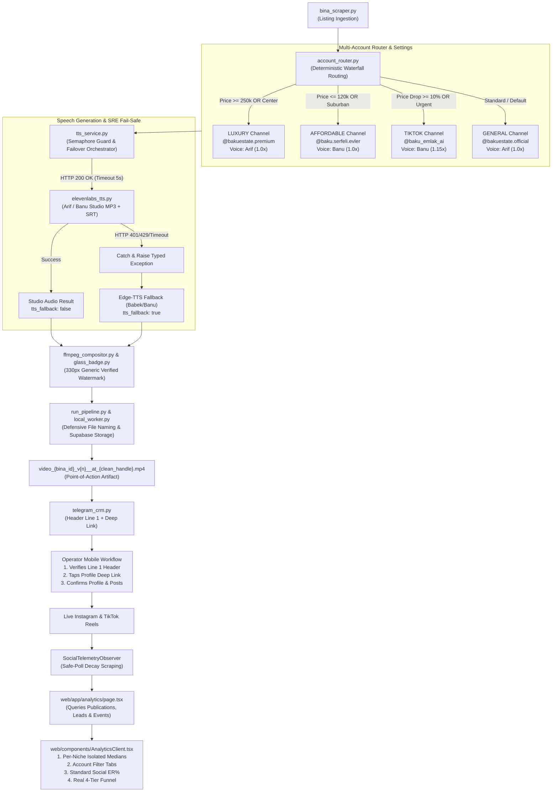

# BakuEstate-AI: Multi-Account Distribution, 100% ElevenLabs Studio Standard & Niche Analytics Engine

* **Author:** Dəniz & Antigravity (EGM Architecture & Ideation Squad)
* **Status:** Implemented (In Production)
* **Date:** 2026-11-20

--------------------------------------------------------------------------------

## Overview

BakuEstate-AI is the autonomous media generation and real estate CRM platform for Baku's property market. As the platform scales from a single channel into 4 specialized Instagram and TikTok publication channels (`@bakuestate.premium`, `@baku.serfeli.evler`, `@bakuestate.official`, and `@baku_emlak_ai`), the day-to-day operations face critical human and algorithmic bottlenecks:

1. **Operator Cross-Posting Confusion:** Videos are produced for distinct target niches (e.g. 1M+ AZN luxury penthouses vs. 40k AZN suburban starter homes), but operators lack prominent visual account indicators when downloading and uploading reels from Telegram.
2. **Audio Consistency & Studio Quality:** Past rendering profiles permitted robotic Edge-TTS fallback synthesis, creating a jarring, low-trust acoustic experience on luxury listings. The brand standard demands 100% studio-grade ElevenLabs Azerbaijani neural voices across all accounts.
3. **Analytics Skew & Blind Funnels:** Grouping all channel views into a single global median view metric crushes Normalized Engagement Ratios (NER) for low-volume luxury properties, hides individual account performance, and fails to attribute real buyer leads, WhatsApp chats, showings, and commission revenue back to specific video creative.

This design document establishes the comprehensive technical architecture to solve these problems across video rendering, CRM dispatch, database attribution, and analytics intelligence.

--------------------------------------------------------------------------------

## The Problem

### 1. The Human Ingestion & Posting Bottleneck
Operators managing social distribution handle dozens of video assets weekly. Because native mobile operating systems (iOS and Android) do not switch active Instagram application profiles when tapping universal web links, an operator whose app is currently logged into `@baku.serfeli.evler` will accidentally post a luxury penthouse to the budget page if they tap "Share" without verifying their profile. The system requires defensive friction at the **Point-of-Action**:
- The Telegram CRM card must state the target account prominently at Line 1 with direct deep links.
- Output video filenames must identify the target account explicitly (`video_{bina_id}_v{n}__at_{clean_handle}.mp4`).
- The Web CRM Pre-Flight verification modal must feature a color-coded account pill badge.

### 2. Audio Quality Variance & Quota Telemetry Silence
While ElevenLabs produces lifelike Azerbaijani speech via Arif (`ZQJv3hwvRAIC7fvWZ1Qr`) and Banu (`EXAVITQu4vr4xnSDxMaL`), previous routing relegated several accounts to Edge-TTS. Furthermore, when ElevenLabs quotas or character limits are reached, the system silently degraded to Edge-TTS without emitting SRE alerts to Telegram or tagging render metadata, leaving operators unaware of why a video featured robotic audio.

### 3. Skewed Metrics & Disconnected Pipeline Attribution
In `web/components/AnalyticsClient.tsx`, calculating a single global median view count (e.g., 20,000 views) skews normalized scoring against luxury properties, which naturally average 1,500–3,000 views but generate substantially higher commission margins. In addition, standard social engagement metrics ($\text{ER\%}$) are missing, there are no per-account filter tabs, and the analytics dashboard does not connect inbound public engagement to downstream CRM pipeline milestones (`showing_scheduled`, `won_closed`, and `actual_commission_azn`).

--------------------------------------------------------------------------------

## Goals

* **G1 (Zero Misposting via Multi-Point Identification):** Ensure that every generated video is unmistakably labeled with its target account handle across 3 point-of-action layers without compromising video asset portability:
  1. Telegram delivery message Line 1 (`🎯 PAYLAŞILACAQ HESAB: @handle (NİŞ)`).
  2. Output MP4 filename (`video_{bina_id}_v{n}__at_{clean_handle}.mp4`).
  3. Web CRM Pre-Flight verification modal pill badge.
  *(Upper-third video watermark pill remains generic `BAKU ESTATE / VERIFIED LISTING` (330px) to preserve content portability, cross-promotion flexibility, and cache reusability).*
* **G2 (100% Studio Voiceover Guarantee):** Reconfigure `account_router.py` to route all 4 distribution niches (`LUXURY`, `AFFORDABLE`, `GENERAL`, `TIKTOK`) exclusively to ElevenLabs neural voices (Arif and Banu).
* **G3 (SRE Telemetry & Automated Fallback Warning):** Detect quota depletion, timeouts ($\le 5.0\text{s}$), and API errors in `tts_service.py` / `elevenlabs_tts.py`, gracefully fall back to Edge-TTS to avoid blocking the pipeline, record canonical metadata in `render_versions.ab_metadata`, and deliver an immediate high-priority warning card to Telegram with a 1-tap re-render callback button.
* **G4 (Isolated Per-Niche Analytics & Fair Scoring):** Overhaul `AnalyticsClient.tsx` to compute rolling median views and NER independently per channel niche, guarding against cold-start sample skew with calibrated baseline anchors and division-by-zero guards.
* **G5 (Standard Social Engagement & Real Attribution Funnel):** Implement platform-resilient Engagement Rate calculations ($\text{ER\%}$) and a 4-tier lead attribution funnel grounded in mobile Instagram reality (Views $\rightarrow$ Video Engagement $\rightarrow$ Scraped Intent Comments $\rightarrow$ Bio Links / Inbound CRM Leads $\rightarrow$ Showings $\rightarrow$ Commissions).

--------------------------------------------------------------------------------

## Non-Goals

* **NG1 (Automated Direct Posting via Private APIs):** The system will not use unofficial Instagram private API wrappers (e.g., `instagrapi`) to publish reels automatically. Direct unauthenticated posting carries extreme account suspension and Meta device blacklisting risks; manual 1-tap operator dispatch remains strictly preserved.
* **NG2 (Complex Real-Time LLM Comment Sentiment Processing):** The system will not invoke costly LLM calls for high-frequency comment spam classification. Fast, deterministic regex intent matching combined with bio WhatsApp attribution tokens fulfills attribution requirements at zero token cost.
* **NG3 (Paid Third-Party Web Scraping Proxies):** The architecture will not introduce recurring proxy subscriptions for telemetry scraping. Public embed scraping with per-account circuit breakers and safe decay scheduling satisfies telemetry needs.
* **NG4 (Permanent Channel Watermark Burning into Video Footage):** The system will not burn specific channel handles into the video frames, ensuring video assets can be repurposed across channels and platforms without visual lock-in.

--------------------------------------------------------------------------------

## Open Questions

* **Q1 (TikTok Subtitle Sync under Audio Acceleration):**  
  **[CLOSED - Resolved in Module 2]** Accelerating Banu's voice for TikTok is implemented strictly by passing `voice_settings.speed = 1.15` to the ElevenLabs REST API endpoint. The returned character-level timestamps natively reflect the accelerated tempo, ensuring frame-accurate subtitle synchronization with zero drift. FFmpeg `atempo` and manual subtitle cue division are strictly prohibited. On Edge-TTS fallback, `voice_speed = 1.15` is converted to `rate = "+15%"`.
* **Q2 (Standard vs. Cinematic Watermark Parity):**  
  **[CLOSED - Resolved in Module 3]** The 330px verified watermark pill (`BAKU ESTATE / VERIFIED LISTING`) is rendered uniformly across both standard Ken Burns mode and cinematic walkthrough mode in `ffmpeg_compositor.py`, ensuring visual brand parity.

--------------------------------------------------------------------------------

## Critical User Journeys (CUJs)

### CUJ 1: Operator Downloads & Publishes Luxury Reel without Cross-Posting
* **Given**: A 450,000 AZN apartment in Nasimi is routed by `account_router.py` to `LUXURY` (`@bakuestate.premium`).
* **When**: The pipeline finishes rendering and dispatches the video card to Telegram CRM.
* **Then**:
  1. The Telegram message header prominently states: `🎯 PAYLAŞILACAQ HESAB: @bakuestate.premium (LÜKS & MƏRKƏZ)`.
  2. The direct link opens the target profile: `https://instagram.com/bakuestate.premium`.
  3. The downloaded MP4 file is named `video_10492_v1__at_bakuestate.premium.mp4`.
  4. The video features Arif's calm studio voiceover and a 330px brand pill displaying `BAKU ESTATE / VERIFIED LISTING`.
  5. The operator selects the verified account profile in Instagram and publishes with zero confusion.

### CUJ 2: Quota Depletion Fail-Safe with Operator Alert
* **Given**: The monthly ElevenLabs character quota is exhausted during an overnight scraping batch of 15 listings.
* **When**: `tts_service.py` synthesizes speech for listing #10502 and receives an HTTP 429 quota exhaustion response.
* **Then**:
  1. Synthesis automatically fails over to Edge-TTS Babek/Banu within $\le 2.0\text{s}$ to prevent pipeline stall.
  2. The render job succeeds, and `render_versions.ab_metadata` logs `{"tts_engine_used": "edge_fallback", "tts_fallback": true, "fallback_engine": "edge-tts"}`.
  3. The Telegram card dispatches with an explicit SRE banner: `⚠️ DİQQƏT: ElevenLabs balansı bitdiyi üçün bu video müvəqqəti Edge-TTS ilə hazırlandı.`
  4. An operator 1-tap inline button `[ 🔄 ElevenLabs ilə Təkrar Render ]` (callback `rerender_eleven_10502`) allows re-synthesis once the quota is topped up.

### CUJ 3: Agency Manager Analyzes Channel Health & Revenue in Web CRM
* **Given**: 80 publications have been recorded across the 4 accounts over the past 30 days.
* **When**: The manager navigates to `/analytics` in the Web CRM.
* **Then**:
  1. The manager clicks the `[ 💎 @bakuestate.premium ]` tab filter.
  2. Luxury metrics are evaluated against Luxury-only rolling medians (e.g. 2,200 views), yielding an accurate, fair NER score of 1.35.
  3. The Engagement Rate card displays $\text{ER\%} = 3.8\%$.
  4. The attribution funnel indicates 14 qualified WhatsApp CRM leads, 3 physical showings, and 1 closed deal with 2,500 AZN commission.

--------------------------------------------------------------------------------

## Technical Plan (Architecture)

### 1. System Architecture & End-to-End Data Flow



---

### 2. Component Design & Structural Mechanics

#### Module 1: Deterministic Multi-Account Routing & Target Action Defense
* **Files:** `src/worker/account_router.py`, `src/dispatcher/telegram_crm.py`, `run_pipeline.py`, `src/cloud/supabase_repo.py`, `web/components/PreflightModal.tsx`
* **Routing Logic Upgrade:** `account_router.py` is upgraded to support district extraction alongside price thresholds, returning `Dict[str, Any]`:
  - **Priority 1 (Viral Dynamics):** If `is_urgent` or `price_drop_pct >= 10.0` (extracted from `price_drop_pct` or `price_drop_info`) $\rightarrow$ `TIKTOK` (`@baku_emlak_ai`).
  - **Priority 2 (Dominant Archetypes):**
    - `price >= 250000 AZN` or elite central districts (`Səbail`, `Nəsimi`, `Nərimanov`, `Gənclik`, `Ağ Şəhər`, `Badamdar`, `Bilgəh`, `Mərdəkan`) $\rightarrow$ `LUXURY` (`@bakuestate.premium`).
    - `price <= 120000 AZN` or suburban areas (`Xırdalan`, `Masazır`, `Hövsan`, `Zabrat`, `Suraxanı`, `Binəqədi`, `Sabunçu`) $\rightarrow$ `AFFORDABLE` (`@baku.serfeli.evler`).
  - **Priority 3 (Default Balanced):** All remaining standard properties $\rightarrow$ `GENERAL` (`@bakuestate.official`).
* **Point-of-Action Defense Mechanisms:**
  1. **Telegram Card Line 1 Header & Platform-Aware Deep Links:** `telegram_crm.py` formats the delivery card:
     ```html
     🎯 <b>PAYLAŞILACAQ HESAB: @{target_account_handle} ({niche_label})</b>
     📲 <a href="{platform_deep_link}">{platform_name} Profilini Aç</a>
     ```
     - Deep link logic branches by platform:
       - If `channel_niche == 'TIKTOK'`: `https://www.tiktok.com/@{clean_handle}`
       - Else: `https://instagram.com/{clean_handle}`
  2. **Defensive File & Storage Key Naming:** In `run_pipeline.py` and `supabase_repo.py`, filenames and storage keys are sanitized to prevent Windows illegal character errors:
     ```python
     clean_handle = re.sub(r'[^a-zA-Z0-9_.-]', '_', target_account_handle.lstrip('@'))
     output_video_path = OUTPUT_DIR / f"video_{bina_id}_v{resolved_version_num}__at_{clean_handle}.mp4"
     storage_object_path = f"videos/{bina_id}/v{resolved_version_num}__at_{clean_handle}.mp4"
     ```
  3. **Web CRM Pre-Flight Pill:** In `PreflightModal.tsx`, an explicit styled status badge displays the assigned account with niche theme colors (Gold for Luxury, Emerald for Affordable, Royal Navy for General, Crimson for TikTok). If `listing.publication` is null, a dynamic fallback calculates the niche from `listing.price` and `listing.location`.

---

#### Module 2: 100% ElevenLabs Voice Standardization & Fail-Safe Telemetry
* **Files:** `src/worker/account_router.py`, `config/settings.py`, `.env.example`, `src/media/elevenlabs_tts.py`, `src/media/tts_service.py`
* **Voice Configuration Matrix:**
  All niches in `account_router.py` return `"voice_engine": "elevenlabs"`. Voice constants are configured in `config/settings.py`:
  - `ELEVENLABS_VOICE_ARIF = os.getenv("ELEVENLABS_VOICE_ARIF", "ZQJv3hwvRAIC7fvWZ1Qr")` (male, prestigious).
  - `ELEVENLABS_VOICE_BANU = os.getenv("ELEVENLABS_VOICE_BANU", "EXAVITQu4vr4xnSDxMaL")` (female, articulate).
  - `ELEVENLABS_MODEL_ID = os.getenv("ELEVENLABS_MODEL_ID", "eleven_multilingual_v2")`
  - **Niche Allocation:**
    - `LUXURY`: Arif, `voice_speed = 1.0`, `stability = 0.65`, `style = 0.10`.
    - `AFFORDABLE`: Banu, `voice_speed = 1.0`, `stability = 0.50`, `style = 0.20`.
    - `GENERAL`: Arif, `voice_speed = 1.0`, `stability = 0.55`, `style = 0.05`.
    - `TIKTOK`: Banu, `voice_speed = 1.15`, `stability = 0.35`, `style = 0.35`.
* **TikTok Dynamic Tempo & Subtitle Alignment:**
  - `voice_speed: float` (1.15) is serialized directly into the ElevenLabs REST request:
    ```json
    "voice_settings": {
      "stability": 0.35,
      "similarity_boost": 0.75,
      "style": 0.35,
      "speed": 1.15
    }
    ```
  - Subtitle timestamps returned by ElevenLabs character-level alignment are natively synchronized to the faster audio.
  - On failover to Edge-TTS, `voice_speed` is converted to rate percentage string: `rate = f"+{int(round((voice_speed - 1.0) * 100))}%"` (e.g. `"+15%"`).
  - FFmpeg `atempo` and manual subtitle math are strictly prohibited.
* **Fail-Safe SRE Telemetry & Concurrency Guards:**
  - To prevent HTTP 429 concurrency blocks, `tts_service.py` wraps ElevenLabs requests in a `threading.BoundedSemaphore(2)`.
  - ElevenLabs request timeout is lowered to `5.0s`. On timeout, HTTP 401, 402, 429, or 5xx, `elevenlabs_tts.py` raises a typed `ElevenLabsSynthesisError`.
  - `tts_service.py` catches the error, immediately fails over to Edge-TTS (`az-AZ-BabekNeural` / `az-AZ-BanuNeural`), and returns a 6-tuple `(script_text, audio_path, srt_path, duration, engine_used, fallback_triggered)`.
  - Canonical `render_versions.ab_metadata` JSONB schema:
    ```json
    {
      "routing_rule": "PRIORITY_2_PRICE_DOMINANCE",
      "target_account_handle": "@bakuestate.premium",
      "channel_niche": "LUXURY",
      "voice_engine": "elevenlabs",
      "voice_id": "ZQJv3hwvRAIC7fvWZ1Qr",
      "voice_speed": 1.0,
      "tts_engine_used": "elevenlabs",
      "tts_fallback": false,
      "fallback_engine": null
    }
    ```
  - `telegram_crm.py` appends an urgent operator alert when `fallback_triggered == True`:
    ```html
    ⚠️ <b>DİQQƏT:</b> ElevenLabs balansı/kvotası bitdiyi üçün bu video müvəqqəti Edge-TTS ilə hazırlandı.
    ```
  - Inline button `[ 🔄 ElevenLabs ilə Təkrar Render ]` with `callback_data=f"rerender_eleven_{bina_id}"` triggers re-rendering via `src/dispatcher/telegram_bot_service.py` (which routes directly to ElevenLabs Studio Arif/Banu based on listing niche).

---

#### Module 3: Generic Verified Watermarking & Compositor Layout Parity
* **Files:** `src/media/glass_badge.py`, `src/media/ffmpeg_compositor.py`
* **Safe-Zone & Pill Dimensions:**
  - Watermark pill dimensions in `glass_badge.py` are expanded to `w = 330, h = 74`.
  - Content: Line 1 `BAKU ESTATE` (font size 21), Line 2 `VERIFIED LISTING` (font size 14, color `(210, 220, 235, 230)`).
  - Generic branding preserves complete video portability across platforms and accounts while providing an elite verified seal.
  - Positioned at `x = 1080 - 330 - 36 = 714, y = 86` (occupying $y = 86..160$).
* **Elimination of Animation Collision:**
  - In `ffmpeg_compositor.py`, `hero_badge` entry animation is updated to start at $y = 186$ using an opacity fade-in filter instead of a 60px vertical slide-down, guaranteeing $\ge 26\text{px}$ vertical clearance and zero visual collision.
* **Compositor Engine Parity:**
  - Watermark overlay is integrated into both `build_cinematic_video()` and standard `build_video()` in `ffmpeg_compositor.py`.
  - In standard `build_video()`, the watermark is overlaid via `-filter_complex movie='...'` without modifying audio stream input indices `1..4`.

---

#### Module 4: Niche-Segmented Analytics Engine & Real Attribution Funnel
* **Files:** `web/app/analytics/page.tsx`, `web/components/AnalyticsClient.tsx`, `web/lib/types.ts`
* **Server Data Loader (`web/app/analytics/page.tsx`):**
  - Updated to query `buyer_leads` (`id, client_name, phone_normalized, stage, actual_commission_azn, attributed_channel_niche, attributed_publication_id`) and `lead_timeline_events` (`event_type, created_at, metadata`).
  - Passes `leads: BuyerLead[]` and `timelineEvents: LeadTimelineEvent[]` down to `AnalyticsClientProps`.
* **Refactored React State Slices (`AnalyticsClient.tsx`):**
  1. **Niche Tab Selector Slice (`selectedNiche`):**
     Tabs: `[ Hamısı ] | [ 💎 @bakuestate.premium ] | [ 🏠 @baku.serfeli.evler ] | [ 🏢 @bakuestate.official ] | [ 🔥 @baku_emlak_ai ]`. Filters publications and leads in instant UI memory.
  2. **Isolated Per-Niche Medians & Fair NER Calculation:**
     ```typescript
     const perNicheMedians = useMemo(() => {
       const map = new Map<string, number>();
       const baselines: Record<string, number> = {
         LUXURY: 2000,
         AFFORDABLE: 12000,
         GENERAL: 5000,
         TIKTOK: 25000,
         ALL: 8000,
       };
       for (const niche of ['LUXURY', 'AFFORDABLE', 'GENERAL', 'TIKTOK', 'ALL']) {
         const pubs = niche === 'ALL' ? publications : publications.filter(p => p.channel_niche === niche);
         const views = pubs.map(p => p.views_count).filter(v => v > 0).sort((a, b) => a - b);
         if (views.length < 10) {
           map.set(niche, baselines[niche] || 5000);
         } else {
           const mid = Math.floor(views.length / 2);
           map.set(niche, views.length % 2 !== 0 ? views[mid] : Math.round((views[mid - 1] + views[mid]) / 2));
         }
       }
       return map;
     }, [publications]);
     ```
     Guarded NER formula preventing division-by-zero or `NaN`:
     $$\text{NER} = \left(\frac{\text{views\_count}}{\text{perNicheMedians.get}(p.\text{channel\_niche} \parallel \text{'GENERAL'}) \parallel 5000}\right) \times 0.6 + \left(\frac{\text{intent\_leads\_count}}{\max(1, p.\text{comments\_count})}\right) \times 0.4$$
  3. **Platform-Resilient Social Engagement Rate ($\text{ER\%}$):**
     $$\text{Effective ER\%} = \frac{\text{Likes} + \text{Comments} + \text{COALESCE}(\text{Shares}, 0)}{\max(1, \text{Views})} \times 100$$
     - Contextual health badges: `> 3.5%` High/Green, `1.5% - 3.5%` Normal/Gold, `< 1.5%` Low/Slate.
     - Guard: returns `0.0%` if views $< 50$.
  4. **Real 4-Tier Funnel Grounded in Mobile Instagram:**
     - Stage 1: `Ümumi Baxış (Total Views across Niche Reels)`
     - Stage 2: `Sosial Maraq və Şərhlər (Engagement & Scraped Intent Comments)`
     - Stage 3: `Qeydə Alınan Leadlər (Inbound WhatsApp Leads with kod:{bina_id} attribution)`
     - Stage 4: `Fiziki Baxış və Satış (Showings Scheduled -> Won Closed & AZN Commission)`

---

### 3. Database Schema Continuity & Model Alignment

* **Database Migration (`supabase/migrations/202611200001_buyer_leads_attribution.sql`):**
  ```sql
  ALTER TABLE public.buyer_leads
    ADD COLUMN IF NOT EXISTS attributed_publication_id UUID REFERENCES public.publications(id) ON DELETE SET NULL,
    ADD COLUMN IF NOT EXISTS attributed_channel_niche VARCHAR(32) DEFAULT 'GENERAL';

  CREATE INDEX IF NOT EXISTS idx_buyer_leads_publication ON public.buyer_leads(attributed_publication_id);
  CREATE INDEX IF NOT EXISTS idx_buyer_leads_niche ON public.buyer_leads(attributed_channel_niche);
  ```
* **Attribution Token Mapping via Agency Bio Links:**
  - Agency profile bio and captions direct viewers: *"Ətraflı məlumat üçün profildəki WhatsApp linkinə keçin və ya 'EV' yazın."*
  - Structured WhatsApp URL: `https://wa.me/{AGENCY_WHATSAPP_PHONE}?text=Salam,%20kod:{bina_id}-{niche_slug}`.
  - When inbound messages arrive with the listing code, `buyer_leads` is tagged with `attributed_publication_id` and `attributed_channel_niche`, attributing showings and commissions back to the exact video.

--------------------------------------------------------------------------------

## Alternatives Considered

### Alternative A: Permanently Burning Channel Handles into Full-Duration Video Footage
* **Description**: Rendering `@bakuestate.premium` or `@baku.serfeli.evler` as an uneditable, opaque video overlay stamp burned across all 30–45 seconds of video frames.
* **Pros**: Impossible for an operator to miss the account name when watching the video file.
* **Cons**: Destroys content portability: videos cannot be cross-promoted, repurposed for YouTube Shorts, or shared directly on status updates without jarring brand clashes. Also invalidates pre-rendered video caches if price adjustments trigger a re-route.
* **Reason for Rejection**: *Rejected by author: Rigid visual stamping creates architectural lock-in and renders assets inflexible. Point-of-action defenses (Telegram delivery header line 1, pre-flight verification pill, defensive filename tags `video_{id}__at_{clean_handle}.mp4`, and modular upper-third brand badges `BAKU ESTATE / VERIFIED LISTING`) achieve 100% operator clarity without asset destruction.*

### Alternative B: Real-Time LLM Semantic Classification on Inbound Social Comments
* **Description**: Invoking Gemini 2.5 Flash on every scraped Instagram/TikTok comment to classify buyer sentiment.
* **Pros**: Capable of parsing highly colloquial, multi-lingual commentary.
* **Cons**: High latency and significant API token burn rate on hundreds of low-intent emojis and bot comments.
* **Reason for Rejection**: *Rejected by author: Over 90% of genuine property inquiries in Azerbaijan use concise keywords ("qiymət", "ev", "yerləşmə", "kupça", "nömrə") or click the WhatsApp bio link directly. A two-tier zero-token regex filter combined with structured WhatsApp attribution query tokens (`kod:{bina_id}-{niche}`) yields deterministic lead capture at zero marginal cost.*

### Alternative C: Direct Automated Reel Publishing via Unofficial Instagram API Reverse-Engineering
* **Description**: Using reverse-engineered private mobile Instagram API client libraries (e.g. `instagrapi`) to publish reels directly from the local worker without human interaction.
* **Pros**: Fully autonomous, zero-operator touch from scraping to live posting.
* **Cons**: Extreme risk of instant permanent account bans, Shadowbans, and Meta device fingerprint blacklisting.
* **Reason for Rejection**: *Rejected by author: Operating 4 commercial agency accounts with active client listings cannot risk catastrophic account termination. High-friction automated posting is strictly rejected in favor of verified 1-tap manual publishing with automated pre-flight pricing validation.*

--------------------------------------------------------------------------------

## Non-Functional Requirements

### 1. Performance & Execution Latency
* **TTS Generation SLA:** ElevenLabs speech synthesis for an average Azerbaijani script (~550 characters) must complete within $\le 4.5$ seconds under normal network conditions.
* **Fallback SLA:** If ElevenLabs encounters a timeout or quota error, Edge-TTS fallback must initiate within $\le 2.0$ seconds (timeout set to 5.0s), preventing render pipeline stalls.
* **Compositor Efficiency:** Expanded 330px watermark badge generation in `glass_badge.py` must execute in memory via Pillow in $\le 30$ ms, adding negligible overhead to video compilation.

### 2. Security, Rate Limiting & Account Safety
* **Concurrency Protection:** Inbound ElevenLabs requests must be gated by `threading.BoundedSemaphore(2)` to respect API tier rate limits.
* **Telemetry Scraping Safety:** Public embed scraping via `SocialTelemetryObserver` must adhere to safe 11-poll decay schedules over 7 days with per-account circuit breakers.
* **Fail-Closed Pre-Flight Verification:** If `bina.az` scraping indicates that a property has changed price or been deactivated, the pre-flight check must block dispatch to Telegram until re-rendering with updated data is confirmed.

### 3. Reliability & SRE Observability
* **Explicit Failure Tagging:** Every render must record its audio engine provenance in `render_versions.ab_metadata` (`tts_engine_used: "elevenlabs" | "edge_fallback"`). Silent failures are strictly prohibited.
* **High-Priority Telegram Alerts:** Whenever fallback audio is generated, an automated warning card must alert the operator immediately with a 1-tap re-render callback button.

--------------------------------------------------------------------------------

## Detailed Implementation Plan

### Target Files to Create/Modify

#### 1. `src/worker/account_router.py` (Modify)
* **Type / Scope**: Media Routing Engine
* **Proposed Changes**:
  - Update return type hint to `Dict[str, Any]`.
  - Reconfigure routing waterfall so that all 4 distribution niches (`LUXURY`, `AFFORDABLE`, `GENERAL`, `TIKTOK`) use `"voice_engine": "elevenlabs"`.
  - Replace legacy string `"voice_rate": "+15%"` with numeric `"voice_speed": 1.15` (float).
  - Add geographic district extraction checking `listing.get("district_normalized")` or `location`:
    - Elite central districts (`Səbail`, `Nəsimi`, `Nərimanov`, `Gənclik`, `Ağ Şəhər`, `Badamdar`, `Bilgəh`, `Mərdəkan`) $\rightarrow$ `LUXURY`.
    - Suburban districts (`Xırdalan`, `Masazır`, `Hövsan`, `Zabrat`, `Suraxanı`, `Binəqədi`, `Sabunçu`) or `price <= 120_000.0` $\rightarrow$ `AFFORDABLE`.
  - Bind `LUXURY` and `GENERAL` to `ELEVENLABS_VOICE_ARIF`, and `AFFORDABLE` and `TIKTOK` to `ELEVENLABS_VOICE_BANU`.

#### 2. `config/settings.py` (Modify)
* **Type / Scope**: Environment Configuration
* **Proposed Changes**:
  - Define voice constants `ELEVENLABS_VOICE_ARIF = os.getenv("ELEVENLABS_VOICE_ARIF", "ZQJv3hwvRAIC7fvWZ1Qr")` and `ELEVENLABS_VOICE_BANU = os.getenv("ELEVENLABS_VOICE_BANU", "EXAVITQu4vr4xnSDxMaL")`.
  - Standardize default `ELEVENLABS_MODEL_ID = os.getenv("ELEVENLABS_MODEL_ID", "eleven_multilingual_v2")`.
  - Define `AGENCY_WHATSAPP_PHONE = os.getenv("AGENCY_WHATSAPP_PHONE", "994501234567")` for public WhatsApp attribution links.

#### 3. `.env.example` (Modify)
* **Type / Scope**: Environment Template
* **Proposed Changes**:
  - Document `ELEVENLABS_VOICE_ARIF`, `ELEVENLABS_VOICE_BANU`, `ELEVENLABS_MODEL_ID`, and `AGENCY_WHATSAPP_PHONE`.

#### 4. `src/media/elevenlabs_tts.py` (Modify)
* **Type / Scope**: Audio Generation Service
* **Proposed Changes**:
  - Update `synthesize_elevenlabs_speech()` to accept `speed: Optional[float] = None`, serializing it into `voice_settings`.
  - Lower HTTP request timeout to 5.0 seconds.
  - Raise typed `ElevenLabsSynthesisError` on HTTP 401, 402, 429, 5xx, or request timeouts, centralizing fallback in `tts_service.py`.

#### 5. `src/media/tts_service.py` (Modify)
* **Type / Scope**: High-Level Voice Synthesis Orchestrator
* **Proposed Changes**:
  - Protect ElevenLabs API calls with `threading.BoundedSemaphore(2)`.
  - Update `generate_tts_for_listing()` signature to accept `voice_speed: Optional[float] = None` and return a 6-tuple:
    `(script_text, audio_path, srt_path, duration, engine_used, fallback_triggered)`.
  - When falling back to Edge-TTS, convert float `voice_speed` to rate string: `rate = f"+{int(round((voice_speed - 1.0) * 100))}%"` (defaulting to `rate or EDGE_TTS_RATE` (+10%) when `voice_speed` is 1.0 or None).

#### 6. `run_pipeline.py` (Modify)
* **Type / Scope**: Core Orchestration Engine
* **Proposed Changes**:
  - In `argparse`, add alias `--bina-id` (pointing to `dest="listing_id"`) and `--voice-engine` (`choices=["elevenlabs", "edge-tts"]`).
  - Update line 675 to pass `voice_speed=route_info.get("voice_speed")` and unpack the 6-tuple from `generate_tts_for_listing()`:
    ```python
    script_text, audio_path, srt_path, duration, engine_used, fallback_triggered = generate_tts_for_listing(...)
    ```
  - Ensure `route_listing_to_channel(working_listing)` is invoked if `target_account_handle` or `channel_niche` is absent, and return `{"tts_engine_used": engine_used, "tts_fallback": fallback_triggered}` in the result dictionary `res`.
  - Format output MP4 filenames with sanitized handle: `OUTPUT_DIR / f"video_{bina_id}_v{resolved_version_num}__at_{clean_handle}.mp4"`.

#### 7. `src/cloud/supabase_repo.py` (Modify)
* **Type / Scope**: Cloud Storage & Data Layer
* **Proposed Changes**:
  - Update `build_versioned_storage_path()` to accept optional `target_account_handle` and format keys as `videos/{bina_id}/v{version_num}__at_{clean_handle}.mp4`.
  - Update `upload_versioned_video(video_path, bina_id, version_num, target_account_handle=None)` to accept `target_account_handle` as optional kwarg and pass it down.

#### 8. `src/dispatcher/telegram_crm.py` (Modify)
* **Type / Scope**: Telegram Dispatch & CRM Card Formatter
* **Proposed Changes**:
  - Update `generate_crm_caption()` and `generate_social_caption()` to accept `target_account_handle: Optional[str] = None`, `channel_niche: Optional[str] = None`, and `fallback_triggered: bool = False`.
  - Prepend Line 1 with `🎯 PAYLAŞILACAQ HESAB: @{target_account_handle} ({niche_name})` and platform-aware deep link (`tiktok.com/@...` for TikTok, `instagram.com/...` for Instagram).
  - Explicitly update `generate_public_caption(listing)` to format public WhatsApp links using `AGENCY_WHATSAPP_PHONE`: `https://wa.me/{AGENCY_WHATSAPP_PHONE}?text=Salam,%20kod:{bina_id}-{niche_slug}`.
  - If `fallback_triggered == True`, append SRE warning banner and add inline button `[ 🔄 ElevenLabs ilə Təkrar Render ]` with `callback_data=f"rerender_eleven_{bina_id}"` (or `voiceset_{bina_id}_eleven_male`).

#### 9. `src/dispatcher/telegram_bot_service.py` (Modify)
* **Type / Scope**: Telegram Bot Callback & Dispatch Service
* **Proposed Changes**:
  - In `on_callback_query`, explicitly handle the `rerender_eleven_` callback prefix without splitting collisions:
    ```python
    elif data.startswith("rerender_eleven_"):
        bina_id = data.replace("rerender_eleven_", "")
        self.executor.submit(self._execute_rerender_job, bina_id, chat_id, message_id, voice_choice="eleven_male")
    ```
  - Gracefully fallback to listing niche / voice routing when re-rendering upon quota recovery.

#### 10. `src/worker/local_worker.py` (Modify)
* **Type / Scope**: Worker Rendering & Metadata Engine
* **Proposed Changes**:
  - In `_tag_render_ab_and_create_draft_publication`, update line 701 to `"voice_speed": route_info.get("voice_speed")`.
  - Merge provenance fields `tts_engine_used = res.get("tts_engine_used") or route_info.get("voice_engine")` and `tts_fallback = res.get("tts_fallback", False)` into `ab_metadata` before persisting to prevent overwriting pipeline telemetry.

#### 11. `src/media/glass_badge.py` (Modify)
* **Type / Scope**: PIL Graphics Layout Engine
* **Proposed Changes**:
  - Expand `create_logo_watermark()` dimensions to `330x74`.
  - Render Line 1 as `BAKU ESTATE` (size 21) and Line 2 as `VERIFIED LISTING` (size 14, color `(210, 220, 235, 230)`).

#### 12. `src/media/ffmpeg_compositor.py` (Modify)
* **Type / Scope**: FFmpeg Video Rendering Pipeline
* **Proposed Changes**:
  - Update `hero_badge` entry animation in `build_cinematic_video()` to start at $y = 186$ via opacity fade-in, eliminating visual collision with the watermark at $y = 86..160$.
  - Integrate watermark overlay into standard `build_video()` via `-filter_complex movie='...'` without modifying audio input indices.

#### 13. `supabase/migrations/202611200001_buyer_leads_attribution.sql` (Create)
* **Type / Scope**: Database Schema Migration
* **Proposed Changes**:
  - Add `attributed_publication_id` and `attributed_channel_niche` columns and indexes to `public.buyer_leads`.

#### 14. `web/app/analytics/page.tsx` (Modify)
* **Type / Scope**: Next.js Server Page Component
* **Proposed Changes**:
  - Query `buyer_leads` (`stage`, `actual_commission_azn`, `attributed_channel_niche`, `attributed_publication_id`) and `lead_timeline_events`.
  - Pass `leads: BuyerLead[]` and `timelineEvents: LeadTimelineEvent[]` down to `AnalyticsClientProps`.

#### 15. `web/components/AnalyticsClient.tsx` (Modify)
* **Type / Scope**: Analytics Dashboard Client Component
* **Proposed Changes**:
  - Update `AnalyticsClientProps` to receive `leads: BuyerLead[]` and `timelineEvents: LeadTimelineEvent[]`.
  - Refactor component into 4 memoized state slices:
    1. `selectedNiche`: Interactive Account Filter tabs.
    2. `perNicheMedians`: Isolated rolling median views per niche with typed `baselines: Record<string, number>` and fallback guards.
    3. `erMetricCards`: Resilient Social Engagement Rate ($\text{ER\%}$) with zero-division guards and health badges.
    4. `funnelBreakdown`: 4-tier funnel mapping views $\rightarrow$ intent comments $\rightarrow$ WhatsApp leads $\rightarrow$ physical showings and closed deal commissions.

#### 16. `web/components/PreflightModal.tsx` (Modify)
* **Type / Scope**: Frontend Pre-Flight Verification Modal
* **Proposed Changes**:
  - Render a prominent, color-coded **Target Account Pill** above the Telegram dispatch confirmation button.
  - Provide a client-side fallback deriving the account dynamically from price and location if `listing.publication` is null.

#### 17. `web/lib/types.ts` (Modify)
* **Type / Scope**: TypeScript Shared Interfaces
* **Proposed Changes**:
  - Update `BuyerLead` interface with `attributed_publication_id: string | null` and `attributed_channel_niche: string | null`.
  - Ensure `LeadTimelineEvent` is properly exported and referenced by `AnalyticsClientProps`.

#### 18. `tests/test_tts.py` (Modify)
* **Type / Scope**: Python Unit Test Suite
* **Proposed Changes**:
  - Update tests to assert new 6-tuple return signature of `generate_tts_for_listing()` and verify numeric `voice_speed` conversion to Edge-TTS rate string.

#### 19. `tests/test_multi_account_and_advisor.py` (Modify)
* **Type / Scope**: Python Unit & Regression Test Suite
* **Proposed Changes**:
  - Add automated test cases verifying:
    - 100% ElevenLabs voice routing for all 4 niches.
    - Geographic district routing precedence.
    - Numeric `voice_speed` validation.
    - Fallback exception handling and canonical metadata generation.
    - 330px watermark layout and text boundaries.
    - Per-niche median views calculation and NER fairness.

---

### Verification Plan

#### 1. Static Analysis & Linting
* **Execution Commands:**
  ```powershell
  ruff check src config tests run_pipeline.py
  cd web; npm run lint
  ```
* **Success Criteria:** Zero syntax errors, zero unused imports, and zero TypeScript compile/type errors.

#### 2. Automated Python Test Suite
* **Execution Command:**
  ```powershell
  python -m unittest discover -s tests -p "test_*.py" -v
  ```
* **Success Criteria:** All unit tests pass with zero failures and zero regressions across existing and new test suites, maintaining $\ge 90\%$ test coverage on modified modules.

#### 3. Frontend Production Build & Hydration Analysis
* **Execution Command:**
  ```powershell
  cd web; npm run build
  ```
* **Success Criteria:** Next.js production build succeeds with exit code 0, verifying clean TypeScript compilation, zero hydration errors, and valid component tree slicing in `AnalyticsClient.tsx` and `PreflightModal.tsx`.

#### 4. End-to-End Render Pipeline Verification
* **Execution Command:**
  ```powershell
  python run_pipeline.py --listing-id 10492 --voice-engine elevenlabs
  # (alias supported: python run_pipeline.py --bina-id 10492 --voice-engine elevenlabs)
  ```
* **Success Criteria:**
  - Audio file is synthesized using ElevenLabs Arif/Banu.
  - Watermark displays `BAKU ESTATE / VERIFIED LISTING` (330px) without clipping.
  - Filename is formatted as `video_10492_v1__at_bakuestate.premium.mp4`.
  - Telegram card header matches `🎯 PAYLAŞILACAQ HESAB: @bakuestate.premium (LÜKS & MƏRKƏZ)`.

--------------------------------------------------------------------------------

*Drafted & Resolved with EGM*
