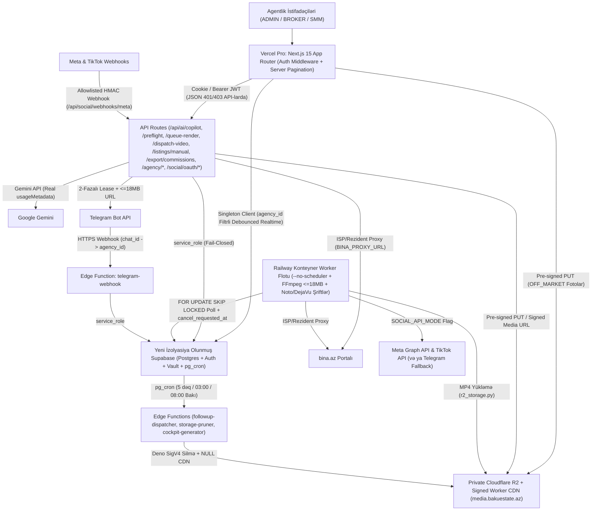

# BakuEstate-AI v2: İzolyasiya Olunmuş Multi-Agent Arxitekturası, Təhlükəsizlik Sərtləşdirməsi və Bulud Media Miqyaslanması

*   **Author:** fxbluster
*   **Status:** Accepted
*   **Date:** 2026-11-25

--------------------------------------------------------------------------------

## Overview

BakuEstate-AI əmlak elanlarının `bina.az` portalından toplanması, AI ssenari/səsləndirmə əsasında şaquli video hazırlanması, Telegram göndərişi və müştəri CRM uçotu üçün qurulmuş platformadır. Hazırda sistem tək-operator prototipi kimi işləyir: Citadel CRM ilə eyni Supabase bazasını paylaşır, anonim internet çıxışına açıqdır və video montajını bir ədəd Windows kompüteri üzərində icra edir.

Bu dizayn sənədi platformanın tam yenidənqurulmasını əhatə edir: BakuEstate-AI ayrıca Supabase layihəsinə köçürülür, real giriş və rol əsaslı icazə nəzarəti (Multi-Agent RBAC) bərpa olunur, aşkarlanmış baza/məntiq/yarış xətaları aradan qaldırılır, video montajı və saxlancı bulud konteynerlərinə (Cloudflare R2 + Railway) daşınır, sosial paylaşımlar rəsmi Meta və TikTok API-larına keçirilir və 1,000+ aktiv istifadəçi yükünə davamlı server-side CRM qurulur.

## The Problem

Müstəqil sistem təftişi istehsalat kodunda və canlı `ejsaccbeatmwqodwwzwu` Supabase bazasında 3 əsas kateqoriya üzrə kritik qüsurlar üzə çıxardı:

### 1. Təhlükəsizlik Deşikləri və Paylaşılan Baza Toqquşması

*   **Açıq Anonim Baza Çıxışı:** `supabase/migrations/202611180004_frictionless_anon_access.sql` (`listings`, `listing_events`, `render_versions`, `publications`, `buyer_leads`, `lead_listings`, `follow_up_tasks`, `pipeline_jobs`, `worker_heartbeats`, `worker_status` view-su və `count_today_auto_renders_baku()` RPC-si) və ondan sonrakı beş additiv miqrasiya (`202611190001`, `202611190002`, `202611190003`, `20261120160000`, `20261121170000` — `social_comments`, `publication_telemetry_snapshots`, `preflight_checks`, `cockpit_cards`, `lead_timeline_events`, `ai_copilot_runs`, `check_copilot_budget()`, `agent_conversations`, `agent_learned_insights`) `anon` roluna tam `SELECT`, `INSERT`, `UPDATE`, `DELETE` (`USING (true)`) və ya `EXECUTE` icazəsi verir. Brauzer kodunda `NEXT_PUBLIC_SUPABASE_ANON_KEY` açıq olduğu üçün kənar şəxs birbaşa REST/RPC sorğusu ilə bütün mülkiyyətçi/müştəri telefonlarını oxuya, bazanı silə və ya limitsiz render işi yarada bilər.
*   **Deaktiv Giriş və Saxta Token Keçidi:** `web/middleware.ts` `/login` marşrutunu `/` ünvanına yönləndirir. `web/app/api/ai/copilot/route.ts`, `web/app/api/pipeline/queue-render/route.ts` və `web/app/api/telegram/dispatch-video/route.ts` istehsalatda `test-jwt` başlanğıclı test tokenlərini (`ALLOW_DEV_OPERATOR` daxil olmaqla) qəbul edir və sessiya olmadıqda sabit `083d8ea3-4a73-4b85-8479-0c532ce939f0` operator ID-sinə düşür. `web/app/api/listings/[bina_id]/preflight/route.ts` isə heç bir autentifikasiya yoxlaması aparmır. `web/lib/supabase/admin.ts` faylı `SUPABASE_SERVICE_ROLE_KEY` olmadıqda səssizcə `NEXT_PUBLIC_SUPABASE_ANON_KEY` işlədir.
*   **Citadel CRM ilə Baza Qarışması (`cockpit_cards`):** Canlı `public.cockpit_cards` cədvəli başqa B2B CRM-ə (Citadel) aid sətirlər saxlayır (`priority` sütunu `INTEGER`, `status` isə kiçik hərflə `"pending"`-dir və `strategic_rationale` sütunu yoxdur; repo miqrasiyalarında isə heç `CREATE TABLE public.cockpit_cards` yoxdur). `web/components/CockpitCardHUD.tsx` və `src/cloud/supabase_repo.py` (`queue_cockpit_card`, `update_cockpit_card_status`) fərqli sxemlər yazır, `CockpitCardHUD` göndərdiyi `"HIGH"`/`"CRM"` dəyərləri Postgres-də xəta verib udulur, integer `priority` qayıtdıqda isə `.toUpperCase()` React səhifəsini çökdürür.

### 2. Məlumat Bütövlüyü, Səssiz Xətalar və Yarış Vəziyyətləri (Race Conditions)

*   **İşləməyən Worker Yazıları:** `src/worker/local_worker.py` (`_handle_sync_social_metrics`, sətir 1549 və 1552) olmayan `price_azn` sütununa yazır (`price_azn_normalized` əvəzinə), buna görə sosial sinxronizasiyada tapılan qiymət endirimləri bazada yenilənmir. Eyni faylda `_handle_telegram_dispatch` (sətir 1737 və 1770) `src/cloud/supabase_repo.py` daxilində mövcud olmayan `get_render_version` və `record_listing_event` metodlarını (uyğun olmayan `summary`, `metadata`, `actor="worker"` arqumentləri ilə) çağırıb `AttributeError` verir və xətanı udur.
*   **Yalançı "Kupça Var" İşarəsi:** `src/scraper/bina_scraper.py` (sətir 288–289 və 367), `config/settings.py` (sətir 215), `src/dispatcher/telegram_crm.py` (sətir 204, 221), `supabase/functions/telegram-webhook/index.ts` (sətir 272) və `web/app/api/listings/[bina_id]/preflight/route.ts` (sətir 641) sahə məlum olmadıqda və ya şablonlarda `has_bill_of_sale = True` / `"Təcili Kupçalı"` təyin edir. Bu, kupçasız mənzillərin videoda və Telegram-da "Kupçalı və ipotekaya yararlı" kimi təqdim olunmasına səbəb olur.
*   **Dublikat Render və Atomik Olmayan Əməliyyatlar:** `web/app/api/pipeline/queue-render/route.ts` əvvəl `SELECT`, sonra `Date.now()` açarı ilə `INSERT` etdiyi üçün paralel kliklərdə dublikat render işi yaranır (DB-də aktiv partial unique index yoxdur). `ListingDetailClient.tsx` (`handleQuickStatus`, `handleSaveOwner`, `handleAddPublication`), `PreflightModal.tsx` (`handleRerenderPriceDrop`), `LeadsClient.tsx`, `ListingsClient.tsx`, `JobsClient.tsx` (`enqueueUtilityJob`) və `DashboardClient.tsx` (`handleTaskAction`) bir neçə cədvələ ardıcıl tranzaksiyasız sorğu göndərir; `LeadsClient.tsx` `follow_up_tasks` insert xətasını ümumiyyətlə yoxlamadan uğur mesajı göstərir.
*   **Kilid Sıfırlanması və Yalançı Telegram Təsdiqi:** `JobsClient.tsx` `handleRetry` funksiyası işin `FAILED`/`EXPIRED` olduğunu yoxlamadan `RUNNING` işi də `QUEUED` vəziyyətinə qaytara bilər. `preflight/route.ts` cooldown-u Telegram-a göndərişdən əvvəl yoxlayır, `sendVideo` uğursuz olduqda belə mətn mesajını göndərir, Vercel-də `fs.existsSync` yoxlayır, Telegram env açarları olmadıqda yalançı uğur qaytarır və `telegram_dispatched: true` yazır. `dispatch-video/route.ts` isə UUID əvəzinə `bina_id` gəldikdə sətir 220-də crash verir və `storage_pruned_at IS NOT NULL` videolarını yoxlamadan 404 linki göndərir.
*   **AI Copilot Səhvləri:** `web/app/api/ai/copilot/route.ts` Gemini xətası zamanı saxta hardcode datalar (`175,000 AZN`, `#5616503`, `994501234567`, sətir 1064–1454 və 589/977/989) ilə `HTTP 200 ok:true` qaytarır; token və xərc yerinə sabit `0.002` (strong) / `0.0006` (fast) yazır (sətir 1459); büdcə/rate limit yoxlamalarında xəta halında `return true` (fail-open) işləyir; `.or(...)` sorğularında (sətir 366, 409, 549, 828, 1074) UUID cast crash və raw string interpolyasiyası var; `agent_conversations.messages` JSONB massivini read-modify-write yarışına açır; `action: "save_insight"` (sətir 462) olmayan `metadata` sütunu yazdığı üçün `PGRST204` xətası verir və `ActionCardView.tsx` anonim client-dən çağırdığı üçün `agent_learned_insights` 0 sətirdə qalıb.
*   **Sosial Şərh Spamı:** `local_worker.py` (sətir 1619–1664) eyni Instagram/TikTok şərhini hər poll dövrəsində təzədən emal edir və eyni müştəri üçün təkrar Telegram bildirişi göndərir; `src/social/observer.py` şərh ID-sini sıra nömrəsindən (`ig_c_{code}_{idx+1}`) düzəldir.

### 3. Miqyaslanma Darboğazları və Çatışmayan İmkanlar

*   **Tək Windows PC və Storage Kvotası:** Bütün render, preflight və sosial müşahidə tək `DESKTOP-6UBPFU0` kompüterindən asılıdır. Paralel yükdə növbə dayanır, 6.5 saniyəlik preflight poll dövrəsi `HTTP 502` xətası verir və Supabase Free 1 GB bucket limiti (~35 video) tez dolur.
*   **Səhifələnməmiş SSR və Polling Fırtınası:** `web/app/listings/page.tsx`, `web/app/leads/page.tsx`, `web/app/analytics/page.tsx` və `AnalyticsTelemetryCard.tsx` bazanı 200/500 sərt limiti ilə kəsir və ya limitsiz sorğu atır (`render_versions` və `publications` ekrandakı elanlara görə filtr edilmir). `JobsClient.tsx` debounce olmadan Realtime + 5s/10s polling edir; `WorkerStatusBadge.tsx` (hər səhifədə 2–3 dəfə mount olunur) hər 15 saniyədən bir təkrar polling sorğusu atır; `web/lib/supabase/client.ts` isə singleton deyil. (`CockpitCardHUD.tsx` artıq 500ms debounce istifadə edir və 5s/10s polling etmir.)
*   **Məhsul Boşluqları:** Multi-Agent RBAC (`assigned_agent_id`, `commission_split_pct`, agentlik ayarları UI), pre-render foto seçimi və ssenari redaktoru, manual oflayn elan əlavə etmə, rəsmi Meta/TikTok API (canlı DB-də `social_comments = 0`), avtomatik alıcı↔elan uyğunlaşdırması, iş ləğvi (`CANCELLED`), CSV ixracı, dinamik rayon medianı və vahid niş yönləndirmə qaydası (`ListingsClient`, `PreflightModal`, `AnalyticsTelemetryCard` və `account_router.py` fərqli hədlər işlədir) mövcud deyil.

## Goals

### P0 — Təhlükəsizlik, İzolyasiya və Məlumat Bütövlüyü

*   **Tam Layihə İzolyasiyası:** BakuEstate-AI məlumatları və şeması Citadel CRM (`ejsaccbeatmwqodwwzwu`) bazasından ayrılaraq təmiz bazalı ayrıca Supabase layihəsinə köçürülməlidir; Citadel cədvəllərinə (`leads`, `tasks`, `calls`, Citadel `cockpit_cards` B2B məlumatları) toxunulmamalıdır.
*   **Sıfır Anonim Çıxış və RBAC:** Bütün `anon` və `PUBLIC` icazələri (cədvəl, view, sequence, RPC) ləğv edilməli, `/login` sessiya yoxlaması bərpa edilməli (`webhook`/`oauth` marşrutları xaric), API marşrutlarında test token/dev bypass-ları və hardcoded `operatorId` silinməli, admin client fail-closed dayanmalıdır.
*   **Doğru Baza Yazıları və Ziddiyyətsiz Sxem:** `price_azn_normalized` sütunu, `SupabaseRepo` (`insert_listing_event`, `get_render_version_by_id`, `cockpit_cards` sxemi), `has_bill_of_sale = False` default qaydası (bütün scraper/dispatcher/API fayllarında), `.or(...)` UUID təhlükəsizliyi və `save_insight` (`metadata` sütun xətası olmadan) 100% işlək olmalıdır.
*   **Atomik Əməliyyatlar və Dürüst AI Cavabları:** `pipeline_jobs` üzrə aktiv partial unique indeks yaradılmalı, 2-fazalı Telegram kilidi tətbiq olunmalı, çox-cədvəlli CRM yazıları SQL RPC tranzaksiyalarına keçirilməli, `JobsClient` retry yalnız `FAILED`/`EXPIRED` sətirlərə məhdudlaşdırılmalı, Gemini xətalarında saxta `200 OK` yerinə `HTTP 503` qaytarılmalı (`OmniChatRoom` + `SpecialistRoom`), və real `usageMetadata` əsasında serializə edilmiş fail-closed büdcə limiti işləməlidir.

### P1 — Miqyaslanma və Əsas Məhsul Funksionallığı

*   **Server-Side Pagination və SQL Aqreqasiyası:** Elanlar (`canonical_niche` daxil olmaqla), müştərilər, işlər və analitika səhifələri limitlə kəsilmədən composite/GIN indekslərlə server-side səhifələmə və Postgres RPC cəmləri ilə işləməlidir.
*   **Bulud Konteyner Worker + Obyekt Saxlancı:** Render və scraping axını tək Windows PC-dən `--no-scheduler` replikalı konteyner worker-lərinə (`Dockerfile.worker` + `run_pipeline.py`) və private Cloudflare R2 saxlancına (<=18 MB MP4, imzalı custom domen `media.bakuestate.az`) köçürülməlidir.
*   **Rəsmi Sosial API və Avtomatik Uyğunlaşdırma:** Instagram/TikTok paylaşımları, OAuth token yenilənməsi (24 saat TikTok / 60 gün Meta), şərhlər və metrikalar rəsmi Meta Graph API / TikTok API ilə idarə olunmalı; həm `bina.az`, həm də `OFF_MARKET` elanlar aktiv alıcı tələbləri ilə SQL RPC vasitəsilə uyğunlaşdırılıb qrup halında bildirilməlidir.
*   **Pre-Render Studio, Oflayn Elan və Agentlik Ayarları:** Broker renderdən əvvəl 4–10 foto seçib sıralamalı, Copilot vasitəsilə ssenari qaralaması yaradıb redaktə etməli, manual eksklüziv elan əlavə etməli, Admin isə `/settings` panelindən agentlik parametrlərini və komissiya bölgüsünü (`commission_split_pct`) idarə etməlidir.
*   **Şəbəkə Yükünün Azaldılması:** Singleton browser client, `agency_id` filtrli debounced Realtime (5s/10s/15s polling fırtınası olmadan) və server-side `pg_cron` ilə cockpit generasiyası tətbiq olunmalıdır.

### P2 — State Təmizliyi və Vahid Qaydalar

*   Niş/kanal yönləndirmə qaydaları bütün Web (`ListingsClient`, `PreflightModal`, `VideoPipelineCard`, `AnalyticsTelemetryCard`) və Python (`account_router.py`) komponentlərində tək mənbədən (`agency_settings.niche_rules_json` + `canonical_niche`) gəlməlidir.
*   `PreflightModal` (`AbortController`, dürüst status yenilənməsi), `OmniChatRoom` & `SpecialistRoom` (rollback/retry), `VideoPipelineCard` & `CrmNegotiationCard` (hardcode demo video/şəkil/lead məlumatlarının silinməsi, `/worker` yönləndirməsi əvəzinə birbaşa `/jobs?tab=worker` linki), `WorkerMonitorClient` (çox-replika görünüşü) və `CopilotDrawer` təmizlənməlidir.
*   `keenable` analitika sorğusu / `market-benchmarks.ts` / `config/settings.py` daxilindəki statik rayon qiymətləri canlı `public.district_price_medians` bazası ilə əvəz edilməli və CSV formula-təhlükəsiz ixrac (`/api/export/commissions`) əlavə olunmalıdır.

## Non-Goals

*   Bu dizayn çərçivəsində iOS/Android üçün nativ mobil tətbiq yazılmır (veb CRM responsive qalır).
*   Citadel CRM-in `ejsaccbeatmwqodwwzwu` layihəsindəki cədvəllər dəyişdirilmir və ya miqrasiya olunmur — yalnız BakuEstate-AI məlumatları yeni layihəyə çıxarılır.
*   Ödəniş qəbulu, onlayn beh/escrow və ya elektron notariat imzalama modulları bu mərhələyə daxil deyil.
*   `tap.az`, `emlak.az`, `lalafo.az` kimi əlavə elan portalları üçün yeni scraper-lər bu dizaynda planlaşdırılmır (yalnız `bina.az` və manual oflayn elan girişi əhatə olunur).
*   Next.js + Supabase + Python texnologiya yığınının tam başqa dilə/freymvorka dəyişdirilməsi nəzərdə tutulmur.

## Open Questions

*(Bütün açıq suallar müəllif tərəfindən qərarlaşdırılıb və dizayna kilidlənib — açıq bloklayıcı qalmayıb.)*

1.  **Kommersiya Proxy Provayderi, Protokolu və Kvota Büdcəsi (`Resolved`):** `BINA_PROXY_URL` üçün **Webshare ISP / Static Residential (`HTTP`)** seçildi; aylıq sərt kvota **15 GB / 20 USD** ilə məhdudlaşdırılır (`5` ardıcıl xətada `MANUAL_OVERRIDE` dövrə açarı aktiv olur).
2.  **Meta/TikTok API Təsdiq Müddəti (`Resolved`):** `SOCIAL_API_MODE=TELEGRAM_FALLBACK` rejimi üçün maksimal keçid müddəti **45 gün** təyin edildi (Meta Business Verification və TikTok Developer App Review təsdiqindən sonra yalnız fövqəladə geri dönüş üçün saxlanılır).
3.  **Faza Keçid Qrafiki (`Resolved`):** **Faza 1** (P0 İzolyasiya + Multi-Agent RBAC + P0 Səhv Düzəlişləri) dərhal təkbaşına istehsalata buraxılır; **Faza 2** (Railway + Cloudflare R2 + Pagination + Pre-Render Studio) və **Faza 3** ardıcıl yayımlanır.
4.  **Kanonik Ekonom Niş Qiymət Həddi (`Resolved`):** `web/lib/niche-router.ts` və `src/worker/account_router.py` üçün susmaya görə kanonik hədd **`<= 120,000 AZN`** (və ya ətraf rayonlar → `AFFORDABLE` `@baku.serfeli.evler`, `120,001–249,999 AZN` → `GENERAL` `@bakuestate.official`, `>= 250,000 AZN` / elit rayonlar → `LUXURY` `@bakuestate.premium`, `>= 10%` endirim / təcili → `TIKTOK` `@baku_emlak_ai`) kimi standartlaşdırıldı.

## Critical User Journeys (CUJs)

### CUJ 1: Rol Əsaslı Giriş, İzolyasiya Olunmuş Baza və Məlumat Qorunması

*   **Given:** BakuEstate-AI təmiz bazalı yeni Supabase layihəsində yerləşir, `anon` və `PUBLIC` icazələri bütün cədvəl/view/sequence/RPC-lərdən sıfırlanıb və agentlikdə aktiv `ADMIN`, `BROKER` və `SMM` hesabları mövcuddur.
*   **When:** Sessiyasız istifadəçi `/listings` və ya `/api/listings/6588858/preflight` ünvanına müraciət edir; sonra aktiv `BROKER` və `SMM` hesabları ayrı-ayrılıqda `/login` üzərindən daxil olur; `ADMIN` isə `/settings` panelində bir brokeri `is_active = false` edir.
*   **Then:** Sessiyasız müraciətlər `/login` (veb) və `401 Unauthorized` JSON (API) cavabı alır; `anon` açarı ilə birbaşa REST/RPC sorğusu `0` sətir və `401/403` qaytarır; `SMM` mülkiyyətçi telefonlarını (`owner_phone_*`) oxuya bilmir; `BROKER` yalnız özünə təhkim olunmuş/ümumi portfeli görür; deaktiv edilmiş broker dərhal `403` alır və hər dəyişiklikdə `actor_user_id` yazılır.

### CUJ 2: Pre-Render Media/Ssenari Studiyası, İdempotent Bulud Renderi və İş Ləğvi

*   **Given:** Daxil olmuş broker `Elanlar Reyestri`ndə videosu olmayan və ya əl ilə əlavə etdiyi `OFF_MARKET` eksklüziv mənzili açır.
*   **When:** İstifadəçi fotolardan 4–10 ədədini (listing-in icazəli siyahısından) seçib sıralayır, `/api/ai/copilot` (`action: "generate_render_script"`) ilə yaratdığı ssenarini 1,000 simvol həddində redaktə edir, hədəf hesabı/səsi təsdiqləyib iki dəfə ardıcıl "Renderə Göndər" düyməsinə basır; sonra isə `İş Növbəsi`ndən həmin işi ləğv etmək və ya xətalı işi yenidən başlatmaq istəyir.
*   **Then:** `enqueue_listing_render_atomic` RPC-si sayəsində yalnız 1 aktiv iş yaranır; Railway konteyner worker-i (`--no-scheduler`) `run_pipeline.py` üzərindən `<= 18 MB` MP4 hazırlayıb private R2 bucket-ə yükləyir; `CANCEL` yalnız `QUEUED` işi dərhal `CANCELLED` edir və ya `RUNNING` işdə `cancel_requested_at` qoyub fazalararası təmiz dayandırır; `RETRY` yalnız `FAILED`/`EXPIRED` işlər üzərində işləyir.

### CUJ 3: Dürüst Pre-Flight Yoxlaması, Rəsmi Sosial Paylaşım və Təkrarsız Şərh-Lead Çevrilməsi

*   **Given:** Hazır videolu elan üçün Meta/TikTok OAuth hesabı Vault-da saxlanan tokenlərlə qoşuludur (və ya keçid rejimində Telegram fallback aktivdir) və video faylı R2-də aktivdir (`storage_pruned_at IS NULL`).
*   **When:** Operator "Yoxla və Paylaş" modalını açıb başqa elana sürətlə keçir, sonra təsdiq düyməsini iki dəfə sıxır (`OFF_MARKET` və ya `bina.az` elanı üzərində); paylaşım yayımlandıqdan sonra Meta webhook və ya fallback poller iki dəfə eyni alıcı şərhini oxuyur.
*   **Then:** Əvvəlki modalın gecikmiş sorğusu `AbortController` ilə ləğv edilir; `OFF_MARKET` elanlarda `bina.az` scraping-i əvəzinə broker təsdiqi işləyir; `claim_telegram_dispatch_slot` 60 saniyəlik atomik lease kilidi ilə ikinci paralel klikin Telegram-a dublikat video atmasını bloklayır; `sendVideo` uğursuz olduqda kilid buraxılır, `telegram_dispatched_at` yazılmır və `502` qayıdır; sosial şərhdən yaranan lead və bildiriş `ON CONFLICT (publication_id, platform_comment_id)` ilə yalnız ilk dəfə yaranır.

### CUJ 4: Səhifələnmiş Yüksək Həcmli CRM, Atomik Lead Yazısı, Smart Matching və CSV İxrac

*   **Given:** Bazada 2,000+ elan, 1,500+ müştəri və `min_rooms` / `requires_kupca` / `budget_max_azn` / `preferred_districts` meyarlı alıcılar mövcuddur.
*   **When:** Broker CRM-də "Yeni Müştəri" formunu doldurub elana bağlayır, oflayn elan yaradır (`OFF_MARKET` R2 upload) və ya `Elanlar` / `Analitika` / komissiya CSV ixracından istifadə edir.
*   **Then:** Müştəri + elan əlaqəsi + follow-up tapşırığı `create_buyer_lead_atomic` SQL RPC-sində tam atomik yazılır; həm scraper, həm də `/api/listings/manual` `match_listing_to_leads` RPC-sini işə salıb uyğun alıcıları `followup-dispatcher` vasitəsilə sakit saatlara uyğun qruplaşdırılmış bildirişlə göndərir; səhifələr `pageSize=24`, persisted `canonical_niche` və `get_agency_crm_kpis` / `get_analytics_summary` SQL RPC-ləri ilə `< 300 ms` işləyir; `/api/export/commissions` isə formula-injection qorumalı CSV verir.

### CUJ 5: Dürüst AI Copilot, Real Xərc/Büdcə Nəzarəti və İtirilməyən Yaddaş

*   **Given:** Operator AI Qərargahında Müdir (`OmniChatRoom`) və ya Analitika / Müştəri Psixologiyası (`SpecialistRoom`) otağında söhbət edir və agentlik üzrə aylıq AI büdcəsi/rate limit nəzarəti aktivdir.
*   **When:** İki paralel tabdan mesaj göndərilir, sonra agentin yaratdığı `SAVE_INSIGHT` kartında "Yaddaşa Saxla" basılır; ayrıca bir sorğu zamanı Gemini API cavab vermir və ya büdcə limiti dolur.
*   **Then:** Mesajlar ayrı append-only `agent_messages` (`seq_num` sıralamalı) cədvəlinə yazıldığı üçün paralel mesajlar itmir; `SAVE_INSIGHT` mövcud olmayan `metadata` sütunu olmadan `/api/ai/copilot` üzərindən uğurla bazaya düşür; `check_and_reserve_ai_budget` + `reconcile_ai_budget_run` real `usageMetadata` dəyərlərini hesablayır; Gemini xətasında `HTTP 503` (`code: "UPSTREAM_UNAVAILABLE"`) qaytarılır və həm `OmniChatRoom`, həm `SpecialistRoom` uğursuz mesajı `localStorage`-a saxlamadan `Yenidən Göndər` imkanı verir.

## Technical Plan (Architecture)

### 1. Sistem Topologiyası

BakuEstate-AI v2 üç müstəqil təbəqədən ibarət izolyasiya olunmuş arxitekturaya keçirilir: Vercel (Pro plan) üzərində işləyən Auth-qorumalı `Next.js 15` tətbiqi (`web/package.json: "next": "^15.3.3"`), yalnız BakuEstate-AI-a məxsus yeni Supabase layihəsi (Postgres + Auth + Vault + RBAC RLS + Atomik RPC + `pg_cron` + Edge Functions) və Railway üzərində `--no-scheduler` replikaları ilə işləyən Docker media konteynerləri (private Cloudflare R2 + imzalı Cloudflare Worker CDN + ISP/Rezident Proxy).

### 2. İzolyasiya Olunmuş Supabase Layihəsi və Multi-Agent RBAC Məlumat Modeli

1.  **Təmiz Baza Başlanğıcı və Citadel CRM-dən Tam Ayrılma:** Mövcud `ejsaccbeatmwqodwwzwu` layihəsinə və Citadel cədvəllərinə (`leads`, `tasks`, `calls`, Citadel `cockpit_cards`) toxunulmur. Yeni layihədə köhnə miqrasiyalar (`202611190003` daxil olmaqla `ALTER TABLE cockpit_cards` xətası verəcək şəkildə) kor-koranə təkrar icra edilmir; bunun əvəzinə **Faza 1 başlanğıc miqrasiyası (`202611260001_v2_baseline_and_rbac.sql`)** `pg_cron`, `pg_net`, `pg_trgm` və `supabase_vault` genişlənmələrini aktivləşdirir, bütün BakuEstate cədvəllərinin (`DRAFT_READY`, `PASSED_WITH_DB_FALLBACK`, təmiz `cockpit_cards`, `baku_estate_config` daxil) tam bazasını sıfırdan yaradır və birdəfəlik köçürmə skripti 16 obyekti köhnə layihədən seçici olaraq ixrac edib köçürür.
2.  **Agentlik və Rol Modeli DDL:**
    *   `public.agencies (id UUID PRIMARY KEY DEFAULT gen_random_uuid(), name TEXT NOT NULL, created_at TIMESTAMPTZ NOT NULL DEFAULT NOW())`
    *   `public.agency_members (user_id UUID PRIMARY KEY REFERENCES auth.users(id) ON DELETE CASCADE, agency_id UUID NOT NULL REFERENCES public.agencies(id) ON DELETE CASCADE, role TEXT NOT NULL CHECK (role IN ('ADMIN','BROKER','SMM')), display_name TEXT NOT NULL, whatsapp_phone TEXT NULL, telegram_chat_id TEXT NULL, commission_split_pct NUMERIC(5,2) NOT NULL DEFAULT 50.00 CHECK (commission_split_pct BETWEEN 0 AND 100), is_active BOOLEAN NOT NULL DEFAULT TRUE, created_at TIMESTAMPTZ NOT NULL DEFAULT NOW())` — 1 istifadəçi = 1 aktiv agentlik modeli `auth.uid()` üzərindən birmənalı tenant həllini təmin edir.
    *   `public.agency_settings (agency_id UUID PRIMARY KEY REFERENCES public.agencies(id) ON DELETE CASCADE, public_phone TEXT NOT NULL, telegram_chat_id TEXT NULL, niche_rules_json JSONB NOT NULL DEFAULT '{"luxury_min_azn":250000,"affordable_max_azn":120000,"viral_drop_pct":10}'::jsonb, social_api_mode TEXT NOT NULL DEFAULT 'TELEGRAM_FALLBACK' CHECK (social_api_mode IN ('OFFICIAL','TELEGRAM_FALLBACK')), watermark_preset_json JSONB NOT NULL DEFAULT '{}'::jsonb, monthly_ai_budget_usd NUMERIC(10,2) NOT NULL DEFAULT 50.00, ai_rate_limit_rpm INT NOT NULL DEFAULT 20, updated_at TIMESTAMPTZ NOT NULL DEFAULT NOW())`
    *   `public.listing_owner_contacts (listing_id UUID PRIMARY KEY REFERENCES public.listings(id) ON DELETE CASCADE, agency_id UUID NOT NULL REFERENCES public.agencies(id) ON DELETE CASCADE, owner_name TEXT NULL, owner_phone_raw TEXT NULL, owner_phone_normalized TEXT NULL)` — mülkiyyətçi telefon PII-sini `listings`-dən ayırır ki `SMM` rolu elan mətnini və mediasını görsün, amma mülkiyyətçi nömrəsinə çıxış əldə edə bilməsin.
    *   `public.listings` əlavə sütunları: `agency_id UUID NOT NULL REFERENCES public.agencies(id) ON DELETE CASCADE`, `assigned_agent_id UUID NULL REFERENCES auth.users(id) ON DELETE SET NULL`, `created_by UUID NULL REFERENCES auth.users(id) ON DELETE SET NULL`, `source_type TEXT NOT NULL DEFAULT 'BINA_AZ' CHECK (source_type IN ('BINA_AZ','OFF_MARKET'))`, `canonical_niche TEXT NOT NULL DEFAULT 'GENERAL' CHECK (canonical_niche IN ('LUXURY','AFFORDABLE','GENERAL','TIKTOK'))`, nullable `bina_id TEXT NULL` & `url TEXT NULL` (`CHECK (source_type = 'OFF_MARKET' OR (bina_id IS NOT NULL AND url IS NOT NULL))`), və qlobal `UNIQUE(bina_id)` əvəzinə `CREATE UNIQUE INDEX uq_listings_agency_bina_id ON public.listings (agency_id, bina_id) WHERE bina_id IS NOT NULL`.
    *   Mövcud əməliyyat cədvəllərinə `agency_id UUID NOT NULL REFERENCES public.agencies(id) ON DELETE CASCADE` (əlavə olaraq `buyer_leads`, `follow_up_tasks`, `publications`, `pipeline_jobs`, `cockpit_cards` cədvəllərinə `assigned_agent_id`, `created_by`; `listing_events` və `lead_timeline_events` cədvəllərinə `actor_user_id UUID NULL REFERENCES auth.users(id)`): `render_versions`, `listing_events`, `lead_listings`, `preflight_checks` (`bina_id` nullable, `listing_id UUID NOT NULL`), `social_comments` (+ `UNIQUE (publication_id, platform_comment_id)`), `lead_timeline_events`, `publication_telemetry_snapshots`, `agent_conversations`, `agent_learned_insights`, `ai_copilot_runs`.
    *   Yeni cədvəllər: `public.cockpit_cards (id UUID PK, agency_id UUID NOT NULL, lead_id UUID NULL, listing_id UUID NULL, channel TEXT NOT NULL, priority TEXT NOT NULL CHECK (priority IN ('LOW','NORMAL','HIGH','URGENT')), status TEXT NOT NULL DEFAULT 'PENDING' CHECK (status IN ('PENDING','EXECUTED','DISMISSED','SNOOZED')), headline TEXT NOT NULL, draft_text TEXT NULL, reason TEXT NULL, sentinel_warning TEXT NULL, strategic_rationale TEXT NULL, target_uri TEXT NULL, assigned_agent_id UUID NULL, created_by UUID NULL, created_at TIMESTAMPTZ NOT NULL DEFAULT NOW(), expires_at TIMESTAMPTZ NULL)`, `public.agent_messages (id UUID PK, conversation_id UUID NOT NULL REFERENCES public.agent_conversations(id) ON DELETE CASCADE, agency_id UUID NOT NULL, operator_id UUID NOT NULL, sender_type TEXT NOT NULL CHECK (sender_type IN ('USER','AGENT','SYSTEM')), sender_name TEXT NOT NULL, content TEXT NOT NULL, action_payload JSONB NOT NULL DEFAULT '{}'::jsonb, seq_num BIGINT GENERATED ALWAYS AS IDENTITY, created_at TIMESTAMPTZ NOT NULL DEFAULT NOW())`, `public.agency_ai_usage_monthly (agency_id UUID NOT NULL, month_baku TEXT NOT NULL, reserved_usd NUMERIC(12,6) NOT NULL DEFAULT 0, spent_usd NUMERIC(12,6) NOT NULL DEFAULT 0, PRIMARY KEY (agency_id, month_baku))`, `public.social_accounts`, `public.lead_listing_matches (id UUID PK, agency_id UUID NOT NULL, lead_id UUID NOT NULL, listing_id UUID NOT NULL, match_score INT NOT NULL CHECK (match_score BETWEEN 0 AND 100), status TEXT NOT NULL DEFAULT 'NEW' CHECK (status IN ('NEW','NOTIFIED','DISMISSED')), notified_at TIMESTAMPTZ NULL, created_at TIMESTAMPTZ NOT NULL DEFAULT NOW(), UNIQUE (lead_id, listing_id))`.
    *   `buyer_leads` əlavələri: `min_rooms INT NULL`, `requires_kupca BOOLEAN NOT NULL DEFAULT FALSE`.
3.  **Sıfır Anon İcazə və Tam Table × Role RLS Matrisi:**
    *   `REVOKE ALL ON ALL TABLES IN SCHEMA public FROM PUBLIC, anon; REVOKE ALL ON ALL SEQUENCES IN SCHEMA public FROM PUBLIC, anon; REVOKE ALL ON ALL FUNCTIONS IN SCHEMA public FROM PUBLIC, anon; ALTER DEFAULT PRIVILEGES IN SCHEMA public REVOKE ALL ON TABLES, SEQUENCES, FUNCTIONS FROM PUBLIC, anon;`
    *   Bütün köhnə `USING (true)` siyasətləri (`202611180004`–`20261121170000`) silinir. `public.current_agency_id()`, `public.is_agency_member(p_agency_id)`, `public.is_agency_admin(p_agency_id)` funksiyaları `SECURITY DEFINER SET search_path = public` olaraq `agency_members.is_active = TRUE` şərtini məcburi yoxlayır (RLS rekursiyasının qarşısı alınır).

| Cədvəl / Obyekt | `ADMIN` | `BROKER` | `SMM` | Qeyd |
| :--- | :--- | :--- | :--- | :--- |
| `agencies`, `agency_settings` | `SELECT`/`UPDATE` (öz `agency_id`) | `SELECT` (öz `agency_id`) | `SELECT` (öz `agency_id`) | Ayar dəyişikliyi yalnız `ADMIN` |
| `agency_members` | Tam CRUD (öz `agency_id`) | `SELECT` (öz `agency_id`) | `SELECT` (öz `agency_id`) | Broker öz `role` sütununu yüksəldə bilməz |
| `listings` | Tam CRUD (öz `agency_id`) | `SELECT` portfel; `INSERT`/`UPDATE` (`assigned_agent_id = auth.uid() OR assigned_agent_id IS NULL`) | `SELECT` (yalnız media/nəşr sahələri) | Mülkiyyətçi telefonu `listing_owner_contacts`-dadır |
| `listing_owner_contacts` | Tam CRUD (öz `agency_id`) | `SELECT`/`UPDATE` (təhkimli və ya `assigned_agent_id IS NULL`) | **İcazə Yoxdur (`0` sətir)** | PII contractor sızması bağlanır |
| `buyer_leads`, `lead_listings`, `follow_up_tasks`, `lead_timeline_events`, `lead_listing_matches` | Tam CRUD (öz `agency_id`) | `SELECT`/`INSERT`/`UPDATE` (yalnız `assigned_agent_id = auth.uid()`) | **İcazə Yoxdur (`0` sətir)** | Brokerlər arası müştəri məxfiliyi |
| `render_versions`, `publications`, `preflight_checks`, `social_comments`, `publication_telemetry_snapshots` | Tam CRUD (öz `agency_id`) | `SELECT` (öz `agency_id`) | Tam CRUD (öz `agency_id`) | Sosial/media əməliyyatları `ADMIN`+`SMM` |
| `pipeline_jobs`, `cockpit_cards` | Tam CRUD (öz `agency_id`) | `SELECT`/öz işləri üzrə `INSERT`/`UPDATE` | `SELECT`/media işləri üzrə `INSERT`/`UPDATE` | Status keçidləri RPC ilə |
| `agent_conversations`, `agent_messages`, `agent_learned_insights`, `ai_copilot_runs` | `SELECT` audit (öz `agency_id`) | Tam CRUD (`operator_id = auth.uid()`) | Tam CRUD (`operator_id = auth.uid()`) | Yalnız server/admin və öz söhbəti |
| `social_accounts`, `baku_estate_config`, `agency_ai_usage_monthly` | **Klient RLS bağlı (`service_role` yalnız)** | **Klient RLS bağlı** | **Klient RLS bağlı** | Token/büdcə yalnız backend RPC/API |
| `worker_heartbeats`, `worker_status` | `SELECT` (authenticated) | `SELECT` (authenticated) | `SELECT` (authenticated) | Yazı yalnız Railway `service_role` |

4.  **Auth Sərtləşdirməsi və Middleware İstisnaları:**
    *   `web/middleware.ts`: `/login`, `/_next/*`, `/favicon.ico`, `/api/social/webhooks/*`, `/api/social/oauth/*` marşrutlarını açıq buraxır; digər `/api/*` sorğularını `307` HTML yönləndirməsinə salmır (`resolve-operator.ts` JSON `401`/`403` qaytarır); veb səhifələrdə isə aktiv Supabase sessiyası (`getUser()`) olmayanları `/login`-ə yönləndirir.
    *   `web/lib/auth/resolve-operator.ts`: Cookie sessiyasını və ya `Authorization: Bearer <jwt>` başlığını təsdiqləyir, `agency_members` cədvəlindən `is_active = TRUE` qeydini oxuyub `{ operatorId, agencyId, role, displayName }` qaytarır. Sessiyasızda `null` (`401`), üzvlüyü olmayan/deaktiv istifadəçidə `403` qaytarır. Bütün `test-jwt` / `ALLOW_DEV_OPERATOR` / hardcoded `083d8ea3-...` keçidləri silinir.
    *   `web/lib/supabase/admin.ts`: `const url = process.env.SUPABASE_URL || process.env.NEXT_PUBLIC_SUPABASE_URL` və `const serviceKey = process.env.SUPABASE_SERVICE_ROLE_KEY` oxuyur; hər hansı biri çatışmadıqda (anon key-ə və ya köhnə layihəyə düşmədən) dərhal `Error` atır (fail-closed).

### 3. Atomik RPC Sxemləri, Yarış Kilidləri və P0 Səhv Düzəlişləri

1.  **İdempotentlik və İş Dövrü İndeksləri:**
    *   `uq_pipeline_jobs_active_listing`: `(listing_id, job_type) WHERE status IN ('QUEUED', 'RUNNING') AND listing_id IS NOT NULL`.
    *   `uq_pipeline_jobs_active_utility`: `(agency_id, job_type) WHERE status IN ('QUEUED', 'RUNNING') AND job_type IN ('SCRAPE_NEW', 'LIVENESS_CHECK')`.
    *   `uq_pipeline_jobs_active_idempotency`: Köhnə `UNIQUE(idempotency_key)` məhdudiyyəti `CREATE UNIQUE INDEX uq_pipeline_jobs_idempotency_active ON public.pipeline_jobs (idempotency_key) WHERE status <> 'CANCELLED'` ilə əvəz olunur ki, broker ləğv edilmiş işi yenidən renderə göndərə bilsin.
2.  **Formal SQL RPC Müqavilələri (bütün klient-çağırılan RPC-lər `SECURITY INVOKER` və ya `auth.uid()` → `current_agency_id()` yoxlaması ilə, `p_agency_id` parametri etibarsız güvən kimi qəbul edilmədən):**
    *   `enqueue_listing_render_atomic(p_listing_id UUID, p_job_type TEXT DEFAULT 'RENDER_INITIAL', p_target_account TEXT DEFAULT NULL, p_voice_preset TEXT DEFAULT NULL, p_params_json JSONB DEFAULT '{}'::jsonb) RETURNS JSONB` — `RENDER_INITIAL` və `RERENDER` dəstəkləyir, dublikat olduqda `{ ok: true, already_queued: true, job_id }` qaytarır.
    *   `retry_or_cancel_pipeline_job(p_job_id UUID, p_action TEXT) RETURNS JSONB` — `RETRY` yalnız `status IN ('FAILED', 'EXPIRED')` üzərində (`attempts = 0, locked_by = NULL, lease_expires_at = NULL, cancel_requested_at = NULL, finished_at = NULL, status = 'QUEUED'`); `RUNNING` işə `RETRY` gəldikdə `409 Conflict` (`error: 'JOB_STILL_RUNNING'`) qaytarır. `CANCEL` `QUEUED` işi dərhal `CANCELLED` edir, `RUNNING` işdə `cancel_requested_at = NOW()` qoyur.
    *   `complete_pipeline_job(p_job_id UUID, p_worker_id TEXT, p_status TEXT, p_error_message TEXT DEFAULT NULL) RETURNS BOOLEAN` — `v_status IN ('SUCCEEDED', 'FAILED', 'EXPIRED', 'QUEUED', 'CANCELLED')` qəbul edir.
    *   `claim_telegram_dispatch_slot(p_publication_id UUID, p_cooldown_seconds INT DEFAULT 300) RETURNS TABLE(acquired BOOLEAN, lock_token UUID, locked_until TIMESTAMPTZ)` — `publications` cədvəlindəki yeni `dispatch_lock_token UUID NULL`, `dispatch_locked_until TIMESTAMPTZ NULL` sütunlarını atomik `UPDATE ... WHERE ... AND (dispatch_locked_until IS NULL OR dispatch_locked_until < NOW()) AND (telegram_dispatched_at IS NULL OR telegram_dispatched_at < NOW() - make_interval(secs => p_cooldown_seconds))` ilə 60 saniyəlik lease alır.
    *   `confirm_telegram_dispatch(p_publication_id UUID, p_lock_token UUID, p_message_id BIGINT) RETURNS BOOLEAN` — `sendVideo ok === true` sonrası `telegram_dispatched_at = NOW()`, `dispatch_lock_token = NULL`, `dispatch_locked_until = NULL` yazır.
    *   `release_telegram_dispatch_slot(p_publication_id UUID, p_lock_token UUID) RETURNS BOOLEAN` — `sendVideo` xətasında `502` qaytarmazdan əvvəl `lock_token` uyğunluğu ilə kilidi açır.
    *   `create_buyer_lead_atomic(...)`, `confirm_publication_atomic(...)`, `resolve_duplicate_listing_atomic(...)` — `actor_user_id = auth.uid()` və `agency_id` ilə çox-cədvəlli tranzaksiyanı icra edir.
3.  **P0 Kod Uyğunsuzluqlarının Tam Düzəlişi:**
    *   `src/worker/local_worker.py` (sətir 1549 və 1552): `"price_azn"` → `"price_azn_normalized"`; sətir 1737/1770: `repo.get_render_version_by_id(...)` və `repo.insert_listing_event(listing_id=..., event_type=..., new_value=..., triggered_job_id=..., actor="local_worker")`.
    *   `src/scraper/bina_scraper.py` (L288–289, L367), `config/settings.py` (L215 `SCRAPE_HAS_BILL_OF_SALE = False`), `src/dispatcher/telegram_crm.py` (L204, L221), `telegram-webhook/index.ts` (L272), `preflight/route.ts` (L641): məlum olmadıqda `has_bill_of_sale = False`, başlıqlardan şərtsiz `"Kupçalı"` ifadəsi silinir.
    *   `web/app/api/telegram/dispatch-video/route.ts` (L220–248, L305, L409–425): `listing.id` UUID-i `render_versions` sorğusundan əvvəl həll edilir, `storage_pruned_at !== null` olduqda `HTTP 410 Gone` qayıdır, Telegram konfiqurasiyası olmadıqda `HTTP 503` (saxta uğur silinir), `enqueueTelegramWorker` `agency_id` yazır.
    *   `web/app/api/listings/[bina_id]/preflight/route.ts`: `OFF_MARKET` elanlarda `bina.az` scraping-i qısa dövrə ilə keçilir; `fs.existsSync` və `getPublicUrl` fallback-ı silinir; Telegram konfiqurasiyası yoxdursa `HTTP 503` qayıdır.
    *   `web/app/api/ai/copilot/route.ts`: bütün 5 `.or(...)` injection sahəsi (`L366`, `L409`, `L549`, `L828`, `L1074`) `UUID_REGEX` + parametrik sorğuya keçirilir; `save_insight` (`L462`) olmayan `metadata` sütununu göndərmir.

### 4. Dürüst AI Copilot, Real Xərc Uçotu və Append-Only Söhbət Tarixçəsi

1.  **Append-Only `public.agent_messages`:** `copilot/route.ts` yalnız yeni mesajları yazmaqla kifayətlənmir — `agent_chat` tarixçə oxunması (`L745–811`), `get_conversation` (`L359`) və `reset_conversation` (`L402`) tamamilə `agent_messages` üzərinə köçürülür və `ORDER BY created_at ASC, seq_num ASC` ilə sıralanır.
2.  **Serializə Edilmiş Büdcə Rezervasiyası, Rekonsiliasiya və Qiymət Cədvəli:**
    *   `check_and_reserve_ai_budget(p_operator_id UUID, p_agency_id UUID, p_estimated_usd NUMERIC DEFAULT 0.015) RETURNS TABLE(allowed BOOLEAN, run_id UUID, reason TEXT)`: `agency_ai_usage_monthly` sətrini `SELECT ... FOR UPDATE` ilə kilidləyir, `spent_usd + reserved_usd + p_estimated_usd <= monthly_ai_budget_usd` və son 60 saniyəlik `COUNT(*) < ai_rate_limit_rpm` yoxlayıb `PENDING` `ai_copilot_runs` sətri və `reserved_usd` artırır (DB xətasında fail-closed `allowed = FALSE`).
    *   `reconcile_ai_budget_run(p_run_id UUID, p_prompt_tokens INT, p_output_tokens INT, p_audio_seconds NUMERIC, p_actual_usd NUMERIC, p_status TEXT)`: Gemini cavabı gəldikdə `reserved_usd` azaldılıb real `spent_usd` yazılır; `HTTP 503` xətasında `reserved_usd` geri qaytarılır (`0.00`).
    *   **Qiymət Cədvəli (USD / 1M token):** `gemini-2.5-flash` / `gemini-3.8-flash` (`input: $0.15`, `output: $0.60`, `audio_in_sec: $0.000025`). `(agency_id, created_at DESC)` indeksi əlavə olunur.
3.  **Saxta Mock Fallback-ların Tam Ləğvi:** `copilot/route.ts` içindəki bütün mock fallback blokları (`L589`, `L977`, `L989`, `L1064–1092`, `L1128–1454`) silinir və əvəzinə `HTTP 503` (`code: "UPSTREAM_UNAVAILABLE"`) qaytarılır. `web/lib/ai-client.ts` `CopilotErrorCode` tipinə `"UPSTREAM_UNAVAILABLE"` əlavə edir. Həm `OmniChatRoom.tsx`, həm də `SpecialistRoom.tsx` `503`/xəta zamanı optimistik mesajı `FAILED` kimi işarələyib `Yenidən Göndər` seçimi verir və uğursuz mesajı `localStorage`-a etibarlı tarixçə kimi yazmır.

### 5. Bulud Media Boru Xətti (Railway + Private R2 + İmzalı Custom Domen + ISP Proxy)

1.  **Railway Konteyner Worker Flotu (`Dockerfile.worker`, `railway.toml`):**
    *   `python:3.13-slim` + `ffmpeg` + `fonts-dejavu-core` + `fonts-noto-core` (Azərbaycan əlifbası `ə, ğ, ş, ç, ö, ü, ı` altyazıları üçün).
    *   Replikalar `--no-scheduler` bayrağı ilə işə düşür (`SCRAPE_NEW` və `LIVENESS_CHECK` cədvəllərini mərkəzi `pg_cron` növbəyə atır).
    *   `local_worker.py` `run_pipeline.py` (`BakuEstatePipeline.process_listing_video_and_dispatch`) funksiyasına `selected_photo_urls`, `custom_script_text`, `agency_settings` (su nişanı, əlaqə nömrəsi) və `cancel_check_cb` ötürür; faza keçidlərində `is_job_cancel_requested` `true` olarsa qismən temp fayllar (`try/finally`) və qismən R2 obyekti silinir, `complete_pipeline_job(..., "CANCELLED")` çağırılır. `SIGTERM` zamanı FFmpeg alt-prosesi dayandırılır və iş `QUEUED` (və ya `CANCELLED`) vəziyyətinə buraxılır.
2.  **Private Cloudflare R2 & Telegram/TikTok Ölçü Zəmanəti (`src/cloud/r2_storage.py`):**
    *   Bucket tam `private` saxlanır; `render_versions.video_cdn_url` sütununa ömrü 7 günə bitən S3 SigV4 URL-i **yazılmır**. Əvəzində `render_versions.storage_object_path` (`videos/{agency_id}/{listing_id}/v{v}.mp4`) və `storage_provider ('supabase'|'r2')` saxlanır.
    *   Videolar Cloudflare Worker custom domeni (`https://media.bakuestate.az/v/...` — TikTok `PULL_FROM_URL` üçün domen doğrulamalı, veb CRM oynatıcı üçün qısa ömürlü HMAC URL imzası ilə) üzərindən xidmət olunur.
    *   FFmpeg iki-keçidli (`2-pass`) bitreyt məhdudlaşdırması ilə bütün MP4 çıxışlarını **<= 18 MB** saxlayır ki Telegram Bot API-nin 20 MB URL fetch limiti heç vaxt aşılmasın.
    *   `supabase/functions/storage-pruner/index.ts` `storage_provider` dəyərinə görə R2 S3 SigV4 (WebCrypto) və ya legacy Supabase Storage silməsi icra edir; həmçinin bazada əlaqəsi olmayan tərk edilmiş `OFF_MARKET` foto obyektlərini R2 lifecycle (7 gün `staging/` prefiksi) ilə təmizləyir.
3.  **ISP/Rezident Proxy (`BINA_PROXY_URL`) və Manual Fallback:**
    *   `preflight/route.ts` (Node.js runtime, `undici.ProxyAgent`) və `src/scraper/bina_scraper.py` `BINA_PROXY_URL` üzərindən sorğu göndərir. Proxy ardıcıl 5 dəfə 403/timeout verdikdə `OPEN` dövrə açarı (circuit breaker) işə düşür və preflight operatora `MANUAL_OVERRIDE` təsdiq pəncərəsi təqdim edir.

### 6. Yüksək Həcmli CRM, Pre-Render Studio, Smart Matching və Rəsmi Sosial API

1.  **Server-Side Pagination, İndekslər və Realtime:**
    *   `202611260003` miqrasiyası composite `(agency_id, created_at DESC)`, `(agency_id, editorial_status, created_at DESC)`, `(agency_id, canonical_niche, created_at DESC)`, `(agency_id, stage, next_followup_at)` və `pg_trgm` GIN axtarış indeksləri əlavə edir.
    *   `listings.canonical_niche` yazıda/redaktədə və `agency_settings.niche_rules_json` dəyişəndə SQL/backend tərəfindən yenilənir ki `/listings` `RANGE` sorğusu 2,000+ sətiri dəqiq səhifələyə bilsin.
    *   `PaginatedResult<T> { items: T[]; totalCount: number; page: number; pageSize: number; hasNextPage: boolean }` müqaviləsi tətbiq edilir (`listings`, `leads`, `analytics`, `jobs` — PostgREST axtarış girişləri escape olunur, filtr dəyişdikdə `page=1`-ə sıfırlanır).
    *   `get_agency_crm_kpis()` və `get_analytics_summary(p_days INT)` RPC-ləri `auth.uid()` üzərindən `agency_id` və `commission_split_pct` əsasında komissiya bölgüsünü hesablayır. `/api/export/commissions` UTF-8 BOM + CSV formula-injection qoruması (`=`, `+`, `-`, `@`, `\t`, `\r` prefiksinə `'` əlavəsi), max 10,000 sətir/1 il limiti və `SMM → 403` qaydası ilə işləyir.
    *   `web/lib/supabase/client.ts` singleton qaytarır; `JobsClient.tsx` 1.5s debounce + WebSocket `SUBSCRIBED` olduqda polling-i dayandırır (`filter: agency_id=eq.${agencyId}`); `WorkerStatusBadge.tsx` 15s polling əvəzinə `AppShell` səviyyəli tək paylaşılan kontekstə bağlanır; `CockpitCardHUD.tsx` yalnız `/` ana səhifəsində render edilir və `Sign Out` zamanı bütün `bakuestate_*` `localStorage` açarları təmizlənir.
2.  **Pre-Render Studio & `OFF_MARKET` İdarəsi:**
    *   `copilot/route.ts` yeni `action: "generate_render_script"` dəstəkləyir (`{ draft_script, hook_type }`).
    *   `queue-render/route.ts` `selected_photo_urls` (`4 <= len <= 10`, SSRF əleyhinə yalnız `listings.photo_urls` və ya agentliyin R2 prefiksi ilə allowlist yoxlaması) və `custom_script_text` (`<= 1,000` simvol) qəbul edir (`< 4` fotoda render düyməsi deaktiv edilir). `bina_scraper.py` `max_photos=10` edir.
    *   `/api/listings/manual` (`POST`): R2 CORS qorumalı, `image/jpeg|png|webp` və max 10 MB həcmli pre-signed PUT URL-ləri (`staging/{agency_id}/...`) verir və yekunda `listings` (`source_type='OFF_MARKET'`, `bina_id=NULL`) yaradır.
3.  **Avtomatik Alıcı ↔ Elan Uyğunlaşdırması (`match_listing_to_leads`):**
    *   Həm scraper (`local_worker.py`), həm də `/api/listings/manual` `ACTIVE` elan yarandıqda və ya qiymət düşdükdə `match_listing_to_leads(p_listing_id UUID)` SQL RPC-sini çağırır.
    *   Qiymətləndirmə (0–100): aktiv `stage NOT IN ('WON_CLOSED','LOST','COLD')`; büdcə uyğunluğu (`price_azn_normalized <= budget_max_azn` → +40, +10% tolerans → +20), rayon uyğunluğu (+30), `rooms >= min_rooms` (+15), `NOT requires_kupca OR has_bill_of_sale` (+15). `match_score >= 60` olduqda `lead_listing_matches` cədvəlinə (`ON CONFLICT (lead_id, listing_id) DO NOTHING`) yazılır və `followup-dispatcher` Bakı sakit saatları (`09:00–21:30`) daxilində qruplaşdırılmış digest Telegram xəbərdarlığı göndərir.
4.  **Rəsmi Meta Graph API & TikTok API + Vault Wrapper-ləri:**
    *   `202611260004`: `social_accounts` cədvəlinə `refresh_vault_secret_id UUID NULL` əlavə edir; `service_role`-only Vault RPC-ləri (`store_social_secret`, `read_social_secret`) yaradır; `pipeline_jobs.job_type` CHECK-inə `'PUBLISH_SOCIAL'` və `publications(channel, external_post_id)` indeksi əlavə edir.
    *   `/api/social/oauth/[platform]`: Meta (`instagram_basic`, `instagram_content_publish`, `instagram_manage_comments`, `pages_show_list`) və TikTok (`video.publish`, `video.list`) CSRF `state` yoxlamalı OAuth + planlı 24s/60g token yeniləmə işi (`refresh_social_tokens`).
    *   `/api/social/webhooks/meta`: `GET` (`hub.mode === 'subscribe'` & `hub.verify_token` → `hub.challenge`) və `POST` (`X-Hub-Signature-256` HMAC-SHA256) işləyir.
    *   `official_clients.py` Meta 2-mərhələli Reels container (`create` → poll `FINISHED` → `publish`) və TikTok `PULL_FROM_URL` (`media.bakuestate.az`) axınını icra edir; `observer.py` isə fallback zamanı `sha256(f"{platform}:{code}:{author_handle}:{clean_text[:120]}")` heşini işlədir.
5.  **P2 Vahid Qaydalar, `/settings` və State Təmizliyi:**
    *   `web/lib/niche-router.ts` və `src/worker/account_router.py` tək `agency_settings.niche_rules_json` qaydasını işlədir (`AnalyticsTelemetryCard.tsx` statik qiymətləri silinir).
    *   `/settings` (`ADMIN` üçün): agentlik telefonu, Telegram chat ID, su nişanı, niş qaydaları, AI büdcəsi, broker aktivasiyası və `commission_split_pct` idarəsi.
    *   `VideoPipelineCard.tsx`, `CrmNegotiationCard.tsx`, `WorkerMonitorClient.tsx` və `CopilotDrawer.tsx` içindəki demo datalar, tək-worker PowerShell əmri və olmayan `phone_raw` sorğusu təmizlənir (`/worker` redirect-i saxlansa da kart linki birbaşa `/jobs?tab=worker` olur).
    *   `district_price_medians` view-su `keenable` analitika callback-i, `market-benchmarks.ts` və `config/settings.py` üçün canlı mənbə olur.

## Alternatives Considered

### Alternative A: Mövcud Paylaşılan Supabase Layihəsində (`ejsaccbeatmwqodwwzwu`) Tək Operator + Server Proxy Kilidi

*   **Pros:** Yeni layihəyə data köçürməsi tələb etmir, mövcud env açarları dəyişmir və 1 nəfərlik istifadə üçün tez kilidlənir.
*   **Cons:** Citadel CRM ilə eyni Postgres və 1 GB Storage resurslarını paylaşmağa davam edir, `cockpit_cards` cədvəl toqquşmasını struktur olaraq həll etmir və multi-agent broker icazələri (RBAC) qurulmur.
*   **Reason for Rejection:** Citadel CRM ilə baza paylaşımı və tək-operator limiti agentlik komandasına və 1,000+ aktiv istifadəçi hədəfinə keçidi struktur olaraq bloklayır.

### Alternative B: Yalnız P0 Səhv Düzəlişi (Mövcud Açıq Girişin və Tək Windows PC-nin Saxlanması)

*   **Pros:** Ən aşağı kod dəyişikliyi və sıfır infrastruktur xərci.
*   **Cons:** `NEXT_PUBLIC_SUPABASE_ANON_KEY` vasitəsilə bazaya ictimai `anon` müdaxiləsi açıq qalır, 200/500 sətirlik SSR kəsilməsi davam edir və tək Windows PC söndükdə preflight/render axını dayanır.
*   **Reason for Rejection:** İctimai PII sızması, səssiz data itkisi və lokal kompüter asılılığı istehsalat təhlükəsizliyi və etibarlılıq tələblərinə ziddir.

### Alternative C: Google Cloud Run Jobs (Scale-to-Zero) + Cloudflare R2

*   **Pros:** Boş vaxtlarda hesablama xərci sıfırdır və pik yüklərdə paralel render konteynerləri avtomatik genişlənir.
*   **Cons:** Konteynerin soyuq startı (3–8 saniyə) gecikmə yaradır, DB-dən webhook itdikdə əlavə fallback poller mexanizmi qurmaq tələb edir və GCP IAM/kvota konfiqurasiyası əməliyyat yükünü artırır.
*   **Reason for Rejection:** Daimi `FOR UPDATE SKIP LOCKED` iş növbəsi dinləməsi və daha sadə Docker idarəetməsi üçün Railway Container Workers seçildi.

### Alternative D: Fly.io Machines (`fra`) + AWS S3 & CloudFront

*   **Pros:** Avropa (`fra`) regionu Vercel və Supabase ilə aşağı şəbəkə gecikməsi verir, S3 obyekt idarəetmə qaydaları standartdır.
*   **Cons:** CRM video önizləmələrində və Telegram göndərişlərində AWS S3/CloudFront çıxış trafiki (egress) yüksək baxış həcmində baha başa gəlir.
*   **Reason for Rejection:** Ödənişsiz çıxış trafiki (zero egress) və imzalı custom domen dəstəyi ilə Cloudflare R2 modeli uzunmüddətli media xərclərini aşağı saxlayır.

### Alternative E: Anonim HTML Scraping (`src/social/observer.py`) ilə Sosial Telemetriya

*   **Pros:** Meta Business Verification və TikTok Developer App Review təsdiqi gözləmədən işlətmək cəhdi mümkündür.
*   **Cons:** Instagram və TikTok anti-bot müdafiəsi anonim sorğuları blokladığı üçün canlı bazada `social_comments = 0` və `publication_telemetry_snapshots = 0` sətir qalıb; mövqeyə əsaslanan sintetik şərh ID-ləri (`ig_c_{code}_{idx+1}`) təkrar lead və Telegram spamı yaradır.
*   **Reason for Rejection:** Etibarsız anonim scraping yerinə `SOCIAL_API_MODE` bayrağı ilə qorunan rəsmi Meta Graph API və TikTok API inteqrasiyası seçildi.

### Alternative F: Agentlik İzolyasiyasında Schema-per-Agency və ya Clerk Auth

*   **Pros:** Schema-per-agency fiziki ayrılıq verir; Clerk hazır UI komponentləri təqdim edir.
*   **Cons:** Hər yeni agentlik üçün dinamik DDL miqrasiyası Railway worker və Edge Function bağlantı hovuzlarını mürəkkəbləşdirir; Clerk + Supabase arasında əlavə JWT sinxronizasiyası tələb edir.
*   **Reason for Rejection:** `agency_id` əsaslı paylaşılan sxem + Postgres RLS və nativ Supabase Auth daxili `auth.uid()` funksiyası ilə ən az gecikmə və sıfır əlavə auth-sync xətası verir.

--------------------------------------------------------------------------------

## Non-Functional Requirements

### Təhlükəsizlik və Məxfilik (Security & Privacy)

*   **Sıfır Anonim Səthi:** `anon` və `PUBLIC` rollarının bütün `public.*` cədvəl, view, sequence və RPC-lər üzərindəki icazələri ləğv edilir; `SMM` rolu `listing_owner_contacts` PII cədvəlini görə bilmir; deaktiv broker (`is_active = false`) dərhal bloklanır.
*   **Fail-Closed Giriş və Açar İdarəsi:** `web/middleware.ts` sessiyasız səhifə sorğularını `/login`-ə yönləndirir (`webhooks`/`oauth` istisnaları xaric); `/api/*` `resolve-operator.ts` ilə `401/403` JSON qaytarır; `admin.ts` service-role açarı olmadan xəta atır.
*   **Sorğu Təhlükəsizliyi və Gizli Açarlar:** PostgREST `.or(...)` raw interpolyasiyası ləğv edilir; `selected_photo_urls` SSRF allowlist-dən keçir; CSV ixracı formula-injection (`=,+,-,@,\t,\r`) neytrallaşdırması edir; Meta/TikTok tokenləri Vault RPC-ləri ilə oxunur; AI büdcəsi fail-closed rezervasiya olunur.

### Performans, Gecikmə və İnfrastruktur İqtisadiyyatı

*   **Sabit Səhifə Həcmi:** Bütün əsas CRM səhifələri (`/listings`, `/leads`, `/jobs`, `/analytics`) `pageSize=24`, composite/GIN indekslər və persisted `canonical_niche` ilə server-side səhifələmə icra edir (hədəf SSR sorğu vaxtı < 300 ms).
*   **İnfrastruktur Tutum və Xərc Modeli (1,000+ Aktiv İstifadəçi Hədəfi Üçün Minimum Plan):**

| Komponent | Tələb Olunan Plan / Ölçü | Sərt Limitlər və Qoruyucular |
| :--- | :--- | :--- |
| **Supabase (Yeni Layihə)** | Pro Plan (min 2 GB+ DB, Supavisor Pooler) | 500+ daxil olan Realtime bağlantısı (`filter: agency_id=eq.*` məcburidir); Free plan (200 Realtime / 500 MB DB) 1,000 istifadəçi üçün qəbul edilmir. |
| **Vercel** | Pro Plan | Serverless timeout 60s (Hobby 10s proxy preflight və Gemini audio debrief üçün yetərsizdir); body 4.5 MB daxilində saxlanır. |
| **Railway Workers** | 2× Docker Replika (hər biri min 2 vCPU / 4 GB RAM) | FFmpeg iki-keçidli render <=18 MB; `try/finally` disk təmizliyi; `--no-scheduler` rejimi. |
| **Cloudflare R2 + Worker CDN** | 100 GB/ay saxlanc + imzalı custom domen | Sıfır egress xərci; 90 günlük video saxlanc siyasəti (`storage-pruner`); `staging/` 7 günlük orphan lifecycle. |
| **AI (Gemini + ElevenLabs)** | Agentlik başına aylıq kvota (`agency_settings`) | Susmaya görə `$50/ay` + `20 RPM` (fail-closed rezervasiya); ssenari max 1,000 simvol. |
| **Kommersiya Proxy** | `Webshare ISP / Static Residential` (`HTTP`) | Aylıq sərt `15 GB / $20` kvota limiti + 5 xətalı circuit breaker (`MANUAL_OVERRIDE`). |

### Yayım və Geri Qayıdış (Rollout & Rollback)

*   **Faza 1 (Təhlükəsizlik + Yeni Supabase + P0 Düzəlişlər — Dərhal Təkbaşına Buraxılış):** Yeni Supabase layihəsi qurulur; köhnə `ejsaccbeatmwqodwwzwu` layihəsində write freeze + BakuEstate `pg_cron` dayandırılması aparılır; 16 obyekt köçürülüb yoxlanır; Vercel env açarları və Telegram `setWebhook` yönləndirilir və Faza 2 gözlənilmədən istehsalata açılır. Köhnə baza Citadel üçün toxunulmaz ehtiyat kimi qalır.
*   **Faza 2 (Railway Worker + Private R2 + Proxy + Səhifələmə + Pre-Render Studio):** `WORKER_MODE` konfiqurasiyası və `render_versions.storage_provider` (`'supabase'|'r2'`) dual-path dəstəyi ilə müstəqil mərhələ kimi keçid aparılır; R2 problemi olarsa `WORKER_MODE` müvəqqəti lokal/legacy saxlanca qaytarılır.
*   **Faza 3 (Rəsmi Meta/TikTok API + Smart Matching + P2 Təmizliyi):** Maksimum 45 günlük `TELEGRAM_FALLBACK` keçid pəncərəsindən sonra `agency_settings.social_api_mode` bayrağı `OFFICIAL`-a keçirilir; Meta/TikTok API xətası olarsa baza ayarı ilə fövqəladə `TELEGRAM_FALLBACK`-ə qaytarılır.

--------------------------------------------------------------------------------

## Risks & Mitigations

*   **FFmpeg OOM və Konteyner Disk Dolması:** Eyni anda böyük foto/video faylları konteyner RAM/diskini doldura bilər. *Tədbir:* Railway konteynerinə min 4 GB RAM ayırmaq, concurrency=1/replika saxlamaq, `<= 18 MB` bitreyt limiti qoymaq və `try/finally` blokunda bütün temp qovluqlarını silmək.
*   **`BINA_PROXY_URL` IP Bloklanması və ya Kvota Bitməsi:** `bina.az` Cloudflare Turnstile bloklaması və ya proxy trafik limitinin aşılması preflight-ı dayandıra bilər. *Tədbir:* 5 ardıcıl xətada dövrə açarı (circuit breaker), HTML cavablarının keşlənməsi və preflight modalında operator üçün `MANUAL_OVERRIDE` yolu.
*   **Meta/TikTok App Review Gecikməsi və Token Bitməsi:** TikTok tokeni 24 saatda, Meta tokeni 60 gündə bitir; təsdiq prosesi uzana bilər. *Tədbir:* `TELEGRAM_FALLBACK` rejimi, `refresh_vault_secret_id` ilə avtomatik planlı token yeniləmə işi və UI-da yenidən qoşulma xəbərdarlığı.
*   **Dual-Supabase Cutover Zamanı Split-Brain və Data Drift:** Köhnə bazada açıq `pg_cron` və ya işləyən worker qalarsa məlumatlar iki bazaya bölünər. *Tədbir:* Köçürmədən əvvəl məcburi texniki pəncərə, lokal worker/cron dayandırılması, sətir + checksum paritet testi və Telegram `setWebhook` yenilənməsi.
*   **Supabase Vault Əlçatmazlığı:** Edge/Worker konteynerlərində PostgREST birbaşa `vault` sxemini oxuya bilmir. *Tədbir:* Yalnız `service_role` üçün açıq `SECURITY DEFINER` `store_social_secret` / `read_social_secret` SQL RPC-ləri və xəta halında sosial yayın işinin təhlükəsiz `FAILED` qeydi (`TELEGRAM_FALLBACK` seçimi ilə).

--------------------------------------------------------------------------------

## Additional Resources

*   [SITEMAP.md](./SITEMAP.md)
*   [followup_web_crm.md](./followup_web_crm.md)
*   [preflight_and_selective_publishing.md](./preflight_and_selective_publishing.md)
*   [standalone_web_ai_engine.md](./standalone_web_ai_engine.md)
*   [social_lifecycle_and_audience_intelligence.md](./social_lifecycle_and_audience_intelligence.md)
*   [baku_estate_executive_agent_hub.md](./baku_estate_executive_agent_hub.md)
*   [floating_window_cards_and_truthful_telemetry.md](./floating_window_cards_and_truthful_telemetry.md)
*   [202611180004_frictionless_anon_access.sql](../../supabase/migrations/202611180004_frictionless_anon_access.sql)

## Future Improvements

*   **Çox-Portallı Elan Yığımı:** `tap.az`, `emlak.az` və `lalafo.az` portallarından eyni dedup mühərriki ilə əmlak toplanması.
*   **Müştəri Kataloq Keçidi (White-Label Portal):** Mülkiyyətçi telefonu gizlədilmiş, baxış statistikası izlənən fərdi müştəri təqdimat linkləri.
*   **Təqvim və WhatsApp Cloud API:** Baxış təyinatlarının Google Calendar sinxronizasiyası və avtomatik WhatsApp təsdiq mesajları.

--------------------------------------------------------------------------------

## Detailed Implementation Plan

### Phase 1: İzolyasiya Olunmuş Supabase, Multi-Agent RBAC və P0 Səhv Düzəlişləri

1.  **`supabase/migrations/202611260001_v2_baseline_and_rbac.sql` (Create):** Yeni izolyasiya olunmuş layihə üçün təmiz baza cədvəllərini (`DRAFT_READY`, `PASSED_WITH_DB_FALLBACK`, təmiz `cockpit_cards` daxil), `pg_cron`/`pg_net`/`pg_trgm`/`supabase_vault` genişlənmələrini, `agencies`, `agency_members`, `agency_settings`, `listing_owner_contacts`, `agent_messages`, `agency_ai_usage_monthly` cədvəllərini, `agency_id`/`assigned_agent_id`/`created_by`/`actor_user_id`/`source_type` sütunlarını, `listings` nullable `bina_id`/`url` + `uq_listings_agency_bina_id` məhdudiyyətini, `REVOKE ALL ON ALL TABLES/SEQUENCES/FUNCTIONS FROM PUBLIC, anon` və tam Table × Role RLS siyasətlərini yaradır.
2.  **`supabase/migrations/202611260002_v2_p0_atomic_rpcs.sql` (Create):** `uq_pipeline_jobs_active_listing`, `uq_pipeline_jobs_active_utility`, `uq_pipeline_jobs_idempotency_active` (`status <> 'CANCELLED'`) indekslərini; `dispatch_lock_token`/`dispatch_locked_until` sütunlarını; `create_buyer_lead_atomic`, `confirm_publication_atomic`, `resolve_duplicate_listing_atomic`, `enqueue_listing_render_atomic`, `retry_or_cancel_pipeline_job`, `complete_pipeline_job` (`'CANCELLED'` daxil), `claim_telegram_dispatch_slot`, `confirm_telegram_dispatch`, `release_telegram_dispatch_slot`, `check_and_reserve_ai_budget`, `reconcile_ai_budget_run` RPC-lərini və `pg_cron` cədvəllərini yaradır.
3.  **`scripts/migrate_from_shared_supabase.py` (Create):** `ejsaccbeatmwqodwwzwu` layihəsindən read-only 16 obyekti (`listings`, `listing_events`, `render_versions`, `publications`, `buyer_leads`, `lead_listings`, `follow_up_tasks`, `pipeline_jobs`, `preflight_checks`, `agent_conversations`→`agent_messages`, `agent_learned_insights`, `ai_copilot_runs`, `lead_timeline_events`, `social_comments`, `publication_telemetry_snapshots`, `baku_estate_config`) `--dry-run` dəstəyi və self-FK (`duplicate_of_listing_id`) iki-keçidli sırası ilə köçürür, `agencies`/`agency_members` yaradır, `agency_id` doldurur və sətir paritetini yoxlayır. (Cutover zamanı köhnə layihədə BakuEstate `pg_cron` dayandırılır və `setWebhook` yenilənir.)
4.  **`web/middleware.ts` (Modify):** `/login` yönləndirməsini silir; `/login`, `/_next/*`, `/favicon.ico`, `/api/social/webhooks/*`, `/api/social/oauth/*` marşrutlarını açıq saxlayır; digər `/api/*` sorğularını 307 yönləndirməsinə salmır; sessiyasız veb sorğularını `/login`-ə göndərir.
5.  **`web/app/login/page.tsx` (Modify):** Yeni Supabase Auth girişi + `agency_members.is_active` yoxlaması (üzvlük/aktivlik yoxdursa açıq səhv).
6.  **`web/lib/supabase/admin.ts` (Modify):** `SUPABASE_URL || NEXT_PUBLIC_SUPABASE_URL` + sərt `SUPABASE_SERVICE_ROLE_KEY` tələbi (`NEXT_PUBLIC_SUPABASE_ANON_KEY`, `SUPABASE_KEY` və `ejsaccbeatmwqodwwzwu` fallback-ları silinir).
7.  **`web/lib/supabase/server.ts` (Modify):** Server Component və SSR marşrutları üçün tək `createServerSupabaseClient` + aktiv üzv konteksti köməkçisi təmin edir.
8.  **`web/lib/supabase/client.ts` (Modify):** Modul səviyyəsində singleton `createBrowserClient` qaytarır.
9.  **`web/lib/auth/resolve-operator.ts` (Create):** Cookie/Bearer JWT təsdiqi + `agency_members.is_active = TRUE` yoxlaması (`401` vs `403`, sıfır `test-jwt` / `ALLOW_DEV_OPERATOR` / `083d8ea3-...`).
10. **`web/lib/types.ts` (Modify):** `JobStatus`-a `'CANCELLED'`, `PipelineJob`-a `cancel_requested_at`, `CockpitStatus`-a `'SNOOZED'`, `AgencyRole`, `AgencyMember`, `AgencySettings`, `AgentMessage`, `PaginatedResult<T>` tiplərini əlavə edir.
11. **`web/lib/format.ts` (Modify):** `JOB_STATUS_META` içərisinə `'CANCELLED'` qeydini əlavə edir (`tsc` xətası olmaması üçün).
12. **`web/lib/ai-client.ts` (Modify):** `CopilotErrorCode`-a `'UPSTREAM_UNAVAILABLE'` və `QueueRenderPayload`-a `selected_photo_urls` / `custom_script_text` əlavə edir.
13. **`web/app/api/ai/copilot/route.ts` (Modify):** `resolve-operator.ts` tətbiq edir (`ALLOW_DEV_OPERATOR` silinir); 5 `.or(...)` injection sahəsini (`L366`, `L409`, `L549`, `L828`, `L1074`) düzəldir; `save_insight` (`L462`) `metadata` sütununu silir; `get_conversation`, `reset_conversation` və söhbət oxumasını `agent_messages` cədvəlinə keçirir; `usageMetadata` + `reconcile_ai_budget_run` hesablayır; bütün mock fallback-ları (`L589`, `L977`, `L989`, `L1064–1454`) silib `HTTP 503 UPSTREAM_UNAVAILABLE` qaytarır.
14. **`web/app/api/pipeline/queue-render/route.ts` (Modify):** `resolve-operator.ts` + `enqueue_listing_render_atomic` (`'RENDER_INITIAL' | 'RERENDER'`).
15. **`web/app/api/listings/[bina_id]/preflight/route.ts` (Modify):** `resolve-operator.ts` + `claim/confirm/release_telegram_dispatch_slot` + `agency_settings` telefon/chat + `OFF_MARKET` qısa dövrə + `fs.existsSync`/mock silinməsi + Kupça başlıq düzəlişi.
16. **`web/app/api/telegram/dispatch-video/route.ts` (Modify):** `resolve-operator.ts` + UUID əvvəlcədən həlli + `storage_pruned_at` (`410 Gone`) + Telegram açarları olmadıqda `503` + `enqueueTelegramWorker` `agency_id`.
17. **`web/app/layout.tsx` (Modify):** SSR auth sessiya və aktiv `AgencyMember` məlumatını `AppShell`-ə ötürür.
18. **`web/components/AppShell.tsx` (Modify):** İstifadəçi adı/rolunu göstərir, `CockpitCardHUD`-u yalnız `/` səhifəsində render edir və `Sign Out` zamanı `bakuestate_*` `localStorage` açarlarını təmizləyir.
19. **`web/components/CockpitCardHUD.tsx` (Modify):** Təmiz `cockpit_cards` sxeminə (`priority` string, `status='PENDING'`, `strategic_rationale`) uyğunlaşdırılır və `localStorage` əsaslı avtomatik `/api/ai/copilot` çağırışları silinir.
20. **`web/components/hub/ActionCardView.tsx` (Modify):** `SAVE_INSIGHT` düyməsini `/api/ai/copilot` (`action: "save_insight"`) üzərindən icra edir.
21. **`web/components/hub/OmniChatRoom.tsx` (Modify):** `agent_messages` tarixçəsini oxuyur, `503`/xəta zamanı optimistik mesajı `FAILED` kimi işarələyib `Yenidən Göndər` imkanı verir və `localStorage`-a saxlamır.
22. **`web/components/hub/SpecialistRoom.tsx` (Modify):** `analitika` və `musteri_psixologiyasi` otaqları üçün `OmniChatRoom` ilə eyni `agent_messages` + `503` rollback/retry davranışını tətbiq edir.
23. **`web/components/PreflightModal.tsx` (Modify):** `AbortController`, dürüst `dispatch_to_telegram: false` statusu və `handleRerenderPriceDrop` atomik API çağırışı.
24. **`web/components/DashboardClient.tsx` (Modify):** `resolve_duplicate_listing_atomic` və `handleTaskAction` atomik tapşırıq yeniləməsi.
25. **`web/components/LeadsClient.tsx` (Modify):** `handleQuickAdd` əvəzinə `create_buyer_lead_atomic` RPC-si.
26. **`web/components/JobsClient.tsx` (Modify):** `retry_or_cancel_pipeline_job` RPC-si, `enqueueUtilityJob` atomik/agency_id düzəlişi, 1.5s debounced Realtime (`filter: agency_id`) və `SUBSCRIBED` olduqda polling dayandırılması.
27. **`web/components/WorkerStatusBadge.tsx` (Modify):** Səhifə başına çoxsaylı 15s polling intervallarını `AppShell`/kontekstdən gələn tək paylaşılan abunəliklə əvəz edir.
28. **`web/components/CopilotDrawer.tsx` (Modify):** Olmayan `buyer_leads.phone_raw` sorğusunu `phone_normalized` ilə əvəz edir və yazıları atomik RPC/API-ya keçirir.
29. **`src/cloud/supabase_repo.py` (Modify):** `get_render_version_by_id`, `is_job_cancel_requested` əlavə edir; `queue_cockpit_card` & `update_cockpit_card_status` metodlarını təmiz `cockpit_cards` sxeminə uyğunlaşdırır; `get_default_operator_uid`-dəki hardcoded `083d8ea3-...` UUID-ni silir.
30. **`src/worker/local_worker.py` (Modify):** `price_azn_normalized` (L1549, L1552), `get_render_version_by_id` + `insert_listing_event(..., actor="local_worker")` (L1737, L1770) düzəlişlərini edir.
31. **`src/scraper/bina_scraper.py` (Modify):** L288–289 və L367 `has_bill_of_sale = False` fallback qaydasını tətbiq edir.
32. **`src/dispatcher/telegram_crm.py` (Modify):** L204 və L221-də şərtsiz `"Kupçalı"` defaultunu silir.
33. **`supabase/functions/telegram-webhook/index.ts` (Modify):** `chat_id → agency_id` həlli, `buyer_leads`/`follow_up_tasks`/`publications`/`pipeline_jobs` yazılarında `agency_id` ötürülməsi və L272 `"Kupçalı"` düzəlişi.
34. **`supabase/functions/followup-dispatcher/index.ts` (Modify):** Hər `agency_id` üzrə öz `agency_settings.telegram_chat_id` ünvanına göndəriş (çarpaz-agentlik PII sızmasının bağlanması).
35. **`config/settings.py` (Modify):** `SCRAPE_HAS_BILL_OF_SALE = False` təyin edir və Faza 1/2/3 env açarlarını mərkəzləşdirir.
36. **`.env.example` (Modify):** Yeni izolyasiya olunmuş Supabase, Railway, R2, Proxy və Social API dəyişənlərini sənədləşdirir.
37. **`web/__tests__/v2-p0-security-and-rpc.test.ts` (Create):** Auth `401`/`403`, `UUID_REGEX`, `503 UPSTREAM_UNAVAILABLE`, `save_insight` və paralel kilid testləri.
38. **`tests/test_v2_p0_worker_and_scraper.py` (Create):** `has_bill_of_sale=False`, `price_azn_normalized` və `insert_listing_event` testləri.

#### Phase 1 Checkpoint
*   `cd web && npm test && npm run lint && npx tsc --noEmit && npm run build` — 0 xəta.
*   `python -m unittest discover -s tests -v` — 0 xəta.
*   Yeni Supabase layihəsində `anon` key ilə REST/RPC sorğuları `401/403`, Citadel `ejsaccbeatmwqodwwzwu` cədvəllərində sətir dəyişikliyi `0`.

---

### Phase 2: Bulud Media (Railway + R2 + Proxy), Server-Side Səhifələmə və Pre-Render Studiyası

1.  **`supabase/migrations/202611260003_v2_p1_cloud_studio_and_pagination.sql` (Create):** `render_versions.storage_provider`, `listings` & `buyer_leads` composite/GIN `pg_trgm` indeksləri, `get_agency_crm_kpis()`, `get_analytics_summary()`, `public.district_price_medians` view-su və `cockpit-generator` `pg_cron` tapşırığını yaradır.
2.  **`web/package.json` (Modify):** `@aws-sdk/client-s3`, `@aws-sdk/s3-request-presigner`, `undici` (proxy agent) paketlərini əlavə edir.
3.  **`requirements.txt` (Modify):** `boto3>=1.35.0` əlavə edir.
4.  **`web/lib/supabase/env.ts` (Modify):** R2 Custom Domain (`NEXT_PUBLIC_R2_MEDIA_BASE_URL`) və `BINA_PROXY_URL` oxunuşunu təhlükəsizləşdirir.
5.  **`web/app/api/listings/[bina_id]/preflight/route.ts` (Modify):** `BINA_PROXY_URL` + `undici.ProxyAgent` + 5-xətalı circuit breaker + `MANUAL_OVERRIDE` cavabını əlavə edir.
6.  **`web/app/api/ai/copilot/route.ts` (Modify):** Pre-Render Studio üçün `action: "generate_render_script"` əlavə edir.
7.  **`web/app/api/pipeline/queue-render/route.ts` (Modify):** `selected_photo_urls` (`4..10` + SSRF subset/R2 allowlist) və `custom_script_text` (`<= 1,000` simvol) yoxlamasını əlavə edir.
8.  **`web/app/api/listings/manual/route.ts` (Create):** `OFF_MARKET` elan yaratma + R2 pre-signed PUT URL-ləri (`image/jpeg|png|webp`, max 10 MB, 15 dəq TTL).
9.  **`web/app/api/export/commissions/route.ts` (Create):** UTF-8 BOM, CSV formula-injection qoruması, max 10,000 sətir/1 il limiti və `ADMIN`/`BROKER` (və `SMM → 403`) ixracı.
10. **`web/app/api/agency/settings/route.ts` (Create):** `ADMIN` üçün `agency_settings` (`public_phone`, `telegram_chat_id`, `niche_rules_json`, `watermark_preset_json`, AI büdcəsi) yeniləmə API-sı.
11. **`web/app/api/agency/members/route.ts` (Create):** `ADMIN` üçün broker rol/aktivasiya/`commission_split_pct` idarəetmə API-sı.
12. **`web/app/listings/page.tsx` (Modify):** Server-side `pageSize=24`, filtrasiya, `canonical_niche` və `.in("listing_id", pageIds)` yükləməsi.
13. **`web/app/listings/[bina_id]/page.tsx` (Modify):** Həm `bina_id`, həm UUID (off-market) marşrut həlli.
14. **`web/app/leads/page.tsx` (Modify):** Server-side pagination + `get_agency_crm_kpis` RPC.
15. **`web/app/analytics/page.tsx` (Modify):** 7 limitsiz `SELECT *` əvəzinə `get_analytics_summary` RPC + səhifələnmiş cədvəl.
16. **`web/app/jobs/page.tsx` (Modify):** Server-side pagination + replika worker statusları.
17. **`web/app/settings/page.tsx` (Create):** Admin Agentlik Ayarları & Komanda SSR səhifəsi.
18. **`web/components/SettingsClient.tsx` (Create):** Agentlik ayarları və `commission_split_pct` idarəetmə interfeysi.
19. **`web/components/ListingsClient.tsx` (Modify):** Server-side pagination UI, `confirm_publication_atomic`, "+ Eksklüziv Elan Əlavə Et" (`OFF_MARKET`) modalı.
20. **`web/components/ListingDetailClient.tsx` (Modify):** Pre-Render Studio (foto seçimi/sıralama, ssenari redaktoru), `handleQuickStatus`/`handleSaveOwner`/`handleAddPublication` atomik RPC keçidi.
21. **`web/components/LeadsClient.tsx` (Modify):** Broker təhkimi, komissiya KPI kartları və CSV ixrac düyməsi.
22. **`web/components/AnalyticsClient.tsx` (Modify):** `get_analytics_summary` SQL cəmlərinin göstərilməsi.
23. **`web/components/WorkerMonitorClient.tsx` (Modify):** Çox-replika Railway worker siyahısı və konteyner telemetriyası (lokal PowerShell mətninin silinməsi).
24. **`src/cloud/r2_storage.py` (Create):** `boto3` S3 client-i ilə MP4 upload/delete (`storage_object_path`) və R2 CORS sənədləşməsi.
25. **`src/cloud/supabase_repo.py` (Modify):** Dual-path (`r2_storage` / `WORKER_MODE`) yükləmə ötürülməsi.
26. **`run_pipeline.py` (Modify):** `selected_photo_urls`, `custom_script_text`, `agency_settings` su nişanı, fazaarası `cancel_check_cb` və FFmpeg `<= 18 MB` two-pass bitreyt limiti.
27. **`src/worker/local_worker.py` (Modify):** `--no-scheduler` bayrağı, kooperativ ləğv (`CANCELLED` + qismən R2 təmizliyi) və graceful `SIGTERM` handler.
28. **`src/scraper/bina_scraper.py` (Modify):** `BINA_PROXY_URL` sessiya dəstəyi və `max_photos=10`.
29. **`Dockerfile.worker` (Create):** `python:3.13-slim`, `ffmpeg`, `fonts-dejavu-core`, `fonts-noto-core`, `--no-scheduler` entrypoint.
30. **`railway.toml` (Create):** 2+ replika, health/restart siyasəti və graceful `SIGTERM` pəncərəsi.
31. **`supabase/functions/storage-pruner/index.ts` (Modify):** `storage_provider` əsasında Deno WebCrypto SigV4 R2 silməsi + `video_cdn_url = NULL`.
32. **`supabase/functions/cockpit-generator/index.ts` (Create):** `CRON_SECRET` yoxlamalı, agentlik-batching + `ai_copilot_runs` xərc qeydi + köhnə `PENDING` kartların vaxtı bitirmə funksiyası.
33. **`web/__tests__/v2-p1-pagination-studio-export.test.ts` (Create):** Server pagination, SSRF photo validation, CSV formula escaping və `/settings` RBAC testləri.
34. **`tests/test_v2_p1_r2_and_pipeline_cancel.py` (Create):** `r2_storage` mock/contract, `run_pipeline` cancel check və `bina_scraper` proxy testləri.

#### Phase 2 Checkpoint
*   `cd web && npm test && npm run lint && npx tsc --noEmit && npm run build` — 0 xəta.
*   `python -m unittest discover -s tests -v` — 0 xəta.
*   `scripts/verify_v2_cutover.py` ilə 2,000 sintetik sətirdə `< 300 ms` pagination, `<= 18 MB` R2 render/prune və `OFF_MARKET` axını təsdiqlənir.

---

### Phase 3: Rəsmi Meta/TikTok API-ları, Smart Matching və P2 Təmizliyi

1.  **`supabase/migrations/202611260004_v2_p2_social_and_matching.sql` (Create):** `social_accounts` (`refresh_vault_secret_id` daxil), `lead_listing_matches` (`UNIQUE(lead_id, listing_id)`), `social_comments` (`UNIQUE(publication_id, platform_comment_id)`), `publications(channel, external_post_id)` indeksi, `pipeline_jobs` (`'PUBLISH_SOCIAL'`), `store_social_secret`/`read_social_secret` `service_role` Vault RPC-ləri, `upsert_social_comment_returning_is_new` və `match_listing_to_leads` RPC-lərini yaradır.
2.  **`web/lib/niche-router.ts` (Create):** `agency_settings.niche_rules_json` əsasında vahid `resolveCanonicalListingNiche(listing, rules)` (`>= 10%` endirim/təcili → `TIKTOK`; `>= 250,000 AZN`/elit rayon → `LUXURY`; `<= 120,000 AZN`/ətraf rayon → `AFFORDABLE`; `120,001–249,999 AZN` → `GENERAL`).
3.  **`web/lib/market-benchmarks.ts` (Modify):** Statik rayon qiymətləri əvəzinə `district_price_medians` view məlumatlarını işlədir.
4.  **`web/lib/agent-personas.ts` (Modify):** Hardcoded rayon qiymət istinadlarını dinamik mənbəyə keçirir.
5.  **`web/app/api/social/oauth/[platform]/route.ts` (Create):** Meta/TikTok CSRF `state` OAuth start/callback axını + Vault RPC saxlancı.
6.  **`web/app/api/social/webhooks/meta/route.ts` (Create):** `GET` (`hub.challenge`) + `POST` (`X-Hub-Signature-256` HMAC-SHA256) + `upsert_social_comment_returning_is_new`.
7.  **`web/app/api/listings/manual/route.ts` (Modify):** `OFF_MARKET` yaradıldıqdan sonra `match_listing_to_leads` çağırışı əlavə edir.
8.  **`web/components/ListingsClient.tsx` (Modify):** `niche-router.ts` istifadəsinə keçir.
9.  **`web/components/PreflightModal.tsx` (Modify):** `niche-router.ts` istifadəsinə keçir.
10. **`web/components/LeadsClient.tsx` (Modify):** `lead_listing_matches` uyğun elan tövsiyələrini göstərir.
11. **`web/components/hub/stage/VideoPipelineCard.tsx` (Modify):** `ForBiggerBlazes.mp4`, `385,000 AZN`, `Badamdar`, Unsplash demo şəkilləri, hardcode `ElevenLabs Arif` etiketi silinir; `/worker` linki birbaşa `/jobs?tab=worker` olur; `niche-router.ts` işlədir.
12. **`web/components/hub/stage/AnalyticsTelemetryCard.tsx` (Modify):** Statik `pricePerM2 > 3000` niş qaydası, `226000`/`95` fallback-ları və limitsiz `buyer_leads` sorğusu silinib `niche-router.ts` + səhifələnmiş/KPI sorğusuna keçirilir.
13. **`web/components/hub/stage/CrmNegotiationCard.tsx` (Modify):** Hardcode `"Rəşad Əliyev"` / `994502123456` demo lead datası silinir, auth başlığı + `!res.ok || !data.ok` yoxlaması əlavə olunur.
14. **`src/worker/account_router.py` (Modify):** Hardcode Python niş hədlərini `agency_settings.niche_rules_json` ilə birləşdirir.
15. **`src/social/official_clients.py` (Create):** Vault RPC token oxunuşu, Meta 2-step Reels container polling, TikTok `PULL_FROM_URL`, metrika/şərh sorğuları və 24s/60g token yeniləmə axını.
16. **`src/social/observer.py` (Modify):** Yalnız `TELEGRAM_FALLBACK` rejimi üçün saxlanır; mövqe əsaslı ID-ni `sha256(f"{platform}:{code}:{author_handle}:{clean_text[:120]}")` ilə əvəz edir.
17. **`src/worker/local_worker.py` (Modify):** `SOCIAL_API_MODE` budaqlanması, `upsert_social_comment_returning_is_new` + `match_listing_to_leads` çağırışları.
18. **`supabase/functions/followup-dispatcher/index.ts` (Modify):** `lead_listing_matches` xəbərdarlıqlarını Bakı sakit saatlarına uyğun qruplaşdırılmış Telegram digest kimi göndərir.
19. **`supabase/functions/telegram-webhook/index.ts` (Modify):** `keenable` callback-də `BAKU_DISTRICT_MEDIAN_M2` lüğətini `public.district_price_medians` view-su ilə əvəz edir.
20. **`config/settings.py` (Modify):** Statik `BAKU_DISTRICT_MEDIAN_M2` lüğətini deprecated/fallback kimi qeyd edir.
21. **`scripts/verify_v2_cutover.py` (Create):** 2,000 sintetik sətir yaradan, RLS/RBAC red-team yoxlaması, paralel dublikat testləri, Meta HMAC testi və köhnə Citadel layihəsi non-regression auditini aparan skript.
22. **`web/__tests__/v2-p2-social-and-niche.test.ts` (Create):** Meta `GET`/`POST` HMAC, `niche-router.ts` və stage kartlarının sıfır-demo-data testləri.
23. **`tests/test_v2_p2_official_social_and_matching.py` (Create):** `official_clients.py`, `observer.py` SHA-256 heşi və smart matching bildiriş testləri.
24. **`docs/designs/SITEMAP.md` (Modify):** Dizayn statusunu `Accepted` olaraq yeniləyir.

#### Phase 3 Checkpoint
*   `cd web && npm test && npm run lint && npx tsc --noEmit && npm run build` — 0 xəta.
*   `python -m unittest discover -s tests -v` — 0 xəta.
*   `scripts/verify_v2_cutover.py` tam yaşıl (RLS `401/403`, `< 300 ms` SSR, Citadel `0` dəyişiklik).

--------------------------------------------------------------------------------

### Verification Plan

*   **Compilation, Lint, Typecheck & Web Tests:**
    *   `cd web && npm test && npm run lint && npx tsc --noEmit && npm run build` — bütün mövcud 122+ test və yeni Faza 1–3 test faylları (`v2-p0-security-and-rpc.test.ts`, `v2-p1-pagination-studio-export.test.ts`, `v2-p2-social-and-niche.test.ts`) 100% keçməlidir.
*   **Python Test Suite:**
    *   `python -m unittest discover -s tests -v` — bütün mövcud 34+ test və yeni Faza 1–3 testləri (`test_v2_p0_worker_and_scraper.py`, `test_v2_p1_r2_and_pipeline_cancel.py`, `test_v2_p2_official_social_and_matching.py`) 100% keçməlidir.
*   **Automated Cutover, Red-Team & Scale Verification (`scripts/verify_v2_cutover.py`):**
    *   `anon` açarı ilə bütün cədvəl/view/RPC sorğularının `HTTP 401/403` qaytarması; `BROKER` vs `ADMIN` vs `SMM` çarpaz-rol və PII (`listing_owner_contacts`) izolyasiyası; deaktiv `is_active = false` istifadəçinin `403` alması.
    *   `/api/social/webhooks/meta` `GET` challenge + yanlış HMAC-a `401/403`; bütün qorunan API-larda `test-jwt` / sessiyasız sorğuya `401`.
    *   Paralel `queue-render`, paralel `preflight (dispatch_to_telegram=true)`, `RETRY` üzərində `RUNNING` → `409`, `CANCEL` üzərində `RUNNING` → kooperativ `CANCELLED`, `410 Gone` pruned R2, `503` AI rollback və `agent_messages` paralel append testləri.
    *   2,000 sintetik sətirlə `/listings`, `/leads`, `/analytics` `< 300 ms` yoxlaması, CSV formula-injection testi (`'=cmd` → `''=cmd`) və `ejsaccbeatmwqodwwzwu` Citadel cədvəllərində `0` sətir dəyişikliyi.

--------------------------------------------------------------------------------

*Drafted with EGM*
