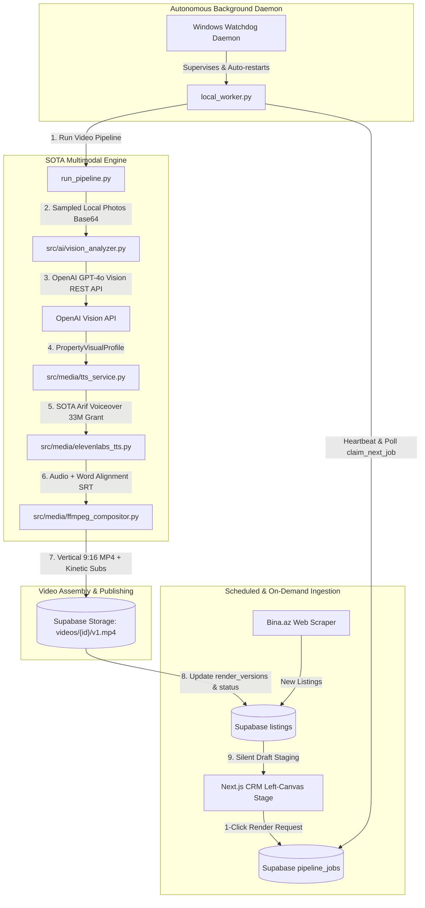

# BakuEstate Video Pipeline Autonomous Worker Recovery & SOTA Multimodal Engine

*   **Author:** Elvin Ismailov
*   **Status:** Approved (Ready for Implementation)
*   **Date:** 2026-11-22

---

## Overview

BakuEstate-AI operates an automated property ingestion and video marketing pipeline designed to scrape verified owner listings from Bina.az, generate high-converting promotional reels, and synchronize media with Supabase Storage and Telegram CRM.

This design document addresses the root cause of the video production stall (stuck at 17 completed videos out of 23 listings since November 19, 2026) and establishes an upgraded architecture that harnesses newly acquired startup credits: **33,028,850 ElevenLabs characters** and **OpenAI GPT-4o multimodal vision capabilities**.

---

## The Problem

1.  **Pipeline Stall (Worker Inactivity)**:
    *   The video generation count has stalled at 17 completed videos for several days.
    *   Direct telemetry inspection reveals that the underlying daemon (`worker_id: DESKTOP-6UBPFU0`) posted its last heartbeat on `2026-11-19 22:47:08 UTC` and has been completely offline since.
    *   Ten listings (`6343052`, `6304638`, `5867067`, `6567513`, `6560444`, `6589921`, `6569774`, `6572383`, `6326061`, `6630403`) are in `NEW` or `QUEUED` states in Supabase.
    *   Automated daily Bina.az scraping is inactive because `SCRAPE_NEW` scheduled jobs rely exclusively on an active local worker process.
    *   The worker currently runs as an interactive Windows command-line script (`start_worker.bat`), making it vulnerable to accidental terminal closures, system sleep, or OS reboots.

2.  **Underutilized SOTA Quota**:
    *   The current pipeline relies on static text heuristics or basic LLM prompting without visual image comprehension.
    *   A startup grant of **33,028,850 ElevenLabs characters** and high-tier **OpenAI GPT-4o API access** is active in `.env`, but the pipeline does not utilize GPT-4o Vision to inspect real listing photos, verify room layouts, or detect high-value selling points (e.g., designer renovations, sea views, brand appliances, natural lighting).

---

## Goals

*   **Goal 1 (Immediate Recovery)**: Re-establish continuous worker execution to process all pending unrendered listings and resume scheduled Bina.az scraping.
*   **Goal 2 (Daemon Resilience)**: Implement automated worker watchdog / Windows background persistence so the worker automatically recovers from machine reboots, crashes, or sleep states without requiring a persistent open terminal window.
*   **Goal 3 (Multimodal Visual Enrichment)**: Integrate OpenAI GPT-4o Vision into the pre-render phase to visually inspect locally downloaded listing photos, identifying architectural strengths and eliminating generic text hallucinations.
*   **Goal 4 (SOTA ElevenLabs Narration at Scale)**: Fully transition production voice generation to ElevenLabs (`eleven_multilingual_v2` / Arif Azerbaijani narrator) utilizing the 33M character grant, with dynamic pauses, natural conversational inflections, and acoustic ducking over background audio.
*   **Goal 5 (Idempotency and Cost Guardrails)**: Enforce strict per-listing render hash deduplication to prevent accidental double-spending of API tokens while maintaining high-speed video generation.

---

## Non-Goals

*   **Non-Goal 1**: Modifying the live Next.js CRM UI / Left-Canvas Action Stage (which is already deployed and operational on Vercel).
*   **Non-Goal 2**: Pure generative AI video creation (such as OpenAI Sora or Runway Gen-3) that generates fictional rooms. Real estate listings strictly mandate authentic photographs of the actual physical property.
*   **Non-Goal 3**: Replacing Supabase Storage or PostgreSQL database schema with third-party media hosting.

---

## Critical User Journeys (CUJs)

### CUJ 1: Scheduled Ingestion, Visual Scripting, and Video Rendering

*   **Given**: The local worker daemon is running in background resilience mode with valid Supabase, ElevenLabs (33M), and OpenAI credentials.
*   **When**: The scheduler triggers a `SCRAPE_NEW` job or a user queues an unrendered listing (`RENDER_INITIAL`).
*   **Then**:
    1. Worker downloads high-res listing images to `DOWNLOADS_DIR` and passes sampled frames as base64 data URIs to GPT-4o Vision.
    2. Vision model outputs verified visual attributes conforming to `PropertyVisualProfile`.
    3. `src/media/tts_service.py` synthesizes visual findings with listing price and Kupça metadata into a localized Baku-style script.
    4. ElevenLabs synthesizes studio-grade Azerbaijani voiceover using Arif voice model (`eleven_multilingual_v2`).
    5. FFmpeg composites vertical 9:16 video with kinetic typography and uploads to Supabase Storage.
    6. `render_versions.status` updates to `COMPLETED` and `listings.pipeline_status` transitions to `DRAFT_READY`, visible immediately on the web CRM.

### CUJ 2: 1-Click Render Recovery from CRM

*   **Given**: A broker or operator views an unrendered listing (e.g., `#6343052`) on the Left-Canvas Stage in the web CRM.
*   **When**: The operator clicks `[ 🚀 Montaj Boru Xəttinə Göndər ]`.
*   **Then**:
    1. Web CRM dispatches API request to enqueue a `RENDER_INITIAL` job in `pipeline_jobs` with `trigger_source='WEB_UI'`.
    2. Background worker claims the job within 10 seconds via `claim_next_pipeline_job()`.
    3. Engine renders video, commits record to `render_versions`, and uploads asset to Supabase Storage.
    4. Listing transitions to `DRAFT_READY` in web CRM, allowing 1-click preview and manual Telegram dispatch.

---

## Technical Plan (Architecture)

### 1. High-Level Data Flow



---

### 2. Detailed Subsystem Specifications

#### Subsystem A: Autonomous Worker Watchdog (`src/worker/watchdog.py`)
*   **Mechanism**: A lightweight background supervisor script that monitors the `local_worker.py` child process. If the worker process exits due to an uncaught network exception, transient DB timeout, or OS memory pressure, the watchdog logs the traceback to `data/logs/worker_watchdog.log` and respawns the worker within 5 seconds with exponential backoff capping at 30 seconds.
*   **Poison-Pill Fencing Protocol**: Maintains a local state marker (`data/worker_crash_state.json`) tracking `{last_job_id: str, failure_count: int}`. If the same `job_id` causes 2 consecutive child crashes, `watchdog.py` invokes Supabase RPC to mark that job `FAILED` (`error_message='POISON_PILL_ABORT'`) and dispatches an emergency alert to Telegram before restarting the worker.
*   **Windows Task Scheduler Integration (`scripts/setup_worker_service.ps1`)**: Registers a Task Scheduler entry (`BakuEstateWorkerService`) running under the current interactive user principal (`$env:USERNAME`) to ensure direct access to Windows graphics drivers (NVENC / QuickSync) for FFmpeg hardware acceleration. Redirects stdout/stderr to `data/logs/worker_service.log`.
*   **Heartbeat & Telemetry**: Emits a heartbeat every 60 seconds calling `SupabaseRepo.record_worker_heartbeat()` RPC in Supabase Postgres, updating `worker_heartbeats`.

#### Subsystem B: Multimodal Vision Analyzer (`src/ai/vision_analyzer.py`)
*   **Mechanism**: Analyzes local high-res listing photos using the active `OPENAI_API_KEY` with `gpt-4o`.
*   **Photo Selection Heuristic**: Avoids passing raw Bina.az URLs (which trigger Cloudflare bot protection HTTP 403). Instead, consumes local downloaded JPEG files from `DOWNLOADS_DIR` and takes a deterministic sample:
    ```python
    def select_key_photos(image_paths: List[Path]) -> List[Path]:
        if not image_paths:
            return []
        if len(image_paths) <= 5:
            return image_paths
        indices = [0, 1, len(image_paths) // 3, len(image_paths) // 2, -1]
        return [image_paths[i] for i in dict.fromkeys(indices)]
    ```
*   **Payload Construction**: Each selected image is resized to max 1080px (if larger), encoded as a base64 data URI (`data:image/jpeg;base64,{data}`), and transmitted via standard `requests.post` to `https://api.openai.com/v1/chat/completions` with `detail: "low"` and `max_tokens: 500`.
*   **Data Contract**:
    ```python
    from dataclasses import dataclass, field
    from typing import List

    @dataclass
    class PropertyVisualProfile:
        renovation_quality: str = "standard"  # euro, modern_luxury, scandinavian, classic, needs_repair
        floor_and_ceiling: str = ""           # natural parquet, stretch ceiling with spotlights
        kitchen_appliances: str = ""          # built-in Bosch, stone countertop
        view_and_lighting: str = ""           # panoramic sea/city view, floor-to-ceiling windows
        hook_sentence_az: str = ""            # 1-sentence Azerbaijani marketing hook
        standout_features: List[str] = field(default_factory=list)
        is_fallback: bool = False
    ```
*   **Circuit Breaker**: If OpenAI returns HTTP 429/500 or times out (15.0s), the function gracefully catches the exception, logs a warning, and returns `PropertyVisualProfile(is_fallback=True)` without interrupting video rendering.
*   **Persistence**: Stored inside `render_versions.ab_metadata["visual_profile"]` JSONB.

#### Subsystem C: SOTA Voice Synthesis (`src/media/elevenlabs_tts.py` & `src/media/tts_service.py`)
*   **Quota Allocation**: Binds to `ELEVENLABS_API_KEY` with 33,028,850 characters remaining.
*   **Model & Voice**:
    *   `model_id`: `eleven_multilingual_v2` (strictly verified multilingual production model).
    *   `voice_id`: `ZQJv3hwvRAIC7fvWZ1Qr` (Arif - Azerbaijani Professional Narrator).
    *   Voice settings: `stability: 0.52`, `similarity_boost: 0.82`, `style: 0.28`, `use_speaker_boost: true`.
*   **Timeout & Networking**: Increases `requests.post` timeout from `5.0` to `15.0` seconds in `elevenlabs_tts.py` to prevent premature timeouts during peak network congestion.
*   **Script Synthesis**: `src/media/tts_service.py:generate_azerbaijani_script` incorporates `PropertyVisualProfile` features into natural Baku dialect sentences.

#### Subsystem D: Unrendered Queue Backfill & Staging (`scripts/backfill_unrendered_jobs.py`)
*   **Scope**: Resolves all 10 unrendered listings currently in `NEW` or `QUEUED` status in Supabase.
*   **Mechanism**: A standalone utility script that checks `listings` where `video_url IS NULL`, queries existing `pipeline_jobs`, and inserts missing `RENDER_INITIAL` jobs with `trigger_source='WEB_UI'`. This ensures `_check_auto_render_guardrails` does not throttle the backfill with `DAILY_AUTO_RENDER_LIMIT`.
*   **Silent Staging**: Completed renders transition to `DRAFT_READY` in `listings` and `COMPLETED` in `render_versions`, appearing immediately in the web CRM for broker review.

---

## Risks & Limits

### 1. Security & Secrets Management
*   **Risk**: Direct storage of `OPENAI_API_KEY` and `ELEVENLABS_API_KEY` on the local workstation.
*   **Mitigation**: API keys are restricted to `C:\Users\HP\BakuEstate-AI\.env` and `web/.env.local`, both enforced in `.gitignore`. Keys are never logged in console outputs, task scheduler arguments, or Git commits.

### 2. Quota & Rate Limit Economics
*   **Risk**: Rapid exhaustion of OpenAI tokens or hitting ElevenLabs concurrency limits.
*   **Mitigation**: Using `detail: "low"` for vision requests limits image tokens to 85 tokens per frame (under 500 tokens total per listing). Local worker concurrency is strictly capped at `CONCURRENCY = 1` for video rendering, preventing simultaneous parallel requests from exceeding ElevenLabs account rate limits.

### 3. Cloudflare Bot CDN Image Fetch Blocking
*   **Risk**: Passing remote Bina.az image URLs directly to OpenAI causes HTTP 403 Forbidden because Cloudflare blocks cloud provider IP blocks.
*   **Mitigation**: The scraper downloads full-resolution images locally first using authenticated browser sessions and proxy rotation. `vision_analyzer.py` reads local JPEGs from disk and sends them as base64 data URIs.

### 4. Windows Session 0 GPU Driver Isolation
*   **Risk**: Running the worker as a non-interactive service in Session 0 disables NVENC / QuickSync GPU acceleration, degrading FFmpeg render performance.
*   **Mitigation**: The service configuration registers the task to run under the interactive desktop user session (`$env:USERNAME`), preserving GPU hardware acceleration and redirecting all process streams to rotating log files.

### 5. Poison-Pill Job Crash Loops
*   **Risk**: A corrupt image or unparseable metadata causes `local_worker.py` to crash repeatedly on the same job, triggering an infinite restart loop in the watchdog.
*   **Mitigation**: The watchdog tracks the active `job_id` in `data/worker_crash_state.json`. If 2 consecutive crashes occur on the same `job_id`, the watchdog marks the job `FAILED` in Supabase Postgres and sends an SRE alert to Telegram before continuing.

---

## Alternatives Considered

### Alternative A: Generative AI Video Synthesis (e.g. OpenAI Sora / Runway Gen-3)
*   **Pros**: Highly dynamic camera motion, 3D volumetric room flythroughs, cinematic lighting effects.
*   **Cons**: Hallucinates architectural details and furniture; generates spaces that do not physically exist in the real apartment. Incurs high render latency (3–5 minutes per video) and prohibitive compute cost.
*   **Reason for Rejection**: *Rejected by author*: Real estate buyers and Baku market standards demand 100% authentic visual representation of the listed property. Generative AI room synthesis misleads prospective buyers and compromises agency credibility.

### Alternative B: Cloud-Only Rendering Worker (AWS Lambda / Modal GPU / Cloud Run)
*   **Pros**: Independent of local PC power state; auto-scales horizontally across large scrape spikes.
*   **Cons**: High ongoing monthly cloud infrastructure expenses; complex maintenance of containerized FFmpeg GPU drivers and headless font engines when a dedicated local workstation is already available.
*   **Reason for Rejection**: *Rejected by author*: The local Windows workstation provides zero marginal compute cost and direct FFmpeg hardware acceleration. Implementing a resilient Windows Task Scheduler watchdog achieves persistent uptime without monthly cloud bills.

### Alternative C: Exhaustive Full-Photo Vision Ingestion (Analyzing all 20+ photos per listing)
*   **Pros**: Maximizes comprehensive feature extraction across minor storage spaces and utilities.
*   **Cons**: Multiplies OpenAI token consumption and increases per-listing analysis latency from ~1.5s to over 6s, while short-form vertical promotional reels only feature 6 to 8 scenes.
*   **Reason for Rejection**: *Rejected by author*: Social reels have a strict 30–45s duration limit and only display primary living spaces. Analyzing non-promotional utility shots (e.g. electrical meters or empty hallways) wastes quota and slows the ingestion pipeline without measurable marketing benefit.

---

## Detailed Implementation Plan

### Target Files to Create/Modify

#### 1. `src/worker/watchdog.py` (Create)
*   **Type / Scope**: Python Background Supervisor Daemon.
*   **Proposed Changes**: Implements child process management for `src/worker/local_worker.py`. Monitors exit codes, handles crash loops with backoff throttling (5s to 30s), tracks `data/worker_crash_state.json` to fence poison-pill jobs after 2 crashes, and logs output to `data/logs/worker_watchdog.log`.

#### 2. `scripts/setup_worker_service.ps1` (Create)
*   **Type / Scope**: Windows PowerShell Service Automation Script.
*   **Proposed Changes**: Automates registration of the Windows Task Scheduler background job `BakuEstateWorkerService` pointing to Python 3.13 executing `src/worker/watchdog.py`. Configures automatic startup on system boot under the interactive user principal (`$env:USERNAME`) with stdout/stderr redirection to `data/logs/worker_service.log`.

#### 3. `src/ai/vision_analyzer.py` (Create)
*   **Type / Scope**: Multimodal OpenAI GPT-4o Vision Service.
*   **Proposed Changes**: Implements `analyze_listing_photos(image_paths: List[Path]) -> PropertyVisualProfile`. Consumes local photos, performs deterministic sampling (`[0, 1, len//3, len//2, -1]`), converts images to base64 data URIs, invokes `https://api.openai.com/v1/chat/completions` using standard `requests`, and provides a circuit breaker returning `PropertyVisualProfile(is_fallback=True)` on failure.

#### 4. `src/media/tts_service.py` (Modify)
*   **Type / Scope**: Video Script Synthesis Engine.
*   **Proposed Changes**: Updates `generate_azerbaijani_script` to accept `visual_profile: Optional[PropertyVisualProfile] = None`. Injects verified visual details (parquet flooring, panoramic windows, built-in kitchen fixtures) into natural Baku conversational dialect scripts.

#### 5. `run_pipeline.py` (Modify)
*   **Type / Scope**: Core Pipeline Orchestration.
*   **Proposed Changes**: In `process_listing_video_and_dispatch`, invokes `vision_analyzer.analyze_listing_photos` immediately after `download_full_hd_photos` finishes, passes the resulting `PropertyVisualProfile` to `generate_tts_for_listing`, and attaches the visual profile into `render_versions.ab_metadata["visual_profile"]`.

#### 6. `src/media/elevenlabs_tts.py` (Modify)
*   **Type / Scope**: Voice Synthesis Service.
*   **Proposed Changes**: Enforces verified model `eleven_multilingual_v2`, verifies Arif narrator voice (`ZQJv3hwvRAIC7fvWZ1Qr`), and increases HTTP request timeout from `5.0` to `15.0` seconds to prevent false timeouts on long narrations.

#### 7. `src/worker/local_worker.py` (Modify)
*   **Type / Scope**: Local Worker Daemon Orchestrator.
*   **Proposed Changes**: Updates `execute_render_job` to pass through `PropertyVisualProfile` into render version metadata and logs, and ensures worker heartbeat records correctly via `SupabaseRepo.record_worker_heartbeat()`.

#### 8. `scripts/backfill_unrendered_jobs.py` (Create)
*   **Type / Scope**: CLI Backfill Reconciliation Script.
*   **Proposed Changes**: Identifies all listings in `listings` where `video_url IS NULL`, checks `pipeline_jobs` for pending jobs, and enqueues missing `RENDER_INITIAL` jobs with `trigger_source='WEB_UI'` to bypass daily auto-render limits.

#### 9. `start_worker.bat` (Modify)
*   **Type / Scope**: Windows Startup Script.
*   **Proposed Changes**: Updates default execution to invoke `src/worker/watchdog.py` instead of bare `local_worker.py`.

#### 10. `tests/test_vision_analyzer.py` (Create)
*   **Type / Scope**: Unit Test Suite.
*   **Proposed Changes**: Implements `test_photo_selection_heuristic_caps_at_5`, `test_analyze_listing_photos_success`, `test_analyze_listing_photos_circuit_breaker_on_500`, and `test_analyze_listing_photos_timeout`.

#### 11. `tests/test_watchdog.py` (Create)
*   **Type / Scope**: Unit Test Suite.
*   **Proposed Changes**: Implements `test_watchdog_respawn_on_crash`, `test_poison_pill_fencing_after_two_crashes`, and `test_clean_shutdown_on_sigterm`.

---

## Verification Plan

*   **Compilation / Syntax**: `python -m py_compile src/worker/watchdog.py src/ai/vision_analyzer.py src/media/tts_service.py run_pipeline.py src/media/elevenlabs_tts.py` -> Exit code 0.
*   **Static Analysis & Linting**: `ruff check src/ tests/` -> 0 errors.
*   **Unit Tests**: `python -m unittest tests/test_vision_analyzer.py tests/test_watchdog.py` -> 100% pass.
*   **Test Coverage Requirement**: Minimum 85% branch coverage on newly created/modified modules.
*   **Local Worker Integration Test**: `python src/worker/local_worker.py --once` -> successfully claims 1 pending unrendered job, executes vision-enriched script synthesis, runs ElevenLabs TTS, compiles vertical video with FFmpeg, and uploads to Supabase Storage.
*   **Database Verification**: Verify via Supabase query that processed listings transition to `render_versions.status = 'COMPLETED'` and `listings.pipeline_status = 'DRAFT_READY'` with active MP4 CDN URLs in `baku-estate-media` bucket.
*   **Watchdog Recovery Test**: Start `watchdog.py`, forcefully terminate child `local_worker.py` via taskkill, and verify the watchdog respawns the child process within 5 seconds as confirmed in `data/logs/worker_watchdog.log`.

---

*Drafted with EGM*
