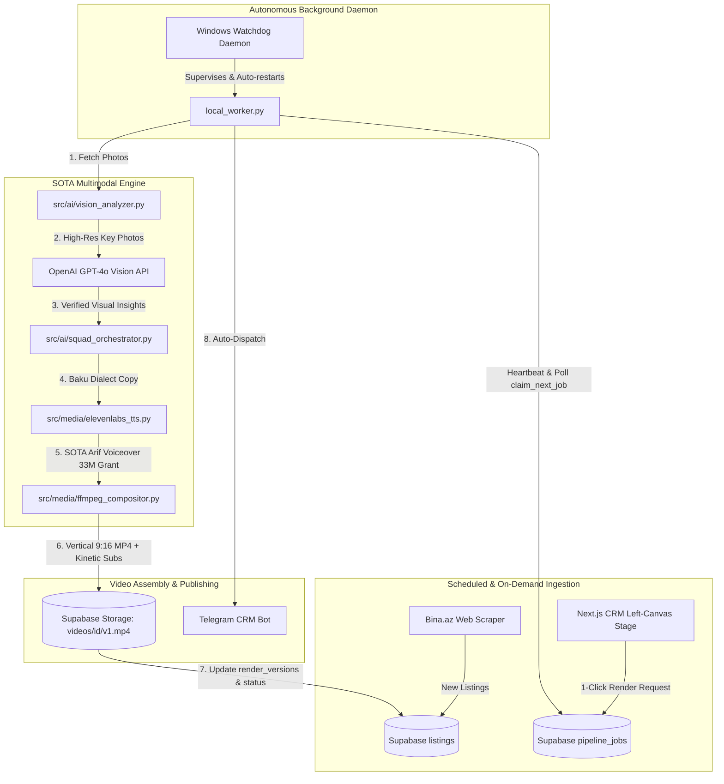

# BakuEstate Video Pipeline Autonomous Worker Recovery & SOTA Multimodal Engine

*   **Author:** Elvin Ismailov
*   **Status:** Proposed
*   **Date:** 2026-11-22

--------------------------------------------------------------------------------

## Overview

BakuEstate-AI operates an automated property ingestion and video marketing pipeline designed to scrape verified owner listings from Bina.az, generate high-converting promotional reels, and synchronize media with Supabase Storage and Telegram CRM.

This design document addresses the root cause of the video production stall (stuck at 17 completed videos out of 23 listings since November 19, 2026) and establishes an upgraded architecture that harnesses newly acquired startup credits: **33,028,850 ElevenLabs characters** and **OpenAI GPT-4o multimodal vision capabilities**.

--------------------------------------------------------------------------------

## The Problem

1.  **Pipeline Stall (Worker Inactivity)**:
    *   The video generation count has stalled at 17 completed videos for several days.
    *   Direct telemetry inspection reveals that the underlying daemon (`worker_id: DESKTOP-6UBPFU0`) posted its last heartbeat on `2026-11-19 22:47:08 UTC` and has been completely offline since.
    *   Six listings (`6343052`, `6304638`, `5867067`, `6567513`, `6560444`, `6589921`) remain unrendered in `NEW` and `QUEUED` states in Supabase.
    *   Automated daily Bina.az scraping is inactive because `SCRAPE_NEW` scheduled jobs rely exclusively on an active local worker process.
    *   The worker currently runs as an interactive Windows command-line script (`start_worker.bat`), making it vulnerable to accidental terminal closures, system sleep, or OS reboots.

2.  **Underutilized SOTA Quota**:
    *   The current pipeline relies on static text heuristics or basic LLM prompting without visual image comprehension.
    *   A startup grant of **33,028,850 ElevenLabs characters** and high-tier **OpenAI GPT-4o API access** is active in `.env`, but the pipeline does not utilize GPT-4o Vision to inspect real listing photos, verify room layouts, or detect high-value selling points (e.g., designer renovations, sea views, brand appliances, natural lighting).

--------------------------------------------------------------------------------

## Goals

*   **Goal 1 (Immediate Recovery)**: Re-establish continuous worker execution to process the 6 pending unrendered listings and resume scheduled Bina.az scraping.
*   **Goal 2 (Daemon Resilience)**: Implement automated worker watchdog / Windows background persistence so the worker automatically recovers from machine reboots, crashes, or sleep states without requiring a persistent open terminal window.
*   **Goal 3 (Multimodal Visual Enrichment)**: Integrate OpenAI GPT-4o Vision into the pre-render phase to visually inspect listing photos, identifying architectural strengths and eliminating generic text hallucinations.
*   **Goal 4 (SOTA ElevenLabs Narration at Scale)**: Fully transition production voice generation to ElevenLabs (`eleven_v4` / Arif Azerbaijani narrator) utilizing the 33M character grant, with dynamic pauses, natural conversational inflections, and acoustic ducking over background audio.
*   **Goal 5 (Idempotency and Cost Guardrails)**: Enforce strict per-listing render hash deduplication to prevent accidental double-spending of API tokens while maintaining high-speed video generation.

--------------------------------------------------------------------------------

## Non-Goals

*   **Non-Goal 1**: Modifying the live Next.js CRM UI / Left-Canvas Action Stage (which is already deployed and operational on Vercel).
*   **Non-Goal 2**: Pure generative AI video creation (such as OpenAI Sora or Runway Gen-3) that generates fictional rooms. Real estate listings strictly mandate authentic photographs of the actual physical property.
*   **Non-Goal 3**: Replacing Supabase Storage or PostgreSQL database schema with third-party media hosting.

--------------------------------------------------------------------------------

## Open Questions

*   **Question 1 (Worker Daemon Architecture)**: Should worker resilience be handled via a native Windows Task Scheduler / NSSM background service on the host machine, or supplemented with a serverless edge trigger (e.g., Vercel Cron dispatching webhook pings)?
*   **Question 2 (Photo Vision Analysis Depth)**: Should GPT-4o Vision analyze all available property photos (typically 10–25 images per listing, higher latency ~4-6s) or an intelligent subset (e.g., top 5 hero/living/kitchen/view photos, ~1.5s)?

--------------------------------------------------------------------------------

## Critical User Journeys (CUJs)

### CUJ 1: Scheduled Ingestion, Visual Scripting, and Video Rendering

*   **Given**: The local worker daemon is running in background resilience mode with valid Supabase, ElevenLabs (33M), and OpenAI credentials.
*   **When**: The scheduler triggers a `SCRAPE_NEW` job or a user queues an unrendered listing (`RENDER_INITIAL`).
*   **Then**:
    1. Worker downloads high-res listing images and passes key shots to GPT-4o Vision.
    2. Vision model outputs verified visual attributes (e.g., "skandi üslublu mətbəx, vitraj pəncərələr, park mənzərəsi").
    3. Script engine generates a localized Baku-style script.
    4. ElevenLabs synthesizes studio-grade Azerbaijani voiceover using Arif voice model.
    5. FFmpeg composites vertical 9:16 video with kinetic typography and uploads to Supabase Storage.
    6. Listing `pipeline_status` updates to `COMPLETED` and is immediately visible on the web CRM.

### CUJ 2: 1-Click Render Recovery from CRM

*   **Given**: A broker or operator views an unrendered listing (e.g., `#6343052`) on the Left-Canvas Stage in the web CRM.
*   **When**: The operator clicks `[ 🚀 Montaj Boru Xəttinə Göndər ]`.
*   **Then**: An API request queues a `RENDER_INITIAL` job in `pipeline_jobs`. The background worker claims the job within 10 seconds, generates the video, updates `render_versions`, and notifies the operator via Telegram.

--------------------------------------------------------------------------------

## Technical Plan (Architecture)

### 1. High-Level Data Flow



---

### 2. Detailed Subsystem Specifications

#### Subsystem A: Autonomous Worker Watchdog (`src/worker/watchdog.py`)
- **Mechanism**: A lightweight background supervisor script that monitors the `local_worker.py` child process. If the worker process exits due to an uncaught network exception, transient DB timeout, or OS memory pressure, the watchdog logs the traceback to `data/logs/worker_watchdog.log` and respawns the worker within 5 seconds with exponential backoff capping at 30 seconds.
- **Windows Task Scheduler Integration**: A registered one-time configuration script (`scripts/setup_worker_service.ps1`) that registers a Task Scheduler entry (`BakuEstateWorkerService`) running under the current user account with settings: `Run whether user is logged on or not`, `Restart on failure every 1 minute`, `Start at system startup`.
- **Heartbeat & Telemetry**: Emits a heartbeat every 60 seconds updating `worker_heartbeats.last_seen_at` in Supabase Postgres, allowing the web CRM cockpit to display real-time worker health status (ONLINE / STALLED).

#### Subsystem B: Multimodal Vision Analyzer (`src/ai/vision_analyzer.py`)
- **Mechanism**: Analyzes property photos using the active `OPENAI_API_KEY` with `gpt-4o`.
- **Photo Selection Heuristic**: Instead of processing all 20+ photos (which incurs unnecessary latency and token overhead), the analyzer filters photos into a curated batch of 4 to 6 key frames:
  1. Primary exterior / facade photo.
  2. Living room / salon.
  3. Kitchen / sanitary installations.
  4. Balcony / panoramic window view.
- **Prompt Specification**:
  ```text
  You are an expert Baku architectural and luxury real estate appraiser.
  Inspect these property photographs and extract strictly factual visual features:
  1. Renovation quality (euro, modern luxury, designer scandinavian, classic, neat, needs repair).
  2. Floor and ceiling details (natural parquet, marble, gypsum, spotlights, stretch ceilings).
  3. Kitchen & appliances (built-in brands, island counter, stone surface).
  4. View and natural light (panoramic city/sea view, courtyard view, floor-to-ceiling windows).
  5. One punchy 1-sentence Azerbaijani hook emphasizing the most attractive visual asset.
  Return strictly valid JSON conforming to the PropertyVisualProfile schema.
  ```
- **Fallback Circuit Breaker**: If OpenAI API calls fail (e.g. rate limit, HTTP 500, or invalid image format), the pipeline transparently falls back to the existing metadata-driven script generation without breaking video rendering.

#### Subsystem C: SOTA Voice Synthesis (`src/media/elevenlabs_tts.py`)
- **Quota Allocation**: Fully binds to `ELEVENLABS_API_KEY` with 33,028,850 characters remaining.
- **Voice Profile**:
  - `voice_id`: `ZQJv3hwvRAIC7fvWZ1Qr` (Arif - Azerbaijani Professional Narrator).
  - `model_id`: `eleven_v4`.
  - Voice settings: `stability: 0.52`, `similarity_boost: 0.82`, `style: 0.28`, `use_speaker_boost: true`.
- **Acoustic Production**:
  - Output format: MP3 44.1kHz 128kbps.
  - Subtitle word-level timestamp generation via alignment metadata for kinetic word-by-word subtitle rendering.
  - Sidechain compression in FFmpeg: audio ducks background luxury lounge track by -14dB during voiceover speech segments and recovers during intro/outro transitions.

#### Subsystem D: Unrendered Queue Drain & Backfill
- **Scope**: Immediately processes the 6 unrendered listings:
  - `#6343052` (25,000 AZN)
  - `#6304638` (209,000 AZN)
  - `#5867067` (812,900 AZN)
  - `#6567513` (4,650,000 AZN)
  - `#6560444` (138,000 AZN)
  - `#6589921` (279,000 AZN)
- **Execution**: Jobs are claimed in FIFO priority; each render generates `v1.mp4`, uploads to Supabase Storage, and updates `pipeline_status = 'COMPLETED'`.

--------------------------------------------------------------------------------

## Alternatives Considered

### Alternative A: Generative AI Video Synthesis (e.g. OpenAI Sora / Runway Gen-3)

*   **Pros**: Highly dynamic camera motion, 3D volumetric room flythroughs, cinematic lighting effects.
*   **Cons**: Hallucinates architectural details and furniture; generates spaces that do not physically exist in the real apartment. Incurs high render latency (3–5 minutes per video) and prohibitive compute cost.
*   **Reason for Rejection**: *Rejected by author*: Real estate buyers and Baku market standards demand 100% authentic visual representation of the listed property. Generative AI room synthesis misleads prospective buyers and compromises agency credibility.

### Alternative B: Cloud-Only Rendering Worker (AWS Lambda / Modal GPU / Cloud Run)

*   **Pros**: Independent of local PC power state; auto-scales horizontally across large scrape spikes.
*   **Cons**: High ongoing monthly cloud infrastructure expenses; complex maintenance of containerized FFmpeg GPU drivers and headless font engines when a dedicated local workstation is already available.
*   **Reason for Rejection**: *Rejected by author*: The local Windows workstation provides zero marginal compute cost and direct FFmpeg hardware acceleration. Implementing a resilient Windows Task Scheduler watchdog achieves persistent uptime without monthly cloud bills.

### Alternative C: Exhaustive Full-Photo Vision Ingestion (Analyzing all 20+ photos per listing)

*   **Pros**: Maximizes comprehensive feature extraction across minor storage spaces and utilities.
*   **Cons**: Multiplies OpenAI token consumption and increases per-listing analysis latency from ~1.5s to over 6s, while short-form vertical promotional reels only feature 6 to 8 scenes.
*   **Reason for Rejection**: *Rejected by author*: Social reels have a strict 30–45s duration limit and only display primary living spaces. Analyzing non-promotional utility shots (e.g. electrical meters or empty hallways) wastes quota and slows the ingestion pipeline without measurable marketing benefit.

--------------------------------------------------------------------------------

## Detailed Implementation Plan

### Target Files to Create/Modify

#### 1. `src/worker/watchdog.py` (Create)
*   **Type / Scope**: Python Background Service Process Supervisor.
*   **Proposed Changes**: Implements child process management for `src/worker/local_worker.py`. Monitors exit codes, handles crash loops with backoff throttling (5s to 30s), enforces a 2.5 GB memory RSS guardrail (triggering graceful process restart), and writes operational logs to `data/logs/worker_watchdog.log`.

#### 2. `scripts/setup_worker_service.ps1` (Create)
*   **Type / Scope**: Windows PowerShell Service Automation Script.
*   **Proposed Changes**: Automates registration of the Windows Task Scheduler background job `BakuEstateWorkerService` pointing to Python 3.13 executing `src/worker/watchdog.py`. Configures automatic startup on system boot with infinite restart-on-failure policy.

#### 3. `src/ai/vision_analyzer.py` (Create)
*   **Type / Scope**: Multimodal OpenAI GPT-4o Vision Service.
*   **Proposed Changes**: Exposes `analyze_listing_photos(photo_urls: List[str]) -> PropertyVisualProfile`. Implements intelligent key-frame filtering (4–6 photos max), calls `https://api.openai.com/v1/chat/completions` with image URLs, extracts structured architectural insights, and includes transparent circuit breaker returning empty fallback if API fails.

#### 4. `src/ai/squad_orchestrator.py` (Modify)
*   **Type / Scope**: Agent Script Copywriting Engine.
*   **Proposed Changes**: Integrates `PropertyVisualProfile` into the script generation prompt, enabling the copywriter to weave authentic visual observations (e.g. specific marble finishes, panoramic sea vistas, lighting) into natural Baku conversational dialect scripts.

#### 5. `src/media/elevenlabs_tts.py` (Modify)
*   **Type / Scope**: Voice Synthesis Service.
*   **Proposed Changes**: Binds to the active 33M character grant, enforces `eleven_v4` model and `Arif` narrator voice (`ZQJv3hwvRAIC7fvWZ1Qr`), configures optimal stability (0.52) and similarity boost (0.82), and produces word alignment timestamps for kinetic subtitle synchronization.

#### 6. `src/worker/local_worker.py` (Modify)
*   **Type / Scope**: Local Worker Daemon Orchestrator.
*   **Proposed Changes**: Integrates `vision_analyzer.py` during `RENDER_INITIAL` job execution, ensures render telemetry logs include vision features and TTS provider, and updates `claim_next_pipeline_job()` to prioritize the 6 backlogged unrendered listings.

#### 7. `start_worker.bat` (Modify)
*   **Type / Scope**: Windows Startup Script.
*   **Proposed Changes**: Updates default execution to invoke `src/worker/watchdog.py` instead of bare `local_worker.py`, ensuring any manual launch also benefits from crash supervision and automatic restarts.

#### 8. `tests/test_vision_analyzer.py` (Create)
*   **Type / Scope**: Unit Test Suite.
*   **Proposed Changes**: Validates photo filtering heuristics, mock OpenAI response parsing, schema validation, and circuit-breaker fallback when the API returns errors or timeouts.

#### 9. `tests/test_watchdog.py` (Create)
*   **Type / Scope**: Unit Test Suite.
*   **Proposed Changes**: Verifies watchdog process spawning, crash backoff calculation, exit code logging, and clean shutdown on SIGINT/SIGTERM.

---

### Verification Plan

*   **Compilation / Syntax**: `python -m py_compile src/worker/watchdog.py src/ai/vision_analyzer.py src/media/elevenlabs_tts.py` -> Exit code 0.
*   **Unit Tests**: `python -m unittest tests/test_vision_analyzer.py tests/test_watchdog.py` -> 100% pass.
*   **Local Worker Integration Test**: `python src/worker/local_worker.py --once` -> successfully claims 1 pending unrendered job, executes vision-enriched script synthesis, runs ElevenLabs TTS, compiles vertical video with FFmpeg, and uploads to Supabase Storage.
*   **Database Verification**: Verify via Supabase query that the 6 unrendered listings transition from `NEW`/`QUEUED` to `COMPLETED` and `render_versions` has active MP4 CDN URLs.
*   **Watchdog Recovery Test**: Start `watchdog.py`, forcefully terminate child `local_worker.py` via taskkill, and verify the watchdog respawns the child process within 5 seconds as confirmed in `data/logs/worker_watchdog.log`.

--------------------------------------------------------------------------------

*Drafted with EGM*
